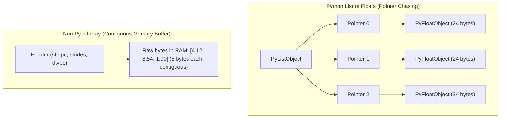
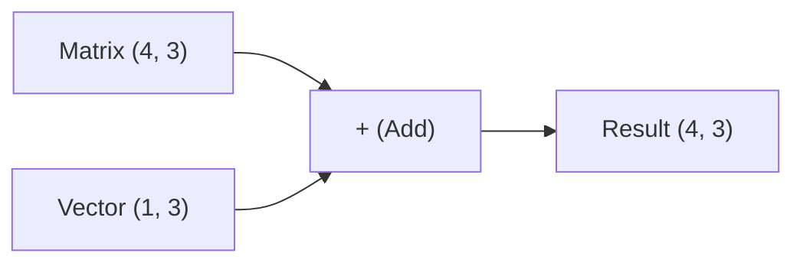

import { Callout } from "fumadocs-ui/components/callout";
import { Tabs, Tab } from "fumadocs-ui/components/tabs";
import { Accordion, Accordions } from "fumadocs-ui/components/accordion";

Modern machine learning models and large language models process billions of floating-point numbers per second. If you attempt to process these numbers using standard Python `for` loops and lists, your application will crawl at a fraction of modern hardware speeds.

To build performant AI systems, you must think in **vectorized arrays**.

---

## 1. The Cost of Pure Python: Why Loops Are Slow

Every standard Python integer or float is not a raw 64-bit value in CPU cache. It is a full **CPython heap object** (`PyObject` or `PyFloatObject`), requiring:

- 16 to 28 bytes of memory overhead per scalar.
- Pointer dereferencing for every access.
- Dynamic type checks on every addition or multiplication.



### Benchmark: Python Loop vs. Vectorized NumPy

```python
import time
import numpy as np

N = 5_000_000

# 1. Pure Python approach
py_list_a = [float(i) for i in range(N)]
py_list_b = [float(i) for i in range(N)]

t0 = time.perf_counter()
py_result = [a * b for a, b in zip(py_list_a, py_list_b)]
t_py = time.perf_counter() - t0

# 2. NumPy vectorized approach
np_a = np.arange(N, dtype=np.float64)
np_b = np.arange(N, dtype=np.float64)

t0 = time.perf_counter()
np_result = np_a * np_b
t_np = time.perf_counter() - t0

print(f"Python list loop:  {t_py:.4f}s")
print(f"NumPy vectorized:  {t_np:.4f}s ({t_py / t_np:.1f}x faster)")
```

NumPy is typically **50x to 100x faster** because the calculation executes inside compiled C code utilizing CPU **SIMD (Single Instruction, Multiple Data)** vector registers (AVX-512, Neon).

---

## 2. Memory Layout: Strides & Shape

An `ndarray` consists of two things:

1. **Raw contiguous byte buffer** in RAM.
2. **Metadata**: Data type (`dtype`), dimensions (`shape`), and byte-stepping increments (`strides`).

```python
import numpy as np

# Create a 2D array of 32-bit floats (4 bytes per element)
matrix = np.array([[10.0, 20.0, 30.0],
                   [40.0, 50.0, 60.0]], dtype=np.float32)

print("Shape:  ", matrix.shape)    # (2, 3) -> 2 rows, 3 columns
print("Strides:", matrix.strides)  # (12, 4) -> 12 bytes to move down a row, 4 bytes to move to next column
print("Dtype:  ", matrix.dtype)    # float32
```

Transposing a matrix (`matrix.T`) does not copy the underlying memory; it merely swaps the shapes and strides metadata! This makes transformations essentially instantaneous:

```python
transposed = matrix.T
print("Transposed Shape:  ", transposed.shape)    # (3, 2)
print("Transposed Strides:", transposed.strides)  # (4, 12)
```

---

## 3. Broadcasting: Aligning Dimensions Without Allocation

Broadcasting allows arithmetic operations on arrays of differing shapes without creating redundant copies of data in memory:



### The Two Broadcasting Rules:

1. Compare dimensions element-wise, starting from the **rightmost (trailing) dimension** and moving left.
2. Two dimensions are compatible if:
   - They are **equal**, or
   - One of them is **1**.

```python
import numpy as np

# A batch of 4 token embeddings, each of dimension 3
embeddings = np.array([
    [1.0, 2.0, 3.0],
    [4.0, 5.0, 6.0],
    [7.0, 8.0, 9.0],
    [2.0, 4.0, 6.0]
])  # Shape: (4, 3)

# A single bias vector for each dimension
bias = np.array([0.5, -0.5, 0.1])  # Shape: (3,)

# Broadcasting expands bias across all 4 rows without memory duplication
biased_embeddings = embeddings + bias
print(biased_embeddings)
```

---

## 4. Matrix Multiplication: The Core of Neural Networks

In deep learning, every linear layer computes:

$$\mathbf{Y} = \mathbf{X} \mathbf{W} + \mathbf{b}$$

In Python, use the `@` infix operator for matrix multiplication:

```python
import numpy as np

# Input batch: 2 sample queries, embedding dimension 4
X = np.array([
    [0.1, 0.8, -0.3, 0.4],
    [-0.5, 0.2, 0.9, 0.1]
])  # Shape: (2, 4)

# Weight projection matrix: mapping 4 dimensions to 3 output features
W = np.array([
    [0.2, -0.1, 0.5],
    [0.4, 0.3, -0.2],
    [-0.1, 0.7, 0.1],
    [0.8, 0.0, -0.4]
])  # Shape: (4, 3)

# Bias vector
b = np.array([0.05, -0.02, 0.01])  # Shape: (3,)

# Forward pass calculation
Y = X @ W + b
print("Output shape:", Y.shape)  # (2, 3)
print("Output activations:\n", Y)
```

---

## 5. Building Vectorized Cosine Similarity

Cosine similarity evaluates semantic closeness between two vectors $\mathbf{u}$ and $\mathbf{v}$:

$$\text{similarity}(\mathbf{u}, \mathbf{v}) = \frac{\mathbf{u} \cdot \mathbf{v}}{\|\mathbf{u}\|_2 \|\mathbf{v}\|_2}$$

Here is a vectorized implementation that computes the similarity between a **single query vector** and a **batch of 100,000 document vectors** simultaneously:

```python
import numpy as np

def batch_cosine_similarity(query: np.ndarray, documents: np.ndarray) -> np.ndarray:
    """
    Computes cosine similarity between a single 1D query vector and a 2D batch of documents.

    Args:
        query: 1D array of shape (D,)
        documents: 2D array of shape (N, D)

    Returns:
        1D array of similarity scores of shape (N,), values in range [-1.0, 1.0]
    """
    # 1. Compute dot products: (N, D) @ (D,) -> (N,)
    dot_products = documents @ query

    # 2. Compute L2 norms (Euclidean lengths)
    query_norm = np.linalg.norm(query)
    doc_norms = np.linalg.norm(documents, axis=1)  # Along each row

    # 3. Prevent division by zero with small epsilon
    denominator = doc_norms * (query_norm + 1e-12)

    return dot_products / denominator

# Demonstration
np.random.seed(42)
query_vec = np.random.randn(768).astype(np.float32)
doc_corpus = np.random.randn(10_000, 768).astype(np.float32)

scores = batch_cosine_similarity(query_vec, doc_corpus)
top_5_indices = np.argsort(scores)[::-1][:5]

print("Top 5 matching document indices:", top_5_indices)
print("Top 5 similarity scores:        ", scores[top_5_indices])
```

---

## 6. Views vs. Copies: Avoiding Silent Bugs

When indexing NumPy arrays, understanding when you are working on a **view** (sharing memory) versus a **copy** is critical:

| Operation                         | Result                          | Modifying result affects original? |
| :-------------------------------- | :------------------------------ | :--------------------------------- |
| `arr[0:5]` (Basic slice)          | **View** (zero-copy)            | **Yes** (mutates original)         |
| `arr[arr > 0]` (Boolean mask)     | **Copy** (allocates new buffer) | **No**                             |
| `arr[[0, 2, 4]]` (Fancy indexing) | **Copy** (allocates new buffer) | **No**                             |
| `arr.reshape(...)`                | **View** (when contiguous)      | **Yes**                            |
| `arr.copy()`                      | **Copy** (explicitly cloned)    | **No**                             |

```python
original = np.array([1, 2, 3, 4, 5])
slice_view = original[0:2]

slice_view[0] = 999
print("Original modified through slice view:", original[0])  # Prints 999!
```

<Callout type="warn" title="AI Engineering Rule">
  Always use `.copy()` when you extract an array slice that will be mutated or
  passed asynchronously across worker processes, preventing accidental memory
  race conditions.
</Callout>

---

## Practice Questions & Challenges

Solidify your vectorized computing intuition, array broadcasting, and memory layout skills:

### Question 1: Output Prediction (NumPy In-Place Mutation via Views)

What is the exact output of the following array slicing and assignment sequence?

```python
import numpy as np

a = np.array([[10, 20, 30], [40, 50, 60]])
b = a[:, 1]
b += 100
c = a[a > 100]
c -= 50

print("Array a:\n", a)
print("Array c:\n", c)
```

<Accordions>
<Accordion title="Solution & Breakdown">
**Output:**
```text
Array a:
 [[ 10 120  30]
 [ 40 150  60]]
Array c:
 [ 70 100]
```

**Explanation:**

1. `b = a[:, 1]` selects column 1 (`[20, 50]`). Basic indexing with integer and slice creates a **view** sharing memory with `a`.
2. `b += 100` mutates column 1 in-place, updating `a[0, 1]` to 120 and `a[1, 1]` to 150.
3. `c = a[a > 100]` uses **boolean mask indexing**. Boolean indexing always returns a **fresh copy**, not a view!
4. `c` contains `[120, 150]`.
5. `c -= 50` modifies `c` to `[70, 100]`, but does **not** alter `a`!
   </Accordion>
</Accordions>

---

### Question 2: Spot and Fix the Bug (Broadcasting Dimension Mismatch in Normalization)

A machine learning engineer wants to normalize each feature column of a dataset to zero mean and unit variance. However, their code raises `ValueError: operands could not be broadcast together with shapes (100,5) (5,)`:

```python
import numpy as np

X = np.random.randn(100, 5)  # 100 samples, 5 features

# Normalizing along rows instead of columns:
mean = np.mean(X, axis=0)  # Shape: (5,)
std = np.std(X, axis=0)    # Shape: (5,)

# Now normalize along samples (axis 1):
sample_mean = np.mean(X, axis=1)  # Shape: (100,)
# BUG: Cannot subtract (100,) directly from (100, 5) without expanding dimension:
X_sample_norm = X - sample_mean
```

Identify the broadcasting mismatch and fix it using `np.newaxis` or `keepdims=True`.

<Accordions>
<Accordion title="Solution & Breakdown">
**The Root Cause:**
NumPy broadcasting aligns shapes from right to left (trailing dimensions first).
- `X` has shape `(100, 5)`.
- `sample_mean` has shape `(100,)`.
Comparing trailing dimensions: `5` vs `100` (incompatible, neither is 1).

**Fix 1: Using `keepdims=True`:**

```python
sample_mean = np.mean(X, axis=1, keepdims=True)  # Shape: (100, 1)
# (100, 5) - (100, 1) broadcasts 1 -> 5 seamlessly!
X_sample_norm = X - sample_mean
```

**Fix 2: Using `np.newaxis` / `None`:**

```python
sample_mean = np.mean(X, axis=1)  # Shape: (100,)
X_sample_norm = X - sample_mean[:, np.newaxis]   # Shape: (100, 1)
```

</Accordion>
</Accordions>

---

### Question 3: Architecture Deep-Dive (C-Order vs Fortran-Order and Strides)

Explain how `strides` dictate how a multi-dimensional array maps to a flat 1D memory buffer. Why does summing rows in C-contiguous order run significantly faster than summing columns on massive matrices?

<Accordions>
<Accordion title="Solution & Breakdown">
**Strides and Memory Layout:**
- Computers have 1-dimensional RAM. A 2D array of shape `(R, C)` with `float64` (8 bytes) is laid out contiguously.
- In **C-contiguous order** (row-major, NumPy's default), rows are placed sequentially: Row 0 followed by Row 1.
- `strides` is a tuple indicating the number of bytes to step in memory to advance by 1 index along each axis. For shape `(1000, 1000)`:
  - `strides = (8000, 8)`: To move down 1 row, jump 8000 bytes. To move right 1 column, jump 8 bytes.

**CPU Cache Hierarchy & Prefetching:**

- When iterating along a row (index `[r, c]` to `[r, c+1]`), each step jumps 8 bytes. Modern CPU cache lines are 64 bytes wide, meaning a single L1 cache line fetch pulls 8 consecutive floats at once. The CPU hardware prefetcher predicts this linear access with near 100% cache hit rates.
- When iterating along a column (index `[r, c]` to `[r+1, c]`), each step jumps 8,000 bytes, jumping past cache lines. Every single addition incurs an **L1/L2 cache miss** and stalls waiting for main memory!
  </Accordion>
</Accordions>

---

### Question 4: Hands-On Challenge (Vectorized Softmax with Numerical Stability)

Implement a numerically stable vectorized `softmax(logits)` function that works on a 2D batch of logits `(batch_size, num_classes)`.

1. Must handle extreme positive values (e.g., `logits = 1000.0`) without producing `inf` or `NaN`.
2. Must sum to `1.0` along the last axis.
3. Must NOT use any Python `for` loops.

<Accordions>
<Accordion title="Solution & Breakdown">
```python
import numpy as np

def stable_softmax(logits: np.ndarray) -> np.ndarray:
"""Computes softmax across axis -1 with numerical stability.""" # 1. Subtract maximum logit along the class axis to prevent exp overflow:
max_logits = np.max(logits, axis=-1, keepdims=True)
shifted_logits = logits - max_logits

    # 2. Exponentiate: values are now in range (0.0, 1.0]
    exp_logits = np.exp(shifted_logits)

    # 3. Normalize by sum of exponents
    sum_exp = np.sum(exp_logits, axis=-1, keepdims=True)
    return exp_logits / sum_exp

# Verification with extreme values that would overflow standard exp(x):

test_logits = np.array([
[1000.0, 1001.0, 1002.0], # Standard exp() would overflow to infinity!
[-50.0, 0.0, 50.0]
])

probs = stable_softmax(test_logits)
print("Softmax probabilities:\n", probs)
print("Row sums:", np.sum(probs, axis=-1)) # [1.0, 1.0]

````
</Accordion>
</Accordions>

---

### Question 5: Code Challenge (Vectorized Top-K Cosine Similarity Search Engine)
Implement a memory-efficient `VectorIndex` class using pure NumPy that:
1. Stores an embedding matrix `embeddings` of shape `(N, D)`.
2. Pre-normalizes all document vectors to unit length $L_2 = 1.0$ at initialization.
3. Implements `search(query_vec: np.ndarray, k: int = 5) -> tuple[np.ndarray, np.ndarray]` returning `(indices, scores)` in descending order using matrix-vector multiplication (`@`) and `np.argpartition` for $O(N)$ top-$K$ selection rather than full $O(N \log N)$ sorting.

**Test cases:**
```python
index = VectorIndex(corpus_vectors)
indices, scores = index.search(query, k=3)
````

<Accordions>
<Accordion title="Solution & Breakdown">
```python
import numpy as np

class VectorIndex:
def **init**(self, embeddings: np.ndarray): # embeddings shape: (N, D) # Pre-normalize embeddings to unit length (L2 norm = 1.0)
norms = np.linalg.norm(embeddings, axis=1, keepdims=True) # Replace zero norms with 1e-12 to avoid division by zero:
norms = np.where(norms == 0, 1e-12, norms)
self.embeddings = (embeddings / norms).astype(np.float32)

    def search(self, query: np.ndarray, k: int = 5) -> tuple[np.ndarray, np.ndarray]:
        # query shape: (D,)
        # 1. Normalize query vector
        q_norm = np.linalg.norm(query)
        if q_norm == 0:
            q_norm = 1e-12
        q = (query / q_norm).astype(np.float32)

        # 2. Cosine similarity of unit vectors is simply their dot product:
        # (N, D) @ (D,) -> (N,)
        similarities = self.embeddings @ q

        # 3. O(N) top-k selection with argpartition instead of full sort:
        n = len(similarities)
        k = min(k, n)

        # Partition finds k largest elements without sorting the entire array:
        top_k_unsorted = np.argpartition(similarities, -k)[-k:]

        # Sort only the top k items:
        top_k_sorted = top_k_unsorted[np.argsort(similarities[top_k_unsorted])[::-1]]

        return top_k_sorted, similarities[top_k_sorted]

# Verification

if **name** == "**main**":
np.random.seed(42)
corpus = np.random.randn(50_000, 128).astype(np.float32)
query = np.random.randn(128).astype(np.float32)

    idx = VectorIndex(corpus)
    top_indices, top_scores = idx.search(query, k=5)
    print("Top-5 Indices:", top_indices)
    print("Top-5 Scores: ", top_scores)
    assert top_scores[0] >= top_scores[1] >= top_scores[2]

```
</Accordion>
</Accordions>
```
