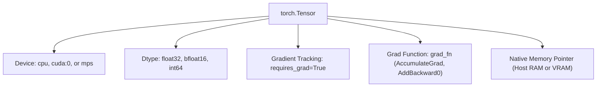
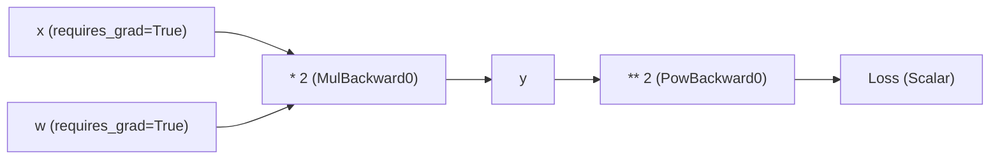

import { Callout } from "fumadocs-ui/components/callout";
import { Tabs, Tab } from "fumadocs-ui/components/tabs";
import { Accordion, Accordions } from "fumadocs-ui/components/accordion";

While NumPy provides the fundamental abstractions for multi-dimensional arrays, modern deep learning requires two critical capabilities NumPy lacks:

1. **Seamless Hardware Acceleration** (NVIDIA CUDA, Apple MPS, AMD ROCm).
2. **Automatic Differentiation (`autograd`)** to calculate partial derivatives (gradients) across complex computation graphs.

**PyTorch** provides both through its core primitive: the **Tensor**.

---

## 1. Tensors vs. NumPy Arrays

A PyTorch `Tensor` is syntactically nearly identical to a NumPy `ndarray`, but it carries device information and tracking metadata:



### Device-Agnostic Setup in Python

Always write device-agnostic code that detects available hardware:

```python
import torch

def get_compute_device() -> torch.device:
    """Detects best available hardware acceleration."""
    if torch.cuda.is_available():
        return torch.device("cuda")
    elif hasattr(torch.backends, "mps") and torch.backends.mps.is_available():
        return torch.device("mps")  # Apple Silicon GPU
    return torch.device("cpu")

device = get_compute_device()
print(f"Executing tensors on: {device}")

# Move tensor to device
x = torch.randn(1024, 1024, dtype=torch.float32, device=device)
y = torch.randn(1024, 1024, dtype=torch.float32, device=device)

# Native GPU matrix multiplication
z = x @ y
print("Result shape:", z.shape)
```

---

## 2. Computational Graphs & Reverse-Mode Autograd

To train neural networks, we must compute how changing each weight affects the final loss:

$$\frac{\partial \mathcal{L}}{\partial \mathbf{W}}$$

PyTorch builds a **Dynamic Computation Graph (DAG)** during the forward pass. Every operation on a tensor with `requires_grad=True` records its mathematical derivative function in `.grad_fn`.



### Hands-on Autograd Demonstration

```python
import torch

# 1. Create leaf tensors with gradient tracking enabled
x = torch.tensor(3.0, requires_grad=True)
w = torch.tensor(2.0, requires_grad=True)
b = torch.tensor(1.5, requires_grad=True)

# 2. Forward pass: y = w * x + b
y = w * x + b  # 2.0 * 3.0 + 1.5 = 7.5

# 3. Calculate scalar loss: L = (y - 10)^2
loss = (y - 10.0) ** 2  # (7.5 - 10.0)^2 = (-2.5)^2 = 6.25

print("Loss value:   ", loss.item())
print("Loss grad_fn: ", loss.grad_fn)  # <PowBackward0 object>

# 4. Backward pass: Reverse-mode autodiff via the chain rule
loss.backward()

# 5. Inspect gradients: dLoss/dw, dLoss/dx, dLoss/db
# Analytical derivative: dLoss/dw = 2 * (w*x + b - 10) * x = 2 * (-2.5) * 3 = -15.0
print("dLoss / dw:", w.grad.item())  # -15.0
print("dLoss / dx:", x.grad.item())  # -10.0
print("dLoss / db:", b.grad.item())  # -5.0
```

---

## 3. The Gradient Accumulation Gotcha

By default, calling `.backward()` does **not** overwrite `.grad`; it **accumulates (adds)** to it:

$$\mathbf{w}.\text{grad} \leftarrow \mathbf{w}.\text{grad} + \frac{\partial \mathcal{L}}{\partial \mathbf{w}}$$

If you do not clear gradients between iterations in a training loop, your gradients will continuously grow, causing training to explode!

```python
# In standard training loops, always zero gradients before computing the backward pass:
# optimizer.zero_grad(set_to_none=True)

# Alternatively on individual tensors:
w.grad = None  # More memory-efficient than w.grad.zero_()
```

---

## 4. Disabling Autograd During Inference

When running models in production for evaluation, search, or generation, building the computation graph wastes CPU and GPU VRAM:

```python
import torch

# 1. Temporarily disable autograd with context manager
with torch.no_grad():
    prediction = model(input_tokens)

# 2. Or detach a specific tensor from the computational graph
untracked_embedding = raw_embedding.detach().cpu().numpy()
```

---

## 5. Building a Neural Network from Scratch

Here is a complete, minimal neural network implemented with PyTorch's `nn.Module` to predict a non-linear relationship:

```python
import torch
import torch.nn as nn
import torch.optim as optim

# 1. Define model architecture
class RegressionNet(nn.Module):
    def __init__(self, input_dim: int, hidden_dim: int, output_dim: int):
        super().__init__()
        self.layer1 = nn.Linear(input_dim, hidden_dim)
        self.activation = nn.ReLU()
        self.layer2 = nn.Linear(hidden_dim, output_dim)

    def forward(self, x: torch.Tensor) -> torch.Tensor:
        h = self.activation(self.layer1(x))
        out = self.layer2(h)
        return out

# 2. Generate synthetic training data: y = 3 * x1 - 2 * x2 + 1.5 + noise
torch.manual_seed(42)
X_train = torch.randn(200, 2)
y_train = 3.0 * X_train[:, 0:1] - 2.0 * X_train[:, 1:2] + 1.5 + 0.1 * torch.randn(200, 1)

# 3. Instantiate model, loss function, and optimizer
model = RegressionNet(input_dim=2, hidden_dim=16, output_dim=1)
criterion = nn.MSELoss()
optimizer = optim.Adam(model.parameters(), lr=0.05)

# 4. Training loop
for epoch in range(100):
    # Forward pass
    predictions = model(X_train)
    loss = criterion(predictions, y_train)

    # Backward pass & optimization
    optimizer.zero_grad(set_to_none=True)
    loss.backward()
    optimizer.step()

    if (epoch + 1) % 20 == 0:
        print(f"Epoch [{epoch + 1}/100], Loss: {loss.item():.4f}")

# 5. Evaluation inference
model.eval()
with torch.no_grad():
    sample_input = torch.tensor([[1.0, 2.0]])
    # Expected: 3*(1) - 2*(2) + 1.5 = 0.5
    pred = model(sample_input)
    print(f"Prediction for [1.0, 2.0]: {pred.item():.4f} (Expected ~0.5)")
```

<Callout type="info" title="Takeaway for AI Engineers">
  Understanding `autograd` and tensor memory layout prepares you for debugging
  LLM fine-tuning scripts, parameter-efficient training (LoRA/QLoRA), and custom
  loss functions.
</Callout>

---

## Practice Questions & Challenges

Solidify your tensor computation skills, dynamic backward propagation, and memory mastery:

### Question 1: Output Prediction (Gradient Accumulation Behavior)

What does `w.grad` print after running the following consecutive backward passes?

```python
import torch

w = torch.tensor([2.0], requires_grad=True)

# Step 1
y1 = w ** 2
y1.backward()
print("Grad after step 1:", w.grad.item())

# Step 2 (without zero_grad)
y2 = w * 3
y2.backward()
print("Grad after step 2:", w.grad.item())
```

<Accordions>
<Accordion title="Solution & Breakdown">
**Output:**
```text
Grad after step 1: 4.0
Grad after step 2: 7.0
```

**Explanation:**

1. In Step 1: $y_1 = w^2 \implies \frac{dy_1}{dw} = 2w$. At $w = 2.0$, gradient is $2(2.0) = 4.0$. So `w.grad` becomes `4.0`.
2. In Step 2: $y_2 = 3w \implies \frac{dy_2}{dw} = 3.0$.
3. PyTorch **accumulates (adds)** gradients into `.grad` by default rather than overwriting them!
4. Therefore, after Step 2, `w.grad = 4.0 + 3.0 = 7.0`.
5. This behavior is deliberate: it makes implementing **gradient accumulation** across small mini-batches straightforward before calling `optimizer.step()`. But in standard loops, you must call `optimizer.zero_grad()` or `w.grad = None` before each backward pass!

</Accordion>
</Accordions>

---

### Question 2: Spot and Fix the Bug (GPU Out-Of-Memory via Loss Graph Accumulation)

A training loop crashes with `torch.cuda.OutOfMemoryError` after 15 epochs, even though batch size is only 16:

```python
total_loss = 0.0

for epoch in range(100):
    for batch_x, batch_y in dataloader:
        optimizer.zero_grad()
        pred = model(batch_x)
        loss = criterion(pred, batch_y)
        loss.backward()
        optimizer.step()

        # CRITICAL BUG:
        total_loss += loss  # Accumulating tensor directly!

    print(f"Epoch {epoch} Loss: {total_loss / len(dataloader)}")
```

Identify why GPU memory is leaking across iterations and fix it.

<Accordions>
<Accordion title="Solution & Breakdown">
**The Root Cause:**
`loss` is a `torch.Tensor` attached to the dynamic computation graph (`loss.grad_fn`). When you write `total_loss += loss`, Python keeps a reference to the entire computation graph (including intermediate activations of all layers for all previous batches). PyTorch's memory manager cannot free the GPU memory buffers because `total_loss` maintains strong references to the graph roots!

**The Fix:**
Use `.item()` or `.detach()` to extract the raw Python float without the graph:

```python
total_loss = 0.0

for epoch in range(100):
    running_loss = 0.0
    for batch_x, batch_y in dataloader:
        optimizer.zero_grad(set_to_none=True)
        pred = model(batch_x)
        loss = criterion(pred, batch_y)
        loss.backward()
        optimizer.step()

        # FIX: Extract raw scalar float, discarding the graph!
        running_loss += loss.item()

    print(f"Epoch {epoch} Loss: {running_loss / len(dataloader):.4f}")
```

</Accordion>
</Accordions>

---

### Question 3: Architecture Deep-Dive (Why Dynamic Graphs in PyTorch vs Static Graphs in TF1)

Explain the architectural difference between PyTorch's **Define-by-Run (Dynamic)** graph and TensorFlow 1.x's legacy **Define-and-Run (Static)** graph. Why did dynamic graphs revolutionize research in NLP and Transformer architectures?

<Accordions>
<Accordion title="Solution & Breakdown">
**Static Graphs (TF 1.x):**
- Two distinct phases: First build an abstract graph blueprint in memory (declaring placeholders and symbolic operations), then execute it inside a `tf.Session()`.
- **Drawback:** Dynamic control flow (Python `if/else`, `while`, variable-length sentences in RNNs) required specialized graph operators (`tf.cond`, `tf.while_loop`). Debugging with standard Python `pdb` was impossible because errors happened inside the C++ runtime session.

**Dynamic Graphs (PyTorch Autograd):**

- Computation graphs are built **dynamically on the fly** as operations execute in Python.
- Every forward pass constructs a fresh DAG.
- **Why NLP/LLMs Benefited:**
  1. Sentences have variable token lengths. In dynamic graphs, you can simply slice or loop over sequence lengths with native Python.
  2. Developers can set breakpoints directly inside forward passes, inspect `tensor.shape`, and debug using standard Python tooling.

</Accordion>
</Accordions>

---

### Question 4: Hands-On Challenge (Implementing Custom Autograd Function)

Implement a custom PyTorch Autograd function `StraightThroughEstimator` (`STE`) for a binary step activation function ($f(x) = 1$ if $x \ge 0$ else $0$). Since the true derivative of a step function is $0$ everywhere (and undefined at $0$), use the straight-through estimator where the backward gradient passes unchanged ($\frac{dL}{dx} = \frac{dL}{dout}$).

<Accordions>
<Accordion title="Solution & Breakdown">
```python
import torch

class BinaryStepSTE(torch.autograd.Function):
@staticmethod
def forward(ctx, x: torch.Tensor) -> torch.Tensor: # Binarize: 1.0 if x >= 0 else 0.0
return (x >= 0.0).float()

    @staticmethod
    def backward(ctx, grad_output: torch.Tensor) -> torch.Tensor:
        # Straight-Through Estimator: Pass gradient through unaltered!
        return grad_output

def binary_step(x: torch.Tensor) -> torch.Tensor:
return BinaryStepSTE.apply(x)

# Verification

x = torch.tensor([-2.0, 0.5, 3.0], requires_grad=True)
y = binary_step(x)
print("Forward binarization:", y) # [0.0, 1.0, 1.0]

loss = (y \* torch.tensor([1.0, 2.0, 3.0])).sum()
loss.backward()
print("Passed-through gradients (x.grad):", x.grad) # [1.0, 2.0, 3.0]

````

</Accordion>
</Accordions>

---

### Question 5: Code Challenge (Two-Layer MLP from Scratch with Manual Backpropagation)
Build a minimal multi-layer perceptron using pure PyTorch tensors **WITHOUT using `loss.backward()` or `torch.optim`**. Manually compute gradients using the chain rule and update weights with gradient descent:
1. Architecture: $X \to W_1 \to \text{ReLU} \to W_2 \to \hat{y}$.
2. Loss: Mean Squared Error (MSE).
3. Compute $\frac{\partial L}{\partial W_2}$ and $\frac{\partial L}{\partial W_1}$ analytically.
4. Verify that the loss steadily decreases over 50 steps.

<Accordions>
<Accordion title="Solution & Breakdown">
```python
import torch

torch.manual_seed(42)

# Dimensions: Batch=4, Input=3, Hidden=4, Output=1
N, D_in, H, D_out = 4, 3, 4, 1

X = torch.randn(N, D_in)
y = torch.randn(N, D_out)

# Weights
w1 = torch.randn(D_in, H)
w2 = torch.randn(H, D_out)

learning_rate = 1e-2

for step in range(50):
    # 1. Forward Pass
    h = X.mm(w1)                # (N, H)
    h_relu = h.clamp(min=0)     # (N, H) ReLU activation
    y_pred = h_relu.mm(w2)      # (N, D_out)

    # 2. Compute Loss
    loss = (y_pred - y).pow(2).mean()

    # 3. Manual Backward Pass (Chain Rule)
    # dL / dy_pred = 2 * (y_pred - y) / N
    grad_y_pred = 2.0 * (y_pred - y) / N

    # dL / dw2 = h_relu.T @ grad_y_pred
    grad_w2 = h_relu.t().mm(grad_y_pred)

    # Backprop into hidden layer
    grad_h_relu = grad_y_pred.mm(w2.t())
    grad_h = grad_h_relu.clone()
    grad_h[h < 0] = 0  # Derivative of ReLU

    # dL / dw1 = X.T @ grad_h
    grad_w1 = X.t().mm(grad_h)

    # 4. Gradient Descent Update
    w1 -= learning_rate * grad_w1
    w2 -= learning_rate * grad_w2

    if step % 10 == 0:
        print(f"Step {step:02d} - Loss: {loss.item():.4f}")

print("Training finished. Initial loss reduced successfully!")
````

</Accordion>
</Accordions>
