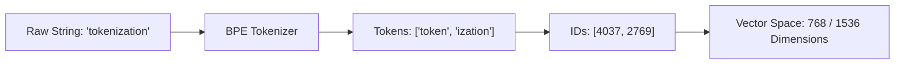

import { Callout } from "fumadocs-ui/components/callout";
import { Tabs, Tab } from "fumadocs-ui/components/tabs";
import { Accordion, Accordions } from "fumadocs-ui/components/accordion";

Language models do not understand text strings directly. Before any reasoning, search, or generation happens, human text is split into numeric tokens and projected into a continuous, high-dimensional coordinate space $\mathbb{R}^D$ known as **embeddings**.

---

## 1. Tokenization: From Characters to Numbers

Language models process text as a sequence of integer IDs called **tokens**. Modern models use subword tokenization algorithms like **Byte-Pair Encoding (BPE)**:



### Why Words Aren't One Token

- A vocabulary of every English word would require millions of entries and could never handle new words, code identifiers, or spelling errors.
- Subword tokenization breaks rare words into common fragments (`"unbelievable"` $\rightarrow$ `"un"`, `"believ"`, `"able"`).
- On average in English, **1 token $\approx$ 0.75 words** or **4 characters**.

---

## 2. The Geometry of Semantic Vectors

An embedding is a vector of floating-point numbers (typically 384, 768, 1536, or 3072 dimensions) where:

- Words/sentences with similar meanings have high cosine similarity.
- Directions in space represent semantic relationships (e.g. $\vec{v}_{\text{King}} - \vec{v}_{\text{Man}} + \vec{v}_{\text{Woman}} \approx \vec{v}_{\text{Queen}}$).

```
"Python programming language" -> [ 0.042, -0.198,  0.881, ..., -0.012 ]
"Writing software in Python"  -> [ 0.039, -0.185,  0.865, ..., -0.015 ]  (High similarity: 0.96)
"Recipe for chocolate cake"   -> [-0.512,  0.721, -0.094, ...,  0.312 ]  (Low similarity: 0.12)
```

---

## 3. Distance Metrics: Cosine vs. L2 vs. Dot Product

Choosing the correct similarity metric depends on whether your embeddings are **unit-normalized** ($\|\mathbf{v}\|_2 = 1$):

| Metric                | Formula                                                             | Best Used For            | Notes                                                                 |
| :-------------------- | :------------------------------------------------------------------ | :----------------------- | :-------------------------------------------------------------------- |
| **Cosine Similarity** | $\frac{\mathbf{u} \cdot \mathbf{v}}{\|\mathbf{u}\| \|\mathbf{v}\|}$ | Semantic text similarity | Invariant to vector length                                            |
| **Dot Product (IP)**  | $\mathbf{u} \cdot \mathbf{v}$                                       | Normalized embeddings    | If $\|\mathbf{u}\| = \|\mathbf{v}\| = 1$, Dot Product $\equiv$ Cosine |
| **Euclidean (L2)**    | $\sqrt{\sum (u_i - v_i)^2}$                                         | Clustering, spatial data | Sensitive to vector magnitude                                         |

<Callout type="tip" title="Optimization Insight">
  Most production vector databases (Pinecone, Qdrant, Milvus, Chroma) prefer
  **inner product (dot product)** because if vectors are pre-normalized upon
  insertion, computing similarity requires only a single BLAS matrix
  multiplication: no square roots or division!
</Callout>

---

## 4. Building an In-Memory Vector Database in Python

Let's build a self-contained, typed vector database with metadata filtering and top-k search in pure Python and NumPy:

```python
from dataclasses import dataclass, field
from typing import Any, Dict, List, Optional
import numpy as np

@dataclass
class DocumentRecord:
    id: str
    text: str
    metadata: Dict[str, Any]
    vector: np.ndarray

class InMemoryVectorDB:
    def __init__(self, dimension: int):
        self.dimension = dimension
        self.records: List[DocumentRecord] = []
        # Pre-allocated matrix for fast vectorized BLAS operations
        self._matrix: Optional[np.ndarray] = None
        self._dirty = False

    def insert(self, doc_id: str, text: str, vector: list[float] | np.ndarray, metadata: Optional[Dict[str, Any]] = None) -> None:
        vec = np.asarray(vector, dtype=np.float32)
        if vec.shape != (self.dimension,):
            raise ValueError(f"Vector dimension mismatch: expected {self.dimension}, got {vec.shape}")

        # Normalize vector to unit length (L2 norm = 1.0)
        norm = np.linalg.norm(vec)
        if norm > 0:
            vec = vec / norm

        record = DocumentRecord(
            id=doc_id,
            text=text,
            metadata=metadata or {},
            vector=vec
        )
        self.records.append(record)
        self._dirty = True

    def _sync_matrix(self) -> None:
        """Stacks records into a contiguous 2D NumPy array (N, D)."""
        if self._dirty or self._matrix is None:
            if not self.records:
                self._matrix = np.empty((0, self.dimension), dtype=np.float32)
            else:
                self._matrix = np.vstack([rec.vector for rec in self.records])
            self._dirty = False

    def search(
        self,
        query_vector: list[float] | np.ndarray,
        top_k: int = 5,
        filter_fn: Optional[callable] = None
    ) -> List[tuple[DocumentRecord, float]]:
        self._sync_matrix()

        if len(self.records) == 0:
            return []

        # 1. Normalize query
        q = np.asarray(query_vector, dtype=np.float32)
        norm = np.linalg.norm(q)
        if norm > 0:
            q = q / norm

        # 2. Compute all cosine similarities in a single C-level dot product
        similarities = self._matrix @ q  # Shape: (N,)

        # 3. Apply optional metadata filters
        candidate_indices = []
        for idx, rec in enumerate(self.records):
            if filter_fn is None or filter_fn(rec.metadata):
                candidate_indices.append(idx)

        if not candidate_indices:
            return []

        candidate_indices = np.array(candidate_indices)
        filtered_scores = similarities[candidate_indices]

        # 4. Efficient Top-K using argpartition (O(N) instead of O(N log N))
        k = min(top_k, len(candidate_indices))
        if k < len(candidate_indices):
            partitioned = np.argpartition(-filtered_scores, k - 1)[:k]
            # Sort only the top k
            sorted_top_k = partitioned[np.argsort(-filtered_scores[partitioned])]
        else:
            sorted_top_k = np.argsort(-filtered_scores)

        results = []
        for rank in sorted_top_k:
            original_idx = candidate_indices[rank]
            score = float(similarities[original_idx])
            results.append((self.records[original_idx], score))

        return results
```

### Testing the Vector DB

```python
# Create database with dimension 4 (for demonstration)
db = InMemoryVectorDB(dimension=4)

db.insert("1", "Python async event loop internals", [0.9, 0.2, 0.1, 0.0], {"category": "python"})
db.insert("2", "Building Web APIs with FastAPI",    [0.85, 0.3, 0.2, 0.1], {"category": "python"})
db.insert("3", "Making sourdough bread at home",    [-0.2, 0.9, 0.8, -0.1], {"category": "cooking"})
db.insert("4", "Deploying models to Kubernetes",    [0.7, 0.1, 0.4, 0.5], {"category": "devops"})

# Query for python development
query = [0.88, 0.25, 0.15, 0.05]
matches = db.search(query, top_k=2, filter_fn=lambda m: m.get("category") == "python")

for doc, score in matches:
    print(f"[{score:.4f}] {doc.text} (Category: {doc.metadata['category']})")
```

---

## 5. Approximate Nearest Neighbors (ANN) & Indexing

When databases store millions or billions of vectors, calculating exact dot products across every document ($O(N)$ brute-force) becomes too slow.

Production vector databases use **Approximate Nearest Neighbor (ANN)** indexing algorithms:

- **HNSW (Hierarchical Navigable Small World)**: Builds a multi-layer graph where high layers allow long-range hops and lower layers perform fine-grained search ($O(\log N)$ search time).
- **IVFFlat (Inverted File Flat)**: Clusters vectors into Voronoi cells using k-means, querying only the nearest cluster centroids.
- **Product Quantization (PQ)**: Compresses floating-point vectors into compact codes for drastic RAM savings.

---

## Practice Questions & Challenges

Test your mastery of embedding geometry, tokenization arithmetic, and vector search engines:

### Question 1: Output Prediction (Cosine Similarity vs Vector Scaling)

Given two 3-dimensional vectors $u$ and $v$, what happens to their cosine similarity when $v$ is multiplied by an arbitrary positive scalar $k = 100$?

```python
import numpy as np

def cosine_similarity(u, v):
    return np.dot(u, v) / (np.linalg.norm(u) * np.linalg.norm(v))

u = np.array([1.0, 2.0, 3.0])
v = np.array([4.0, 5.0, 6.0])

sim_original = cosine_similarity(u, v)
sim_scaled = cosine_similarity(u, v * 100.0)

print(f"Original: {sim_original:.4f}")
print(f"Scaled:   {sim_scaled:.4f}")
```

<Accordions>
<Accordion title="Solution & Breakdown">
**Output:**
```text
Original: 0.9746
Scaled:   0.9746
```

**Explanation:**
Cosine similarity measures the **angle** between two vectors in space, not their magnitude.
Mathematically:
$$\text{Cosine}(u, k \cdot v) = \frac{u \cdot (k \cdot v)}{\|u\| \|k \cdot v\|} = \frac{k(u \cdot v)}{\|u\| \cdot k \|v\|} = \frac{u \cdot v}{\|u\| \|v\|}$$
Because the positive scalar $k$ factors out of both numerator and denominator, it cancels out completely. This property makes cosine similarity ideal for document retrieval where long documents might have higher raw token counts or larger vector magnitudes without changing semantic orientation.

</Accordion>
</Accordions>

---

### Question 2: Spot and Fix the Bug (Post-Filtering Vector DB Drop-off)

A developer builds an enterprise search feature with metadata filtering (e.g. `tenant_id == "tenant_123"`). However, users complain that queries often return **0 results**, even though matching documents exist:

```python
def naive_tenant_search(query_vec, top_k=5, tenant_id="acme"):
    # Step 1: Retrieve top-k nearest neighbors globally
    global_results = vector_db.search(query_vec, top_k=top_k)  # returns 5 docs

    # Step 2: Post-filter by tenant
    tenant_results = [
        doc for doc in global_results
        if doc.metadata.get("tenant_id") == tenant_id
    ]
    return tenant_results  # Often empty!
```

Explain why this "post-filtering" approach fails and provide the architectural fix.

<Accordions>
<Accordion title="Solution & Breakdown">
**The Root Cause (Post-Filtering Pitfall):**
If the top 5 globally nearest vectors belong to other tenants, `global_results` contains zero documents from `"acme"`. Filtering afterwards yields an empty list, even if `"acme"` has thousands of highly relevant documents ranked 6th through 20th!

**The Fix (Pre-Filtering / Single-Stage Iterative Search):**
Filter **before** or **during** vector scoring, evaluating candidates that satisfy the tenant predicate:

```python
def pre_filtered_search(query_vec, top_k=5, tenant_id="acme"):
    # 1. Filter candidates first (or query tenant-specific partition index):
    tenant_doc_indices = [
        idx for idx, doc in enumerate(vector_db.records)
        if doc.metadata.get("tenant_id") == tenant_id
    ]
    if not tenant_doc_indices:
        return []

    # 2. Score only valid candidates:
    tenant_matrix = vector_db.matrix[tenant_doc_indices]
    scores = tenant_matrix @ query_vec

    top_indices = np.argsort(scores)[::-1][:top_k]
    return [(vector_db.records[tenant_doc_indices[i]], scores[i]) for i in top_indices]
```

Modern vector DBs (e.g. Qdrant, Milvus) solve this with **payload index filtering** directly inside the HNSW traversal graph.

</Accordion>
</Accordions>

---

### Question 3: Architecture Deep-Dive (Dense Retrieval vs Sparse Lexical BM25)

Why do state-of-the-art RAG pipelines use **Hybrid Search** (combining dense vector embeddings with sparse lexical BM25) rather than relying exclusively on dense vector search?

<Accordions>
<Accordion title="Solution & Breakdown">
**Dense Vector Retrieval Strengths & Weaknesses:**
- **Strengths:** Captures conceptual synonyms and broad semantics (e.g. "puppy" matches "dog"; "hypertension" matches "high blood pressure").
- **Weaknesses:** Poor at exact matches, acronyms, part numbers, SKUs, or rare terminology (e.g. querying `"CVE-2024-38077"` or `"User ID 894123"` may yield random semantically general cybersecurity articles instead of the exact CVE number).

**Sparse Lexical Retrieval (BM25) Strengths & Weaknesses:**

- **Strengths:** Exact keyword matching, term frequency / inverse document frequency (TF-IDF) scoring. Perfect for code identifiers, model names, and IDs.
- **Weaknesses:** Suffers from vocabulary mismatch (cannot connect "automobile" to "car" without synonyms).

**Hybrid Search Solution:**
Combines both retrieval methods and merges ranked results using **Reciprocal Rank Fusion (RRF)**:
$$\text{RRF\_Score}(d) = \sum_{m \in \{\text{Dense}, \text{BM25}\}} \frac{1}{60 + \text{Rank}_m(d)}$$
This delivers the best of both worlds: conceptual semantic understanding without dropping exact keyword matches!

</Accordion>
</Accordions>

---

### Question 4: Hands-On Challenge (Reciprocal Rank Fusion Implementation)

Implement a function `reciprocal_rank_fusion(dense_ranks: list[str], bm25_ranks: list[str], k: int = 60) -> list[tuple[str, float]]` that:

1. Merges two ranked lists of document IDs.
2. Applies the standard RRF formula: $\sum \frac{1}{k + \text{rank}}$.
3. Returns a consolidated list of `(doc_id, score)` sorted in descending order of fused score.

<Accordions>
<Accordion title="Solution & Breakdown">
```python
from collections import defaultdict

def reciprocal_rank_fusion(
dense_ranks: list[str],
bm25_ranks: list[str],
k: int = 60
) -> list[tuple[str, float]]:
scores = defaultdict(float)

    # Accumulate dense rankings (1-indexed rank)
    for rank, doc_id in enumerate(dense_ranks, start=1):
        scores[doc_id] += 1.0 / (k + rank)

    # Accumulate BM25 rankings
    for rank, doc_id in enumerate(bm25_ranks, start=1):
        scores[doc_id] += 1.0 / (k + rank)

    # Sort descending by fused score
    fused_results = sorted(scores.items(), key=lambda item: item[1], reverse=True)
    return fused_results

# Verification

dense_results = ["doc_A", "doc_B", "doc_C", "doc_D"]
bm25_results = ["doc_C", "doc_A", "doc_E", "doc_B"]

ranked = reciprocal_rank_fusion(dense_results, bm25_results, k=60)
for doc, score in ranked:
print(f"{doc}: {score:.5f}")

# doc_A and doc_C rank highest because they appear near the top in both retrieval channels!

````

</Accordion>
</Accordions>

---

### Question 5: Code Challenge (Multi-Tenant Vector DB with L2 Normalization and Payload Filtering)
Extend the `InMemoryVectorDB` with:
1. Automatic $L_2$ unit normalization on vector insertion.
2. Metadata payload indexing: Maintain an inverted index for metadata keys/values (e.g., `{"department": "engineering"}`) to execute pre-filtered searches in $O(1)$ predicate lookup time before computing vector dot products.

**Test cases:**
```python
db = FastFilteredVectorDB(dimension=3)
db.insert("doc1", "text A", [1.0, 0.0, 0.0], {"dept": "legal"})
db.insert("doc2", "text B", [0.0, 1.0, 0.0], {"dept": "eng"})
db.insert("doc3", "text C", [0.9, 0.1, 0.0], {"dept": "eng"})

# Search with filter dept == "eng":
results = db.search([1.0, 0.0, 0.0], filter_meta={"dept": "eng"}, top_k=2)
# Must return doc3 first, followed by doc2, but NEVER doc1
````

<Accordions>
<Accordion title="Solution & Breakdown">
```python
from collections import defaultdict
import numpy as np

class FastFilteredVectorDB:
def **init**(self, dimension: int):
self.dimension = dimension
self.vectors = [] # List of normalized 1D arrays
self.doc_ids = []
self.metadata = [] # Inverted index: (key, value) -> set of integer internal indices
self.attr_index = defaultdict(set)

    def insert(self, doc_id: str, text: str, vector: list[float], meta: dict):
        v = np.array(vector, dtype=np.float32)
        norm = np.linalg.norm(v)
        if norm > 0:
            v = v / norm
        else:
            v = np.zeros(self.dimension, dtype=np.float32)

        idx = len(self.vectors)
        self.vectors.append(v)
        self.doc_ids.append(doc_id)
        self.metadata.append({"text": text, **meta})

        # Populate inverted index
        for k, val in meta.items():
            self.attr_index[(k, val)].add(idx)

    def search(self, query_vec: list[float], filter_meta: dict | None = None, top_k: int = 5):
        q = np.array(query_vec, dtype=np.float32)
        q_norm = np.linalg.norm(q)
        if q_norm > 0:
            q = q / q_norm

        # 1. Resolve candidate indices via set intersection of filters
        if filter_meta:
            candidate_sets = [
                self.attr_index.get((k, v), set())
                for k, v in filter_meta.items()
            ]
            if not candidate_sets or any(len(s) == 0 for s in candidate_sets):
                return []
            candidate_indices = sorted(list(set.intersection(*candidate_sets)))
        else:
            candidate_indices = list(range(len(self.vectors)))

        if not candidate_indices:
            return []

        # 2. Extract matrix slice for candidates
        candidate_matrix = np.array([self.vectors[i] for i in candidate_indices])

        # 3. Inner product (equivalent to cosine similarity for normalized vectors)
        scores = candidate_matrix @ q

        # 4. Rank candidates
        k = min(top_k, len(candidate_indices))
        top_arg_indices = np.argsort(scores)[::-1][:k]

        return [
            (self.doc_ids[candidate_indices[i]], self.metadata[candidate_indices[i]], float(scores[i]))
            for i in top_arg_indices
        ]

# Verification

db = FastFilteredVectorDB(dimension=3)
db.insert("doc1", "Contract review", [1.0, 0.0, 0.0], {"dept": "legal"})
db.insert("doc2", "Kubernetes cluster", [0.0, 1.0, 0.0], {"dept": "eng"})
db.insert("doc3", "Python concurrency", [0.9, 0.1, 0.0], {"dept": "eng"})

results = db.search([1.0, 0.0, 0.0], filter_meta={"dept": "eng"}, top_k=2)
print("Filtered Search Results:")
for doc_id, meta, score in results:
print(f"- {doc_id} ({meta['dept']}): score={score:.4f}, text='{meta['text']}'")
assert results[0][0] == "doc3"
assert all(r[1]["dept"] == "eng" for r in results)

```

</Accordion>
</Accordions>
```
