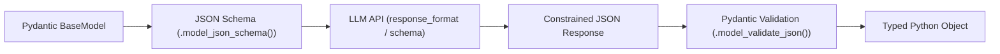

import { Callout } from "fumadocs-ui/components/callout";
import { Tabs, Tab } from "fumadocs-ui/components/tabs";
import { Accordion, Accordions } from "fumadocs-ui/components/accordion";

In modern AI engineering, language models are rarely isolated scripts. They power backend microservices, real-time user interfaces, and automated extraction pipelines.

Building reliable LLM services requires three non-negotiables:

1. **Asynchronous Streaming**: Reducing Time-To-First-Token (TTFT) for user responsiveness.
2. **Deterministic Structured Outputs**: Enforcing machine-readable data structures via Pydantic schemas instead of hoping for valid JSON.
3. **Resilient Rate-Limit Handling**: Gracefully recovering from HTTP 429 and transient provider downtime.

---

## 1. Async Streaming with Python Generators

When generating large responses, waiting for the entire completion blocks the client for seconds. Using Python's `async for` over Server-Sent Events (SSE) streams tokens immediately as they are sampled:

```python
import asyncio
import os
import httpx

async def stream_chat_completion(prompt: str, model: str = "gpt-4o-mini"):
    """
    Streams tokens from a modern OpenAI-compatible API endpoint using httpx.
    """
    api_key = os.getenv("OPENAI_API_KEY", "mock-token")
    url = "https://api.openai.com/v1/chat/completions"

    headers = {
        "Authorization": f"Bearer {api_key}",
        "Content-Type": "application/json"
    }

    payload = {
        "model": model,
        "messages": [{"role": "user", "content": prompt}],
        "stream": True,
        "temperature": 0.2
    }

    async with httpx.AsyncClient(timeout=30.0) as client:
        async with client.stream("POST", url, headers=headers, json=payload) as response:
            if response.status_code != 200:
                error_body = await response.aread()
                raise RuntimeError(f"API Error {response.status_code}: {error_body.decode()}")

            async for line in response.aiter_lines():
                if not line or not line.startswith("data: "):
                    continue
                data_str = line[len("data: "):].strip()
                if data_str == "[DONE]":
                    break

                # Parse chunk JSON
                try:
                    import json
                    chunk = json.loads(data_str)
                    delta = chunk["choices"][0]["delta"]
                    if "content" in delta and delta["content"]:
                        yield delta["content"]
                except Exception:
                    continue

# Usage example
async def main():
    print("Streaming output: ", end="", flush=True)
    async for token in stream_chat_completion("Explain the Python GIL in 2 concise sentences."):
        print(token, end="", flush=True)
    print("\n[Stream Complete]")

# asyncio.run(main())
```

---

## 2. Guaranteed Structured Outputs with Pydantic v2

Never rely on raw string parsing or regular expressions to parse model outputs. Modern LLMs support **Structured Outputs** (JSON Schema constraints directly enforced during decoding).

In Python, define your target output structure using **Pydantic v2**:



### Implementing Structured Extraction

```python
from enum import Enum
from typing import List, Optional
from pydantic import BaseModel, Field, field_validator

class SentimentEnum(str, Enum):
    POSITIVE = "positive"
    NEUTRAL = "neutral"
    NEGATIVE = "negative"

class ExtractedEntity(BaseModel):
    name: str = Field(description="The proper name of the entity or product")
    category: str = Field(description="Entity type, e.g., company, technology, person")
    confidence: float = Field(ge=0.0, le=1.0, description="Confidence score from 0.0 to 1.0")

class CustomerFeedbackAnalysis(BaseModel):
    sentiment: SentimentEnum
    urgency_score: int = Field(ge=1, le=5, description="1 is low priority, 5 is critical outage")
    key_points: List[str] = Field(min_length=1, description="Bulleted summary of feedback")
    entities_mentioned: List[ExtractedEntity]
    suggested_reply: Optional[str] = None

    @field_validator("key_points")
    def points_must_be_substantive(cls, v):
        for point in v:
            if len(point.strip()) < 5:
                raise ValueError("Key points must be at least 5 characters long")
        return v

# Inspect the auto-generated JSON schema that gets passed to the LLM API
print(CustomerFeedbackAnalysis.model_json_schema())
```

### Feeding Schema to the LLM and Validating

```python
import json
from pydantic import ValidationError

def parse_llm_json(raw_llm_response: str) -> CustomerFeedbackAnalysis:
    """Safely parses and validates LLM output against the schema."""
    try:
        # Pydantic v2 validates JSON string directly in high-performance C/Rust
        validated_data = CustomerFeedbackAnalysis.model_validate_json(raw_llm_response)
        return validated_data
    except ValidationError as e:
        print("Schema validation failed! Model output was invalid:")
        print(e.errors())
        raise
```

---

## 3. Resilient API Execution with Jittered Exponential Backoff

LLM APIs frequently return `HTTP 429 Too Many Requests` when token-per-minute (TPM) or request-per-minute (RPM) quotas are reached.

A robust Python caller must implement **Full Jitter Exponential Backoff**:

```python
import asyncio
import random
import time
from typing import Any, Callable, Coroutine

async def call_with_backoff(
    async_fn: Callable[[], Coroutine[Any, Any, Any]],
    max_retries: int = 5,
    base_delay: float = 1.0,
    max_delay: float = 30.0
) -> Any:
    """
    Executes an async API call with randomized exponential backoff (full jitter).
    Prevents the 'thundering herd' problem against rate-limited endpoints.
    """
    for attempt in range(max_retries):
        try:
            return await async_fn()
        except Exception as exc:
            # Check if error is transient rate limit or network issue
            if attempt == max_retries - 1:
                raise exc

            # Calculate backoff: min(max_delay, base_delay * 2^attempt)
            exponential_delay = min(max_delay, base_delay * (2 ** attempt))
            # Apply full jitter: random uniform between 0 and exponential_delay
            jittered_sleep = random.uniform(0.5, 1.0) * exponential_delay

            print(f"[Attempt {attempt + 1}] Request failed: {exc}. Retrying in {jittered_sleep:.2f}s...")
            await asyncio.sleep(jittered_sleep)

    raise RuntimeError("Unreachable")
```

---

## 4. Context Budgeting & Token Window Management

Language models have finite context windows. To avoid silent truncation or expensive overflow errors:

```python
def estimate_token_count(text: str) -> int:
    """Rule of thumb estimate: 1 token ~ 4 characters in English."""
    return len(text) // 4

def truncate_to_context_budget(history: list[dict], max_tokens: int = 4000) -> list[dict]:
    """Retains the system prompt and the most recent messages that fit the budget."""
    if not history:
        return []

    system_msg = history[0] if history[0]["role"] == "system" else None
    remaining_messages = history[1:] if system_msg else history[:]

    budget = max_tokens
    if system_msg:
        budget -= estimate_token_count(system_msg["content"])

    kept_messages = []
    # Accumulate backwards from newest to oldest
    for msg in reversed(remaining_messages):
        cost = estimate_token_count(msg["content"])
        if budget - cost >= 0:
            kept_messages.append(msg)
            budget -= cost
        else:
            break

    kept_messages.reverse()
    return ([system_msg] if system_msg else []) + kept_messages
```

---

## Practice Questions & Challenges

Test your capabilities in production LLM client design, streaming protocols, and type-safe schema extraction:

### Question 1: Output Prediction (Async Generator Cancellation in Streaming)

Consider the following streaming consumer that aborts reading as soon as it detects a stop phrase:

```python
import asyncio

async def token_stream():
    tokens = ["Hello", " ", "world", "!", " [STOP]", " extra", " words"]
    try:
        for t in tokens:
            await asyncio.sleep(0.01)
            yield t
    finally:
        print("[Stream] Cleaned up socket connection")

async def main():
    async for tok in token_stream():
        print(f"Token: {tok.strip()}")
        if "[STOP]" in tok:
            print("Stop condition reached, breaking!")
            break

asyncio.run(main())
```

What is the exact console output sequence, and does the `finally` block execute when `break` terminates the generator?

<Accordions>
<Accordion title="Solution & Breakdown">
**Output:**
```text
Token: Hello
Token: 
Token: world
Token: !
Token: [STOP]
Stop condition reached, breaking!
[Stream] Cleaned up socket connection
```

**Explanation:**

1. The consumer iterates through tokens up until `"[STOP]"`.
2. When `break` is encountered, Python terminates the generator loop.
3. CPython raises a `GeneratorExit` exception inside the async generator at its suspension point.
4. The `finally` block in `token_stream()` is **guaranteed to execute**, printing `"[Stream] Cleaned up socket connection"`.
5. Remaining tokens (`" extra"`, `" words"`) are never yielded, saving network bandwidth and CPU cycles!
   </Accordion>
</Accordions>

---

### Question 2: Spot and Fix the Bug (Unconstrained JSON Regex Extraction)

A developer attempts to extract a JSON response from an LLM by finding the first `{` and last `}` with a regular expression, but the parser crashes with `json.decoder.JSONDecodeError` on markdown code blocks or thought transcripts:

````python
import json
import re

def parse_llm_json(response_text: str) -> dict:
    # BUG: Greedily captures markdown backticks or explanations
    match = re.search(r"\{.*\}", response_text, re.DOTALL)
    if not match:
        raise ValueError("No JSON found")
    return json.loads(match.group(0))

bad_response = """
Here is your requested data:
```json
{
  "status": "success",
  "score": 0.95
}
```
Hope this helps!
"""

print(parse_llm_json(bad_response))
````

Why does naive regex extraction fail on real-world LLM outputs, and how do you write a robust parser handling markdown code fences?

<Accordions>
<Accordion title="Solution & Breakdown">
**The Root Cause:**
If the LLM outputs curly braces in its surrounding conversational prose (e.g. `Here is the user profile {admin: false}: ...`), greedy `r"\{.*\}"` matches from the first conversational brace to the final brace, incorporating invalid JSON text and markdown delimiters.

**The Fix:**

1. First, attempt to match explicit markdown code fences (` ```json ... ``` `).
2. Fall back to balanced JSON extraction or Pydantic validation:

````python
import json
import re

def parse_llm_json_robust(response_text: str) -> dict:
    text = response_text.strip()

    # 1. Check for fenced code block: ```json ... ``` or ``` ... ```
    fence_pattern = r"```(?:json)?\s*([\s\S]*?)\s*```"
    match = re.search(fence_pattern, text)
    if match:
        raw_json = match.group(1).strip()
    else:
        # 2. Fall back to first '{' and last '}'
        start = text.find("{")
        end = text.rfind("}")
        if start != -1 and end != -1 and end > start:
            raw_json = text[start : end + 1]
        else:
            raise ValueError(f"Could not locate JSON in response: {text[:100]}...")

    return json.loads(raw_json)

# Verification
data = parse_llm_json_robust(bad_response)
print("Parsed safely:", data)  # {'status': 'success', 'score': 0.95}
````

</Accordion>
</Accordions>

---

### Question 3: Architecture Deep-Dive (Function Calling vs JSON Mode vs Outlines Constrained Sampling)

Compare three mechanisms used by modern AI infrastructure to generate structured outputs:

1. Standard Prompting with JSON Mode (`response_format={"type": "json_object"}`)
2. Tool / Function Calling (`tools=[{"type": "function", ...}]`)
3. Context-Free Grammar (CFG) / Regex Constrained Decoding (e.g. OpenAI Structured Outputs, Outlines, llama.cpp grammars).

<Accordions>
<Accordion title="Solution & Breakdown">
**1. JSON Mode:**
- The model is instructed to output valid JSON, but the vocabulary logits are completely unconstrained during sampling.
- The model can still generate missing keys, incorrect data types, or hallucinated fields. Validation must happen entirely in Python post-generation.

**2. Tool / Function Calling:**

- The schema is provided as a function definition.
- The model decides whether to respond in natural language or emit a tool call.
- Still relies largely on the model's learned ability to adhere to the schema, though fine-tuned specifically for tool formatting.

**3. Constrained Decoding (Grammar-Guided Generation / Structured Outputs):**

- At each token generation step, the engine compiles the Pydantic JSON schema into a **Deterministic Finite Automaton (DFA)** or context-free grammar.
- Tokens that would violate the JSON grammar or schema are **masked out** (logits set to $-\infty$) before softmax!
- **Guarantee:** 100% mathematical guarantee that the output parses and adheres to the schema on the very first attempt, with zero formatting hallucinations.
  </Accordion>
</Accordions>

---

### Question 4: Hands-On Challenge (Pydantic Schema Validator with Self-Correction Retry)

Implement an async function `extract_with_retry(prompt: str, schema_cls: Type[BaseModel], max_attempts: int = 3)` that:

1. Calls a simulated LLM endpoint returning text.
2. Validates the result against `schema_cls`.
3. If validation fails (`pydantic.ValidationError`), captures the validation error messages and re-prompts the model with the exact feedback until valid or attempts run out.

<Accordions>
<Accordion title="Solution & Breakdown">
```python
import asyncio
from pydantic import BaseModel, Field, ValidationError
from typing import Type, TypeVar

T = TypeVar("T", bound=BaseModel)

# Mock LLM that fails on attempt 1, succeeds on attempt 2

mock_responses = [
'{"name": "Alice", "age": "twenty-five"}', # Invalid: age must be int
'{"name": "Alice", "age": 25, "skills": ["python", "docker"]}' # Valid
]
attempt_counter = 0

async def mock_llm_generate(prompt: str) -> str:
global attempt_counter
res = mock_responses[min(attempt_counter, len(mock_responses) - 1)]
attempt_counter += 1
return res

async def extract_with_retry(
prompt: str,
schema_cls: Type[T],
max_attempts: int = 3
) -> T:
current_prompt = prompt
for attempt in range(max_attempts):
response_text = await mock_llm_generate(current_prompt)
try: # Validate schema
validated = schema_cls.model_validate_json(response_text)
print(f"[Attempt {attempt + 1}] Schema successfully validated!")
return validated
except ValidationError as err:
print(f"[Attempt {attempt + 1}] Validation failed:\n{err}") # Feed validation error back into prompt:
current_prompt = (
f"{prompt}\n\nYour previous response was invalid JSON according to the schema:\n"
f"{err}\n\nPlease correct the errors and re-emit the JSON object."
)

    raise ValueError(f"Failed to extract valid {schema_cls.__name__} after {max_attempts} attempts.")

# Verification

class DeveloperProfile(BaseModel):
name: str
age: int
skills: list[str] = Field(default_factory=list)

async def main():
profile = await extract_with_retry("Extract developer info", DeveloperProfile)
print("Final Model Object:", profile)

asyncio.run(main())

````
</Accordion>
</Accordions>

---

### Question 5: Code Challenge (Token-Budgeted Sliding Window Chat History Manager)
Build a production `ConversationMemory` class that:
1. Keeps a permanent `system` prompt that is never dropped.
2. Accepts `add_message(role: str, content: str)`.
3. Provides `get_messages(max_tokens: int) -> list[dict]`:
   - Calculates message token cost (approx 1 token per 4 chars + 4 tokens overhead per message).
   - If the conversation exceeds `max_tokens`, drops oldest non-system messages first.
   - Preserves message turn integrity (never leaves an orphaned `assistant` message without a preceding `user` message if possible).

**Test cases:**
```python
mem = ConversationMemory(system_prompt="You are a helpful assistant.")
for i in range(10):
    mem.add_message("user", f"Question {i}: " + "x" * 200)
    mem.add_message("assistant", f"Answer {i}: " + "y" * 200)

messages = mem.get_messages(max_tokens=300)
# Must retain system prompt + most recent user/assistant pairs fitting 300 tokens
````

<Accordions>
<Accordion title="Solution & Breakdown">
```python
from dataclasses import dataclass
from typing import List, Dict

@dataclass
class Message:
role: str
content: str

    def token_cost(self) -> int:
        # 4 tokens overhead for role/message delimiters + content tokens
        return 4 + (len(self.content) // 4)

class ConversationMemory:
def **init**(self, system_prompt: str):
self.system_message = Message(role="system", content=system_prompt)
self.history: List[Message] = []

    def add_message(self, role: str, content: str):
        self.history.append(Message(role=role, content=content))

    def get_messages(self, max_tokens: int) -> List[Dict[str, str]]:
        system_cost = self.system_message.token_cost()
        if system_cost > max_tokens:
            raise ValueError(f"System prompt ({system_cost} tokens) exceeds total budget ({max_tokens} tokens)")

        budget = max_tokens - system_cost
        retained: List[Message] = []

        # Walk backwards from newest to oldest
        for msg in reversed(self.history):
            cost = msg.token_cost()
            if budget - cost >= 0:
                retained.append(msg)
                budget -= cost
            else:
                break

        retained.reverse()

        # Clean up turn integrity: If the oldest message is an assistant response,
        # discard it so the prompt starts with user query
        if retained and retained[0].role == "assistant":
            retained.pop(0)

        # Assemble final list
        final_list = [self.system_message] + retained
        return [{"role": m.role, "content": m.content} for m in final_list]

# Verification

if **name** == "**main**":
mem = ConversationMemory("You are an expert engineer.")
for i in range(5):
mem.add_message("user", f"Query {i}: " + "detail " _ 10)
mem.add_message("assistant", f"Response {i}: " + "answer " _ 10)

    # Budget for ~3 messages
    out = mem.get_messages(max_tokens=100)
    print(f"Retained {len(out)} messages within budget:")
    for m in out:
        print(f"[{m['role']}] {m['content'][:30]}...")
    assert out[0]["role"] == "system"
    assert out[1]["role"] == "user"

```
</Accordion>
</Accordions>
```
