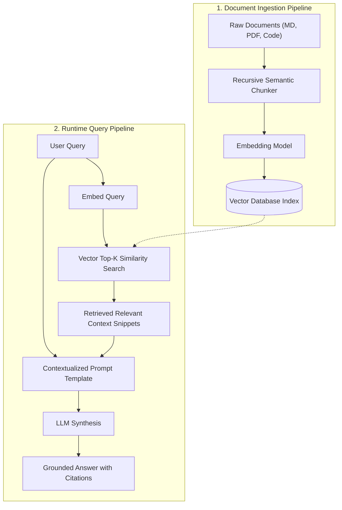

import { Callout } from "fumadocs-ui/components/callout";
import { Tabs, Tab } from "fumadocs-ui/components/tabs";
import { Accordion, Accordions } from "fumadocs-ui/components/accordion";

Language models suffer from two major limitations:

1. **Knowledge Cutoffs**: They do not know about proprietary internal data or recent world events.
2. **Hallucinations**: When uncertain, they generate convincing but factually incorrect assertions.

**Retrieval-Augmented Generation (RAG)** solves both by retrieving relevant document snippets from a knowledge base and injecting them as verified context into the model's prompt.



---

## 1. Chunking Strategies: The Foundation of RAG

If you chunk text naively (e.g. splitting every 500 characters), you will split sentences in half and sever context.

A production chunker uses **recursive boundary splitting**:

1. Try splitting on major section breaks (`\n\n# `, `\n\n`).
2. If a chunk exceeds the maximum size, split on newlines (`\n`).
3. If still too large, split on sentence ends (`. `, `? `, `! `).
4. Maintain an **overlap window** so thoughts spanning borders are preserved.

### Implementing a Recursive Text Chunker in Python

```python
import re
from typing import List

class RecursiveTextChunker:
    def __init__(self, chunk_size: int = 500, chunk_overlap: int = 100):
        self.chunk_size = chunk_size
        self.chunk_overlap = chunk_overlap
        self.separators = ["\n\n", "\n", ". ", " "]

    def split_text(self, text: str) -> List[str]:
        """Recursively splits text respecting natural punctuation boundaries."""
        return self._split_recursive(text, self.separators)

    def _split_recursive(self, text: str, separators: List[str]) -> List[str]:
        final_chunks = []
        if not separators:
            # Base case: split by character length if no separators left
            return [text[i:i + self.chunk_size] for i in range(0, len(text), self.chunk_size - self.chunk_overlap)]

        separator = separators[0]
        splits = text.split(separator)

        current_chunk = ""
        for split in splits:
            candidate = f"{current_chunk}{separator}{split}" if current_chunk else split

            if len(candidate) <= self.chunk_size:
                current_chunk = candidate
            else:
                if current_chunk:
                    final_chunks.append(current_chunk.strip())

                # If a single split is larger than chunk_size, recursively split with finer separator
                if len(split) > self.chunk_size:
                    sub_chunks = self._split_recursive(split, separators[1:])
                    final_chunks.extend(sub_chunks)
                    current_chunk = ""
                else:
                    current_chunk = split

        if current_chunk:
            final_chunks.append(current_chunk.strip())

        return [c for c in final_chunks if c]

# Demonstration
sample_article = """
Python 3.12 introduced major performance optimizations including specialized adaptive bytecode instructions.

In Python 3.13, free-threaded execution (PEP 703) provides experimental builds that disable the Global Interpreter Lock entirely. This allows multiple CPU threads to execute Python bytecode concurrently across separate cores without GIL contention.

Subinterpreters (PEP 734) offer another avenue for concurrency, providing independent interpreter states with isolated GILs in the same process.
"""

chunker = RecursiveTextChunker(chunk_size=150, chunk_overlap=30)
chunks = chunker.split_text(sample_article)

for i, ch in enumerate(chunks, 1):
    print(f"--- Chunk {i} ({len(ch)} chars) ---\n{ch}\n")
```

---

## 2. Hybrid Retrieval: Combining Dense & Sparse Search

While dense vector embeddings excel at semantic conceptual matching, they sometimes miss exact keyword matches like error codes (`ERR_401_AUTH`), product serial numbers, or function identifiers.

Production RAG systems use **Hybrid Search**:

- **Dense Vector Search**: Captures synonyms and semantic meaning.
- **Sparse BM25 Search**: Matches exact keywords and rare alphanumeric identifiers.
- **Reciprocal Rank Fusion (RRF)**: Merges the ranked lists:

$$\text{RRF Score}(d) = \sum_{m \in \{\text{dense}, \text{sparse}\}} \frac{1}{60 + \text{rank}_m(d)}$$

---

## 3. Building an End-to-End RAG Pipeline in Python

Here is a functional, runnable Python RAG pipeline assembling chunking, vector indexing, context injection, and citation generation:

```python
from dataclasses import dataclass
from typing import List
import numpy as np

@dataclass
class RetrievedChunk:
    doc_id: str
    chunk_id: int
    content: str
    score: float

class SimpleRAGPipeline:
    def __init__(self):
        self.chunk_store: List[tuple[str, int, str, np.ndarray]] = []

    def mock_embed(self, text: str) -> np.ndarray:
        """
        Deterministic mock embedding generator for demonstration.
        In production, replace with: openai.embeddings.create() or sentence-transformers
        """
        np.random.seed(abs(hash(text)) % (2**32))
        vec = np.random.randn(128).astype(np.float32)
        return vec / np.linalg.norm(vec)

    def ingest_document(self, doc_id: str, raw_text: str) -> None:
        chunker = RecursiveTextChunker(chunk_size=300, chunk_overlap=50)
        chunks = chunker.split_text(raw_text)

        for idx, chunk_text in enumerate(chunks):
            embedding = self.mock_embed(chunk_text)
            self.chunk_store.append((doc_id, idx, chunk_text, embedding))

        print(f"Ingested document '{doc_id}' into {len(chunks)} chunks.")

    def retrieve(self, query: str, top_k: int = 3) -> List[RetrievedChunk]:
        query_vec = self.mock_embed(query)
        scored = []

        for doc_id, chunk_id, content, emb in self.chunk_store:
            # Cosine similarity
            score = float(np.dot(query_vec, emb))
            scored.append(RetrievedChunk(doc_id=doc_id, chunk_id=chunk_id, content=content, score=score))

        scored.sort(key=lambda x: x.score, reverse=True)
        return scored[:top_k]

    def build_augmented_prompt(self, query: str, top_k: int = 3) -> str:
        matches = self.retrieve(query, top_k=top_k)

        context_blocks = []
        for i, match in enumerate(matches, 1):
            context_blocks.append(f"[{i}] Document: {match.doc_id} (Chunk {match.chunk_id})\n{match.content}")

        context_str = "\n\n".join(context_blocks)

        prompt = f"""You are a specialized AI assistant. Answer the user's question strictly using the provided context snippets below. If the information is not present, respond that you do not know based on the provided documents. Always cite references using [1], [2], etc.

CONTEXT SNIPPETS:
{context_str}

USER QUESTION:
{query}

ANSWER:"""
        return prompt

# Demonstration
rag = SimpleRAGPipeline()
rag.ingest_document("pep-703", "PEP 703 makes the Global Interpreter Lock optional in CPython 3.13 builds. This enables multi-threaded scaling on multicore CPUs.")
rag.ingest_document("uv-guide", "uv is an ultra-fast Python package and project manager written in Rust, designed as a drop-in replacement for pip and virtualenv.")

prompt = rag.build_augmented_prompt("What is the benefit of PEP 703 for multithreading?")
print(prompt)
```

---

## Practice Questions & Challenges

Test your architectural intuition in chunking boundary design, retrieval ranking, and hallucination prevention:

### Question 1: Output Prediction (Chunk Overlap Boundary Calculation)

A developer configures a sliding window chunker with `chunk_size = 5` and `chunk_overlap = 2` on a list of 10 words:
`words = ["w0", "w1", "w2", "w3", "w4", "w5", "w6", "w7", "w8", "w9"]`

What are the exact slices of words produced, and what is the stride (step size) between consecutive chunk starts?

<Accordions>
<Accordion title="Solution & Breakdown">
**Output Chunks:**
```text
Chunk 0: ["w0", "w1", "w2", "w3", "w4"] (Indices 0..5)
Chunk 1: ["w3", "w4", "w5", "w6", "w7"] (Indices 3..8)
Chunk 2: ["w6", "w7", "w8", "w9"]       (Indices 6..10)
```

**Explanation:**
The stride (step size) between consecutive chunks is:
$$\text{stride} = \text{chunk\_size} - \text{chunk\_overlap} = 5 - 2 = 3$$

- Chunk 0 starts at index `0`, ends at `0 + 5 = 5`.
- Chunk 1 starts at index `0 + 3 = 3`, ends at `3 + 5 = 8`. Notice words `w3` and `w4` overlap across both chunks!
- Chunk 2 starts at index `3 + 3 = 6`, ends at `min(6 + 5, 10) = 10`. Words `w6` and `w7` overlap between chunk 1 and chunk 2.

</Accordion>
</Accordions>

---

### Question 2: Spot and Fix the Bug (The Lost-in-the-Middle Phenomenon)

An enterprise Q&A system retrieves the top 10 most relevant policy documents and concatenates them into the prompt in descending order of similarity score (Rank 1 at the top, Rank 10 at the bottom).
However, evaluations show that the LLM frequently misses key facts located in documents ranked 4 through 7:

```python
def naive_prompt_builder(query: str, retrieved_docs: list[str]) -> str:
    # BUG: Puts most relevant doc at the very top, least at bottom
    context_str = "\n\n".join(
        f"[Doc {i+1}]: {doc}" for i, doc in enumerate(retrieved_docs)
    )
    return f"Context:\n{context_str}\n\nQuestion: {query}\nAnswer:"
```

Explain the cognitive attention curve ("Lost-in-the-Middle") of Transformer models and refactor the ordering to optimize recall.

<Accordions>
<Accordion title="Solution & Breakdown">
**The Root Cause (Lost-in-the-Middle):**
Extensive research (Liu et al., Stanford) proves that Transformer self-attention mechanisms exhibit a U-shaped retrieval accuracy curve:
- Highest attention recall: **Beginning** of the prompt (primacy effect) and **end** of the prompt right before the question (recency effect).
- Lowest attention recall: **The middle** of long context windows (documents placed in the middle are frequently ignored or hallucinated over).

**The Architectural Fix (Alternating / Re-sorted Primacy-Recency Ordering):**
Place the most relevant chunks at the very beginning and very end of the context block, pushing lower-relevance documents into the middle:

```python
def lost_in_the_middle_ordering(retrieved_docs: list[str]) -> list[str]:
    """
    Sorts retrieved docs so most relevant items sit at the start and end of context.
    Input docs assumed sorted descending by relevance score.
    """
    reordered = []
    # Place highest at start, second highest at end, third highest at start+1, etc.
    for i, doc in enumerate(retrieved_docs):
        if i % 2 == 0:
            reordered.insert(0, doc)   # Prepend
        else:
            reordered.append(doc)      # Append
    return reordered

# Verification:
docs = [f"Doc-Rank-{i}" for i in range(1, 6)]
reordered = lost_in_the_middle_ordering(docs)
print("Reordered for optimal attention:\n", reordered)
# Output: ['Doc-Rank-5', 'Doc-Rank-3', 'Doc-Rank-1', 'Doc-Rank-2', 'Doc-Rank-4']
# Highest rank (Doc 1) and top-runners sit anchored around optimal attention zones!
```

</Accordion>
</Accordions>

---

### Question 3: Architecture Deep-Dive (Cross-Encoder Re-Ranking vs Bi-Encoder Retrieval)

Why does modern enterprise RAG use a two-stage retrieval architecture:
Stage 1: **Bi-Encoder** (Dense embeddings / Vector DB)
Stage 2: **Cross-Encoder** (Re-ranker model like Cohere Re-rank or BGE-Reranker)?

<Accordions>
<Accordion title="Solution & Breakdown">
**1. Stage 1: Bi-Encoder (Embedding Models):**
- Embeds query and documents **independently**: $\mathbf{q} = f(\text{query})$, $\mathbf{d} = f(\text{document})$.
- Similarity is a simple dot product $\mathbf{q} \cdot \mathbf{d}$.
- **Advantage:** Blazing fast. Document vectors are pre-computed offline and indexed in HNSW trees. Can search 100M documents in 5 milliseconds.
- **Weakness:** Query and document tokens never interact directly in attention layers. Fine-grained cross-token nuances are lost.

**2. Stage 2: Cross-Encoder (Re-Ranker):**

- Feeds `[CLS] query [SEP] document` simultaneously into a Transformer encoder.
- Cross-attention layers calculate attention between **every token of the query and every token of the document**.
- **Advantage:** Hugely higher accuracy and semantic precision.
- **Weakness:** Computationally expensive; cannot be pre-computed.

**The Two-Stage Pipeline:**

1. Bi-Encoder retrieves top 50 candidates from millions of docs in 5ms.
2. Cross-Encoder re-ranks only those 50 candidates in 30ms, passing the pristine top 5 to the generation LLM!

</Accordion>
</Accordions>

---

### Question 4: Hands-On Challenge (Markdown Header-Aware Semantic Chunker)

Implement a chunker `chunk_markdown(content: str)` that splits markdown documents on section headers (`# `, `## `, `### `), ensuring each chunk preserves its hierarchical breadcrumb metadata (e.g. `{"section": "Overview > Installation"}`).

<Accordions>
<Accordion title="Solution & Breakdown">
```python
import re
from dataclasses import dataclass
from typing import List, Dict

@dataclass
class SectionChunk:
header_path: str
content: str

def chunk_markdown(content: str) -> List[SectionChunk]:
lines = content.split("\n")
chunks: List[SectionChunk] = []

    current_headers = {1: "", 2: "", 3: ""}
    current_lines = []

    def get_breadcrumb() -> str:
        parts = [current_headers[lvl] for lvl in (1, 2, 3) if current_headers[lvl]]
        return " > ".join(parts) if parts else "Introduction"

    def flush():
        if current_lines:
            text = "\n".join(current_lines).strip()
            if text:
                chunks.append(SectionChunk(header_path=get_breadcrumb(), content=text))
            current_lines.clear()

    header_regex = re.compile(r"^(#{1,3})\s+(.*)$")

    for line in lines:
        match = header_regex.match(line)
        if match:
            flush()
            level = len(match.group(1))
            title = match.group(2).strip()
            current_headers[level] = title
            # Reset lower headers
            for l in range(level + 1, 4):
                current_headers[l] = ""
        else:
            current_lines.append(line)

    flush()
    return chunks

# Verification

md_sample = """# Authentication API
We support OAuth2 and JWT.

## JWT Bearer Tokens

Include the token in Authorization header.

### Expiration

Tokens expire after 1 hour.

## API Keys

Pass via X-API-Key header.
"""

chunks = chunk_markdown(md_sample)
for c in chunks:
print(f"[{c.header_path}]:\n{c.content}\n")

````

</Accordion>
</Accordions>

---

### Question 5: Code Challenge (Self-Correcting RAG with Citation Verification)
Build a verification module `verify_citations(answer: str, context_chunks: dict[str, str]) -> tuple[bool, list[str]]` that:
1. Extracts all inline bracketed citations from an LLM answer (e.g. `[doc1]`, `[doc2]`).
2. Checks that every cited doc exists in `context_chunks`.
3. Verifies that the sentence containing the citation contains at least two distinctive key terms that actually exist in the cited source text (preventing hallucinated citations).
4. Returns `(is_valid, list_of_flagged_hallucinations)`.

<Accordions>
<Accordion title="Solution & Breakdown">
```python
import re

def verify_citations(
    answer: str,
    context_chunks: dict[str, str]
) -> tuple[bool, list[str]]:
    # Split answer into sentences
    sentences = re.split(r"(?<=[.!?])\s+", answer.strip())
    flagged = []

    citation_pattern = re.compile(r"\[(doc\d+)\]")

    for sentence in sentences:
        citations = citation_pattern.findall(sentence)
        if not citations:
            continue

        # Extract words from sentence (filtering short stopwords)
        words = set(re.findall(r"\b[A-Za-z]{4,}\b", sentence.lower()))

        for cited_id in citations:
            if cited_id not in context_chunks:
                flagged.append(f"Invalid citation [{cited_id}]: Document not in context!")
                continue

            source_text = context_chunks[cited_id].lower()
            source_words = set(re.findall(r"\b[A-Za-z]{4,}\b", source_text))

            # Overlap between sentence and source
            overlap = words.intersection(source_words)
            if len(overlap) < 2:
                flagged.append(
                    f"Hallucinated citation [{cited_id}] in sentence: '{sentence}'. "
                    f"Only {len(overlap)} matching keywords found in source."
                )

    is_valid = len(flagged) == 0
    return is_valid, flagged

# Verification
context = {
    "doc1": "Python 3.13 introduces experimental free-threading to run without the GIL.",
    "doc2": "PostgreSQL provides robust ACID guarantees for financial ledgers."
}

good_answer = "Python 3.13 allows threads to execute without the GIL [doc1]."
bad_answer = "Quantum computers break all existing encryption standards [doc2]."

ok1, flags1 = verify_citations(good_answer, context)
print("Good Answer Valid?", ok1)  # True

ok2, flags2 = verify_citations(bad_answer, context)
print("Bad Answer Valid? ", ok2)  # False
print("Flags:", flags2)
````

</Accordion>
</Accordions>
