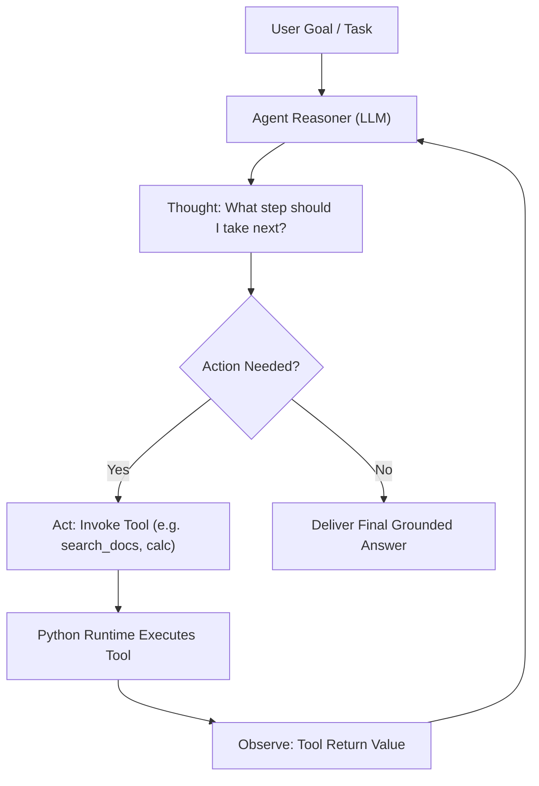

import { Callout } from "fumadocs-ui/components/callout";
import { Tabs, Tab } from "fumadocs-ui/components/tabs";
import { Accordion, Accordions } from "fumadocs-ui/components/accordion";

While RAG gives language models access to passive knowledge, **AI Agents** grant them agency: the ability to take actions, interact with external systems (APIs, databases, bash commands), inspect the results, and dynamically adjust their strategy.

---

## 1. The ReAct Architecture: Reason $\rightarrow$ Act $\rightarrow$ Observe

The foundational framework behind modern agents is **ReAct (Reasoning and Acting)**:



At each turn, the agent:

1. **Reasons** about its current state and what missing information it needs.
2. **Acts** by emitting a structured tool call.
3. **Observes** the output produced by the host Python runtime.
4. Repeats until the task is complete.

---

## 2. Converting Python Functions into Tool Schemas

To allow an LLM to call a Python function, the model needs to know:

- The function name.
- What it does (description).
- The parameter names, types, and descriptions.

In Python, we can generate this schema automatically using type hints and docstrings:

```python
import inspect
from typing import Any, Callable, Dict, get_type_hints

def get_tool_schema(func: Callable) -> Dict[str, Any]:
    """Generates an OpenAI/Gemini compatible tool definition from a Python function."""
    sig = inspect.signature(func)
    type_hints = get_type_hints(func)

    properties = {}
    required = []

    type_mapping = {
        str: "string",
        int: "integer",
        float: "number",
        bool: "boolean",
        list: "array",
        dict: "object"
    }

    for param_name, param in sig.parameters.items():
        param_type = type_hints.get(param_name, str)
        json_type = type_mapping.get(param_type, "string")

        properties[param_name] = {
            "type": json_type,
            "description": f"Parameter: {param_name}"
        }

        if param.default == inspect.Parameter.empty:
            required.append(param_name)

    return {
        "type": "function",
        "function": {
            "name": func.__name__,
            "description": func.__doc__.strip() if func.__doc__ else "",
            "parameters": {
                "type": "object",
                "properties": properties,
                "required": required
            }
        }
    }
```

---

## 3. Defining Real Python Tools

```python
import math

def calculate_expression(expression: str) -> str:
    """Evaluates a safe mathematical expression in Python."""
    allowed_names = {"sqrt": math.sqrt, "pi": math.pi, "sin": math.sin, "cos": math.cos}
    try:
        # Evaluates safely without builtins
        result = eval(expression, {"__builtins__": {}}, allowed_names)
        return str(result)
    except Exception as e:
        return f"Calculation error: {e}"

def search_weather(city: str) -> str:
    """Retrieves current simulated weather conditions for a given city."""
    weather_data = {
        "london": "14°C, Overcast with light drizzle",
        "tokyo": "22°C, Clear skies and sunny",
        "san francisco": "17°C, Morning coastal fog"
    }
    return weather_data.get(city.lower(), f"Weather data unavailable for '{city}'.")
```

---

## 4. Building the Agent Execution Loop

Here is a pure Python implementation of an agent execution controller:

```python
import json
from dataclasses import dataclass, field
from typing import Any, Callable, Dict, List

@dataclass
class AgentState:
    messages: List[Dict[str, Any]] = field(default_factory=list)
    max_steps: int = 6
    step_count: int = 0

class ToolRegistry:
    def __init__(self):
        self.tools: Dict[str, Callable] = {}
        self.schemas: List[Dict[str, Any]] = []

    def register(self, func: Callable):
        self.tools[func.__name__] = func
        self.schemas.append(get_tool_schema(func))

    def execute(self, name: str, arguments: Dict[str, Any]) -> str:
        if name not in self.tools:
            return f"Error: Tool '{name}' does not exist."
        try:
            result = self.tools[name](**arguments)
            return str(result)
        except Exception as e:
            return f"Error executing tool '{name}': {e}"

class AutonomousAgent:
    def __init__(self, registry: ToolRegistry):
        self.registry = registry

    def mock_llm_step(self, messages: List[Dict[str, Any]]) -> Dict[str, Any]:
        """
        Simulates an LLM step. In production, this calls:
        client.chat.completions.create(messages=messages, tools=self.registry.schemas)
        """
        last_message = messages[-1]

        # Simulated agent reasoning based on conversation state
        if "weather in Tokyo" in last_message.get("content", ""):
            return {
                "role": "assistant",
                "content": None,
                "tool_calls": [{
                    "id": "call_001",
                    "function": {"name": "search_weather", "arguments": json.dumps({"city": "Tokyo"})}
                }]
            }
        elif last_message.get("role") == "tool":
            return {
                "role": "assistant",
                "content": f"Based on the tool report: {last_message['content']}. Let me know if you need more details!",
                "tool_calls": None
            }
        else:
            return {
                "role": "assistant",
                "content": "I am ready to help you with research and calculations.",
                "tool_calls": None
            }

    def run(self, user_goal: str) -> str:
        state = AgentState()
        state.messages.append({"role": "user", "content": user_goal})

        print(f"\n[Agent Initialized] Goal: '{user_goal}'")

        while state.step_count < state.max_steps:
            state.step_count += 1
            print(f"\n--- Step {state.step_count} ---")

            # 1. Reason: Consult LLM
            response = self.mock_llm_step(state.messages)
            state.messages.append(response)

            # Check if LLM requested tool execution
            tool_calls = response.get("tool_calls")
            if not tool_calls:
                # LLM finished and produced final answer
                print(f"[Agent Final Answer]: {response['content']}")
                return response["content"]

            # 2. Act: Execute each requested tool
            for call in tool_calls:
                fn_name = call["function"]["name"]
                args = json.loads(call["function"]["arguments"])
                print(f"[Agent Action] Executing: {fn_name}({args})")

                # 3. Observe: Tool execution
                observation = self.registry.execute(fn_name, args)
                print(f"[Observation] -> {observation}")

                # Feed observation back into conversation state
                state.messages.append({
                    "role": "tool",
                    "tool_call_id": call["id"],
                    "name": fn_name,
                    "content": observation
                })

        return "Agent stopped: Reached maximum step limit without concluding."

# Demonstration
registry = ToolRegistry()
registry.register(search_weather)
registry.register(calculate_expression)

agent = AutonomousAgent(registry)
final_result = agent.run("What is the current weather in Tokyo?")
```

<Callout type="info" title="Safety & Guardrails">
  Always configure `max_steps` to protect against infinite loops, and sandbox
  tools that execute shell commands or code evaluation.
</Callout>

---

## Practice Questions & Challenges

Test your understanding of autonomous agent design, schema generation, and tool dispatch:

### Question 1: Output Prediction (Multi-Tool Dispatch Call Handling)

Consider an agent step where the LLM decides to call two tools in parallel in a single turn:

```python
tool_calls = [
    {"id": "call_1", "function": {"name": "add", "arguments": '{"a": 2, "b": 3}'}},
    {"id": "call_2", "function": {"name": "multiply", "arguments": '{"x": 4, "y": 5}'}}
]

def add(a, b): return a + b
def multiply(x, y): return x * y
tools = {"add": add, "multiply": multiply}

messages = []
for call in tool_calls:
    name = call["function"]["name"]
    fn = tools[name]
    import json
    args = json.loads(call["function"]["arguments"])
    res = fn(**args)
    messages.append({
        "role": "tool",
        "tool_call_id": call["id"],
        "name": name,
        "content": str(res)
    })

for m in messages:
    print(f"[{m['role']}] ID={m['tool_call_id']}, {m['name']} -> {m['content']}")
```

What is the printed output, and why must each tool response explicitly reference `tool_call_id`?

<Accordions>
<Accordion title="Solution & Breakdown">
**Output:**
```text
[tool] ID=call_1, add -> 5
[tool] ID=call_2, multiply -> 20
```

**Explanation:**
When modern LLMs emit parallel tool calls, they generate a unique identifier (e.g. `call_1`, `call_2`) for each invocation.
In the chat history, the assistant's turn contains a list of these calls. The API specification requires that each subsequent `tool` message includes the corresponding `tool_call_id` so the model's self-attention can deterministically map each observation back to the exact question/action it initiated!

</Accordion>
</Accordions>

---

### Question 2: Spot and Fix the Bug (Unsanitized Code Execution Injection)

The following agent has a Python REPL tool to execute math calculations, but a malicious or hallucinated prompt allows arbitrary filesystem deletion:

```python
def unsafe_python_calculator(code: str) -> str:
    # CRITICAL SECURITY VULNERABILITY:
    # eval/exec runs with full OS privileges!
    try:
        result = eval(code)
        return str(result)
    except Exception as e:
        return f"Error: {e}"

# Attack prompt or hallucination:
# code = "__import__('os').system('rm -rf /')"
```

Identify the vulnerability and demonstrate how to restrict execution using an Abstract Syntax Tree (AST) validator or `asteval` to only allow mathematical operations.

<Accordions>
<Accordion title="Solution & Breakdown">
**The Vulnerability:**
Python's `eval()` executes arbitrary Python code within the host process, permitting attackers to access builtins via `__import__('os')`, read environment variables, or delete files.

**The Fix (AST Whitelist):**
Use Python's native `ast` module to verify that the expression consists strictly of numbers and basic arithmetic operators before evaluating:

```python
import ast
import operator

SAFE_OPERATORS = {
    ast.Add: operator.add,
    ast.Sub: operator.sub,
    ast.Mult: operator.mul,
    ast.Div: operator.truediv,
    ast.Pow: operator.pow,
    ast.USub: operator.neg,
}

def safe_math_eval(node):
    if isinstance(node, ast.Constant) and isinstance(node.value, (int, float)):
        return node.value
    elif isinstance(node, ast.BinOp):
        op_type = type(node.op)
        if op_type not in SAFE_OPERATORS:
            raise ValueError(f"Unsupported operator: {op_type.__name__}")
        left = safe_math_eval(node.left)
        right = safe_math_eval(node.right)
        return SAFE_OPERATORS[op_type](left, right)
    elif isinstance(node, ast.UnaryOp):
        op_type = type(node.op)
        if op_type not in SAFE_OPERATORS:
            raise ValueError(f"Unsupported unary operator: {op_type.__name__}")
        return SAFE_OPERATORS[op_type](safe_math_eval(node.operand))
    else:
        raise ValueError(f"Disallowed expression syntax: {type(node).__name__}")

def safe_calculator(expr: str) -> str:
    try:
        tree = ast.parse(expr, mode='eval')
        val = safe_math_eval(tree.body)
        return str(val)
    except Exception as e:
        return f"Rejected for security: {e}"

# Verification
print(safe_calculator("2 + 3 * 4"))  # 14
print(safe_calculator("__import__('os').system('echo pwned')"))  # Rejected!
```

</Accordion>
</Accordions>

---

### Question 3: Architecture Deep-Dive (ReAct Loop vs Plan-and-Solve / Orchestrator-Workers)

When should an AI system use a single-threaded **ReAct loop** versus an **Orchestrator-Workers (Multi-Agent)** pattern? What are the latency and reliability trade-offs?

<Accordions>
<Accordion title="Solution & Breakdown">
**ReAct Pattern:**
- **How it works:** Single LLM loops sequentially: Think $\to$ Act $\to$ Observe $\to$ Think...
- **Best For:** Interactive tasks with unpredictable paths (e.g. debugging a server error, exploratory web browsing).
- **Trade-off:** High latency ($N$ sequential LLM calls). Risk of getting stuck in infinite loops or drifting off-topic as chat history grows.

**Orchestrator-Workers / Plan-and-Solve:**

- **How it works:** An Orchestrator model breaks the goal down into a formal Directed Acyclic Graph (DAG) of subtasks upfront, delegates each subtask to specialized parallel workers, and a synthesizer merges the findings.
- **Best For:** Large deterministic research jobs (e.g. "Research 5 competitors and write a comparison table").
- **Trade-off:** Parallel workers run concurrently (massively lower wall-clock latency), but cannot easily adjust the overall plan if an early assumption is disproven.
  </Accordion>
</Accordions>

---

### Question 4: Hands-On Challenge (Automatic Tool Schema Generator with Pydantic)

Write a decorator `@agent_tool` that inspects a Python function with docstrings and type hints, compiles it into a strict OpenAI-compatible JSON tool specification, and stores it in a `.schema` attribute on the function.

<Accordions>
<Accordion title="Solution & Breakdown">
```python
import inspect
from typing import get_type_hints, Callable

def agent_tool(func: Callable) -> Callable:
sig = inspect.signature(func)
hints = get_type_hints(func)
doc = inspect.getdoc(func) or "No description provided."

    type_map = {
        str: "string",
        int: "integer",
        float: "number",
        bool: "boolean",
        list: "array",
        dict: "object"
    }

    properties = {}
    required = []

    for name, param in sig.parameters.items():
        param_type = hints.get(name, str)
        json_type = type_map.get(param_type, "string")
        properties[name] = {
            "type": json_type,
            "description": f"Parameter: {name}"
        }
        if param.default is inspect.Parameter.empty:
            required.append(name)

    schema = {
        "type": "function",
        "function": {
            "name": func.__name__,
            "description": doc.split("\n")[0],
            "parameters": {
                "type": "object",
                "properties": properties,
                "required": required
            }
        }
    }
    func.schema = schema
    return func

# Verification

@agent_tool
def fetch_user_orders(user_id: str, limit: int = 10) -> list:
"""Fetch recent orders for a customer."""
return []

import json
print(json.dumps(fetch_user_orders.schema, indent=2))
```
</Accordion>
</Accordions>

---

### Question 5: Code Challenge (Resilient ReAct Agent with Loop Detection)

Build an `AgentLoop` runner that:

1. Tracks previous tool calls and argument combinations.
2. **Loop Detection**: If the agent attempts to call the exact same tool with the exact same arguments 3 times in a row, intervenes with a system warning message instructing the model to try an alternate approach.
3. Automatically enforces `max_iterations = 6`.

**Test cases:**

```python
agent = AgentLoop(tools=[search_web])
# If search_web("python news") is invoked 3 consecutive times,
# next turn forces a reflection warning rather than executing the duplicate call.
```

<Accordions>
<Accordion title="Solution & Breakdown">
```python
from dataclasses import dataclass
from typing import Callable, Dict, List
import json

class AgentLoop:
def **init**(self, tools: Dict[str, Callable], max_iterations: int = 6):
self.tools = tools
self.max_iterations = max_iterations
self.call_history: List[str] = []

    def _detect_loop(self, call_signature: str) -> bool:
        self.call_history.append(call_signature)
        if len(self.call_history) >= 3:
            # Check if last 3 calls are identical
            if self.call_history[-1] == self.call_history[-2] == self.call_history[-3]:
                return True
        return False

    def execute_turn(self, tool_name: str, args: dict) -> str:
        sig = f"{tool_name}:{json.dumps(args, sort_keys=True)}"

        if self._detect_loop(sig):
            return (
                "SYSTEM INTERVENTION: Loop detected! You have executed this identical "
                "action 3 times without making progress. Do NOT repeat this call. "
                "Synthesize a final response with your current knowledge or use an alternative tool."
            )

        if tool_name not in self.tools:
            return f"Error: Tool '{tool_name}' does not exist."

        try:
            result = self.tools[tool_name](**args)
            return str(result)
        except Exception as e:
            return f"Execution error in {tool_name}: {e}"

# Verification

def mock_search(query: str):
return "No new articles found."

runner = AgentLoop(tools={"search": mock_search})

for i in range(4):
obs = runner.execute_turn("search", {"query": "python 3.14"})
print(f"Turn {i + 1} Output:\n-> {obs}\n")

```
</Accordion>
</Accordions>
```
