import { Callout } from "fumadocs-ui/components/callout";
import { Tabs, Tab } from "fumadocs-ui/components/tabs";
import { Steps, Step } from "fumadocs-ui/components/steps";
import { Cards, Card } from "fumadocs-ui/components/card";

## The Semantic Foundation: Commands, Events & Queries

At the core of distributed systems engineering lies the discipline of **Command-Query Separation (CQS)**, first formulated by Bertrand Meyer and expanded in distributed systems by Greg Young and Martin Fowler. Misunderstanding the semantic boundaries between commands, queries, and events is the single most common cause of distributed architectural decay.

```mermaid
flowchart TD
    subgraph Triad["The Communication Triad"]
        direction TB
        C["Command<br/><i>'Do this'</i><br/>Intent · Can be rejected · Imperative"]
        Q["Query<br/><i>'Tell me this'</i><br/>Idempotent · Zero side-effects · Interrogative"]
        E["Event<br/><i>'This happened'</i><br/>Fact · Immutable · Past Tense"]
    end

    style C fill:#1e1e2e,stroke:#f38ba8,stroke-width:2px
    style Q fill:#1e1e2e,stroke:#89b4fa,stroke-width:2px
    style E fill:#1e1e2e,stroke:#a6e3a1,stroke-width:2px
    style Triad fill:#181825,stroke:#45475a,stroke-width:1px
```

### 1. Commands: Imperative Intent

A **Command** is a request for an action to be performed in the future.

- **Semantics**: Expressed in the **imperative mood** (`BookFlightSeat`, `ChargeCreditCard`, `TranscodeVideo`).
- **Targeting**: Directed to a **single, specific handler** (e.g., the `PaymentService`).
- **Authority**: The recipient retains full authority to **reject or accept** the command based on domain invariants (e.g., rejecting a booking if seats are sold out, or payment if funds are insufficient).
- **Side Effects**: Expected to mutate system state.

### 2. Queries: Side-Effect-Free Retrieval

A **Query** is an inquiry for state without intent to mutate.

- **Semantics**: Interrogative (`GetPassengerManifest`, `FetchVideoMetadata`).
- **Safety**: Strictly idempotent and read-only.
- **Coupling**: The caller expects a synchronous or near-instantaneous return of data.

### 3. Events: Immutable Statements of Fact

An **Event** is a record of something significant that has already occurred in the domain.

- **Semantics**: Expressed strictly in the **past tense** (`FlightBooked`, `PaymentCaptured`, `VideoUploaded`).
- **Targeting**: Broadcast without expectations; the producer does not know, nor care, whether 0 or 100 consumers are listening.
- **Authority**: **Cannot be rejected or vetoed**. Because it records a historical fact that already happened, a downstream service cannot say _"No, that didn't happen"_. It can only execute compensatory actions if necessary.
- **Immutability**: Once recorded, an event is permanent.

---

### The Antipattern: Fowler's "Passive-Aggressive Command"

A frequent architectural failure occurs when a software engineer wraps an imperative command inside an event envelope to claim their system is "event-driven". Martin Fowler termed this the **passive-aggressive event**.

```mermaid
flowchart LR
    subgraph Antipattern["Anti-Pattern: Passive-Aggressive Command"]
        direction TB
        P1["Upload Service"] -->|"Emits: SendUserWelcomeEmail<br/>(Tells consumer what to do!)"| C1["Email Worker"]
        Note1["High semantic coupling!<br/>Producer dictates consumer behavior."]
    end

    subgraph TrueEDA["True Event-Driven Decoupling"]
        direction TB
        P2["Upload Service"] -->|"Emits: VideoUploaded<br/>(States an objective domain fact)"| Broker{{"Event Broker"}}
        Broker -->|"Subscribed"| C2["Email Worker (Sends email)"]
        Broker -->|"Subscribed"| C3["Analytics Engine (Increments count)"]
        Broker -->|"Subscribed"| C4["Recommendation (Updates vector)"]
        Note2["Zero coupling!<br/>New consumers attach without producer changes."]
    end

    style Antipattern fill:#1e1e2e,stroke:#f38ba8,stroke-width:1px
    style TrueEDA fill:#1e1e2e,stroke:#a6e3a1,stroke-width:1px
```

<Callout
  type="warning"
  title="Spotting Passive-Aggressive Events in Code Reviews"
>
  If an event is named after what the consumer should do rather than what the
  producer did, it is a disguised command: - ❌ `SendPushNotificationRequested`
  (Command masquerading as an event) - ❌ `ResizeThumbnailCommandEvent`
  (Producer dictating consumer logic) - ✅ `FlightDelayed` (True event:
  Notification, rebooking, and catering services react independently) - ✅
  `VideoUploaded` (True event: Transcoders, thumbnailers, and search indexers
  react independently)
</Callout>

---

## The 2x2 Delivery vs. Purpose Matrix

Systems are often mischaracterized as either "synchronous" or "event-driven". In reality, distributed messaging spans a two-dimensional matrix of **Delivery Mode** (Synchronous vs. Asynchronous) and **Semantic Intent** (Command vs. Event).

```mermaid
flowchart TD
    subgraph Matrix["The 2x2 Delivery vs. Purpose Matrix"]
        direction TB
        subgraph SyncCol["Synchronous Delivery (Blocking I/O)"]
            direction TB
            Q1["<b>Quadrant 1: Synchronous Command</b><br/>• REST HTTP POST /bookings<br/>• gRPC ReserveSeat()<br/>• High temporal & spatial coupling"]
            Q3["<b>Quadrant 3: Synchronous Event</b><br/>• Node.js EventEmitter.emit()<br/>• Spring ApplicationEvent<br/>• Decoupled logic, shared thread/stack"]
        end

        subgraph AsyncCol["Asynchronous Delivery (Decoupled Buffering)"]
            direction TB
            Q2["<b>Quadrant 2: Asynchronous Command</b><br/>• Celery Task Queues<br/>• RabbitMQ Direct Queues<br/>• AWS SQS Point-to-Point"]
            Q4["<b>Quadrant 4: Distributed Event-Driven</b><br/>• Apache Kafka Topics<br/>• AWS EventBridge / SNS<br/>• Total spatial & temporal decoupling"]
        end
    end

    style Q1 fill:#1e1e2e,stroke:#f38ba8,stroke-width:2px
    style Q2 fill:#1e1e2e,stroke:#fab387,stroke-width:2px
    style Q3 fill:#1e1e2e,stroke:#89b4fa,stroke-width:2px
    style Q4 fill:#1e1e2e,stroke:#a6e3a1,stroke-width:2px
    style SyncCol fill:#181825,stroke:#45475a,stroke-width:1px
    style AsyncCol fill:#181825,stroke:#45475a,stroke-width:1px
    style Matrix fill:#11111b,stroke:#585b70,stroke-width:2px
```

### Detailed Breakdown of the Four Quadrants

#### Quadrant 1: Synchronous Command (REST / gRPC)

- **Mechanism**: Client issues an HTTP `POST /api/v1/bookings` or gRPC `ReserveSeat()` call and blocks the calling thread awaiting an immediate response.
- **Trade-off**: Low complexity and immediate error feedback, but introduces extreme temporal coupling and latency accumulation.

#### Quadrant 2: Asynchronous Command (Task Queues / Celery / SQS)

- **Mechanism**: Client enqueues an imperative payload (`TranscodeVideoTask`) to a point-to-point queue (e.g., Amazon SQS, Celery with Redis, or RabbitMQ Direct Exchange).
- **Trade-off**: Decoupled in time (the producer does not wait for transcoding to complete), but **semantically coupled**: the message has an intended destination worker pool and will be processed by exactly one consumer.

#### Quadrant 3: Synchronous Event (In-Process Observer Pattern)

- **Mechanism**: An application service calls `eventEmitter.emit('userRegistered', user)` or Spring's `applicationEventPublisher.publishEvent(event)`.
- **Trade-off**: The event is decoupled from downstream consumers in code architecture, but **coupled at runtime**: the consumers execute on the producer's call stack. An unhandled exception in an event listener can roll back the producer's database transaction or crash the process!

#### Quadrant 4: Asynchronous Event (Distributed Event Broker)

- **Mechanism**: The producer publishes `FlightBooked` to an append-only distributed log (Kafka, Pulsar) or pub/sub exchange.
- **Trade-off**: Maximum decoupling across space, time, and failure domains. The producer has no awareness of downstream consumers, and consumers process messages at their own rate.

---

## Event Flavors: Notification vs. ECST vs. Domain Events

Not all events carry the same data density. In distributed software engineering, events fall into three primary architectural patterns:

```mermaid
flowchart TD
    subgraph Thin["1. Event Notification (Thin Ping)"]
        direction TB
        E1["{ videoId: 'video_123', event: 'UPLOADED' }"]
        C1["Consumer"] -->|"1. Reads event"| E1
        C1 -->|"2. Synchronous GET /videos/video_123"| API["Upload Service API"]
        Note1["High coupling back to source!<br/>Risk of stampeding herd."]
    end

    subgraph ECST["2. Event-Carried State Transfer (Fat Event)"]
        direction TB
        E2["{ videoId: 'video_123', title: '...', rawUrl: '...', user: {...}, codecs: [...] }"]
        C2["Consumer"] -->|"1. Reads complete payload"| E2
        C2 -->|"2. Stores local copy in its DB"| LocalDB[("Consumer Local DB")]
        Note2["Zero callback queries!<br/>Higher payload size & PII governance."]
    end

    subgraph DomainEv["3. Domain Event (State Delta)"]
        direction TB
        E3["{ bookingId: 'bk_99', seatFrom: '14B', seatTo: '3A', fareDelta: 15000 }"]
        C3["Consumer"] -->|"1. Applies business transition"| E3
        Note3["Captures domain intent & deltas.<br/>Ideal for Event Sourcing & Audits."]
    end

    style Thin fill:#1e1e2e,stroke:#f38ba8,stroke-width:1px
    style ECST fill:#1e1e2e,stroke:#89b4fa,stroke-width:1px
    style DomainEv fill:#1e1e2e,stroke:#a6e3a1,stroke-width:1px
```

### 1. Event Notification (The Thin Ping)

The event contains only the identifier of the entity and a timestamp. It serves merely as a signal that state changed.

- **Payload**: Minimalist (`{ "flightId": "TB-402", "status": "BOARDING" }`).
- **Downstream Behavior**: Consumers must issue a synchronous query back to the producer's API to fetch the latest state.
- **The Stampeding Herd Problem**: If TravelBuddy broadcasts a thin ping for flight `TB-402` to 40 downstream microservices, all 40 services simultaneously query the `Flight Service` API, creating a catastrophic internal Denial-of-Service (DoS) spike.

### 2. Event-Carried State Transfer (ECST / Fat Events)

The event contains both the identifier and the **complete state snapshot** required by downstream consumers to execute their business logic without querying the producer.

- **Payload**: Comprehensive snapshot of the entity at that instant.
- **Downstream Behavior**: Consumers consume the payload and update their own local read-optimized data stores.
- **Architectural Trade-off**: Eliminates query stampedes and enables full offline operation, but increases network bandwidth and complicates PII compliance (e.g., GDPR "Right to be Forgotten" across distributed event logs).

### 3. Domain Events

Domain Events originate directly from Domain-Driven Design (DDD). Rather than broadcasting full snapshots, they capture the **exact transition and the business delta**.

- **Payload**: Specific to the business action (`{ "passengerId": "p_88", "oldTier": "SILVER", "newTier": "GOLD", "qualifyingMiles": 50400 }`).
- **Downstream Behavior**: Consumers apply the delta directly to their projection models.

### Comprehensive Comparison Matrix

| Evaluation Dimension        | Event Notification (Thin)                   | Event-Carried State Transfer (Fat)           | Domain Event (Delta)                          |
| :-------------------------- | :------------------------------------------ | :------------------------------------------- | :-------------------------------------------- |
| **Payload Size**            | Minimal ($\approx 100 \text{ bytes}$)       | Large ($1 \text{ KB} - 100 \text{ KB}$)      | Moderate ($500 \text{ bytes} - 5 \text{ KB}$) |
| **Downstream Coupling**     | **High**: Consumers must query producer API | **Zero**: Completely self-contained          | **Zero**: Self-contained business transition  |
| **Network Traffic**         | High downstream query amplification ($N+1$) | Moderate broker payload volume               | Low, efficient broker payload volume          |
| **Temporal Independence**   | Weak: Producer API must be online           | Total: Consumer operates 100% offline        | Total: Consumer operates 100% offline         |
| **Staleness Handling**      | Pulls latest state; immune to lag           | Susceptible to out-of-order race conditions  | Preserves exact business causal sequence      |
| **Security & PII Exposure** | Minimal: ACLs enforced at producer API      | High: Sensitive data copied to multiple logs | Moderate: Scoped strictly to business delta   |

### Payload Structures in Production

<Tabs items={["Event Notification", "Event-Carried State Transfer", "Domain Event"]}>
  <Tab value="Event Notification">
```json
{
  "specversion": "1.0",
  "id": "evt_notif_982341",
  "source": "/travelbuddy/flight-ops",
  "type": "com.travelbuddy.flights.gate-changed",
  "time": "2026-11-02T16:20:00Z",
  "data": {
    "flightId": "TB-402",
    "airlineCode": "TB",
    "updatedAt": "2026-11-02T16:19:58Z"
  }
}
```
*Note: Any consumer wanting to know the new gate must call `GET /api/v1/flights/TB-402`.*
  </Tab>

  <Tab value="Event-Carried State Transfer">
```json
{
  "specversion": "1.0",
  "id": "evt_ecst_440192",
  "source": "/travelbuddy/booking-service",
  "type": "com.travelbuddy.reservations.ticket-issued",
  "time": "2026-11-02T16:20:00Z",
  "data": {
    "ticketNumber": "016-9928172635",
    "bookingReference": "TB-K9X2P",
    "passenger": {
      "id": "usr_9410",
      "firstName": "Elena",
      "lastName": "Rostova",
      "email": "elena.rostova@example.com",
      "frequentFlyerNumber": "TB-FF-88219"
    },
    "flightDetails": {
      "flightNumber": "TB-402",
      "origin": "JFK",
      "destination": "LHR",
      "departureTime": "2026-11-15T21:00:00Z",
      "seat": "14B",
      "cabinClass": "PREMIUM_ECONOMY"
    },
    "payment": {
      "amountInCents": 125000,
      "currency": "USD",
      "paymentMethod": "CARD",
      "transactionReference": "tx_ch_991823"
    }
  }
}
```
*Note: Downstream services (Email, Passbook, Luggage, Analytics) have 100% of the data needed to perform their tasks.*
  </Tab>

  <Tab value="Domain Event">
```json
{
  "specversion": "1.0",
  "id": "evt_dom_771829",
  "source": "/travelbuddy/inventory-service",
  "type": "com.travelbuddy.seat.reassigned",
  "time": "2026-11-02T16:20:00Z",
  "data": {
    "bookingReference": "TB-K9X2P",
    "flightNumber": "TB-402",
    "previousSeat": "14B",
    "newSeat": "3A",
    "previousClass": "PREMIUM_ECONOMY",
    "newClass": "BUSINESS",
    "upgradeReasonCode": "OPERATIONAL_CABIN_BALANCING",
    "fareDeltaCents": 0,
    "authorizedByStaffId": "agent_jfk_441"
  }
}
```
*Note: Records the discrete state transition delta for accounting, catering, and seat map re-indexing.*
  </Tab>
</Tabs>

---

## Event Anatomy & The CloudEvents v1.0 Specification

Without an industry standard, every engineering team invents its own proprietary envelope format. Team A wraps data in `{ "meta": { ... }, "payload": { ... } }`, while Team B uses `{ "header": { ... }, "body": { ... } }`.

To establish cross-platform interoperability, the Cloud Native Computing Foundation (CNCF) established the **CloudEvents v1.0 Specification**.

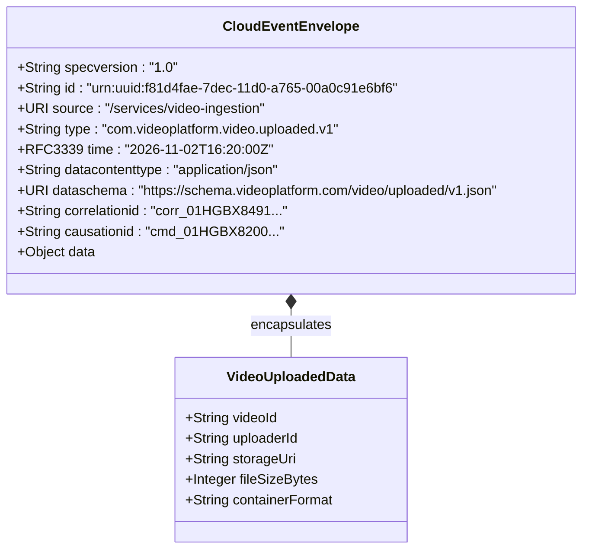

### Required CloudEvents Attributes

1. `specversion`: The version of the CloudEvents specification (e.g., `"1.0"`).
2. `id`: Identifier for the event. In combination with `source`, this pair **MUST be unique globally**. Used by consumers for idempotency deduplication.
3. `source`: Identifies the context in which an event happened (URI format). Enables routing engines to filter by producer system.
4. `type`: A human-readable and machine-parseable string describing the event kind, typically organized in reverse-DNS format (`com.travelbuddy.booking.confirmed`).

### Optional but Mission-Critical Attributes

- `time`: RFC 3339 UTC timestamp of when the occurrence happened (`2026-11-02T16:20:00Z`).
- `datacontenttype`: Content type of the `data` attribute (e.g., `application/json`, `application/avro`).
- `dataschema`: URI pointing to the schema definition validating the payload.
- `data`: The domain-specific event payload.

---

### Distributed Tracing: Correlation ID vs. Causation ID

In complex event-driven topologies, a single initial action can trigger a cascade of hundreds of asynchronous downstream events across dozens of worker clusters. Debugging production incidents requires two distinct tracing identifiers:

```mermaid
flowchart TD
    subgraph TraceTree["Causation vs. Correlation Tree"]
        direction TB
        C0["1. User Request (HTTP POST /checkout)<br/><b>correlationId:</b> 'trace_root_889'<br/><b>causationId:</b> 'req_001'"]

        E1["2. Event: PaymentCaptured<br/><b>correlationId:</b> 'trace_root_889'<br/><b>causationId:</b> 'req_001'"]

        E2["3. Event: FlightSeatAssigned<br/><b>correlationId:</b> 'trace_root_889'<br/><b>causationId:</b> 'evt_PaymentCaptured_889'"]

        E3["4. Event: BoardingPassRendered<br/><b>correlationId:</b> 'trace_root_889'<br/><b>causationId:</b> 'evt_FlightSeatAssigned_889'"]

        E4["5. Event: WelcomeSmsDispatched<br/><b>correlationId:</b> 'trace_root_889'<br/><b>causationId:</b> 'evt_FlightSeatAssigned_889'"]

        C0 -->|"Triggers"| E1
        E1 -->|"Triggers"| E2
        E2 -->|"Triggers"| E3
        E2 -->|"Triggers"| E4
    end

    style C0 fill:#1e1e2e,stroke:#89b4fa,stroke-width:2px
    style E1 fill:#1e1e2e,stroke:#f9e2af,stroke-width:1px
    style E2 fill:#1e1e2e,stroke:#a6e3a1,stroke-width:1px
    style E3 fill:#1e1e2e,stroke:#cba6f7,stroke-width:1px
    style E4 fill:#1e1e2e,stroke:#fab387,stroke-width:1px
```

<Callout type="info" title="The Fundamental Distinction">
  - **`correlationId`**: Answers *"Which global business transaction does this
  event belong to?"* It is minted once at the initial system ingress (API
  Gateway or client HTTP request) and propagated unchanged across every
  downstream event, message, queue, and log. - **`causationId`**: Answers *"What
  direct parent message or event immediately caused this specific event to
  occur?"* It is set to the `id` of the message that the current service was
  processing when it emitted this new event.
</Callout>

---

## Schema Governance & Serialization Protocols

In synchronous microservices, if an API changes an endpoint contract, client compilation or integration tests immediately fail.

In asynchronous systems, producers and consumers are deployed independently. If a producer removes or renames a field in a JSON payload, downstream consumers may fail silently, or throw unhandled null-pointer exceptions hours later when processing historical events.

### Serialization Format Comparison

```mermaid
flowchart LR
    subgraph Formats["Serialization Contenders"]
        direction TB
        F_JSON["<b>JSON</b><br/>Human-Readable Text<br/>Schema Optional<br/>High Bandwidth Overhead"]
        F_AVRO["<b>Apache Avro</b><br/>Binary Compact<br/>Schema Required via Registry<br/>Dynamic Resolution"]
        F_PROTO["<b>Protocol Buffers</b><br/>Binary Compact<br/>Field Tags / Code Gen<br/>Strict Static Typing"]
    end

    style F_JSON fill:#1e1e2e,stroke:#f38ba8,stroke-width:1px
    style F_AVRO fill:#1e1e2e,stroke:#a6e3a1,stroke-width:2px
    style F_PROTO fill:#1e1e2e,stroke:#89b4fa,stroke-width:2px
```

| Dimension                    | JSON                                      | Apache Avro                                          | Protocol Buffers (Protobuf)                          |
| :--------------------------- | :---------------------------------------- | :--------------------------------------------------- | :--------------------------------------------------- |
| **Payload Representation**   | UTF-8 Text                                | Compact Binary                                       | Compact Binary (Varints/Tags)                        |
| **Schema Distribution**      | Self-describing keys repeated per message | External Schema Registry                             | Pre-compiled code artifacts (`.proto`)               |
| **Relative Size**            | $100\%$ (Baseline: e.g., 850 bytes)       | $\approx \mathbf{15\% - 25\%}$ ($\approx 150$ bytes) | $\approx \mathbf{20\% - 30\%}$ ($\approx 180$ bytes) |
| **Serialization Throughput** | Slow (string parsing & CPU overhead)      | Extremely fast binary encoder                        | Extremely fast native C++/Rust codegen               |
| **Evolution Engine**         | Manual validation / JSON Schema           | First-class Schema Registry rules                    | Field tag numbers (1, 2, 3...)                       |

---

### Schema Compatibility Evolution Rules

When publishing events to shared topics, schema changes must conform to explicit mathematical compatibility rules enforced by a **Schema Registry** (e.g., Confluent Schema Registry or Apicurio):

```mermaid
flowchart TD
    subgraph Compatibility["Compatibility Paradigms"]
        direction TB
        B["<b>BACKWARD</b><br/>Consumers upgrade first.<br/>New schema can read data written by old schema.<br/>Rule: Can only delete optional fields or add fields with defaults."]
        F["<b>FORWARD</b><br/>Producers upgrade first.<br/>Old schema can read data written by new schema.<br/>Rule: Can only add optional fields or delete fields with defaults."]
        FULL["<b>FULL (Transitive)</b><br/>Producers & Consumers upgrade in any order.<br/>Both backward and forward compatible across all versions.<br/>Rule: Can only add or remove optional fields with defaults."]
    end

    style B fill:#1e1e2e,stroke:#89b4fa,stroke-width:1px
    style F fill:#1e1e2e,stroke:#f9e2af,stroke-width:1px
    style FULL fill:#1e1e2e,stroke:#a6e3a1,stroke-width:2px
```

1. **BACKWARD Compatibility**:
   - Upgraded consumers can read records written by older producers.
   - **Rollout order**: Deploy consumers first, then deploy producers.
   - **Allowed changes**: Delete a field that had a default value, or add an optional field.
2. **FORWARD Compatibility**:
   - Older consumers can read records written by upgraded producers.
   - **Rollout order**: Deploy producers first, then deploy consumers.
   - **Allowed changes**: Add a field that has a default value, or delete an optional field.
3. **FULL Compatibility (Production Gold Standard)**:
   - Schemas are simultaneously backward and forward compatible.
   - Producers and consumers can be upgraded completely independently without coordination.

---

### Confluent Schema Registry Wire Format

When sending high-throughput binary messages via Apache Avro or Protobuf, embedding the entire schema definition inside every single message would balloon bandwidth overhead.

The Confluent Schema Registry solves this with an optimized **5-byte wire prefix**:

```mermaid
flowchart LR
    subgraph WireFormat["Confluent Schema Registry Wire Format (5-Byte Prefix + Payload)"]
        direction LR
        B0["Byte 0<br/><b>Magic Byte</b><br/><code>0x00</code>"]
        B1["Bytes 1 - 4<br/><b>Schema ID</b><br/><code>32-bit Big-Endian Int</code>"]
        B2["Bytes 5 ... N<br/><b>Binary Payload</b><br/><code>Avro / Protobuf Bytes</code>"]

        B0 --> B1 --> B2
    end

    style B0 fill:#1e1e2e,stroke:#f38ba8,stroke-width:2px
    style B1 fill:#1e1e2e,stroke:#89b4fa,stroke-width:2px
    style B2 fill:#1e1e2e,stroke:#a6e3a1,stroke-width:2px
    style WireFormat fill:#181825,stroke:#45475a,stroke-width:1px
```

```
+----------------+-------------------------------+-----------------------------------+
| Byte 0         | Bytes 1-4                     | Bytes 5...N                       |
+----------------+-------------------------------+-----------------------------------+
| 0x00           | Schema ID (e.g., 0x0000002A)  | Serialized Binary Avro/Proto Data |
| (Magic Marker) | (Big-Endian integer = ID 42)  | (Zero field names, zero overhead) |
+----------------+-------------------------------+-----------------------------------+
```

#### The Consumer Deserialization Flow

<Steps>
  <Step>
    ### Intercept Binary Packet
    The consumer reads raw bytes from Kafka partition. It checks byte 0; if it equals `0x00`, it knows the payload uses Schema Registry wire format.
  </Step>

<Step>
  ### Extract 4-Byte Schema ID It reads bytes 1 through 4 and parses the
  big-endian integer (e.g., Schema ID `42`).
</Step>

<Step>
  ### Cache Lookup / Fetch Schema The consumer checks its local in-memory LRU
  schema cache. If Schema `42` is not cached, it calls `GET /schemas/ids/42` on
  the Schema Registry HTTP API once and caches the schema definition
  permanently.
</Step>

  <Step>
    ### Fast Binary Deserialization
    The consumer deserializes the remaining payload bytes (starting from byte 5) directly into native objects using the resolved schema.
  </Step>
</Steps>

---

## Distributed Interaction Models

How messages flow from producers to consumers dictates scalability and operational guarantees:

```mermaid
flowchart TD
    subgraph P2P["1. Point-to-Point (Competing Consumers)"]
        direction LR
        P_P2P["Producer"] --> Q["Work Queue"]
        Q --> W1["Worker 1 (Processes Task 1)"]
        Q --> W2["Worker 2 (Processes Task 2)"]
        Note_P2P["Each message consumed by exactly ONE worker.<br/>Load is distributed evenly."]
    end

    subgraph PubSub["2. Publish-Subscribe (Broadcast)"]
        direction LR
        P_PS["Producer"] --> T["Topic"]
        T --> S1["Subscriber A (Billing)"]
        T --> S2["Subscriber B (Analytics)"]
        Note_PS["Every subscriber receives an identical copy of the message.<br/>Fan-out architecture."]
    end

    subgraph CG["3. Consumer Groups (The Hybrid Model)"]
        direction LR
        P_CG["Producer"] --> KP["Partitioned Topic"]
        KP -.->|"Fan-Out"| CGA["Group A (Billing Workers)"]
        KP -.->|"Fan-Out"| CGB["Group B (Notification Workers)"]
        subgraph GroupA["Group A Workers"]
            CGA --> GA1["Worker A1 (Partitions 0, 1)"]
            CGA --> GA2["Worker A2 (Partition 2)"]
        end
        Note_CG["Pub/Sub across groups;<br/>Competing consumers within each group!"]
    end

    style P2P fill:#1e1e2e,stroke:#f9e2af,stroke-width:1px
    style PubSub fill:#1e1e2e,stroke:#89b4fa,stroke-width:1px
    style CG fill:#1e1e2e,stroke:#a6e3a1,stroke-width:2px
```

1. **Competing Consumers (Work Queue)**: Multiple instances of a service listen to a single queue. Each message is delivered to exactly one worker. Ideal for distributing expensive tasks (e.g., video rendering jobs).
2. **Publish-Subscribe (Pub/Sub)**: Messages are broadcast to a topic. Every subscribed service receives a full copy. Ideal for cross-boundary domain announcements (e.g., `OrderPlaced`).
3. **Consumer Groups (Kafka Hybrid Model)**: Provides the best of both worlds. Across different consumer groups, the topic acts as **Pub/Sub** (both Billing and Analytics receive the event). Within a single consumer group, multiple worker instances act as **Competing Consumers**, each reading exclusive partitions to achieve parallel processing without data races.

---

## Broker Architectures: Ephemeral Queues vs. Append-Only Logs

The distributed messaging ecosystem is fundamentally split into two competing broker philosophies: **Ephemeral Queue Brokers** (e.g., RabbitMQ, ActiveMQ, SQS) and **Append-Only Commit Logs** (e.g., Apache Kafka, Apache Pulsar, Redpanda).

```mermaid
flowchart TD
    subgraph RabbitArch["Traditional Broker: RabbitMQ (AMQP)"]
        direction TB
        R_Prod["Producer"] --> R_Ex["Exchange (Topic / Direct)"]
        R_Ex -->|"Binding Key"| R_Q1["Queue 1 (Memory)"]
        R_Ex -->|"Binding Key"| R_Q2["Queue 2 (Memory)"]
        R_Q1 -->|"Push & ACK"| R_C1["Consumer 1"]
        Note_R["Broker tracks delivery state per message.<br/>Message DELETED once ACKed.<br/>Destructive read; zero replayability!"]
    end

    subgraph KafkaArch["Log-Based Broker: Apache Kafka"]
        direction TB
        K_Prod["Producer"] -->|"Hash(Key) % NumPartitions"| K_Part["Partition 0 (On-Disk Commit Log)"]
        K_Part -->|"Offset 0"| M0["Msg 0"]
        K_Part -->|"Offset 1"| M1["Msg 1"]
        K_Part -->|"Offset 2"| M2["Msg 2"]
        K_Part -->|"Offset 3"| M3["Msg 3"]
        C_G1["Consumer A (Offset: 2)"] -.-> M1
        C_G2["Consumer B (Offset: 4)"] -.-> M3
        Note_K["Broker is dumb; consumer is smart.<br/>Messages immutable on disk for N days.<br/>Non-destructive read; rewind & replay!"]
    end

    style RabbitArch fill:#1e1e2e,stroke:#fab387,stroke-width:1px
    style KafkaArch fill:#1e1e2e,stroke:#a6e3a1,stroke-width:2px
```

### 1. Ephemeral Queue Brokers (RabbitMQ / AMQP)

- **Storage Model**: Messages reside primarily in RAM. They are placed in queues and routed via exchanges (Direct, Fanout, Topic, Headers).
- **Consumption Lifecycle**: **Destructive Read**. The broker tracks the state of every individual message for every consumer. Once a worker acknowledges (`ACK`) a message, the broker removes it from storage.
- **Backpressure**: The broker monitors queue memory depth. If consumers slow down, RAM fills up, causing the broker to throttle publishers and page messages to disk, which severely degrades throughput.
- **Ideal Use Case**: Complex routing keys, priority queues, individual message acknowledgement deadlines, and transactional task dispatching.

---

### 2. Append-Only Commit Logs (Apache Kafka)

- **Storage Model**: Messages are sequentially appended to an immutable, on-disk commit log segmented into partitions.
- **Consumption Lifecycle**: **Non-Destructive Read**. Reading a message does not delete it. Messages persist according to retention policies (e.g., 7 days or 500 GB).
- **Consumer State Tracking**: The broker does not track per-message ACK states. A consumer tracks only a single scalar integer: its current **Offset** in the partition.
- **Zero-Copy Performance**: Kafka bypasses user-space memory buffers by utilizing the Linux kernel `sendfile()` system call. Bytes are transferred directly from the OS Page Cache to the network socket descriptor without CPU memory copies.
- **Replayability**: If a bug is deployed to production, engineers can fix the bug, reset consumer group offsets back to midnight, and replay all events deterministically.

---

### Architectural Decision Matrix: RabbitMQ vs. Apache Kafka

| Dimension                 | Ephemeral Queues (RabbitMQ)                          | Append-Only Commit Logs (Kafka)                     |
| :------------------------ | :--------------------------------------------------- | :-------------------------------------------------- |
| **Primary Philosophy**    | "Smart broker, dumb consumer"                        | "Dumb broker, smart consumer"                       |
| **Message Ordering**      | FIFO per queue, but disrupted by concurrency & NACKs | **Strict total order** within each partition        |
| **Delivery Model**        | Push (Broker pushes to consumer)                     | Pull (Consumer polls broker at its own pace)        |
| **Throughput Ceiling**    | Tens of thousands of msgs/sec                        | Millions of msgs/sec per cluster node               |
| **Retention & Replay**    | No (messages deleted immediately upon ACK)           | Yes (time- or size-based retention; full rewind)    |
| **Routing Flexibility**   | Extreme (wildcards, regex, header-based matching)    | Simple (publish to named topic; partition by key)   |
| **Backpressure Behavior** | Broker memory exhaustion risks                       | Total decoupling; consumer lag does not slow broker |
| **Scaling Mechanism**     | Vertical / clustering with Mirrored Queues / Quorum  | Horizontal partitioning across distributed brokers  |

---

## Engineering Synthesis: Selecting Your Messaging Architecture

When architecting a production system, evaluate your requirements against these structural criteria:

<Callout type="info" title="The Rule of Thumb for Technology Selection">
  - Choose an **Ephemeral Queue Broker (RabbitMQ / AWS SQS)** when you have
  discrete tasks requiring complex routing, per-message timeouts, priority
  queues, and where individual task states are independently acknowledged and
  discarded. - Choose an **Append-Only Commit Log (Apache Kafka / Redpanda)**
  when you require massive throughput, high consumer fan-out, event
  replayability, strict per-key ordering, or event sourcing architectures.
</Callout>

In the next module, **[02: Delivery Guarantees & Idempotent Consumers](/docs/system-design/07-event-driven-architecture/02-delivery-guarantees-and-idempotent-consumers)**, we explore how distributed networks introduce message duplicates and reorderings, and how to construct bulletproof idempotent consumers.
