import { Callout } from "fumadocs-ui/components/callout";
import { Tabs, Tab } from "fumadocs-ui/components/tabs";
import { Steps, Step } from "fumadocs-ui/components/steps";
import { Cards, Card } from "fumadocs-ui/components/card";

## The TravelBuddy Narrative: The \$12,600 Ski Trip Glitch

On Black Friday at 09:14:22 UTC, Liam booked a luxury holiday ski package to Zermatt through **TravelBuddy**. The total booking value was **\$4,200**.

Under the hood, TravelBuddy's `BookingService` published a `PaymentRequested` event to the `payments.requests` Apache Kafka topic. Downstream, three instances of the `PaymentProcessorService` were consuming from the topic under consumer group `payment-workers-prod`.

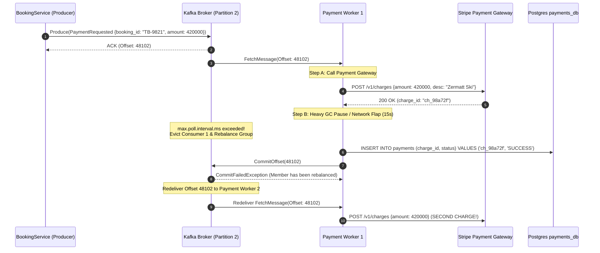

During execution, Worker 1 suffered a 15-second Stop-The-World JVM Garbage Collection pause and an accompanying transient cloud network flap. Because Worker 1 exceeded its heartbeat threshold, the Kafka Group Coordinator assumed Worker 1 had died. It initiated a **consumer group rebalance** and reassigned Partition 2 to Worker 2.

Meanwhile, Worker 1 had already sent the HTTP request to the payment gateway, charging Liam's credit card \$4,200. When Worker 1 woke up and attempted to commit its consumer offset, the broker rejected the commit with a `CommitFailedException`.

Worker 2 then pulled the uncommitted message at offset 48102 and charged Liam's card a second time. Minutes later, Worker 2 crashed during an unrelated container redeployment, and the message was redelivered to Worker 3, which charged Liam a _third_ time.

Liam’s bank account had been charged **\$12,600** for a single \$4,200 vacation.

This failure was not caused by a coding typo or an unhandled null pointer. It was the predictable consequence of relying on distributed message brokers without designing **strictly idempotent consumers**. In distributed systems, message redelivery is not a rare anomaly; it is an unavoidable law of network physics.

---

## The Delivery Guarantees Spectrum

Every message broker, queue, and streaming platform operates under one of three delivery models. Understanding the precise boundary of where acknowledgments are exchanged reveals why duplicate messages are inevitable.

```mermaid
flowchart TD
    subgraph Guarantees["Message Broker Delivery Models"]
        direction TB
        AMO["1. At-Most-Once<br/>• Commit offset BEFORE processing<br/>• Message loss on crash<br/>• Zero duplicate executions"]
        ALO["2. At-Least-Once<br/>• Commit offset AFTER processing<br/>• Zero message loss<br/>• Frequent duplicate executions"]
        EOS["3. 'Exactly-Once' (Bounded)<br/>• Atomic read-process-write within single log<br/>• Leaks duplicates on external side effects<br/>• Impossible across open heterogeneous networks"]
    end

    style Guarantees fill:#020617,stroke:#38bdf8,stroke-width:2px
    style AMO fill:#0f172a,stroke:#ef4444,stroke-width:1px
    style ALO fill:#0f172a,stroke:#38bdf8,stroke-width:1px
    style EOS fill:#0f172a,stroke:#f59e0b,stroke-width:1px
```

### 1. At-Most-Once Delivery (Pre-ACK)

In an **at-most-once** configuration, the consumer receives the message from the broker, immediately commits the offset (or acknowledges the message back to the broker), and _then_ hands the payload to the business processing logic.

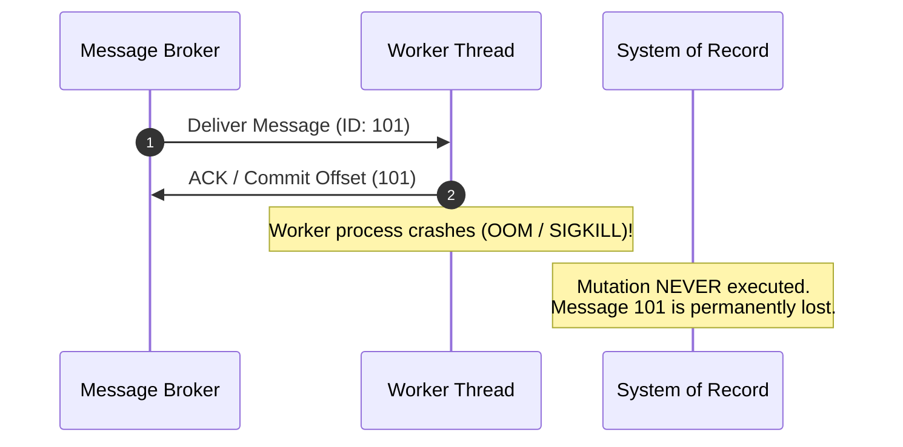

- **Mechanism**: Auto-commit enabled (`enable.auto.commit = true` with low intervals, or manual `ACK` before work starts).
- **Failure Mode**: If the consumer encounters an Out-Of-Memory error, hardware failure, unhandled runtime exception, or network disconnect while executing the domain logic, the broker has already advanced its consumer pointer. The message is **permanently lost**.
- **When to Use**: High-frequency, loss-tolerant telemetry (e.g., flight GPS coordinates updated every 200ms, CPU temperature metrics, ephemeral clickstream scroll depth).

### 2. At-Least-Once Delivery (Post-ACK)

In an **at-least-once** configuration, the consumer fetches the message, processes the business logic to completion (including database writes or external RPC calls), and _only then_ transmits the acknowledgment or offset commit back to the message broker.

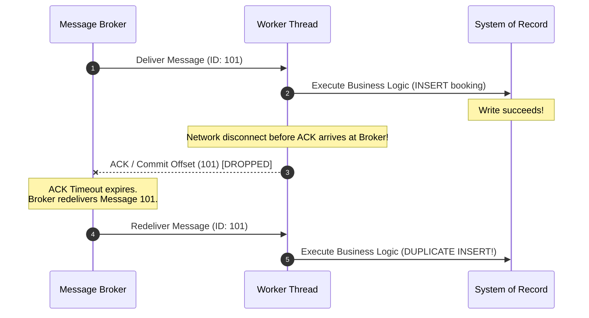

- **Mechanism**: Manual acknowledgment after successful transaction commit (`enable.auto.commit = false`).
- **Failure Mode**: If the consumer crashes _after_ mutating the database but _before_ the ACK reaches the broker, or if the network drops the ACK packet, the broker redelivers the message to a different consumer instance. The domain operation runs **two or more times**.
- **When to Use**: Financial operations, booking workflows, order fulfillment, and any enterprise business domain where data loss is unacceptable.

### 3. The "Exactly-Once" Myth & The Two Generals' Problem

Product marketing frequently advertises "out-of-the-box exactly-once processing." In a distributed system spanning independent physical machines across a network, **pure end-to-end exactly-once delivery is provably impossible**.

The theoretical foundation is formalized by the **Two Generals' Problem**:

<Callout type="info" title="The Two Generals' Problem: An Inductive Impossibility Proof">
Two allied generals, $G_1$ and $G_2$, have surrounded an enemy city from opposite hills. The city can only be conquered if both armies attack simultaneously. If only one army attacks, that army will be annihilated.

$G_1$ and $G_2$ can only communicate by sending foot messengers through the enemy valley, where messengers may be captured.

1. $G_1$ sends a messenger: _"Attack tomorrow at 06:00 AM."_
2. Did the messenger get through? $G_1$ cannot know without an acknowledgment. $G_1$ cannot attack safely.
3. $G_2$ receives the message and sends an acknowledgment: _"Agreed, attacking at 06:00 AM."_
4. Did $G_2$'s acknowledgment get through? $G_2$ cannot know if $G_1$ received it. If $G_1$ did not receive it, $G_1$ will not attack. Therefore, $G_2$ cannot attack without an acknowledgment of the acknowledgment.
5. By induction, every message requires an acknowledgment, requiring an infinite chain of confirmations:

$$\text{Confidence}(N) < 1.0 \quad \forall N \in \mathbb{N}$$

No finite sequence of message exchanges across an unreliable network can ever establish common knowledge.

</Callout>

When frameworks like Kafka or Flink advertise **Exactly-Once Semantics (EOS)**, they refer to a closed, bounded system:

- It coordinates transactional writes across Kafka input topic offsets and Kafka output topic partitions using a distributed Two-Phase Commit (2PC) protocol managed by a Transaction Coordinator.
- **The catch**: The instant your consumer performs a non-Kafka side effect—such as writing to PostgreSQL, calling the Stripe API, pushing a notification via Twilio, or mutating a Redis cache—Kafka's transactional boundaries terminate at the consumer boundary.

### The Golden Axiom of Event-Driven Systems

Because the network cannot guarantee exactly-once delivery, production reliability rests entirely upon a fundamental axiom:

$$\boxed{\text{At-Least-Once Delivery} + \text{Idempotent Processing} = \text{Effectively-Once Execution}}$$

If your message broker delivers a message ten times, but your consumer produces the exact same system state on runs $2$ through $10$ as it did on run $1$ without repeating side effects, your architecture achieves **effective exactly-once processing**.

---

## Three Production Idempotency Blueprints

An operation is mathematically idempotent if applying it multiple times yields the same result as applying it once:

$$f(f(x)) = f(x)$$

In software engineering, implementing this property requires choosing the right pattern for your storage engine and data domain. Below are the three canonical production patterns.

```mermaid
flowchart TD
    subgraph Patterns["Production Idempotency Strategies"]
        direction TB
        P1["Blueprint 1: Transactional Inbox<br/>• Dedicated deduplication table<br/>• DB-level atomic constraint<br/>• Works for non-idempotent business logic"]
        P2["Blueprint 2: Monotonic Version OCC<br/>• State version increments<br/>• Strict inequality filter: WHERE version < target<br/>• Handles out-of-order delivery natively"]
        P3["Blueprint 3: FSM Transition Guards<br/>• Explicit lifecycle states<br/>• Illegal/past transitions become no-op ACKs<br/>• Prevents zombie state overwrites"]
    end

    style Patterns fill:#020617,stroke:#38bdf8,stroke-width:2px
    style P1 fill:#0f172a,stroke:#38bdf8,stroke-width:1px
    style P2 fill:#0f172a,stroke:#34d399,stroke-width:1px
    style P3 fill:#0f172a,stroke:#eab308,stroke-width:1px
```

---

### Blueprint 1: The Transactional Inbox (Deduplication Table)

When business mutations are non-idempotent (e.g., deducting loyalty points, decrementing warehouse stock, recording an invoice line item), the most robust pattern binds message tracking to the domain state mutation within the **same local database transaction**.

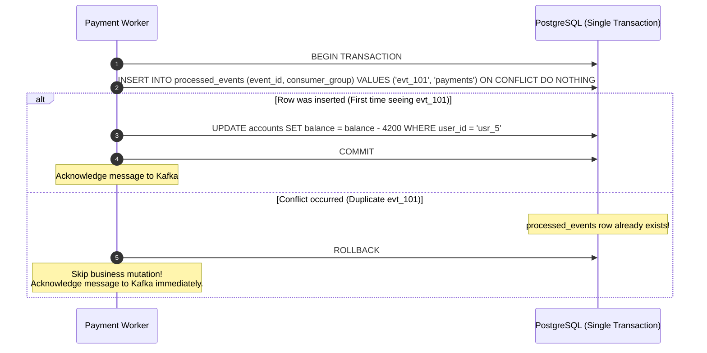

#### Production PostgreSQL Schema

The deduplication table must include the consumer group ID (allowing different microservices to process the same event independently) and a cleanup timestamp for index maintenance.

```sql
-- Schema for the Transactional Deduplication Inbox
CREATE TABLE IF NOT EXISTS processed_events (
    event_id VARCHAR(64) NOT NULL,
    consumer_group VARCHAR(64) NOT NULL,
    event_type VARCHAR(128) NOT NULL,
    processed_at TIMESTAMPTZ NOT NULL DEFAULT CURRENT_TIMESTAMP,
    payload_hash CHAR(64) NOT NULL, -- SHA-256 of payload to detect ID collisions
    PRIMARY KEY (event_id, consumer_group)
);

-- Index for background partition pruning / retention deletion
CREATE INDEX idx_processed_events_processed_at
ON processed_events (processed_at);

-- Example domain table
CREATE TABLE IF NOT EXISTS customer_wallets (
    user_id VARCHAR(64) PRIMARY KEY,
    balance_cents BIGINT NOT NULL CHECK (balance_cents >= 0),
    updated_at TIMESTAMPTZ NOT NULL DEFAULT CURRENT_TIMESTAMP
);
```

#### Implementation

<Tabs items={["TypeScript (Node.js / pg)", "Go (pgx)"]}>
<Tab value="TypeScript (Node.js / pg)">
```typescript
import { Pool, PoolClient } from "pg";
import { createHash } from "crypto";

interface DomainEvent<T> {
id: string;
type: string;
timestamp: string;
data: T;
}

interface WalletDeduction {
userId: string;
amountCents: number;
}

export class IdempotentWalletConsumer {
  constructor(
    private readonly dbPool: Pool,
    private readonly consumerGroup: string
  ) {}

public async processEvent(event: DomainEvent<WalletDeduction>): Promise<void> {
const client: PoolClient = await this.dbPool.connect();
const payloadHash = createHash("sha256")
.update(JSON.stringify(event.data))
.digest("hex");

    try {
      await client.query("BEGIN TRANSACTION ISOLATION LEVEL READ COMMITTED");

      // Step 1: Attempt to register the event in the deduplication table
      const insertInboxSql = `
        INSERT INTO processed_events (event_id, consumer_group, event_type, payload_hash)
        VALUES ($1, $2, $3, $4)
        ON CONFLICT (event_id, consumer_group) DO NOTHING
        RETURNING event_id;
      `;
      const inboxRes = await client.query(insertInboxSql, [
        event.id,
        this.consumerGroup,
        event.type,
        payloadHash,
      ]);

      // If no row was returned, this message was already processed successfully
      if (inboxRes.rowCount === 0) {
        console.warn(
          `[Idempotency] Duplicate event detected and safely skipped: ${event.id} for group ${this.consumerGroup}`
        );
        await client.query("ROLLBACK");
        return; // Early exit; caller will commit Kafka offset
      }

      // Step 2: Execute the core business mutation
      const updateWalletSql = `
        UPDATE customer_wallets
        SET balance_cents = balance_cents - $1,
            updated_at = CURRENT_TIMESTAMP
        WHERE user_id = $2;
      `;
      const walletRes = await client.query(updateWalletSql, [
        event.data.amountCents,
        event.data.userId,
      ]);

      if (walletRes.rowCount === 0) {
        throw new Error(`Wallet not found for user: ${event.data.userId}`);
      }

      // Step 3: Commit both the domain update and inbox record atomically
      await client.query("COMMIT");
      console.log(`[Idempotency] Successfully processed event: ${event.id}`);
    } catch (error) {
      await client.query("ROLLBACK");
      console.error(`[Idempotency] Failed processing event ${event.id}. Rolled back.`, error);
      throw error; // Re-throw to trigger Kafka consumer retry / backoff
    } finally {
      client.release();
    }

}
}

````
</Tab>

<Tab value="Go (pgx)">
```go
package consumer

import (
	"context"
	"crypto/sha256"
	"encoding/hex"
	"encoding/json"
	"errors"
	"fmt"
	"log"

	"github.com/jackc/pgx/v5"
	"github.com/jackc/pgx/v5/pgxpool"
)

type DomainEvent struct {
	ID        string          `json:"id"`
	Type      string          `json:"type"`
	Timestamp string          `json:"timestamp"`
	Data      WalletDeduction `json:"data"`
}

type WalletDeduction struct {
	UserID      string `json:"userId"`
	AmountCents int64  `json:"amountCents"`
}

type IdempotentWalletConsumer struct {
	pool          *pgxpool.Pool
	consumerGroup string
}

func NewIdempotentWalletConsumer(pool *pgxpool.Pool, group string) *IdempotentWalletConsumer {
	return &IdempotentWalletConsumer{pool: pool, consumerGroup: group}
}

func (c *IdempotentWalletConsumer) ProcessEvent(ctx context.Context, event DomainEvent) error {
	rawPayload, err := json.Marshal(event.Data)
	if err != nil {
		return fmt.Errorf("failed to marshal event data: %w", err)
	}
	hash := sha256.Sum256(rawPayload)
	payloadHash := hex.EncodeToString(hash[:])

	tx, err := c.pool.BeginTx(ctx, pgx.TxOptions{IsoLevel: pgx.ReadCommitted})
	if err != nil {
		return fmt.Errorf("failed to begin db tx: %w", err)
	}
	defer tx.Rollback(ctx)

	// Step 1: Insert into processed_events table
	const insertInboxQuery = `
		INSERT INTO processed_events (event_id, consumer_group, event_type, payload_hash)
		VALUES ($1, $2, $3, $4)
		ON CONFLICT (event_id, consumer_group) DO NOTHING
		RETURNING event_id;
	`
	var insertedID string
	err = tx.QueryRow(ctx, insertInboxQuery, event.ID, c.consumerGroup, event.Type, payloadHash).Scan(&insertedID)

	if errors.Is(err, pgx.ErrNoRows) {
		// Conflict triggered: event was already processed
		log.Printf("[Idempotency] Duplicate event %s ignored for group %s", event.ID, c.consumerGroup)
		return nil // Safe no-op; caller will commit offset
	} else if err != nil {
		return fmt.Errorf("inbox check failed: %w", err)
	}

	// Step 2: Execute domain state change
	const updateWalletQuery = `
		UPDATE customer_wallets
		SET balance_cents = balance_cents - $1,
		    updated_at = CURRENT_TIMESTAMP
		WHERE user_id = $2;
	`
	tag, err := tx.Exec(ctx, updateWalletQuery, event.Data.AmountCents, event.Data.UserID)
	if err != nil {
		return fmt.Errorf("wallet deduction failed: %w", err)
	}
	if tag.RowsAffected() == 0 {
		return fmt.Errorf("wallet for user %s does not exist", event.Data.UserID)
	}

	// Step 3: Commit atomic transaction
	if err := tx.Commit(ctx); err != nil {
		return fmt.Errorf("failed to commit transaction: %w", err)
	}

	log.Printf("[Idempotency] Successfully processed event %s", event.ID)
	return nil
}
````

</Tab>
</Tabs>

<Callout type="warn" title="Deduplication Table Growth and Partition Pruning">
A deduplication table in a high-volume system (e.g., 5,000 events/sec) will accumulate **432 million rows per day**. Without maintenance, the B-tree primary key index will exceed available RAM, degrading write performance.

**Production Solution**: Partition `processed_events` by day using PostgreSQL declarative partitioning (`PARTITION BY RANGE (processed_at)`), and drop daily partitions older than your broker's message retention period (e.g., 7 days) via an automated `pg_cron` maintenance job:

```sql
DROP TABLE processed_events_y2026m11d01;
```

</Callout>

---

### Blueprint 2: Naturally Idempotent & Monotonic Version-Checked Updates

Some domain operations are naturally idempotent:

- **Non-idempotent**: `UPDATE accounts SET balance = balance - 100` (Running twice subtracts \$200).
- **Naturally idempotent**: `UPDATE accounts SET status = 'SUSPENDED'` (Running twice leaves the status as `'SUSPENDED'`).

However, natural idempotency fails when events arrive **out of order**. If a `UserAddressUpdated(version: 2)` arrives _before_ an overdue `UserAddressUpdated(version: 1)`, a naive overwrite will leave the database with stale version 1 data.

To resolve this, employ **Optimistic Concurrency Control (OCC) with strict monotonic inequality**:

```sql
UPDATE bookings
SET status = 'CONFIRMED',
    version = 4,
    updated_at = CURRENT_TIMESTAMP
WHERE id = 'TB-101'
  AND version < 4;
```

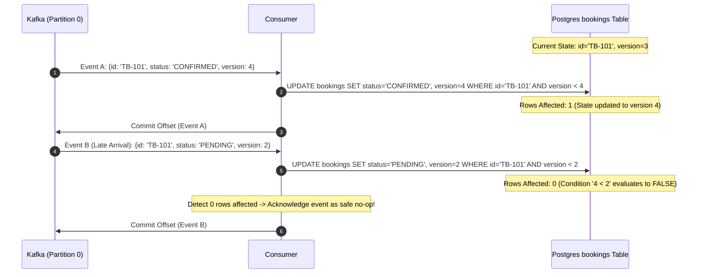

```typescript
export async function updateBookingStatusMonotonic(
  client: PoolClient,
  bookingId: string,
  newStatus: string,
  incomingVersion: number
): Promise<void> {
  const query = `
    UPDATE bookings
    SET status = $1,
        version = $2,
        updated_at = NOW()
    WHERE id = $3
      AND version < $2;
  `;

  const result = await client.query(query, [
    newStatus,
    incomingVersion,
    bookingId,
  ]);

  if (result.rowCount === 0) {
    // Check if the row exists at all or was simply superseded by a newer version
    const checkRes = await client.query(
      "SELECT version FROM bookings WHERE id = $1",
      [bookingId]
    );
    if (checkRes.rowCount === 0) {
      throw new Error(`Booking ${bookingId} not found in database.`);
    }

    const currentVersion = checkRes.rows[0].version;
    console.warn(
      `[Idempotency] Out-of-order event skipped. Current version=${currentVersion}, incoming version=${incomingVersion}`
    );
    // Return cleanly without error so consumer acknowledges offset
    return;
  }

  console.log(
    `[Idempotency] Booking ${bookingId} successfully transitioned to version ${incomingVersion}`
  );
}
```

---

### Blueprint 3: Finite State Machine (FSM) Transition Guards

Complex entities such as hotel reservations and airline tickets follow strict lifecycles. A Finite State Machine enforces valid transitions and treats stale or replayed transitions as **safe, silent no-ops**.

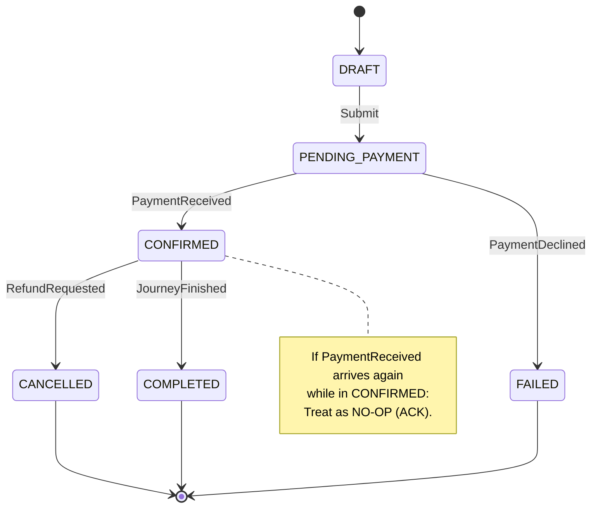

#### Transition Rule Table

| Current State | Incoming Event    | Target State | Consumer Action                                                              |
| :------------ | :---------------- | :----------- | :--------------------------------------------------------------------------- |
| `DRAFT`       | `PaymentReceived` | `CONFIRMED`  | **Apply Transition** (Write DB, publish downstream)                          |
| `CONFIRMED`   | `PaymentReceived` | `CONFIRMED`  | **No-op**: Stale replay detected. Return `200 OK` / ACK offset.              |
| `CANCELLED`   | `PaymentReceived` | `CANCELLED`  | **Illegal/Compensate**: Log alert, do not mutate state, trigger refund saga. |
| `COMPLETED`   | `BookingUpdated`  | `COMPLETED`  | **Terminal**: Silently drop event and commit offset.                         |

#### Implementation

<Tabs items={["TypeScript FSM Guard", "Go FSM Guard"]}>
<Tab value="TypeScript FSM Guard">
```typescript
type BookingState = "DRAFT" | "PENDING_PAYMENT" | "CONFIRMED" | "CANCELLED" | "COMPLETED";

type TransitionAction = "APPLY" | "IGNORE_DUPLICATE" | "REJECT_ILLEGAL";

interface FSMTransitionRule {
allowedFrom: BookingState[];
targetState: BookingState;
}

export class BookingFSM {
  private static readonly TRANSITIONS: Record<string, FSMTransitionRule> = {
    PAYMENT_SUCCESS: {
      allowedFrom: ["PENDING_PAYMENT"],
      targetState: "CONFIRMED",
    },
    CANCEL_REQUESTED: {
      allowedFrom: ["PENDING_PAYMENT", "CONFIRMED"],
      targetState: "CANCELLED",
    },
    JOURNEY_COMPLETED: {
      allowedFrom: ["CONFIRMED"],
      targetState: "COMPLETED",
    },
  };

public static evaluate(
currentState: BookingState,
eventType: string
): { action: TransitionAction; nextState?: BookingState } {
const rule = this.TRANSITIONS[eventType];
if (!rule) {
return { action: "REJECT_ILLEGAL" };
}

    // 1. Is this transition valid from the current state?
    if (rule.allowedFrom.includes(currentState)) {
      return { action: "APPLY", nextState: rule.targetState };
    }

    // 2. Are we already in the target state? (Duplicate / Replay)
    if (currentState === rule.targetState) {
      return { action: "IGNORE_DUPLICATE" };
    }

    // 3. Are we in a terminal state?
    if (currentState === "CANCELLED" || currentState === "COMPLETED") {
      return { action: "IGNORE_DUPLICATE" };
    }

    // 4. Truly illegal transition (e.g., PAYMENT_SUCCESS on a DRAFT)
    return { action: "REJECT_ILLEGAL" };

}
}

// Consumer loop integration
export async function handleBookingEvent(
db: PoolClient,
bookingId: string,
eventType: string
): Promise<void> {
const { rows } = await db.query(
"SELECT status FROM bookings WHERE id = $1 FOR UPDATE",
[bookingId]
);
if (rows.length === 0) throw new Error(`Booking ${bookingId} not found`);

const currentStatus: BookingState = rows[0].status;
const decision = BookingFSM.evaluate(currentStatus, eventType);

switch (decision.action) {
case "APPLY":
await db.query("UPDATE bookings SET status = $1 WHERE id = $2", [
decision.nextState,
bookingId,
]);
console.log(`Transitioned ${bookingId} from ${currentStatus} -> ${decision.nextState}`);
break;

    case "IGNORE_DUPLICATE":
      console.warn(
        `Ignored replayed event '${eventType}' for booking ${bookingId} in state '${currentStatus}'`
      );
      break;

    case "REJECT_ILLEGAL":
      throw new Error(
        `Illegal event '${eventType}' received for booking ${bookingId} in state '${currentStatus}'`
      );

}
}

````
</Tab>

<Tab value="Go FSM Guard">
```go
package fsm

import (
	"errors"
	"fmt"
)

type BookingState string

const (
	StateDraft          BookingState = "DRAFT"
	StatePendingPayment BookingState = "PENDING_PAYMENT"
	StateConfirmed      BookingState = "CONFIRMED"
	StateCancelled      BookingState = "CANCELLED"
	StateCompleted      BookingState = "COMPLETED"
)

type TransitionAction int

const (
	ActionApply TransitionAction = iota
	ActionIgnoreDuplicate
	ActionRejectIllegal
)

type TransitionRule struct {
	AllowedFrom []BookingState
	Target      BookingState
}

var transitions = map[string]TransitionRule{
	"PAYMENT_SUCCESS": {
		AllowedFrom: []BookingState{StatePendingPayment},
		Target:      StateConfirmed,
	},
	"CANCEL_REQUEST": {
		AllowedFrom: []BookingState{StatePendingPayment, StateConfirmed},
		Target:      StateCancelled,
	},
}

func Evaluate(current BookingState, eventType string) (TransitionAction, BookingState, error) {
	rule, exists := transitions[eventType]
	if !exists {
		return ActionRejectIllegal, current, fmt.Errorf("unknown event type: %s", eventType)
	}

	for _, s := range rule.AllowedFrom {
		if s == current {
			return ActionApply, rule.Target, nil
		}
	}

	if current == rule.Target || current == StateCancelled || current == StateCompleted {
		return ActionIgnoreDuplicate, current, nil
	}

	return ActionRejectIllegal, current, errors.New("illegal state transition attempt")
}
````

</Tab>
</Tabs>

---

## Partitioning, Ordering Realities & Key Design

Distributed event platforms like Kafka, AWS Kinesis, and Azure Event Hubs scale throughput by dividing a topic into multiple independent **partitions**.

This architectural design introduces a fundamental constraint:

<Callout type="error" title="The Universal Ordering Law of Event Streams">
  A message broker guarantees total order **only within a single partition**.
  There is no total order across different partitions of the same topic.
</Callout>

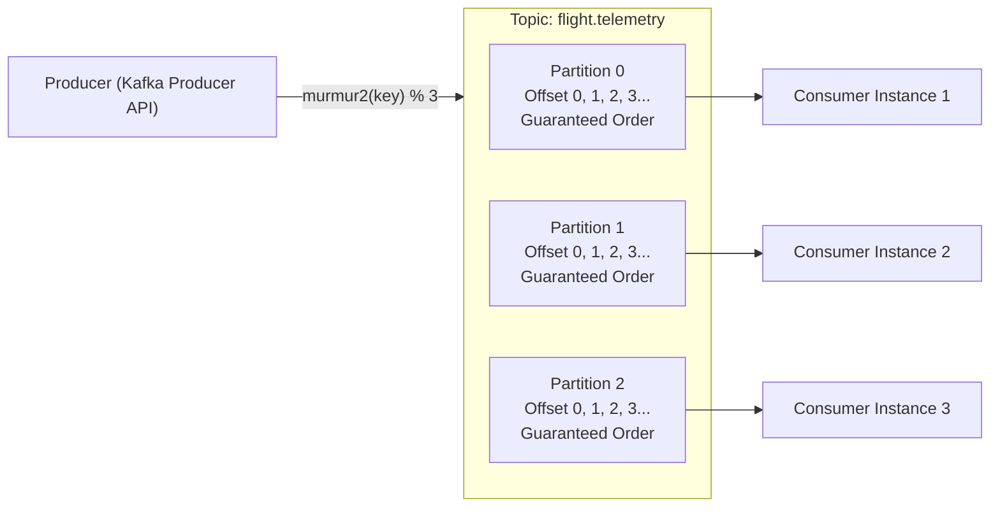

### The Murmur2 Hashing Algorithm

When a producer publishes a record with a message key, the partition is calculated using the 32-bit Murmur2 hashing algorithm:

$$\text{partition} = (\text{Murmur2}(\text{serializedKey}) \ \& \ \text{0x7fffffff}) \pmod{\text{numPartitions}}$$

The bitwise mask `& 0x7fffffff` strips the 32-bit two's-complement sign bit to prevent negative partition numbers.

```python
# Reference Murmur2 Partition Computation (Kafka Default Partitioner)
def compute_kafka_partition(key_bytes: bytes, num_partitions: int) -> int:
    import mmh3  # MurmurHash3 / MurmurHash2 library
    raw_hash = mmh3.hash(key_bytes, seed=0x9747b28c)
    positive_hash = raw_hash & 0x7FFFFFFF
    return positive_hash % num_partitions
```

<Callout type="warn" title="The Topic Resharding Disaster">
If you increase the number of partitions on a live topic (e.g., from 12 to 24 partitions to handle peak load):

$$N_{\text{new}} \neq N_{\text{old}} \implies \text{Murmur2}(\text{key}) \pmod{24} \neq \text{Murmur2}(\text{key}) \pmod{12}$$

Existing keys will immediately hash to **different partitions**. Consumer instances reading the new partitions will process subsequent updates for an entity _concurrently_ with workers reading the old partition's backlog, resulting in **catastrophic out-of-order execution**.

</Callout>

---

### The Fallacy of Wall-Clock Timestamps

Developers often attempt to resolve out-of-order events by sorting them on the consumer using a client-provided `timestamp` header. In distributed systems, this is fundamentally flawed due to **Physical Clock Drift**.

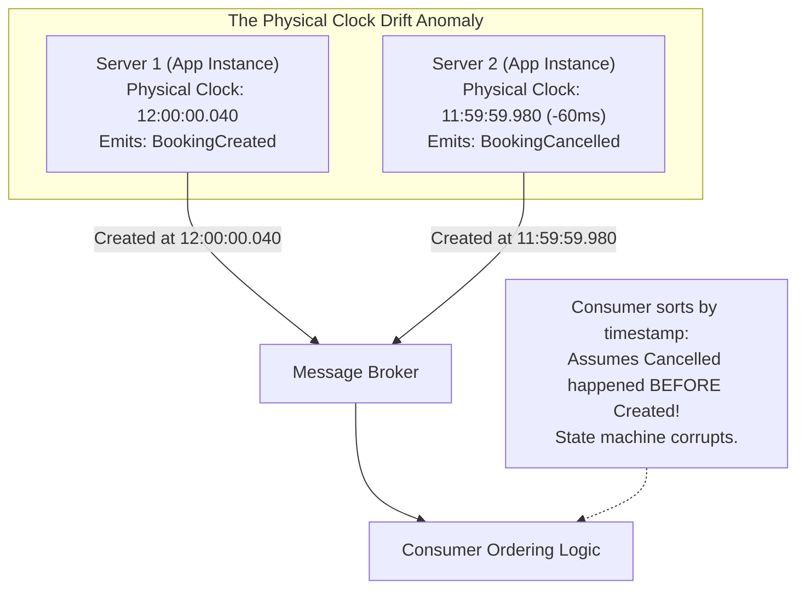

1. **Network Time Protocol (NTP) Inaccuracy**: NTP synchronizes clocks over the Internet within 10 to 50 milliseconds. Hardware oscillators drift unpredictably due to ambient temperature changes and crystal aging.
2. **Virtual Machine Hypervisor Pauses**: Cloud VMs experience hypervisor "time steals" and garbage collection pauses lasting up to several hundred milliseconds, during which physical clocks stall or suddenly jump forward.
3. **Leap Seconds**: Non-smeared NTP servers insert a leap second by repeating second 59 or stepping backward, breaking monotonicity.

**Engineering Rule**: Never use physical wall-clock timestamps for business-critical event sequencing. Rely exclusively on **monotonically increasing domain sequence numbers**, **partition offsets**, or **Lamport logical clocks**.

---

### Partition Key Design: Cardinality and Hotspots

Choosing the correct partition key is the single most critical architectural decision in stream design.

```mermaid
flowchart TD
    subgraph Bad["Antipattern: Low Cardinality Key"]
        direction LR
        K1["key = 'US' (80% of traffic)"] --> P0["Partition 0<br/>🔥 80,000 msg/sec (LAG SPIKING!)"]
        K2["key = 'CA' (15% of traffic)"] --> P1["Partition 1<br/>15,000 msg/sec"]
        K3["key = 'MX' (5% of traffic)"] --> P2["Partition 2<br/>5,000 msg/sec"]
    end

    subgraph Good["Best Practice: High Cardinality Key"]
        direction LR
        B1["key = 'TB-100293'"] --> PA["Partition 0 (Balanced)"]
        B2["key = 'TB-100294'"] --> PB["Partition 1 (Balanced)"]
        B3["key = 'TB-100295'"] --> PC["Partition 2 (Balanced)"]
    end

    style Bad fill:#450a0a,stroke:#ef4444,stroke-width:1px
    style Good fill:#064e3b,stroke:#10b981,stroke-width:1px
```

- **Low Cardinality (Anti-pattern)**: Partitioning by `country_code` (`US`, `FR`, `DE`). Because the United States generates 80% of TravelBuddy's flight traffic, Partition 0 saturates its consumer CPU and generates massive consumer lag, while Partitions 1 and 2 remain idle.
- **High Cardinality (Best Practice)**: Partitioning by `booking_id`, `user_id`, or `flight_id`. The hash function evenly distributes events across all partitions while guaranteeing that all lifecycle updates for any single entity travel down the **exact same partition in strict sequential order**.

---

### Key Salting Techniques for Extreme Hotspots

What happens when an entity is inherently hot? For example, during a flash sale for a concert ticket, a single `event_id` might generate **100,000 events/second**. Sending all events to a single partition will overload a single consumer instance.

To preserve horizontal scalability without forfeiting system health, use **Key Salting**:

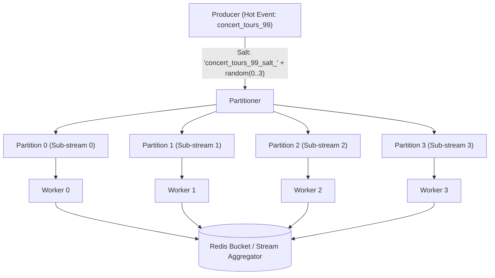

```typescript
// Producer Salting Blueprint for High-Throughput Hot Keys
export function getSaltedPartitionKey(
  entityId: string,
  saltRange: number = 4
): string {
  // If the entity is a known hot entity, append a pseudo-random salt
  const salt = Math.floor(Math.random() * saltRange);
  return `${entityId}#salt_${salt}`;
}
```

<Callout type="info" title="The Trade-off of Key Salting">
  Salting distributes the write load across multiple partitions and workers, but
  it **sacrifices total ordering for that entity**. Downstream consumers must
  either handle commutative operations (such as atomic Redis counter increments
  `INCRBY`) or implement a two-tier aggregation architecture.
</Callout>

---

## Architecture Summary Cards

<Cards>
  <Card title="Transactional Inbox" icon="ShieldCheck">
    Best for non-idempotent business operations (wallet deductions, credit authorizations). Uses database unique constraints to guarantee that an event mutation runs exactly once per consumer group.
  </Card>
  <Card title="Monotonic Versioning (OCC)" icon="Workflow">
    Best for state updates where messages may arrive out of order. Enforces `WHERE version < incoming_version` to safely ignore delayed or superseded events.
  </Card>
  <Card title="FSM Transition Guards" icon="Zap">
    Best for complex domain entities with strict lifecycle stages. Treats duplicate or illegal historical transitions as successful no-ops to acknowledge offsets without corrupting state.
  </Card>
  <Card title="Partition Key Hashing" icon="Copy">
    Order is guaranteed only within a single partition. Design keys with high cardinality (e.g., UUIDs) to prevent partition skew and hot-spot bottlenecks.
  </Card>
</Cards>
