import { Callout } from "fumadocs-ui/components/callout";
import { Tabs, Tab } from "fumadocs-ui/components/tabs";
import { Steps, Step } from "fumadocs-ui/components/steps";
import { Cards, Card } from "fumadocs-ui/components/card";

## The TravelBuddy Narrative: The Ghost Hotel Reservation

At 14:20:00 UTC, Elena submitted a booking for a seven-night stay at the Ryokan Gion in Kyoto through **TravelBuddy**. Her credit card was billed **\$1,800**.

TravelBuddy's engineering team had split their monolithic booking system into two microservices:

1. `BookingService`: Backed by a transactional PostgreSQL database storing bookings, invoices, and payment states.
2. `InventoryService`: An independent service managing hotel room allocations across worldwide hotel partners, subscribing to events on Apache Kafka.

To notify the `InventoryService`, the developer implemented a seemingly standard sequence:

```typescript
// Antipattern: The Dual-Write Trap
async function confirmBooking(bookingId: string, hotelId: string) {
  // 1. Commit state change to PostgreSQL
  await db.transaction(async (tx) => {
    await tx.query("UPDATE bookings SET status = 'CONFIRMED' WHERE id = $1", [
      bookingId,
    ]);
  });

  // 2. Publish event to Apache Kafka
  await kafkaProducer.send({
    topic: "hotel-bookings",
    messages: [
      {
        key: hotelId,
        value: JSON.stringify({ bookingId, hotelId, status: "CONFIRMED" }),
      },
    ],
  });
}
```

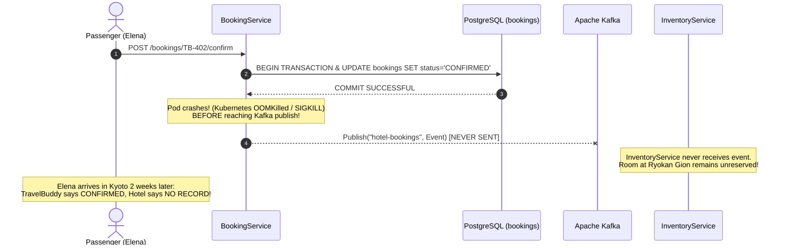

Just after the PostgreSQL transaction committed successfully, the Kubernetes cluster encountered memory pressure. The Linux Out-Of-Memory (OOM) Killer terminated the `BookingService` pod before the network packet reached the Kafka broker.

The outcome:

- TravelBuddy’s database marked Elena's reservation as `CONFIRMED`, and Elena’s card was charged \$1,800.
- The `InventoryService` never received the event.
- Elena arrived in Kyoto after a 14-hour flight only to find the hotel completely sold out.

Reversing the order of execution introduces an equally catastrophic failure mode:

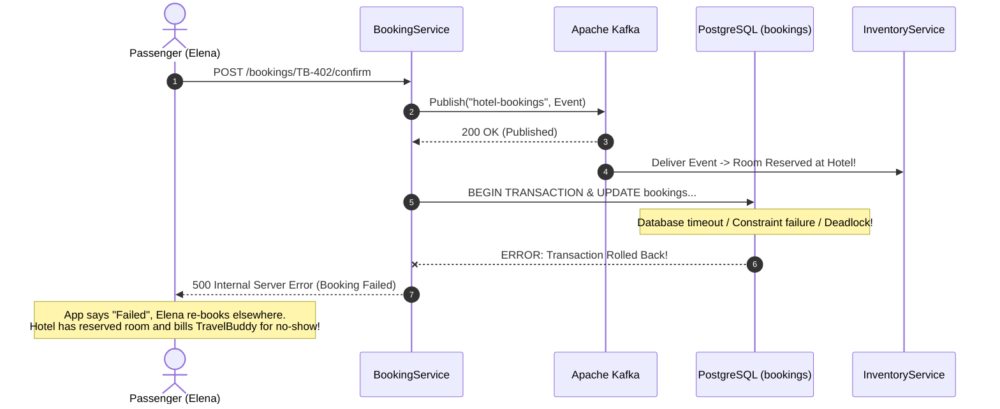

This vulnerability is known as the **Dual-Write Vulnerability**. In distributed systems, updating a database and publishing a message to a broker are two distinct network operations across separate transactional domains. Without distributed transactions, they cannot be made atomic.

---

## The Dual-Write Vulnerability Analyzed

Why can't we simply wrap both operations in a distributed transaction?

```mermaid
flowchart TD
    subgraph DualWriteProblem["The Dual-Write Dilemma"]
        direction TB
        OptA["Option A: Write DB First, Then Publish<br/>❌ Failure after DB commit = Phantom record in DB, event lost forever."]
        OptB["Option B: Publish First, Then Write DB<br/>❌ Failure during DB commit = Phantom event in broker, room reserved without record."]
        XA["Distributed 2-Phase Commit (2PC / XA)<br/>❌ Not supported by Kafka/RabbitMQ/Redis.<br/>❌ High latency, blocking locks, single point of coordinator failure."]
    end

    style DualWriteProblem fill:#020617,stroke:#38bdf8,stroke-width:2px
    style OptA fill:#0f172a,stroke:#ef4444,stroke-width:1px
    style OptB fill:#0f172a,stroke:#ef4444,stroke-width:1px
    style XA fill:#0f172a,stroke:#f59e0b,stroke-width:1px
```

In classical enterprise architectures, the **XA standard / Two-Phase Commit (2PC)** coordinated multi-resource transactions. However, 2PC is fundamentally unviable in modern cloud-native systems:

1. **Lack of Protocol Support**: Modern cloud brokers (Apache Kafka, RabbitMQ, Amazon SQS, Google Pub/Sub) deliberately do not implement XA or 2PC protocols because distributed locking destroys horizontally scalable streaming throughput.
2. **Availability Degradation (CAP Theorem)**: 2PC is a blocking protocol. If the transaction coordinator or any participant becomes unreachable during the prepare phase, locks on database rows remain held indefinitely, causing cascading thread pool exhaustion.
3. **Latency Amplification**: Coordinating multiple network round-trips across distinct services increases P99 write latency by orders of magnitude.

To achieve reliable event publishing without distributed locks, we must use the **Transactional Outbox Pattern**.

---

## The Transactional Outbox Pattern

The Transactional Outbox Pattern eliminates dual-writes by transforming the event publication into a **local database write**.

Instead of publishing directly to the external message broker, the application writes the outbound event into an `outbox_events` table inside the **exact same ACID transaction** that updates the domain entities.

```mermaid
flowchart LR
    subgraph ServiceBoundary["BookingService Service Boundary"]
        App["Application Logic"]

        subgraph DB["PostgreSQL Database (ACID Boundary)"]
            Bookings[("bookings table<br/>(Domain State)")]
            Outbox[("outbox_events table<br/>(Event Staging)")]
        end
    end

    Relay["Outbox Relay<br/>(CDC / Debezium / Poller)"]
    Broker["Message Broker<br/>(Apache Kafka)"]

    App -->|"1. Single Atomic Transaction<br/>(BEGIN ... COMMIT)"| DB
    DB -.->|"Contains"| Bookings
    DB -.->|"Contains"| Outbox

    Outbox -->|"2. Tail WAL / Read"| Relay
    Relay -->|"3. Reliable Publish"| Broker

    style DB fill:#0f172a,stroke:#38bdf8,stroke-width:2px
    style ServiceBoundary fill:#020617,stroke:#64748b,stroke-dasharray: 5 5
    style Relay fill:#0f172a,stroke:#34d399,stroke-width:2px
    style Broker fill:#0f172a,stroke:#eab308,stroke-width:2px
```

Because both writes occur within a single database transaction, atomicity is guaranteed by the database engine:

- If the transaction commits, **both** the booking state and the outbox event exist on disk.
- If the transaction rolls back, **neither** the booking state nor the outbox event exists.
- The dual-write vulnerability is completely eliminated.

### Production PostgreSQL Outbox Schema

The schema must support both high-throughput writes and clean metadata extraction for downstream partition routing:

```sql
-- Production Outbox Schema for PostgreSQL
CREATE TABLE IF NOT EXISTS outbox_events (
    id UUID PRIMARY KEY DEFAULT gen_random_uuid(),
    aggregate_type VARCHAR(64) NOT NULL,    -- e.g., 'Booking', 'Flight', 'User'
    aggregate_id VARCHAR(64) NOT NULL,      -- e.g., 'TB-402' (Used for Kafka Partition Key)
    event_type VARCHAR(128) NOT NULL,       -- e.g., 'BookingConfirmed', 'BookingCancelled'
    payload JSONB NOT NULL,                 -- Full event payload
    headers JSONB DEFAULT '{}'::jsonb,      -- Tracing context (traceparent, correlation_id)
    created_at TIMESTAMPTZ NOT NULL DEFAULT CURRENT_TIMESTAMP,
    published BOOLEAN NOT NULL DEFAULT FALSE -- Only required for Polling Publisher
);

-- Index optimized for Polling Publisher (SKIP LOCKED)
CREATE INDEX idx_outbox_unpublished
ON outbox_events (created_at)
WHERE published = FALSE;

-- Index for aggregate audit trails
CREATE INDEX idx_outbox_aggregate
ON outbox_events (aggregate_type, aggregate_id);
```

### Atomic Domain & Outbox Write Implementation

<Tabs items={["TypeScript (Kysely / pg)", "Go (pgx)"]}>
<Tab value="TypeScript (Kysely / pg)">
```typescript
import { Pool, PoolClient } from "pg";
import { v4 as uuidv4 } from "uuid";

interface BookingConfirmation {
bookingId: string;
hotelId: string;
userId: string;
amountCents: number;
}

export class BookingOutboxService {
  constructor(private readonly pool: Pool) {}

public async confirmBookingAtomically(data: BookingConfirmation, traceparent: string): Promise<void> {
const client: PoolClient = await this.pool.connect();

    try {
      await client.query("BEGIN TRANSACTION ISOLATION LEVEL READ COMMITTED");

      // 1. Mutate domain business entity
      const updateBookingQuery = `
        UPDATE bookings
        SET status = 'CONFIRMED',
            version = version + 1,
            updated_at = CURRENT_TIMESTAMP
        WHERE id = $1 AND status = 'PENDING';
      `;
      const updateRes = await client.query(updateBookingQuery, [data.bookingId]);
      if (updateRes.rowCount === 0) {
        throw new Error(`Booking ${data.bookingId} not found or not in PENDING state`);
      }

      // 2. Stage event in the outbox table within the SAME local transaction
      const insertOutboxQuery = `
        INSERT INTO outbox_events (
          id, aggregate_type, aggregate_id, event_type, payload, headers
        ) VALUES ($1, $2, $3, $4, $5, $6);
      `;

      const eventPayload = {
        bookingId: data.bookingId,
        hotelId: data.hotelId,
        userId: data.userId,
        amountCents: data.amountCents,
        confirmedAt: new Date().toISOString(),
      };

      const eventHeaders = {
        traceparent,
        source: "booking-service",
        schemaVersion: "1.0",
      };

      await client.query(insertOutboxQuery, [
        uuidv4(),
        "Booking",
        data.bookingId, // Will map to Kafka Partition Key
        "BookingConfirmed",
        JSON.stringify(eventPayload),
        JSON.stringify(eventHeaders),
      ]);

      // 3. Atomically commit both domain update and outbox record
      await client.query("COMMIT");
      console.log(`[Outbox] Booking ${data.bookingId} and outbox event committed atomically.`);
    } catch (err) {
      await client.query("ROLLBACK");
      console.error(`[Outbox] Transaction rolled back for booking ${data.bookingId}:`, err);
      throw err;
    } finally {
      client.release();
    }

}
}

````
</Tab>

<Tab value="Go (pgx)">
```go
package outbox

import (
	"context"
	"encoding/json"
	"fmt"
	"time"

	"github.com/google/uuid"
	"github.com/jackc/pgx/v5"
	"github.com/jackc/pgx/v5/pgxpool"
)

type BookingConfirmation struct {
	BookingID   string `json:"bookingId"`
	HotelID     string `json:"hotelId"`
	UserID      string `json:"userId"`
	AmountCents int64  `json:"amountCents"`
}

type BookingOutboxService struct {
	pool *pgxpool.Pool
}

func NewBookingOutboxService(pool *pgxpool.Pool) *BookingOutboxService {
	return &BookingOutboxService{pool: pool}
}

func (s *BookingOutboxService) ConfirmBookingAtomically(ctx context.Context, data BookingConfirmation, traceparent string) error {
	tx, err := s.pool.BeginTx(ctx, pgx.TxOptions{IsoLevel: pgx.ReadCommitted})
	if err != nil {
		return fmt.Errorf("failed to begin transaction: %w", err)
	}
	defer tx.Rollback(ctx)

	// 1. Update domain entity
	const updateBookingSQL = `
		UPDATE bookings
		SET status = 'CONFIRMED',
		    version = version + 1,
		    updated_at = CURRENT_TIMESTAMP
		WHERE id = $1 AND status = 'PENDING';
	`
	cmdTag, err := tx.Exec(ctx, updateBookingSQL, data.BookingID)
	if err != nil {
		return fmt.Errorf("failed to update booking: %w", err)
	}
	if cmdTag.RowsAffected() == 0 {
		return fmt.Errorf("booking %s is not in PENDING state", data.BookingID)
	}

	// 2. Prepare payload and headers
	payloadBytes, err := json.Marshal(map[string]interface{}{
		"bookingId":   data.BookingID,
		"hotelId":     data.HotelID,
		"userId":      data.UserID,
		"amountCents": data.AmountCents,
		"confirmedAt": time.Now().UTC().Format(time.RFC3339),
	})
	if err != nil {
		return fmt.Errorf("failed to serialize payload: %w", err)
	}

	headersBytes, _ := json.Marshal(map[string]string{
		"traceparent": traceparent,
		"source":      "booking-service",
	})

	// 3. Insert into outbox_events table
	const insertOutboxSQL = `
		INSERT INTO outbox_events (
			id, aggregate_type, aggregate_id, event_type, payload, headers
		) VALUES ($1, $2, $3, $4, $5, $6);
	`
	eventID := uuid.New().String()
	_, err = tx.Exec(ctx, insertOutboxSQL, eventID, "Booking", data.BookingID, "BookingConfirmed", payloadBytes, headersBytes)
	if err != nil {
		return fmt.Errorf("failed to insert outbox event: %w", err)
	}

	// 4. Commit atomic transaction
	if err := tx.Commit(ctx); err != nil {
		return fmt.Errorf("failed to commit transaction: %w", err)
	}

	return nil
}
````

</Tab>
</Tabs>

---

## Outbox Relay Mechanisms: Polling vs. CDC

Once events are committed to the `outbox_events` table, an asynchronous process must relay them to the message broker. There are two primary architectural mechanisms to accomplish this:

```mermaid
flowchart TD
    subgraph Mechanism1["Mechanism 1: Polling Publisher"]
        PWorker["Background Poller Worker"] -->|"SELECT ... FOR UPDATE SKIP LOCKED<br/>(Polls every 500ms)"| PTable[("outbox_events table")]
        PWorker -->|"Publish"| PBroker["Kafka Broker"]
        PWorker -->|"UPDATE outbox_events SET published=TRUE"| PTable
    end

    subgraph Mechanism2["Mechanism 2: Change Data Capture (CDC)"]
        WAL[("PostgreSQL WAL<br/>(Write-Ahead Log)")] -->|"Logical Replication Stream<br/>(pgoutput plugin)"| Deb["Debezium Connector<br/>(Kafka Connect Engine)"]
        Deb -->|"Single Message Transform<br/>(EventRouter SMT)"| CBroker["Kafka Broker"]
    end

    style Mechanism1 fill:#0f172a,stroke:#38bdf8,stroke-width:1px
    style Mechanism2 fill:#0f172a,stroke:#34d399,stroke-width:1px
```

---

### Mechanism 1: Polling Publisher (`FOR UPDATE SKIP LOCKED`)

A background polling process periodically queries the database for unpublished rows.

<Callout type="error" title="The Naive Polling Lock Contention Trap">
  A naive query such as `SELECT * FROM outbox_events WHERE published = FALSE
  LIMIT 100 FOR UPDATE` locks the oldest 100 rows. If you run multiple poller
  worker threads for redundancy, Worker 2 will **block and wait** for Worker 1
  to release its row locks, destroying concurrency.
</Callout>

To run concurrent poller workers safely, use PostgreSQL's `SKIP LOCKED` clause:

```sql
-- Concurrently safe polling query
SELECT id, aggregate_type, aggregate_id, event_type, payload, headers
FROM outbox_events
WHERE published = FALSE
ORDER BY created_at ASC
LIMIT 50
FOR UPDATE SKIP LOCKED;
```

When Worker 1 executes this query, it locks rows 1 through 50. When Worker 2 executes the exact same query concurrently, `SKIP LOCKED` instructs the engine to **skip rows 1 through 50 entirely** and lock rows 51 through 100 without blocking.

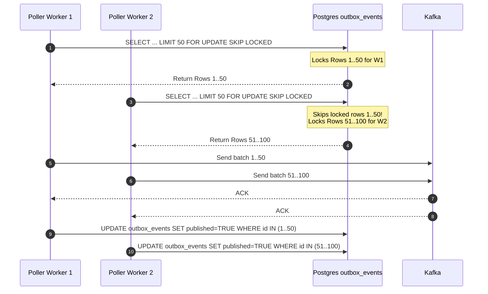

#### Trade-offs of Polling Publisher

- **Advantages**: Simple architecture, zero third-party infrastructure required, uses existing database connections.
- **Disadvantages**: Introduces polling latency (typically 200ms–2000ms), adds read query load on the primary operational database, and causes PostgreSQL table bloat due to frequent `UPDATE` operations unless aggressive `VACUUM` policies are configured.

---

### Mechanism 2: Change Data Capture (CDC) via Debezium

The production gold standard for event relay is **Change Data Capture (CDC)** using Debezium.

Instead of executing SQL queries against tables, Debezium directly reads the database’s **Write-Ahead Log (WAL)** using PostgreSQL’s logical decoding feature (the `pgoutput` plugin).

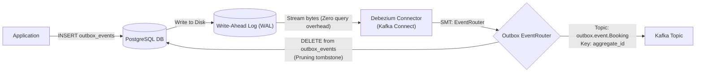

1. The application inserts the event into `outbox_events` as part of its local transaction.
2. PostgreSQL writes the transaction to its internal Write-Ahead Log on disk.
3. Debezium tails the WAL in real time via a logical replication slot.
4. Latency between database commit and Kafka delivery is **sub-millisecond** (5ms–50ms).
5. There are **zero SQL queries** executed on the primary database engine, eliminating read load and table locking.

#### The Debezium Outbox EventRouter SMT

By default, Debezium streams raw database change events containing database-specific metadata (before/after row states). To convert these into clean domain events, Debezium provides the **Outbox EventRouter Single Message Transform (SMT)** (`io.debezium.transforms.outbox.EventRouter`).

The EventRouter automatically:

- Extracts `aggregate_type` to route events to dynamic topics (e.g., `outbox.event.Booking`).
- Uses `aggregate_id` as the **Kafka message key** to ensure partition-level ordering.
- Extracts `payload` as the Kafka message value.
- Lifts fields from `headers` into native Kafka record headers.

#### Production Kafka Connect Configuration

```json
{
  "name": "travelbuddy-booking-outbox-connector",
  "config": {
    "connector.class": "io.debezium.connector.postgresql.PostgresConnector",
    "tasks.max": "1",
    "plugin.name": "pgoutput",
    "database.hostname": "postgres.internal.travelbuddy.com",
    "database.port": "5432",
    "database.user": "debezium_cdc",
    "database.password": "${file:/secrets/db-credentials.properties:cdc_password}",
    "database.dbname": "travelbuddy_prod",
    "database.server.name": "travelbuddy_pg",
    "table.include.list": "public.outbox_events",
    "tombstones.on.delete": "false",

    "transforms": "outbox",
    "transforms.outbox.type": "io.debezium.transforms.outbox.EventRouter",
    "transforms.outbox.route.by.field": "aggregate_type",
    "transforms.outbox.route.topic.replacement": "outbox.event.${routedByValue}",
    "transforms.outbox.table.fields.additional.placement": "type:header:eventType,headers:header:tracingContext",
    "transforms.outbox.table.field.event.id": "id",
    "transforms.outbox.table.field.event.key": "aggregate_id",
    "transforms.outbox.table.field.event.payload": "payload"
  }
}
```

#### Comparison Matrix: Polling vs. Debezium CDC

| Dimension                     | Polling Publisher (`SKIP LOCKED`)                     | Debezium Change Data Capture (CDC)                        |
| :---------------------------- | :---------------------------------------------------- | :-------------------------------------------------------- |
| **End-to-End Latency**        | High (500ms – 5,000ms polling interval)               | Sub-millisecond (5ms – 50ms)                              |
| **Operational DB Overhead**   | Medium to High (constant polling queries, MVCC bloat) | Zero query overhead (reads binary disk WAL)               |
| **Infrastructure Complexity** | Low (runs within existing worker pods)                | High (requires Kafka Connect cluster & replication slots) |
| **Message Ordering**          | Risk of reordering under multi-threaded pollers       | Strict sequential ordering preserved from WAL             |
| **Data Pruning**              | Manual `DELETE` or `published = true` cleanup         | Automatic outbox table truncation or ephemeral tables     |

---

## Distributed Sagas: Coordinating Multi-Service Workflows

A single business transaction in TravelBuddy frequently spans multiple microservices:

1. `BookingService`: Reserves travel itinerary.
2. `PaymentService`: Charges customer card (\$1,800).
3. `FlightInventoryService`: Allocates seats on airline carrier.
4. `HotelInventoryService`: Reserves room at resort.
5. `NotificationService`: Sends confirmation SMS/email.

Because each service owns its private database, ACID transactions cannot span service boundaries. We coordinate distributed business transactions using the **Saga Pattern**, formalized by Hector Garcia-Molina and Kenneth Salem in 1987.

<Callout type="info" title="What is a Saga?">
A **Saga** is a sequence of local ACID transactions:

$$S = [T_1, T_2, \dots, T_n]$$

Each local transaction $T_i$ updates the service's private database and publishes an event or triggers the next step. If a transaction $T_k$ fails, the saga executes a series of **compensating transactions**:

$$C = [C_{k-1}, C_{k-2}, \dots, C_1]$$

in reverse order to undo the changes made by earlier transactions, returning the distributed system to an eventually consistent state.

</Callout>

---

### Choreography vs. Orchestration

There are two primary paradigms for coordinating a saga:

```mermaid
flowchart TD
    subgraph Choreography["Choreography (Event-Driven)"]
        direction LR
        S1["Booking Service"] -->|BookingCreated| S2["Payment Service"]
        S2 -->|PaymentCaptured| S3["Flight Service"]
        S3 -->|FlightReserved| S4["Hotel Service"]
        S4 -.->|HotelSoldOut| S3
        S3 -.->|CompensateFlight| S2
    end

    subgraph Orchestration["Orchestration (Command-Driven)"]
        direction TB
        Orch["Saga Orchestrator<br/>(Temporal / AWS Step Functions)"]
        Orch -->|"1. Command: AuthorizePayment"| OPay["Payment Service"]
        Orch -->|"2. Command: BookFlight"| OFlight["Flight Service"]
        Orch -->|"3. Command: BookHotel"| OHotel["Hotel Service"]
        OHotel --x|"Error: Sold Out"| Orch
        Orch -->|"Compensate: CancelFlight"| OFlight
        Orch -->|"Compensate: RefundPayment"| OPay
    end

    style Choreography fill:#0f172a,stroke:#38bdf8,stroke-width:1px
    style Orchestration fill:#0f172a,stroke:#34d399,stroke-width:1px
```

#### Decision Matrix

| Dimension               | Choreography                                                                   | Orchestration                                                                 |
| :---------------------- | :----------------------------------------------------------------------------- | :---------------------------------------------------------------------------- |
| **Communication Style** | Reactive publish-subscribe (Domain Events)                                     | Direct command-response (RPC / Targeted Queues)                               |
| **Coordination Point**  | Decentralized; each service listens and reacts                                 | Centralized; dedicated workflow state machine                                 |
| **Complexity Boundary** | Low for 2–3 services; unmaintainable beyond 4 ("Pinball machine" anti-pattern) | Consistent complexity regardless of participant count                         |
| **Failure Recovery**    | Complex; compensation logic scattered across services                          | Explicit; single error-handling tree in workflow code                         |
| **State Inspection**    | Difficult; requires querying multiple service logs                             | Trivially simple; orchestrator holds full workflow state                      |
| **Best Used For**       | Simple linear pipelines, cross-domain notifications                            | Complex business flows with branching, loops, and human-in-the-loop approvals |

---

### Step Classification: Garcia-Molina & Salem Framework

To design reliable sagas, every transaction in the sequence must be classified into one of three distinct categories:

```mermaid
flowchart LR
    subgraph Steps["The Saga Step Lifecycle"]
        direction LR
        C1["T1: Reserve Flight<br/>(Compensable)"] --> C2["T2: Reserve Hotel<br/>(Compensable)"]
        C2 --> PIVOT["T3: Charge Card<br/>⭐ PIVOT TRANSACTION ⭐"]
        PIVOT --> R1["T4: Issue E-Ticket<br/>(Retriable)"]
        R1 --> R2["T5: Send Email<br/>(Retriable)"]
    end

    style C1 fill:#0f172a,stroke:#38bdf8,stroke-width:1px
    style C2 fill:#0f172a,stroke:#38bdf8,stroke-width:1px
    style PIVOT fill:#450a0a,stroke:#ef4444,stroke-width:2px
    style R1 fill:#064e3b,stroke:#10b981,stroke-width:1px
    style R2 fill:#064e3b,stroke:#10b981,stroke-width:1px
```

1. **Compensable Transactions ($T_1 \dots T_{i-1}$)**:
   - Transactions that precede the pivot transaction.
   - They **can be undone** if a downstream step fails.
   - Every compensable transaction $T_i$ must have a corresponding compensating transaction $C_i$ (e.g., $T$: `ReserveSeat` $\rightarrow$ $C$: `ReleaseSeat`).
2. **The Pivot Transaction ($T_{\text{pivot}}$)**:
   - **The point of no return**.
   - If the pivot transaction commits, the saga **must run to completion**.
   - It cannot be compensated. If it fails, all preceding compensable transactions are rolled back.
   - Example: Capturing an irreversible credit card charge or submitting an immutable booking confirmation to an external airline API.
3. **Retriable Transactions ($T_{i+1} \dots T_n$)**:
   - Transactions that execute _after_ the pivot transaction.
   - They **cannot be compensated** and are not allowed to fail permanently.
   - They must be designed to be idempotent and retried indefinitely until they succeed (e.g., sending an email receipt, updating loyalty rewards points).

---

### Mitigating the Missing Isolation ("I" in ACID) in Sagas

The biggest challenge in distributed sagas is the **lack of Isolation**:

<Callout type="warn" title="The Saga Isolation Anomaly">
  In a local ACID transaction, uncommitted writes are invisible to external
  observers. In a Saga, as soon as local transaction $T_1$ commits, **its
  changes are immediately visible to the entire world**, even though the overall
  saga might fail at $T_3$ and execute compensation $C_1$ thirty seconds later!
</Callout>

This opens the door to dirty reads, lost updates, and double-allocation anomalies. Production architectures resolve this using two techniques:

#### 1. Semantic Locking

Instead of setting the row state directly to `RESERVED`, set it to a pending state:

```sql
UPDATE hotel_rooms
SET status = 'PENDING_CONFIRMATION',
    saga_id = 'saga_98231',
    expires_at = NOW() + INTERVAL '15 minutes'
WHERE id = 'room_101' AND status = 'AVAILABLE';
```

Other transactions reading `hotel_rooms` check this semantic lock. If a room is in `PENDING_CONFIRMATION`, other users cannot book it. If the saga fails, compensation updates the status back to `AVAILABLE`. If the orchestrator dies, a background worker expires the reservation after the 15-minute TTL.

#### 2. Pessimistic Reservation Buckets

For fungible inventory (e.g., flight seats, e-commerce warehouse units), partition the inventory into active stock and reserved stock:

$$\text{AvailableStock} = \text{TotalStock} - \text{ReservedStock}$$

```sql
UPDATE inventory
SET reserved_count = reserved_count + 1
WHERE item_id = 'flight_AA102'
  AND (total_count - reserved_count) >= 1;
```

---

## CQRS & Event Sourcing in Practice

As systems grow in complexity, the data model optimized for transactional writes often becomes a bottleneck for read queries.

### Command Query Responsibility Segregation (CQRS)

CQRS separates the application architecture into two distinct pipelines:

```mermaid
flowchart TD
    Client["Client / Web UI"]

    subgraph CommandPipeline["Write Path (Commands)"]
        CmdHandler["Command Handler"] --> WriteDB[("Primary Database (PostgreSQL)<br/>Normalized, ACID invariants")]
        WriteDB --> Outbox["Transactional Outbox / CDC"]
    end

    subgraph ReadPipeline["Read Path (Queries)"]
        Outbox -->|"Event Stream (Kafka)"| Projector["Read Model Projector"]
        Projector --> ReadDB[("Read Store (Elasticsearch / Redis)<br/>Denormalized, Pre-aggregated")]
        ReadDB --> QueryHandler["Query Handler"]
    end

    Client -->|"POST /commands/book-room"| CmdHandler
    Client -->|"GET /queries/user-itinerary"| QueryHandler

    style CommandPipeline fill:#0f172a,stroke:#38bdf8,stroke-width:1px
    style ReadPipeline fill:#0f172a,stroke:#34d399,stroke-width:1px
```

- **Command Model (Write Path)**: Highly normalized relational schema (3NF). Focuses exclusively on validation, data integrity, and transactional boundaries.
- **Query Model (Read Path)**: Denormalized document or key-value store (e.g., Elasticsearch for full-text search, Redis for flight search result caching).

#### Mitigating "Read-Your-Own-Writes" Lag

Because read models are updated asynchronously via the event stream, a user who updates their profile might refresh the page and see their old data (**Eventual Consistency Lag**).

To guarantee a seamless user experience:

1. **Client Version Tokens**: When a mutation succeeds, the server returns the updated version number ($v=42$). The client includes `If-None-Match: v42` or `min_version=42` in subsequent query headers. If the read replica has only replicated up to $v=41$, the query service routes the read directly to the primary database or pauses briefly for the read replica to catch up.
2. **Optimistic Client Updates**: The frontend immediately renders the updated state in local memory before the background read model projection finishes.

---

### Event Sourcing Mechanics

In a traditional CRUD system, the database stores only the **current state** of an entity. Previous states are overwritten and lost:

$$\text{CurrentState} = f(\text{Last UPDATE})$$

In an **Event Sourced** system, state is never mutated. The system of record is an append-only log of immutable domain events. The current state is calculated by replaying all historical events:

$$\text{CurrentState} = \sum_{i=1}^{N} \text{Event}_i$$

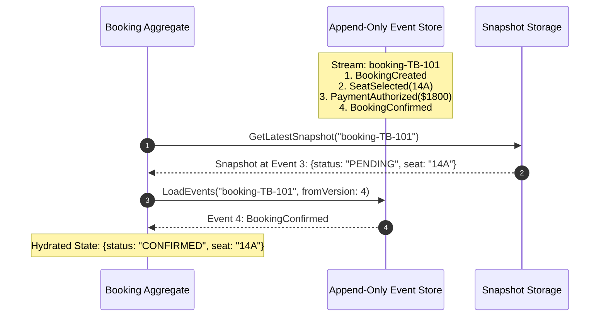

- **Stream Hydration**: To execute a command, load all events for that stream ID from the event store into memory and apply them sequentially to reconstruct the in-memory domain aggregate.
- **Snapshots**: If a stream has 10,000 events, replaying them on every request is $O(N)$ and degrades latency. Every $K$ events ($K=100$), the system takes an atomic state snapshot. Hydration then becomes $O(1)$: load the latest snapshot and replay only the events appended after it.

---

### Handling GDPR "Right to be Forgotten" via Crypto-Shredding

A major regulatory hurdle with Event Sourcing is the European Union’s **General Data Protection Regulation (GDPR) Article 17 ("Right to be Forgotten")**:

<Callout type="error" title="The Immutable Log vs. Legal Deletion Paradox">
  GDPR requires that when a user requests deletion, all Personally Identifiable
  Information (PII) must be erased from the system. But an Event Store is
  **mathematically append-only and immutable**. Modifying or deleting past
  events breaks cryptographic hash chains, invalidates snapshots, and corrupts
  event sourcing streams.
</Callout>

The industry-standard architectural solution is **Crypto-Shredding (Key-per-User Encryption)**:

```mermaid
flowchart TD
    subgraph EventStore["Immutable Event Store (Disk / S3 / Kafka)"]
        E1["Event 1: UserRegistered<br/>Payload: {'ciphertext': '8f92a7...'}"]
        E2["Event 2: FlightBooked<br/>Payload: {'ciphertext': 'b34e19...'}"]
    end

    subgraph KMS["Key Management Service (KMS)"]
        K1["User 1 Encryption Key<br/>(AES-256 GCM)"]
    end

    E1 -.->|Decrypts with| K1
    E2 -.->|Decrypts with| K1

    Destroy["User Exercises GDPR Article 17<br/>DELETE /users/usr_1"] -->|DESTROY KEY| K1

    K1 -.-x|Key Permanently Erased| KMS
    Note["Historical events remain in event store,<br/>but ciphertext is mathematically undecipherable.<br/>Legally equivalent to physical destruction!"] -.-> EventStore

    style KMS fill:#0f172a,stroke:#38bdf8,stroke-width:1px
    style EventStore fill:#0f172a,stroke:#f59e0b,stroke-width:1px
    style Destroy fill:#450a0a,stroke:#ef4444,stroke-width:2px
```

<Steps>
<Step title="Key Generation">
When user Liam registers, the security service generates a unique 256-bit AES cryptographic key in a dedicated Key Management Service (AWS KMS, Google Cloud KMS, or HashiCorp Vault): `kms:keys/user-liam-9821`.
</Step>

<Step title="Encrypted Event Append">
  Before writing any event containing Liam's PII (name, passport number, email,
  credit card token) to the append-only event store, the application encrypts
  the sensitive fields with Liam's unique KMS key. The event store only ever
  holds the **ciphertext**.
</Step>

<Step title="Runtime Projection">
  During stream hydration, workers fetch Liam's key from the KMS and decrypt the
  payload in volatile RAM to execute business logic.
</Step>

<Step title="Crypto-Shredding (Deletion)">
When Liam submits a GDPR erasure request, TravelBuddy does not touch the immutable event log. Instead, it instructs the KMS to **cryptographically destroy `kms:keys/user-liam-9821`**.
</Step>
</Steps>

Without the key, the ciphertext stored in the historical event stream becomes mathematically impossible to decrypt, effectively rendering it indistinguishable from random noise. This fulfills the legal requirement for complete data erasure while preserving the structural integrity and append-only immutability of the event store.

---

## Architectural Summary Cards

<Cards>
  <Card title="Transactional Outbox" icon="Workflow">
    Eliminates dual-write vulnerabilities by staging outbound events in an
    internal database table within the same ACID transaction as the business
    entity update.
  </Card>
  <Card title="Change Data Capture (CDC)" icon="Zap">
    Tails the database Write-Ahead Log (WAL) with sub-millisecond latency and
    zero query overhead using Debezium and the Outbox EventRouter SMT.
  </Card>
  <Card title="Distributed Sagas" icon="Copy">
    Coordinates multi-service transactions using Compensable, Pivot, and
    Retriable steps with semantic locks to compensate for the absence of
    distributed isolation.
  </Card>
  <Card title="Crypto-Shredding" icon="ShieldCheck">
    Enables compliance with GDPR Right-to-be-Forgotten in immutable, append-only
    event-sourced streams by encrypting PII with a per-user key and destroying
    the key upon deletion.
  </Card>
</Cards>
