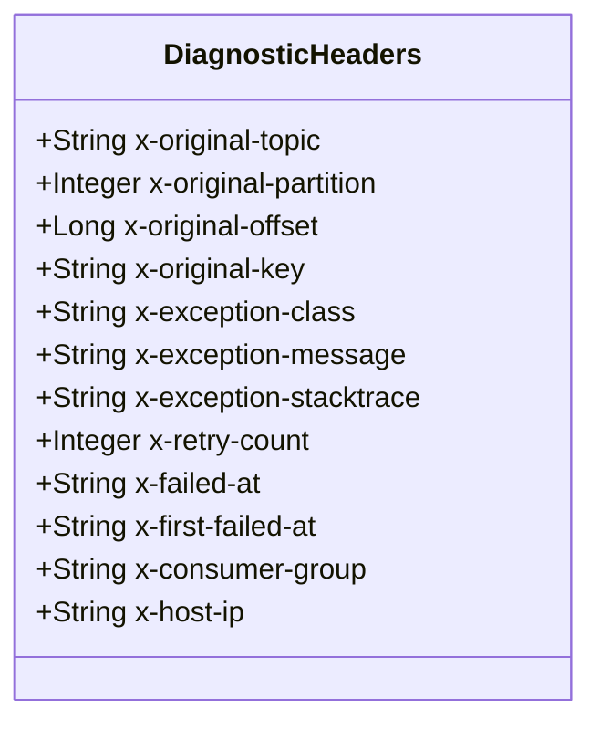
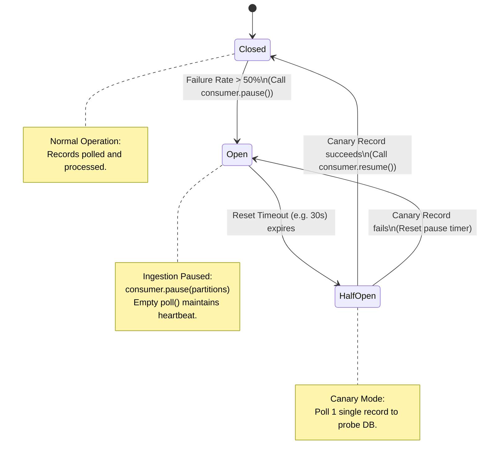
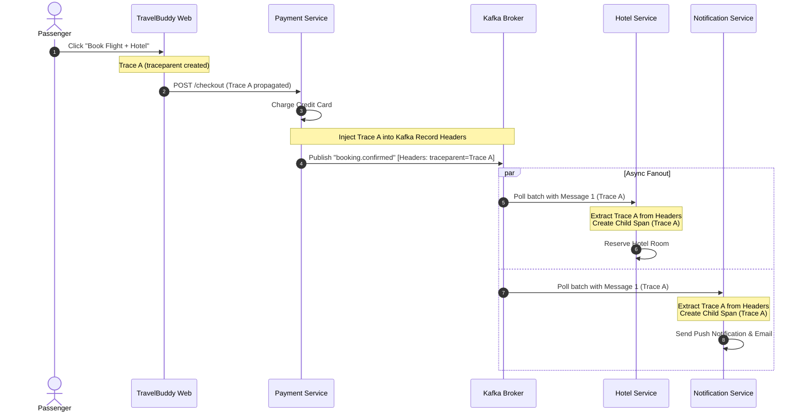

import { Callout } from "fumadocs-ui/components/callout";
import { Tabs, Tab } from "fumadocs-ui/components/tabs";
import { Steps, Step } from "fumadocs-ui/components/steps";
import { Cards, Card } from "fumadocs-ui/components/card";

In a synchronous HTTP or gRPC microservice ecosystem, an error is immediate and localized: an downstream database query times out, a `504 Gateway Timeout` is returned to the client, and the caller handles the failure.

In an **event-driven architecture (EDA)**, the producer has long since fired its message and moved on. The consumer processes the message milliseconds, minutes, or even hours later in total temporal isolation. When that processing fails, standard synchronous mitigation patterns fall apart completely.

If you retry immediately in a loop, you risk locking a partition forever. If you discard the failed message, you cause silent financial or data loss. If you dump everything into an uninspected Dead-Letter Queue (DLQ), you turn your disaster-recovery store into a digital graveyard.

This guide explores the design patterns, mathematical foundations, and observability standards required to build fault-tolerant, self-healing event consumer topologies at scale.

---

## 1. Error Classification & The Poison Pill Catastrophe

Before architecting retry mechanisms, we must classify why an asynchronous consumer fails. In distributed systems, message processing errors fall into two mutually exclusive categories: **Transient Errors** and **Deterministic (Poison Pill) Errors**.

```mermaid
flowchart TD
    Err["Consumer Record Failure"] --> Classify{"Error Classification"}

    Classify -->|"Transient Fault"| Transient["Transient Infrastructure Issue"]
    Transient --> T1["Network blip / socket reset"]
    Transient --> T2["Database lock contention (Deadlock 40P01)"]
    Transient --> T3["Downstream API HTTP 429 / 503"]
    Transient --> T4["Pod restart / rolling deployment"]

    Classify -->|"Deterministic Fault"| Deterministic["Poison Pill (Deterministic)"]
    Deterministic --> D1["JSON / Avro / Protobuf parse error"]
    Deterministic --> D2["Schema evolution mismatch (missing field)"]
    Deterministic --> D3["Null Pointer / Business logic invariant failure"]
    Deterministic --> D4["Illegal data value (e.g. negative seat price)"]

    style Err fill:#1e293b,stroke:#94a3b8,stroke-width:2px
    style Transient fill:#0f766e,stroke:#14b8a6,stroke-width:2px
    style Deterministic fill:#881337,stroke:#f43f5e,stroke-width:2px
```



### The Anatomy of a Poison Pill

A **Poison Pill** is a message that cannot be processed successfully regardless of how many times it is retried because the failure is deterministic. The payload is intrinsically malformed, violates business constraints, or triggers an unhandled software bug.

Consider TravelBuddy's Black Friday flash sale. A consumer on the `hotel-reservations` topic receives a reservation event:

```json
{
  "reservation_id": "res_982341",
  "hotel_id": "htl_tokyo_shinjuku_01",
  "nights": -3,
  "guest_id": null,
  "total_cents": "NaN"
}
```

The consumer code attempts to calculate room pricing:

```typescript
const totalPrice = record.nights * getRoomRate(record.hotel_id);
if (isNaN(totalPrice) || totalPrice <= 0) {
  throw new Error(
    `Invalid booking duration or pricing for ${record.reservation_id}`
  );
}
```

Every single time this consumer executes, it throws `Error: Invalid booking duration`.

### The Head-of-Line (HoL) Blocking Disaster

In an append-only log broker like Apache Kafka, Redpanda, or AWS Kinesis, partitions are strictly ordered. A consumer group tracks its position within a partition using an **offset**.

```mermaid
flowchart LR
    subgraph Partition["Kafka Partition 3: hotel-reservations"]
        direction LR
        O101["Offset 101<br/>[Committed]"]
        O102["Offset 102<br/>[Committed]"]
        O103["Offset 103<br/>(POISON PILL)<br/>CRASH!"]
        O104["Offset 104<br/>(Valid Booking)"]
        O105["Offset 105<br/>(Valid Booking)"]
        O106["Offset 106<br/>(Valid Booking)"]
    end

    Consumer["Consumer Instance B"] -->|"Stuck at Offset 103"| O103

    style O101 fill:#1e293b,stroke:#64748b
    style O102 fill:#1e293b,stroke:#64748b
    style O103 fill:#881337,stroke:#f43f5e,stroke-width:3px
    style O104 fill:#064e3b,stroke:#059669
    style O105 fill:#064e3b,stroke:#059669
    style O106 fill:#064e3b,stroke:#059669
    style Consumer fill:#1e293b,stroke:#38bdf8,stroke-width:2px
```



If the consumer configuration specifies simple in-memory retries (`retry.backoff.ms` with infinite attempts):

1. The consumer encounters the poison pill at Offset 103.
2. The consumer fails and throws an exception.
3. Because the record was not processed, the consumer **cannot commit Offset 103**.
4. The consumer re-polls the broker, receives Offset 103 again, and crashes again.
5. **Head-of-Line Blocking occurs:** Valid bookings at Offsets 104, 105, 106, and beyond are completely starved.
6. The consumer lag on Partition 3 spikes toward infinity. Thousands of valid hotel bookings are delayed, causing customer cancellations across the platform.

<Callout
  type="error"
  title="In-Place Retries are Forbidden on Shared Partitions"
>
  Never implement unbounded in-place synchronous retry loops inside a Kafka or
  Kinesis message listener. If an error is deterministic, an in-place retry
  freezes the entire partition. If an error is transient but lasts 5 minutes,
  in-place retries will exceed `max.poll.interval.ms`, causing consumer group
  rebalance storms.
</Callout>

---

## 2. Multi-Tiered Non-Blocking Retry Topic Laddering

To achieve zero message loss, zero Head-of-Line blocking, and predictable recovery times, enterprise architectures use **Non-Blocking Retry Topic Laddering**.

Instead of pausing consumption on the main partition, the consumer immediately commits the offset of the failed message and republishes it to a dedicated **delayed retry topic** with enriched routing headers.

```mermaid
flowchart TD
    Main["main-topic: hotel-bookings"] -->|"1. Poll record"| CMain["Main Consumer Group"]
    CMain -->|"2. Process fails (Attempt 1)"| Route1{"Error Type?"}

    Route1 -->|"Poison Pill (4xx/Schema)"| DLQ["dlq: hotel-bookings.dlq"]
    Route1 -->|"Transient Failure"| R10["retry-topic: hotel-bookings.retry-10s"]
    CMain -.->|"3. Commit offset on Main immediately"| Main

    R10 -->|"4. Delayed Poll (10s delay)"| C10["Retry-10s Consumer Group"]
    C10 -->|"5. Process fails (Attempt 2)"| R60["retry-topic: hotel-bookings.retry-60s"]
    C10 -->|"Success"| Done1["Acknowledge & Complete"]

    R60 -->|"6. Delayed Poll (60s delay)"| C60["Retry-60s Consumer Group"]
    C60 -->|"7. Process fails (Attempt 3)"| R600["retry-topic: hotel-bookings.retry-600s"]
    C60 -->|"Success"| Done2["Acknowledge & Complete"]

    R600 -->|"8. Delayed Poll (10m delay)"| C600["Retry-600s Consumer Group"]
    C600 -->|"9. Exhausted max attempts"| DLQ
    C600 -->|"Success"| Done3["Acknowledge & Complete"]

    style Main fill:#1e293b,stroke:#38bdf8,stroke-width:2px
    style DLQ fill:#881337,stroke:#f43f5e,stroke-width:2px
    style R10 fill:#1e293b,stroke:#f59e0b,stroke-width:2px
    style R60 fill:#1e293b,stroke:#f59e0b,stroke-width:2px
    style R600 fill:#1e293b,stroke:#ea580c,stroke-width:2px
```



### How Non-Blocking Retries Operate

<Steps>
### Step 1: Main Topic Ingestion
The main consumer processes the incoming record. If processing succeeds, the offset is committed. If a transient error occurs (e.g. database timeout), the error handler intercepts the exception.

### Step 2: Forwarding to the First Retry Tier

The error handler adds metadata headers (such as `x-retry-count: 1`, `x-original-topic: hotel-bookings`, and `x-retry-timestamp: <now>`), publishes the record to `hotel-bookings.retry-10s`, and **immediately commits the offset on the main topic**. The main partition is unblocked and processes the next message instantly.

### Step 3: Enforcing Topic-Specific Delays

The consumer group dedicated to `hotel-bookings.retry-10s` must not consume records instantly; otherwise, the transient downstream condition will still be present. It enforces a 10-second delay based on record timestamps.

### Step 4: Escalation to Higher Tiers

If the attempt on `hotel-bookings.retry-10s` fails again, the message is routed to `hotel-bookings.retry-60s`. If that fails, it goes to `hotel-bookings.retry-600s` (10 minutes).

### Step 5: Terminal Routing to the Dead-Letter Queue

If the message exhausts all configured retry tiers, it is published to `hotel-bookings.dlq` for human inspection, forensics, or offline batch reconciliation.

</Steps>

### Enforcing Delays: Kafka vs. RabbitMQ

Brokers implement delays differently:

<Tabs items={["Kafka / Redpanda", "RabbitMQ / AMQP"]}>
  <Tab value="Kafka / Redpanda">
    Kafka does not have a native "delay delivery" feature for topic messages. To prevent busy-waiting, retry consumers must inspect the record timestamp (`record.timestamp()` or custom header):

    ```typescript
    const targetDelayMs = 10_000; // 10 seconds for retry-10s
    const recordTimestamp = record.headers['x-retry-timestamp']
      ? Number(record.headers['x-retry-timestamp'])
      : record.timestamp;

    const now = Date.now();
    const timeRemaining = (recordTimestamp + targetDelayMs) - now;

    if (timeRemaining > 0) {
      // Pause partition consumption to prevent busy looping
      consumer.pause([{ topic: record.topic, partition: record.partition }]);

      // Schedule resumption after the exact delay window
      setTimeout(() => {
        consumer.resume([{ topic: record.topic, partition: record.partition }]);
      }, timeRemaining);

      // Seek back to this record so poll() returns it again when resumed
      consumer.seek({ topic: record.topic, partition: record.partition, offset: record.offset });
      return;
    }
    ```

    Alternatively, production systems use frameworks like **Spring Kafka** (`@RetryableTopic`) or route delayed events through an ephemeral **Redis Sorted Set (ZSET)** where `score = scheduled_epoch_ms`.

  </Tab>

  <Tab value="RabbitMQ / AMQP">
    RabbitMQ natively supports delayed message laddering without custom consumer pause logic using **Per-Message TTL (Time-To-Live)** and **Dead Letter Exchanges (DLX)**:

    1. Define exchange `retry.10s.exchange` routed to queue `retry.10s.queue`.
    2. Configure queue arguments on `retry.10s.queue`:
       - `x-message-ttl: 10000` (10,000 milliseconds = 10s)
       - `x-dead-letter-exchange: bookings.direct`
       - `x-dead-letter-routing-key: bookings.main`
    3. The consumer sends failed messages directly to `retry.10s.exchange`.
    4. **No consumers listen on `retry.10s.queue`!**
    5. After exactly 10,000 ms, RabbitMQ automatically expires the message and routes it through the Dead Letter Exchange back into `bookings.main`.

  </Tab>
</Tabs>

---

## 3. Diagnostic DLQ Message Headers & Forensic Metadata

A dead-letter queue full of raw JSON or binary byte payloads without context is an operational liability. When an on-call engineer is paged at 03:00 AM, they cannot safely replay or discard messages without knowing _where_ they originated, _why_ they failed, and _how many_ attempts were made.

Every enterprise DLQ router must inject standard diagnostic headers before writing to the DLQ:



### The Standard Forensic Header Schema

| Header Key               | Type     | Description                                           | Example                                     |
| :----------------------- | :------- | :---------------------------------------------------- | :------------------------------------------ |
| `x-original-topic`       | String   | The main topic where the event was first ingested     | `"travelbuddy.bookings.v1"`                 |
| `x-original-partition`   | Integer  | Source partition ID                                   | `4`                                         |
| `x-original-offset`      | Long     | Source partition offset for log correlation           | `14092841`                                  |
| `x-original-key`         | String   | Original partitioning key (preserves entity identity) | `"user_882914"`                             |
| `x-exception-class`      | String   | FQDN of the exception thrown by consumer              | `"org.postgresql.util.PSQLException"`       |
| `x-exception-message`    | String   | Truncated human-readable failure message              | `"ERROR: deadlock detected (Process 4012)"` |
| `x-exception-stacktrace` | String   | First 5 lines of stack trace for immediate triage     | `"at HotelRepo.reserve (hotel.ts:42)..."`   |
| `x-retry-count`          | Integer  | Total attempts across all laddered tiers              | `4`                                         |
| `x-failed-at`            | ISO-8601 | Timestamp of the final terminal failure               | `"2026-11-02T16:20:00.124Z"`                |
| `x-first-failed-at`      | ISO-8601 | Timestamp when Attempt 1 originally failed            | `"2026-11-02T16:08:49.001Z"`                |

### Implementation: Production Dead-Letter Router

```typescript
import { Kafka, Producer, EachMessagePayload } from "kafkajs";

export interface DLQMetadata {
  originalTopic: string;
  partition: number;
  offset: string;
  key?: string;
  error: Error;
  retryCount: number;
  firstFailedAt: string;
  consumerGroup: string;
}

export class ResilientDeadLetterRouter {
  constructor(
    private readonly producer: Producer,
    private readonly dlqTopicName: string
  ) {}

  public async routeToDLQ(
    payload: EachMessagePayload,
    meta: DLQMetadata
  ): Promise<void> {
    const rawHeaders = payload.message.headers || {};

    // Construct immutable forensic envelope headers
    const enrichedHeaders = {
      ...rawHeaders,
      "x-original-topic": Buffer.from(meta.originalTopic),
      "x-original-partition": Buffer.from(String(meta.partition)),
      "x-original-offset": Buffer.from(meta.offset),
      "x-original-key": meta.key ? Buffer.from(meta.key) : Buffer.from(""),
      "x-exception-class": Buffer.from(meta.error.name || "Error"),
      "x-exception-message": Buffer.from(
        (meta.error.message || "").slice(0, 1024)
      ),
      "x-exception-stacktrace": Buffer.from(
        (meta.error.stack || "").slice(0, 2048)
      ),
      "x-retry-count": Buffer.from(String(meta.retryCount)),
      "x-failed-at": Buffer.from(new Date().toISOString()),
      "x-first-failed-at": Buffer.from(meta.firstFailedAt),
      "x-consumer-group": Buffer.from(meta.consumerGroup),
      "x-host-id": Buffer.from(process.env.HOSTNAME || "unknown-pod"),
    };

    await this.producer.send({
      topic: this.dlqTopicName,
      messages: [
        {
          key: payload.message.key,
          value: payload.message.value,
          headers: enrichedHeaders,
          timestamp: String(Date.now()),
        },
      ],
    });
  }
}
```

---

## 4. Full-Jitter Exponential Backoff Mechanics

When an external dependency fails (such as TravelBuddy's primary PostgreSQL cluster or Stripe's API), retrying immediately is catastrophic. If 5,000 consumers experience an error at $T_0$ and all retry after a static 2-second delay, they will all blast the downstream service at $T_0 + 2.0\text{s}$, driving it back into saturation.

This synchronization of retry traffic is called the **Thundering Herd Retry Storm**.

```mermaid
flowchart TD
    subgraph Synchronized["No Jitter: Synchronized Spikes (Service Crushes Again)"]
        S1["T0: DB Crash (5000 reqs fail)"] -->|"All sleep exactly 2.000s"| S2["T0 + 2.0s: 5000 req spike! DB Dies!"]
        S2 -->|"All sleep exactly 4.000s"| S3["T0 + 6.0s: 5000 req spike! DB Dies!"]
    end

    subgraph FullJitter["Full Jitter: Distributed Poisson Smoothing"]
        J1["T0: DB Crash (5000 reqs fail)"] -->|"Uniform distribution: random(0, 2.0s)"| J2["T0 to T0+2.0s: Continuous smooth trickle of ~25 req/sec"]
        J2 -->|"Downstream DB Recovers"| J3["Gradual recovery without overload"]
    end

    style Synchronized fill:#881337,stroke:#f43f5e
    style FullJitter fill:#064e3b,stroke:#059669
```



### Mathematical Formulations of Backoff Strategies

Let $b$ be the base delay (e.g. 500ms), $c$ be the retry attempt number ($c \in [1, 2, 3, \dots]$), and $T_{\text{max}}$ be the maximum backoff ceiling (e.g. 30,000ms).

#### 1. Standard Exponential Backoff (No Jitter)

$$T_{\text{sleep}} = \min(T_{\text{max}}, b \cdot 2^{c})$$
_Failure Mode:_ All clients fail at once, double their delay together, and strike the server in perfectly synchronized periodic waves.

#### 2. Equal Jitter

Half of the exponential interval is fixed, and the other half is jittered:
$$T_{\text{temp}} = \min(T_{\text{max}}, b \cdot 2^{c})$$
$$T_{\text{sleep}} = \frac{T_{\text{temp}}}{2} + \text{random}\left(0, \frac{T_{\text{temp}}}{2}\right)$$
_Properties:_ Guarantees a minimum rest interval while dispersing half the load.

#### 3. Full Jitter (The Industry Gold Standard)

The entire backoff duration is randomized uniformly between $0$ and the exponential ceiling:
$$T_{\text{sleep}} = \text{random}\left(0, \min(T_{\text{max}}, b \cdot 2^{c})\right)$$

### Mathematical Proof: Why Full Jitter Eliminates Spikes

Consider $N$ concurrent consumers failing at $T=0$.

Under **No Jitter**, the arrival rate at time $t = b \cdot 2^c$ is modeled by a Dirac delta function:
$$\lambda(t) = N \cdot \delta(t - b \cdot 2^c)$$
The peak throughput instantaneously hits $N$, exceeding server capacity $C_{\text{max}}$, ensuring $N > C_{\text{max}}$ and precipitating consecutive cascading failures.

Under **Full Jitter**, each consumer's sleep time $X_i$ is an independent and identically distributed (i.i.d.) continuous uniform random variable:
$$X_i \sim \mathcal{U}(0, M), \quad \text{where } M = \min(T_{\text{max}}, b \cdot 2^c)$$

The probability density function (PDF) for any consumer retrying at time $t$ is constant over the interval $[0, M]$:
$$f_X(t) = \begin{cases} \frac{1}{M} & \text{for } 0 \le t \le M \\ 0 & \text{otherwise} \end{cases}$$

The expected number of retry requests arriving in any tiny sub-interval of width $\Delta t$ is:
$$\mathbb{E}[K_{\Delta t}] = N \cdot \int_{t}^{t + \Delta t} f_X(u) \, du = \frac{N \Delta t}{M}$$

The instantaneous request rate is:
$$\lambda(t) = \frac{N}{M} = \frac{N}{\min(T_{\text{max}}, b \cdot 2^c)}$$

By choosing $M$ sufficiently large, the instantaneous load $\lambda(t)$ is suppressed well below the downstream recovery capacity $C_{\text{max}}$, transforming a fatal spike into a uniform stochastic trickle.

---

## 5. Consumer Circuit Breakers & Ingestion Throttling

When a critical downstream service (e.g. TravelBuddy's primary PostgreSQL booking database) goes offline completely, **neither retry topics nor DLQs will protect you**.

If consumers process 10,000 events per second and the database is dead, every single message fails. If you route them all to retry topics or DLQ, you will flush millions of messages into the DLQ within minutes. When the database comes back online, the DLQ is filled with valid, uncorrupted messages that now require massive manual remediation.



### The Kafka Consumer Pause/Resume Pattern

A Kafka consumer must send periodic heartbeats to the broker coordinator (`heartbeat.interval.ms`, default 3s). If the consumer stops polling for longer than `max.poll.interval.ms` (default 300s), the coordinator marks the consumer dead and triggers a rebalance.

Therefore, you **must not** block the consumer thread with `Thread.sleep()`. Instead, you invoke `consumer.pause(assignedPartitions)`. In this paused state, calling `consumer.poll()` returns 0 records immediately, allowing the background heartbeat to keep the consumer alive without fetching new records.

### Production Implementation: Node.js / KafkaJS Circuit Breaker

```typescript
import { Consumer, EachBatchPayload, TopicPartition } from "kafkajs";

enum CircuitState {
  CLOSED,
  OPEN,
  HALF_OPEN,
}

export class KafkaConsumerCircuitBreaker {
  private state: CircuitState = CircuitState.CLOSED;
  private consecutiveFailures = 0;
  private readonly failureThreshold = 5;
  private readonly recoveryTimeoutMs = 30_000;
  private nextAttemptTimestamp = 0;

  constructor(private readonly consumer: Consumer) {}

  public async handleBatch(
    payload: EachBatchPayload,
    processRecord: (record: any) => Promise<void>
  ): Promise<void> {
    const {
      batch,
      resolveOffset,
      heartbeat,
      commitOffsetsIfNecessary,
      isRunning,
      isPaused,
    } = payload;

    // Check if open circuit has reached cool-down window
    if (this.state === CircuitState.OPEN) {
      if (Date.now() >= this.nextAttemptTimestamp) {
        console.warn(
          "[CircuitBreaker] Transitioning to HALF_OPEN. Probing downstream..."
        );
        this.state = CircuitState.HALF_OPEN;
        // Resume partition consumption for canary probe
        this.consumer.resume([
          { topic: batch.topic, partition: batch.partition },
        ]);
      } else {
        // Still open: skip processing, maintain heartbeat, do not advance offset
        await heartbeat();
        return;
      }
    }

    for (const message of batch.messages) {
      if (!isRunning() || isPaused()) break;

      try {
        await processRecord(message);

        // If in HALF_OPEN and processing succeeded, close circuit
        if (this.state === CircuitState.HALF_OPEN) {
          console.info(
            "[CircuitBreaker] Canary record succeeded! Circuit is CLOSED."
          );
          this.state = CircuitState.CLOSED;
          this.consecutiveFailures = 0;
        }

        resolveOffset(message.offset);
        await commitOffsetsIfNecessary();
        await heartbeat();
      } catch (err: any) {
        this.consecutiveFailures++;
        console.error(
          `[CircuitBreaker] Error processing offset ${message.offset}: ${err.message}`
        );

        if (
          this.consecutiveFailures >= this.failureThreshold ||
          this.state === CircuitState.HALF_OPEN
        ) {
          this.tripCircuit(batch.topic, batch.partition);
          // Break loop: do not process remaining batch messages
          break;
        }

        throw err; // Trigger standard retry ladder for isolated failure
      }
    }
  }

  private tripCircuit(topic: string, partition: number): void {
    this.state = CircuitState.OPEN;
    this.nextAttemptTimestamp = Date.now() + this.recoveryTimeoutMs;
    console.error(
      `[CircuitBreaker] TRIPPED! Pausing partition ${topic}:${partition} for ${this.recoveryTimeoutMs}ms`
    );

    // Pause partition: poll() will return empty batches, preserving consumer heartbeat
    this.consumer.pause([{ topic, partition }]);
  }
}
```

---

## 6. Asynchronous Observability & Distributed Tracing

In synchronous REST or gRPC microservices, distributed tracing is straightforward: a request hits an API gateway, generating a trace ID, and the trace context is passed through HTTP headers (`traceparent`) along every synchronous hop.

In event-driven architectures, tracing often breaks down because:

1. **Temporal Disconnection:** Message production and consumption are decoupled in time.
2. **One-to-Many Fanout:** A single produced event may trigger 15 distinct consumer services.
3. **Batch Consumption:** A single consumer poll might receive 100 messages originating from 100 distinct user traces.
4. **Thread Disconnection:** In asynchronous runtimes, worker pools decouple message reception from message execution.



### The W3C Trace Context Specification

All enterprise event architectures should adhere to the **W3C Trace Context** standard. Traces propagate across brokers using two specific header keys:

1. `traceparent`: Encodes the version, trace ID, parent span ID, and trace flags.
2. `tracestate`: Carries vendor-specific routing state (e.g., Datadog, Dynatrace, AWS X-Ray).

The `traceparent` header is a 4-part string format:

$$\texttt{version - trace\_id - parent\_id - trace\_flags}$$

$$\texttt{00 - 4bf92f3577b34da6a3ce929d0e0e4736 - 00f067aa0ba902b7 - 01}$$

- **version (2 hex chars):** Currently `00`.
- **trace_id (32 hex chars):** Unique 16-byte distributed transaction identifier across all services.
- **parent_id (16 hex chars):** Unique 8-byte ID of the sending operation (the producer's span ID).
- **trace_flags (2 hex chars):** Bitmap flags (`01` indicates the trace was sampled).

### Header Injection & Extraction in Kafka

<Tabs items={["TypeScript (OpenTelemetry)", "Java (Spring Cloud Sleuth / OTel)"]}>
  <Tab value="TypeScript (OpenTelemetry)">
    ```typescript
    import { propagation, context, trace, SpanKind } from '@opentelemetry/api';
    import { ProducerRecord, Message } from 'kafkajs';

    // 1. Producer: Inject traceparent into Kafka message headers
    export function createTracedKafkaMessage(topic: string, key: string, payload: any): ProducerRecord {
      const carrier: Record<string, string> = {};

      // Inject current active span context into plain object carrier
      propagation.inject(context.active(), carrier);

      const kafkaHeaders: Record<string, Buffer> = {};
      for (const [k, v] of Object.entries(carrier)) {
        kafkaHeaders[k] = Buffer.from(v);
      }

      return {
        topic,
        messages: [
          {
            key,
            value: JSON.stringify(payload),
            headers: kafkaHeaders,
          },
        ],
      };
    }

    // 2. Consumer: Extract traceparent and wrap execution in Child Span
    export async function processTracedMessage(
      message: Message,
      handler: () => Promise<void>
    ): Promise<void> {
      const tracer = trace.getTracer('travelbuddy-consumer');

      // Extract headers from Kafka format to carrier format
      const carrier: Record<string, string> = {};
      if (message.headers) {
        for (const [k, v] of Object.entries(message.headers)) {
          if (v) carrier[k] = v.toString();
        }
      }

      const extractedContext = propagation.extract(context.active(), carrier);

      // Create consumer span linked as a child of the producer span
      await tracer.startActiveSpan(
        `Consume:${message.key?.toString() || 'record'}`,
        { kind: SpanKind.CONSUMER },
        extractedContext,
        async (span) => {
          try {
            await handler();
            span.setStatus({ code: 1 }); // OK
          } catch (err: any) {
            span.recordException(err);
            span.setStatus({ code: 2, message: err.message }); // ERROR
            throw err;
          } finally {
            span.end();
          }
        }
      );
    }
    ```

  </Tab>

  <Tab value="Java (Spring Cloud Sleuth / OTel)">
    ```java
    import io.opentelemetry.api.trace.Tracer;
    import io.opentelemetry.context.propagation.TextMapGetter;
    import org.apache.kafka.clients.consumer.ConsumerRecord;
    import org.apache.kafka.common.header.Header;
    import org.springframework.kafka.annotation.KafkaListener;
    import org.springframework.stereotype.Component;

    @Component
    public class BookingEventListener {

        private final Tracer tracer;

        public BookingEventListener(Tracer tracer) {
            this.tracer = tracer;
        }

        @KafkaListener(topics = "travelbuddy.bookings.v1", groupId = "hotel-service")
        public void onMessage(ConsumerRecord<String, String> record) {
            // TextMapGetter for Kafka Record Headers
            TextMapGetter<ConsumerRecord<String, String>> getter = new TextMapGetter<>() {
                @Override
                public Iterable<String> keys(ConsumerRecord<String, String> carrier) {
                    return () -> java.util.stream.StreamSupport.stream(carrier.headers().spliterator(), false)
                            .map(Header::key).iterator();
                }

                @Override
                public String get(ConsumerRecord<String, String> carrier, String key) {
                    Header header = carrier.headers().lastHeader(key);
                    return header != null ? new String(header.value()) : null;
                }
            };

            // Extract context and execute within consumer span
            io.opentelemetry.context.Context extractedContext = io.opentelemetry.api.GlobalOpenTelemetry
                .getPropagators().getTextMapPropagator()
                .extract(io.opentelemetry.context.Context.current(), record, getter);

            try (var scope = extractedContext.makeCurrent()) {
                var span = tracer.spanBuilder("ProcessBookingEvent")
                    .setSpanKind(io.opentelemetry.api.trace.SpanKind.CONSUMER)
                    .startSpan();
                try {
                    // Execute business logic...
                } finally {
                    span.end();
                }
            }
        }
    }
    ```

  </Tab>
</Tabs>

### OpenTelemetry SpanLinks for Batch Consumers

What happens when a Kafka consumer fetches a batch of 500 messages, where each message was produced by a different user transaction with its own unique `trace_id`?

A child span can only have **one** direct parent. If you arbitrarily pick the first message's trace context as the parent of the batch span, you corrupt the distributed traces of the other 499 transactions.

The solution is OpenTelemetry **SpanLinks**:

```mermaid
flowchart TD
    M1["Message 1 (Trace A)"] -->|"Span Link 1"| BatchSpan["Batch Consumer Execution Span<br/>(Own Autonomous Trace X)"]
    M2["Message 2 (Trace B)"] -->|"Span Link 2"| BatchSpan
    M3["Message 3 (Trace C)"] -->|"Span Link 3"| BatchSpan

    BatchSpan --> Sub1["Process Record 1 (Child of Trace A)"]
    BatchSpan --> Sub2["Process Record 2 (Child of Trace B)"]
    BatchSpan --> Sub3["Process Record 3 (Child of Trace C)"]

    style BatchSpan fill:#1e293b,stroke:#38bdf8,stroke-width:2px
    style M1 fill:#0f766e,stroke:#14b8a6
    style M2 fill:#0f766e,stroke:#14b8a6
    style M3 fill:#0f766e,stroke:#14b8a6
```



The batch processing execution creates its own standalone span. It attaches **SpanLinks** referencing the extracted contexts of all 500 messages. When individual records are subsequently iterated over and processed, individual child spans are spawned linked directly to their specific parent traces.

### The Metadata Triad: Causality DAG Reconstruction

While W3C `traceparent` tracks runtime execution spans across machines, complex asynchronous sagas and business workflows require semantic causality tracking. Distributed tracing tells you _which code executed_; causality tracking tells you _why a business event occurred_.

Every event envelope must carry **The Metadata Triad**:

```mermaid
flowchart TD
    E1["Event 1: FlightBooked<br/>-----------------------------<br/>message_id: 001<br/>correlation_id: TX_999<br/>causation_id: 001 (Root)"]

    E1 -->|"triggers"| E2["Event 2: PaymentProcessed<br/>-----------------------------<br/>message_id: 002<br/>correlation_id: TX_999<br/>causation_id: 001"]

    E2 -->|"triggers"| E3["Event 3: HotelVoucherIssued<br/>-----------------------------<br/>message_id: 003<br/>correlation_id: TX_999<br/>causation_id: 002"]

    E2 -->|"triggers"| E4["Event 4: ReceiptEmailed<br/>-----------------------------<br/>message_id: 004<br/>correlation_id: TX_999<br/>causation_id: 002"]

    style E1 fill:#1e293b,stroke:#38bdf8,stroke-width:2px
    style E2 fill:#1e293b,stroke:#f59e0b,stroke-width:2px
    style E3 fill:#064e3b,stroke:#059669,stroke-width:2px
    style E4 fill:#064e3b,stroke:#059669,stroke-width:2px
```



1. **`message_id` (UUIDv4 or ULID):** The globally unique identifier for this specific physical message envelope.
2. **`correlation_id` (Business Workflow UUID):** Shared across every single event and command participating in the same high-level business workflow (e.g. TravelBooking `TX_999`), from initiation to completion or compensation.
3. **`causation_id` (Parent `message_id`):** The `message_id` of the direct ancestor event or command that caused this event to be produced.

By indexing these three fields in an analytical store (such as Elasticsearch, ClickHouse, or Snowflake), you can reconstruct the complete Directed Acyclic Graph (DAG) of any distributed business transaction:

```sql
-- Reconstruct the full downstream causality tree for a failed event
WITH RECURSIVE EventCausalityTree AS (
    -- Anchor member: The root initiating event
    SELECT message_id, correlation_id, causation_id, event_type, created_at, 1 AS depth
    FROM event_store
    WHERE message_id = '001'

    UNION ALL

    -- Recursive member: Find all direct children whose causation_id matches
    SELECT e.message_id, e.correlation_id, e.causation_id, e.event_type, e.created_at, ect.depth + 1
    FROM event_store e
    INNER JOIN EventCausalityTree ect ON e.causation_id = ect.message_id
)
SELECT * FROM EventCausalityTree ORDER BY depth, created_at;
```

---

## 7. Resilience & Observability Architecture Summary

Building resilient consumers requires orchestrating these techniques into a single, cohesive topology:

<Cards>
  <Card title="Classify Before Retrying" icon="AlertTriangle">
    Filter poison pills at the gateway. Never allow a deterministic schema or
    deserialization error into an automated retry loop.
  </Card>
  <Card title="Laddered Topics for Kafka" icon="Layers">
    Use non-blocking escalating delay topics (`10s`, `60s`, `600s`) to prevent
    partition Head-of-Line blocking.
  </Card>
  <Card title="Enrich DLQ Envelopes" icon="FileText">
    Attach complete forensic headers: original partition, offset, exception
    class, stack trace, and retry counts.
  </Card>
  <Card title="Pause, Don't Sleep" icon="PauseCircle">
    Integrate circuit breakers directly with consumer partition pause APIs
    (`consumer.pause()`) to preserve broker heartbeats while downstream services
    recover.
  </Card>
  <Card title="Full Jitter Backoff" icon="TrendingUp">
    Eliminate thundering herd storms by randomizing retry backoffs uniformly
    across the exponential range.
  </Card>
  <Card title="The Observability Triad" icon="Activity">
    Combine W3C `traceparent` headers with `message_id`, `correlation_id`, and
    `causation_id` for distributed causality tracing.
  </Card>
</Cards>
