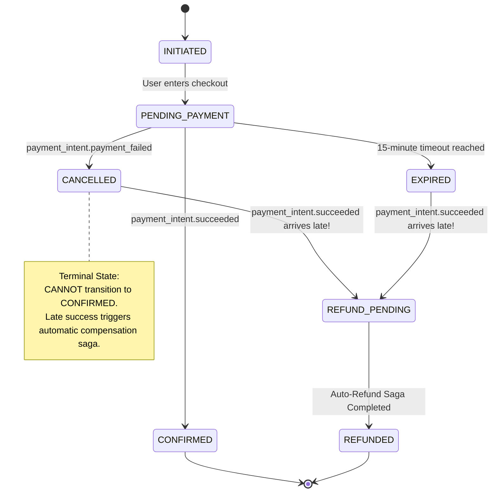
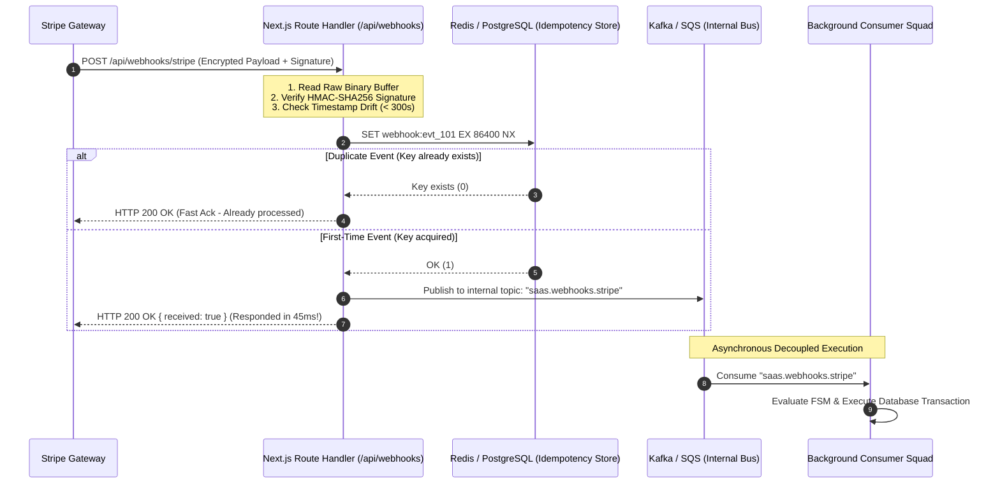

import { Callout } from "fumadocs-ui/components/callout";
import { Tabs, Tab } from "fumadocs-ui/components/tabs";
import { Steps, Step } from "fumadocs-ui/components/steps";
import { Cards, Card } from "fumadocs-ui/components/card";

While internal Event-Driven Architecture relies on private, controlled brokers like Apache Kafka, RabbitMQ, and Amazon SQS running inside secure VPCs, modern engineering teams do not live in isolation. Crucial business transactions depend on external SaaS platforms: **Stripe** and **PayPal** for payment processing, **Clerk** and **Auth0** for identity, **Twilio** for SMS, **Shopify** for inventory, and **GitHub** for CI/CD.

How do these third-party platforms notify your system when a background event occurs? Through **Webhooks**—the public internet's event-driven architecture.

Webhooks invert the standard HTTP client-server relationship: the SaaS provider becomes the client making HTTP `POST` callbacks, and your web application becomes the server. However, receiving events across the unauthenticated, hostile, public internet introduces severe engineering risks: spoofed requests, replay attacks, duplicate deliveries, out-of-order execution, and catastrophic race conditions.

---

## 1. Webhooks as the Public Internet's EDA

To understand why webhooks fail in production, we must contrast internal message brokers with public HTTP callbacks.

```mermaid
flowchart LR
    subgraph InternalEDA["Internal EDA (Kafka / SQS)"]
        direction TB
        P1["Internal Service"] -->|"TCP / Wire Protocol"| B1[("Private Broker (VPC)")]
        B1 -->|"Pull / Long-Poll"| C1["Internal Consumer"]
    end

    subgraph ExternalEDA["Public Internet EDA (Webhooks)"]
        direction TB
        SaaS["External SaaS (Stripe / Clerk)"] -->|"Push: HTTP POST"| Internet(("Public Internet"))
        Internet -->|"Edge CDN / API Gateway"| WebhookHandler["Webhook Ingestion Route"]
    end

    style InternalEDA fill:#0f172a,stroke:#38bdf8,stroke-width:2px
    style ExternalEDA fill:#0f172a,stroke:#f59e0b,stroke-width:2px
```



### The Architectural Contrast

| Dimension             | Internal Broker (Kafka / RabbitMQ)            | Public Webhooks (HTTP Callbacks)                    |
| :-------------------- | :-------------------------------------------- | :-------------------------------------------------- |
| **Network Boundary**  | Private VPC / Intranet                        | Public, untrusted Internet                          |
| **Delivery Model**    | Consumer **Pulls** at its own capacity        | Provider **Pushes** at its own rate                 |
| **Backpressure**      | Native (consumer pauses or slows poll loop)   | None (provider can inadvertently DDOS your API)     |
| **Authentication**    | Mutual TLS, SASL/SCRAM, IAM roles             | Shared HMAC signatures in HTTP headers              |
| **Latency Profile**   | Sub-millisecond to low milliseconds           | Highly variable (100ms to 5,000ms over WAN)         |
| **Payload Integrity** | Schema Registry (Avro, Protobuf, JSON Schema) | Raw JSON text over HTTP body                        |
| **Replay & Audit**    | Built-in offset rewind or log retention       | Provider dashboard or custom reconciliation polling |

Because public webhooks use HTTP `POST` pushes over the open web, your ingestion endpoint cannot assume caller identity, delivery order, or network stability.

---

## 2. The "Payment Failed then Charged Later" Real-World Outage

To grasp the danger of treating webhooks as simple synchronous updates, consider an actual high-severity production outage experienced by TravelBuddy during peak summer holiday booking.

```mermaid
sequenceDiagram
    autonumber
    actor User as Passenger (Alice)
    participant App as TravelBuddy Frontend
    participant API as TravelBuddy Backend
    participant Stripe as Stripe Gateway
    participant Bank as Issuing Bank Network
    participant Airline as Airline Seat Inventory

    User->>App: Book Flight Seat 12A (\$850)
    App->>API: Reserve Seat 12A & Create Checkout
    API->>Airline: Hold Seat 12A (15-minute lock)
    API->>Stripe: Create PaymentIntent (\$850)

    User->>Stripe: Submit Card Details & 3D-Secure
    Stripe->>Bank: Authorize Charge
    Bank-->>Stripe: Connection Timeout / Soft Decline
    Stripe-->>App: Card Error / Payment Failed

    App->>User: Display: "Payment Failed. Seat released."
    App->>API: Cancel Booking
    API->>Airline: Release Seat 12A Hold
    Note over User: Alice closes laptop and books another airline.

    rect rgb(30, 41, 59)
        Note over Bank,Stripe: 18 Minutes Later (Out-of-Band Background Retry)
        Bank->>Stripe: Asynchronous Settlement Succeeded!
        Stripe->>API: POST /api/webhooks/stripe<br/>event: payment_intent.succeeded (\$850)
    end

    Note over API: Naive Webhook Handler executes:<br/>UPDATE bookings SET status = 'CONFIRMED'
    API->>Airline: Finalize Ticket for Seat 12A
    Airline-->>API: ERROR 409: Seat 12A already sold to Bob!

    Note over API,User: DISASTER: Alice was charged \$850 for a non-existent seat!
```



### The Anatomy of the Failure

1. **Card Network Asynchrony:** When Alice initiated payment for Seat 12A (\$850), the issuing bank experienced a network blip during 3D-Secure verification. Stripe returned an immediate failure to the client browser.
2. **Resource Release:** The TravelBuddy application correctly displayed a failure message, marked the internal booking as `CANCELLED`, and released the 15-minute temporary hold on Seat 12A. Another traveler, Bob, immediately bought Seat 12A.
3. **The Out-of-Band Retry:** 18 minutes later, the issuing bank's clearing network reconciled the hanging transaction and notified Stripe of settlement. Stripe did what it is designed to do: it generated a webhook event `payment_intent.succeeded` and delivered it to TravelBuddy.
4. **The Naive Handler:** TravelBuddy's webhook handler received the event and executed:
   ```sql
   UPDATE bookings
   SET status = 'CONFIRMED', payment_id = 'pi_991823'
   WHERE booking_id = 'bk_alice_4920';
   ```
5. **The Incident:** TravelBuddy charged Alice \$850, confirmed a booking in the local database, but had no flight seat to assign. When Alice arrived at the airport three days later, she had no ticket. TravelBuddy faced regulatory fines, credit card chargeback penalties, and a severe customer trust crisis.

### The Architectural Fix: Finite State Machine (FSM) Guards

The fatal flaw was treating an asynchronous webhook as an unconditional state assignment rather than an **external state transition proposal** evaluated against a strict **Finite State Machine (FSM)**.



#### FSM Rule of Terminal States

Once an entity transitions into a terminal state (`CANCELLED`, `EXPIRED`, `REFUNDED`), it **cannot** be revived into `CONFIRMED`.

If an unexpected `payment_intent.succeeded` event arrives for a terminal booking:

1. The webhook handler intercepts the terminal state mismatch.
2. The booking transitions into `REFUND_PENDING`.
3. The system dispatches an automated compensation command: `InitiateStripeRefundCommand`.
4. A notification is sent to the customer: _"Your card was charged after your session timed out. We have automatically credited \$850 back to your card."_

---

## 3. High-Throughput Webhook Ingestion Topology

External SaaS platforms enforce strict HTTP acknowledgment timeouts. For example:

- **Stripe:** Expects an HTTP `2xx` response within **15 seconds** (ideally under 2 seconds).
- **GitHub:** Times out after **10 seconds**.
- **Shopify:** Times out after **5 seconds**.

If your webhook endpoint performs heavy work synchronously—such as querying multiple database tables, generating PDFs, or calling airline reservation systems—processing will easily exceed these timeouts during high load.

When a timeout occurs, the SaaS provider assumes delivery failed and triggers **automated exponential retries**. If 500 webhooks time out, Stripe retries all 500 simultaneously, doubling the load on your struggling database and initiating a cascading collapse.



### The Ingestion Rules

1. **Verify at the Edge:** Cryptographically verify the signature and timestamp window before touching any internal service.
2. **Deduplicate Immediately:** Check an atomic idempotency key (`evt_...`). If already seen, immediately return `200 OK`.
3. **Buffer and Acknowledge:** Write the verified payload to an internal, highly durable message broker (Kafka, Amazon SQS, or transactional outbox) and return `HTTP 200 OK` within **100 milliseconds**.
4. **Process Asynchronously:** Downstream background workers consume from the internal queue, handling business logic, third-party integrations, and database state updates with full retry elasticity.

---

## 4. Cryptographic HMAC Verification & Security

Never accept webhook requests without verifying cryptographic authenticity. Anyone can spoof an HTTP `POST` request with a fake payload claiming:

```json
{
  "type": "payment_intent.succeeded",
  "data": {
    "object": { "amount": 85000, "customer": "cus_malicious_attacker" }
  }
}
```

To prevent spoofing, SaaS providers sign every webhook request using a **Hash-based Message Authentication Code (HMAC-SHA256)** with a secret key shared between the provider and your application.

```mermaid
flowchart TD
    subgraph SaaSProvider["SaaS Provider (Stripe)"]
        RawPayload["Raw HTTP Body Bytes (P)"]
        Timestamp["Current Epoch Seconds (T)"]
        Secret["Shared Webhook Secret (K)"]

        Combine["Concatenate: T + '.' + P"]
        HMAC["Compute HMAC-SHA256(Combine, K)"]
        Header["Header: Stripe-Signature: t=T, v1=HMAC"]

        RawPayload & Timestamp --> Combine
        Combine & Secret --> HMAC --> Header
    end

    subgraph Receiver["Your Server (Next.js / Node.js)"]
        RecvBody["Read Raw Buffer (Not parsed JSON!)"]
        RecvHeader["Extract t and v1 from Header"]

        CheckTime{"|Now - t| < 300s?"}
        ComputeLocal["Compute HMAC-SHA256(t + '.' + RecvBody, K)"]
        Compare{"crypto.timingSafeEqual(v1, LocalHMAC)"}

        RecvHeader --> CheckTime
        CheckTime -->|"Expired (> 5 min)"| Reject1["Reject HTTP 400 (Replay Attack)"]
        CheckTime -->|"Valid"| ComputeLocal
        RecvBody --> ComputeLocal
        ComputeLocal --> Compare
        Compare -->|"Mismatch"| Reject2["Reject HTTP 400 (Tampered / Invalid Secret)"]
        Compare -->|"Match"| Accept["Proceed to Idempotency & Queue"]
    end

    Header -.->|"Transmitted over HTTP"| RecvHeader
    RawPayload -.->|"Transmitted over HTTP"| RecvBody

    style SaaSProvider fill:#0f172a,stroke:#38bdf8,stroke-width:2px
    style Receiver fill:#0f172a,stroke:#10b981,stroke-width:2px
```



### The Raw Body Gotcha: Why JSON Re-Serialization Destroys Signatures

<Callout
  type="error"
  title="Critical Vulnerability: Never Verify Against Re-Serialized JSON"
>
  You MUST verify the HMAC signature against the **exact raw binary bytes**
  received over the TCP socket. Never parse the body as JSON and then call
  `JSON.stringify(body)` to compute the HMAC!
</Callout>

Why will re-serializing parsed JSON fail or introduce security vulnerabilities?

1. **Key Ordering Non-Determinism:** JSON specification (ECMA-404) states that object key ordering is unordered. Stripe might sign `{"amount":850,"currency":"usd"}`, but your JavaScript engine might serialize it as `{"currency":"usd","amount":850}`. The resulting SHA256 hashes will be completely different!
2. **Whitespace and Formatting Differences:** A single space, newline, or tab character alters the cryptographic hash:
   - Wire payload: `{"id": "evt_01"}` (with space after colon)
   - Serialized: `{"id":"evt_01"}` (minified without space)
   - Hash match: **FAILED**.
3. **Unicode Escapes:** Stripe might send `\u0026` instead of `&`. `JSON.parse` resolves the escape, and `JSON.stringify` emits `&`. The byte stream changes, failing HMAC validation.
4. **Floating Point Precision:** Numbers like `1.0` vs `1` or large 64-bit integers may experience truncation or stringification differences across runtimes.

### Replay Attacks & The Timestamp Tolerance Window

An attacker who intercepts a valid webhook request over the network (or from compromised edge logs) could theoretically replay that exact HTTP request thousands of times. Because the signature matches the payload, a naive receiver would accept every replayed request.

To prevent replay attacks:

1. The SaaS provider includes a timestamp in the signature header: `Stripe-Signature: t=1710000000,v1=9f8a...`
2. The signature is computed over both the timestamp and the payload: `HMAC_SHA256(t + "." + rawPayload, secret)`. This prevents an attacker from altering the timestamp without invalidating the signature.
3. Your server checks the timestamp against its current system clock:
   $$\Delta t = |t_{\text{current}} - t_{\text{header}}|$$
   If $\Delta t > 300\text{ seconds}$ (5 minutes), the request is rejected immediately.
4. Always use **constant-time string comparison** (`crypto.timingSafeEqual`) to verify the signature. Standard equality (`===`) leaks timing information that allows attackers to iteratively guess signature bytes.

---

## 5. Production Blueprint: Next.js App Router Webhook Handler

Below is a complete, production-grade Next.js App Router route (`app/api/webhooks/stripe/route.ts`) implementing raw buffer extraction, cryptographic HMAC verification, timestamp drift validation, atomic PostgreSQL deduplication, and immediate internal queuing.

```typescript
import { NextRequest, NextResponse } from "next/server";
import crypto from "node:crypto";
import { Pool } from "pg";

// Initialize a connection pool to PostgreSQL for atomic deduplication
const dbPool = new Pool({
  connectionString: process.env.DATABASE_URL,
  max: 10,
});

const STRIPE_WEBHOOK_SECRET = process.env.STRIPE_WEBHOOK_SECRET!;
const MAX_TIMESTAMP_TOLERANCE_SECONDS = 300; // 5 minutes

interface StripeSignatureHeader {
  timestamp: number;
  signatures: string[];
}

function parseStripeSignature(headerValue: string): StripeSignatureHeader {
  const parts = headerValue.split(",");
  let timestamp = -1;
  const signatures: string[] = [];

  for (const part of parts) {
    const [key, val] = part.split("=");
    if (key === "t") {
      timestamp = parseInt(val, 10);
    } else if (key === "v1") {
      signatures.push(val);
    }
  }

  return { timestamp, signatures };
}

function verifyHmacSignature(
  rawBody: string,
  signatureHeader: string,
  secret: string
): boolean {
  const { timestamp, signatures } = parseStripeSignature(signatureHeader);

  if (timestamp === -1 || signatures.length === 0) {
    return false;
  }

  // 1. Guard against Replay Attacks: Check timestamp tolerance
  const now = Math.floor(Date.now() / 1000);
  if (Math.abs(now - timestamp) > MAX_TIMESTAMP_TOLERANCE_SECONDS) {
    console.error(
      `[Webhook Security] Timestamp out of tolerance window. Drift: ${now - timestamp}s`
    );
    return false;
  }

  // 2. Compute HMAC-SHA256 over: timestamp + "." + rawBody
  const signedPayload = `${timestamp}.${rawBody}`;
  const computedHmac = crypto
    .createHmac("sha256", secret)
    .update(signedPayload, "utf8")
    .digest("hex");

  const computedBuffer = Buffer.from(computedHmac, "utf8");

  // 3. Constant-time comparison against all supplied v1 signatures
  for (const sig of signatures) {
    const sigBuffer = Buffer.from(sig, "utf8");
    if (
      sigBuffer.length === computedBuffer.length &&
      crypto.timingSafeEqual(sigBuffer, computedBuffer)
    ) {
      return true;
    }
  }

  return false;
}

export async function POST(req: NextRequest) {
  // CRITICAL: Extract raw unparsed text directly from request stream
  const rawBody = await req.text();
  const signatureHeader = req.headers.get("stripe-signature");

  if (!signatureHeader) {
    return NextResponse.json(
      { error: "Missing stripe-signature header" },
      { status: 400 }
    );
  }

  // 1. Cryptographic Verification
  const isValid = verifyHmacSignature(
    rawBody,
    signatureHeader,
    STRIPE_WEBHOOK_SECRET
  );
  if (!isValid) {
    console.warn("[Webhook Security] Unauthorized webhook signature mismatch");
    return NextResponse.json(
      { error: "Invalid cryptographic signature" },
      { status: 401 }
    );
  }

  let event: any;
  try {
    event = JSON.parse(rawBody);
  } catch (err) {
    return NextResponse.json(
      { error: "Malformed JSON payload" },
      { status: 400 }
    );
  }

  const client = await dbPool.connect();
  try {
    await client.query("BEGIN");

    // 2. Atomic Deduplication Store
    // Using PostgreSQL UNIQUE constraint on webhook_id (event.id)
    const dedupQuery = `
      INSERT INTO processed_webhooks (webhook_id, provider, event_type, payload, status)
      VALUES ($1, 'stripe', $2, $3, 'RECEIVED')
      ON CONFLICT (webhook_id) DO NOTHING
      RETURNING id;
    `;

    const res = await client.query(dedupQuery, [
      event.id,
      event.type,
      JSON.stringify(event),
    ]);

    // If no row was inserted, this is a duplicate event!
    if (res.rowCount === 0) {
      await client.query("ROLLBACK");
      console.info(
        `[Webhook Idempotency] Duplicate event ${event.id} suppressed.`
      );
      // Always return 200 to inform provider not to retry
      return NextResponse.json(
        { received: true, duplicate: true },
        { status: 200 }
      );
    }

    // 3. Transactional Outbox Pattern: Enqueue for async processing
    const outboxQuery = `
      INSERT INTO transactional_outbox (aggregate_type, aggregate_id, event_type, payload)
      VALUES ('WEBHOOK', $1, $2, $3);
    `;
    await client.query(outboxQuery, [
      event.id,
      event.type,
      JSON.stringify(event),
    ]);

    await client.query("COMMIT");

    // 4. Ultra-fast HTTP 200 OK Response (Execution completed in < 50ms)
    return NextResponse.json({ received: true }, { status: 200 });
  } catch (dbErr: any) {
    await client.query("ROLLBACK");
    console.error(
      `[Webhook DB Error] Failed to persist event ${event.id}:`,
      dbErr
    );
    // Returning 500 signals Stripe to retry with exponential backoff
    return NextResponse.json(
      { error: "Internal storage error" },
      { status: 500 }
    );
  } finally {
    client.release();
  }
}
```

---

## 6. Out-of-Band State Reconciliation

Even with cryptographic verification, instant deduplication, and transactional outboxes, **relying solely on webhooks is an architectural anti-pattern**.

Why? Because the public internet is fundamentally unreliable:

- Cloudflare or AWS CloudFront may block legitimate Stripe webhook IP ranges during transient DDoS mitigations.
- DNS resolution can fail intermittently across ISP boundary borders.
- A rolling deployment of your API gateway may drop active TCP sockets.
- An engineer may accidentally deploy an invalid environment secret, rejecting webhooks for 45 minutes before rolling back.

If 0.05% of webhooks are dropped silently, your financial ledgers and seat inventory will drift permanently.

To achieve 100% data consistency, you must pair real-time webhooks with **Out-of-Band State Reconciliation Sweeps**.

```mermaid
flowchart TD
    subgraph RealTime["Real-Time Path (Low Latency)"]
        WEvent["Stripe Webhook Event"] -->|"Push over HTTP"| Edge["Webhook Handler"]
        Edge -->|"Immediate"| DB[("Production Database")]
    end

    subgraph Reconciliation["Out-of-Band Healing Path (Scheduled Cron)"]
        Cron["Hourly Reconciliation Cron (Job Worker)"]
        Cron -->|"1. Poll Stripe API: GET /v1/payment_intents?created[gte]=..."| StripeAPI["Stripe REST API"]
        Cron -->|"2. Query local bookings created in same window"| DB

        StripeAPI --> ReconEngine["Reconciliation Engine"]
        DB --> ReconEngine

        ReconEngine -->|"Diff Analysis"| Discrepancy{"Discrepancy Found?"}

        Discrepancy -->|"Local: PENDING, Stripe: SUCCEEDED"| Heal1["Heal: Trigger Late-Payment FSM Transition"]
        Discrepancy -->|"Local: CONFIRMED, Stripe: REFUNDED"| Heal2["Heal: Mark Fraud / Trigger Revocation"]
        Discrepancy -->|"Matching States"| OK["Log: 100% Ledger Consistency"]
    end

    style RealTime fill:#0f172a,stroke:#38bdf8,stroke-width:2px
    style Reconciliation fill:#0f172a,stroke:#10b981,stroke-width:2px
```



### The Two-Way Reconciliation Algorithm

Every hour (or every night at 02:00 AM UTC), an automated batch worker performs a sweep across a sliding lookback window (e.g. $[T - 25\text{ hours}, T - 1\text{ hour}]$):

<Steps>
### Step 1: Extract External Source of Truth
The worker queries the SaaS provider's paginated REST API:
```bash
GET /v1/payment_intents?created[gte]=1710000000&created[lte]=1710086400&limit=100
```
It extracts the list of all external transaction IDs and their terminal settlement statuses.

### Step 2: Query Local Ledger State

The worker queries the internal database for all bookings and payments recorded in that exact timestamp window.

### Step 3: Compute Difference Matrix

The reconciliation engine runs a set difference:

- **Set A:** Successful payments in Stripe.
- **Set B:** Confirmed bookings in TravelBuddy.

### Step 4: Execute Automated Remediation

1. **Case 1: Phantom Charge (In Stripe, but missing or pending in DB):**
   A webhook was dropped or crashed before committing. The reconciliation engine invokes the FSM. If the flight seat was already sold to another passenger, it executes an automatic refund via Stripe API. If the seat is still available, it auto-confirms the booking and emails the ticket to the user.
2. **Case 2: Phantom Ticket (In DB as confirmed, but missing or refunded in Stripe):**
   Indicates chargeback, fraud, or an unauthorized manual database update. The system flags the account, voids the boarding pass, and alerts fraud operations.

</Steps>

### Production Reconciliation Job Blueprint

```typescript
import { Stripe } from "stripe";
import { Pool } from "pg";

const stripe = new Stripe(process.env.STRIPE_SECRET_KEY!, {
  apiVersion: "2023-10-16",
});
const pool = new Pool({ connectionString: process.env.DATABASE_URL });

export async function runHourlyStripeReconciliationSweep(): Promise<void> {
  const windowEnd = Math.floor(Date.now() / 1000) - 3600; // 1 hour ago
  const windowStart = windowEnd - 86400; // 25 hours lookback

  console.info(
    `[Reconciliation] Starting sweep for window: ${windowStart} -> ${windowEnd}`
  );

  const missingCharges: Stripe.PaymentIntent[] = [];

  // 1. Paginate through Stripe payment intents
  for await (const intent of stripe.paymentIntents.list({
    created: { gte: windowStart, lte: windowEnd },
    limit: 100,
  })) {
    if (intent.status === "succeeded") {
      // 2. Check if local database has confirmed this payment
      const res = await pool.query(
        "SELECT id, status FROM bookings WHERE payment_intent_id = $1",
        [intent.id]
      );

      if (res.rowCount === 0) {
        console.error(
          `[Reconciliation ALERT] Unmatched successful charge: ${intent.id} for \$${intent.amount / 100}`
        );
        missingCharges.push(intent);
      } else if (res.rows[0].status === "PENDING_PAYMENT") {
        console.warn(
          `[Reconciliation HEALING] Recovering dropped webhook for booking ${res.rows[0].id}`
        );
        await healDroppedPayment(res.rows[0].id, intent);
      }
    }
  }

  console.info(
    `[Reconciliation] Sweep complete. Healed ${missingCharges.length} orphaned transactions.`
  );
}

async function healDroppedPayment(
  bookingId: string,
  intent: Stripe.PaymentIntent
): Promise<void> {
  // Execute FSM transition or trigger refund if expired
  await pool.query(
    `UPDATE bookings 
     SET status = 'CONFIRMED', reconciled_at = NOW() 
     WHERE id = $1 AND status = 'PENDING_PAYMENT'`,
    [bookingId]
  );
}
```

---

## 7. Webhook & Edge Events Summary

Building robust webhook systems requires treating external HTTP callbacks with zero-trust architectural discipline:

<Cards>
  <Card title="Raw Bytes Verification" icon="ShieldCheck">
    Always verify HMAC-SHA256 signatures against the raw binary request buffer.
    Re-serializing JSON invalidates signatures.
  </Card>
  <Card title="Prevent Replay Attacks" icon="Clock">
    Enforce a strict 5-minute timestamp tolerance window using constant-time
    string comparisons (`crypto.timingSafeEqual`).
  </Card>
  <Card title="Fast 200 OK Responses" icon="Zap">
    Decouple ingestion from business logic. Persist verified payloads to an
    atomic outbox or internal queue and return within 100ms.
  </Card>
  <Card title="FSM State Protection" icon="Cpu">
    Never blindly overwrite states. Guard against out-of-order success webhooks
    for cancelled bookings with automatic refund sagas.
  </Card>
  <Card title="Atomic Deduplication" icon="Database">
    Use unique constraints on external event IDs (`evt_...`) to gracefully drop
    duplicate provider retries.
  </Card>
  <Card title="Reconciliation Sweeps" icon="RefreshCw">
    Pair push-based webhooks with scheduled pull-based API reconciliation sweeps
    to guarantee zero financial and state drift.
  </Card>
</Cards>
