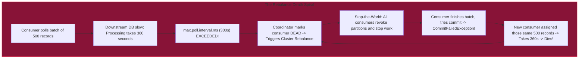
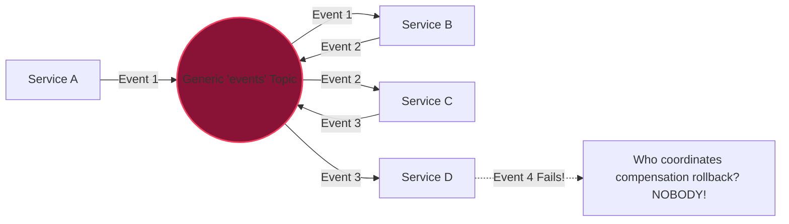
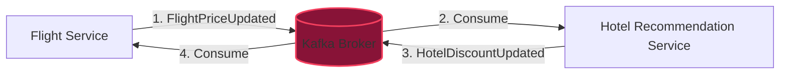

import { Callout } from "fumadocs-ui/components/callout";
import { Tabs, Tab } from "fumadocs-ui/components/tabs";
import { Steps, Step } from "fumadocs-ui/components/steps";
import { Cards, Card } from "fumadocs-ui/components/card";

Choosing a messaging technology is one of the most consequential decisions in distributed system design. Choose the wrong tool, and you will spend years fighting architectural mismatches: attempting to use an append-only log broker as a job queue, forcing an in-memory queue to act as a 30-day historical replay ledger, or watching consumer rebalance storms crash your production clusters during peak holiday traffic.

Once the technology is chosen, building an event-driven system introduces subtle design hazards. Without strict architectural discipline, teams fall into the trap of the **"Pinball Architecture"**—where events bounce unpredictably between twenty decoupled microservices, and no single engineer understands the end-to-end business flow.

This final lesson of Track 07 provides an exhaustive technology comparison matrix, deconstructs consumer rebalancing and Kafka Share Groups (KIP-932), analyzes the four deadliest EDA anti-patterns, and delivers the **Ten Golden Rules of Event-Driven Architecture**.

---

## 1. The Technology Selection Decision Tree

Architects often ask: _"Should we use Kafka, RabbitMQ, SQS, or Redis?"_

There is no universal winner. The choice depends entirely on five fundamental vectors: **throughput volume**, **retention and replay requirements**, **routing topology complexity**, **ordering semantics**, and **consumer concurrency scaling**.

```mermaid
flowchart TD
    Start["New Asynchronous Messaging Requirement"] --> Q1{"What is the primary message model?"}

    Q1 -->|"Task / Job Queue (Worker Pool)"| QTask{"Need serverless AWS native or multi-protocol?"}
    QTask -->|"AWS Managed Serverless"| SQS["Amazon SQS / SNS<br/>(Zero maintenance, per-message ack, simple DLQ)"]
    QTask -->|"Complex Routing / Low Latency"| Rabbit["RabbitMQ<br/>(AMQP, Topic exchanges, per-message TTL, microsecond P99)"]

    Q1 -->|"Event Streaming Log (Replayable History)"| QLog{"What is the scale & operations model?"}
    QLog -->|"Massive (>100k msg/sec), Partition Ordering"| Kafka["Apache Kafka / Redpanda<br/>(Append-only commit log, long retention, log compaction)"]
    QLog -->|"Ultra-low latency (<1ms), Edge / Polyglot"| NATS["NATS JetStream<br/>(Single binary, subject-based routing, kv/object store)"]
    QLog -->|"Lightweight, Short-lived (<24h), In-Memory"| Redis["Redis Streams<br/>(Consumer groups over existing Redis cluster)"]

    Q1 -->|"SaaS Integrations / Cloud Event Routing"| QEvent{"Cloud-wide JSON schema routing?"}
    QEvent -->|"AWS Ecosystem & SaaS Webhooks"| EB["AWS EventBridge<br/>(Content-based JSON filtering, direct SaaS partners)"]

    style Start fill:#1e293b,stroke:#94a3b8,stroke-width:2px
    style SQS fill:#0f172a,stroke:#38bdf8,stroke-width:2px
    style Rabbit fill:#0f172a,stroke:#f59e0b,stroke-width:2px
    style Kafka fill:#0f172a,stroke:#10b981,stroke-width:2px
    style NATS fill:#0f172a,stroke:#a855f7,stroke-width:2px
    style Redis fill:#0f172a,stroke:#f43f5e,stroke-width:2px
    style EB fill:#0f172a,stroke:#06b6d4,stroke-width:2px
```



### Core Architecture Classification: Smart Broker vs. Smart Consumer

Distributed messaging systems divide into two fundamentally opposing philosophical designs:

1. **Smart Broker, Dumb Consumer (e.g. RabbitMQ, Amazon SQS):**
   The broker tracks individual message delivery, acknowledgments, dead-letter timeouts, and redeliveries. When a consumer acknowledges a message (`basic.ack`), the broker physically removes it from the queue. The consumer does not care about offsets; it simply consumes messages.
2. **Dumb Broker, Smart Consumer (e.g. Apache Kafka, Redpanda):**
   The broker is an append-only disk commit log. Messages are never deleted upon consumption; they remain on disk for days, weeks, or indefinitely. Consumers maintain an **offset pointer** indicating their reading position. Consumers can rewind offsets to replay historical events at will.

---

## 2. Comprehensive Technology Comparison Matrix

| Technology          | Architectural Model                 | Delivery Semantics                                  | Max Throughput / Node                         | Latency (P99)                   | Replayability                              | Ordering Guarantee                         | Concurrency Limit                              | Best TravelBuddy Use Case                                     | Fatal Anti-Case                                     |
| :------------------ | :---------------------------------- | :-------------------------------------------------- | :-------------------------------------------- | :------------------------------ | :----------------------------------------- | :----------------------------------------- | :--------------------------------------------- | :------------------------------------------------------------ | :-------------------------------------------------- |
| **Apache Kafka**    | Dumb Broker / Partitioned Log       | At-least-once (EOS via 2PC transactions)            | 500,000+ msg/sec                              | 5ms - 25ms                      | Yes (rewind offsets, multi-week retention) | Strict per-partition                       | Partition-bound (Max 1 consumer per partition) | Financial ledger, flight search clickstream, CDC outbox       | Slow I/O worker queues (e.g. 30s PDF generation)    |
| **Redpanda**        | Kafka API in C++ (No JVM, Raft)     | At-least-once (EOS supported)                       | 1,000,000+ msg/sec                            | 1ms - 8ms                       | Yes (Kafka wire compatible)                | Strict per-partition                       | Partition-bound                                | High-scale Kafka drop-in without JVM GC pauses                | Same as Kafka                                       |
| **RabbitMQ**        | Smart Broker / Transient AMQP Queue | At-least-once                                       | 30,000 - 80,000 msg/sec                       | 0.5ms - 2ms                     | No (deleted upon `ack`)                    | FIFO per-queue without competing consumers | Free (1,000 workers can consume 1 queue)       | Asynchronous boarding pass PDF generator, webhook dispatcher  | 90-day analytics replay, high-volume event sourcing |
| **AWS SQS / SNS**   | Serverless Cloud Queue / Fanout     | SQS Standard: At-least-once; SQS FIFO: Exactly-once | SQS Standard: Nearly unlimited; FIFO: 3,000/s | 15ms - 45ms                     | No (deleted on delete-message)             | SQS FIFO: MessageGroupId; Standard: None   | Free (scaled via autoscaling Lambdas)          | Low-maintenance cloud workflows, Stripe webhook ingestion     | Sub-millisecond trading, cross-cloud portability    |
| **NATS JetStream**  | Lightweight Log / Subject Hierarchy | At-least-once                                       | 1,000,000+ msg/sec                            | Sub-millisecond (0.1ms - 1ms)   | Yes (configurable stream storage)          | Strict per-subject                         | Flexible (queue groups over streams)           | Global multi-region edge mesh, real-time flight telemetry     | Complex out-of-the-box SQL analytics connectors     |
| **Redis Streams**   | In-Memory Log with AOF persistence  | At-least-once                                       | 100,000+ msg/sec                              | Sub-millisecond (0.2ms - 0.5ms) | Limited by RAM (can trim via `XTRIM`)      | Strict per-stream                          | Group-based (read unconsumed messages)         | Real-time driver location updates, live hotel room view count | Multi-terabyte immutable audit ledgers              |
| **AWS EventBridge** | Serverless JSON Event Bus           | At-least-once                                       | 10,000 events/sec                             | 50ms - 200ms                    | Yes (event archive & replay feature)       | None                                       | Event rule targets (Lambdas, Step Functions)   | Direct SaaS integrations (Zendesk, Shopify, Auth0)            | High-frequency telemetry (>50,000 msg/sec)          |

---

## 3. Kafka Share Groups (KIP-932): Breaking the Partition Limit

For over a decade, Apache Kafka developers have grappled with its single biggest architectural constraint: **Partition-Bound Consumer Concurrency**.

```mermaid
flowchart TD
    subgraph TraditionalKafka["Traditional Kafka Consumer Group (Partition-Bound)"]
        direction TB
        subgraph Topic1["Topic: pdf-generation (4 Partitions)"]
            P0["Partition 0"]
            P1["Partition 1"]
            P2["Partition 2"]
            P3["Partition 3"]
        end

        C0["Consumer A"] <--> P0
        C1["Consumer B"] <--> P1
        C2["Consumer C"] <--> P2
        C3["Consumer D"] <--> P3
        C4["Consumer E<br/>(IDLE / WASTED!)"] -.->|"Cannot Consume!"| Topic1
    end

    subgraph ShareGroup["Kafka Share Groups KIP-932 (Queue Semantics)"]
        direction TB
        subgraph Topic2["Topic: pdf-generation (1 Partition)"]
            Recs["Records: [R1] [R2] [R3] [R4] [R5] [R6] [R7] [R8]"]
        end

        Recs -->|"Acquire R1"| W1["Worker 1"]
        Recs -->|"Acquire R2"| W2["Worker 2"]
        Recs -->|"Acquire R3"| W3["Worker 3"]
        Recs -->|"Acquire R4"| W4["Worker 4"]
        Recs -->|"Acquire R5"| W5["Worker 5 (ACTIVE!)"]
    end

    style TraditionalKafka fill:#0f172a,stroke:#f43f5e,stroke-width:2px
    style ShareGroup fill:#0f172a,stroke:#10b981,stroke-width:2px
```



### The Historic Dilemma

In traditional Kafka Consumer Groups:

- Each partition within a topic can be consumed by **at most one** consumer instance in that group.
- If a topic has 16 partitions, you can run at most 16 parallel consumer threads.
- If you scale your consumer deployment to 32 pods, **16 pods will sit completely idle**, consuming CPU and memory while doing zero work.

This is fine for fast, CPU-bound event streaming (processing 50,000 events/sec where each event takes 0.5ms). But for slow, I/O-bound tasks—such as TravelBuddy's boarding pass PDF generator (taking 8 seconds per PDF) or calling an external airline GDS API (taking 3 seconds)—a 16-partition topic can only generate two PDFs per second total!

To increase concurrency to 200 workers, teams historically had to create 200 artificial partitions or migrate the entire workload to RabbitMQ or SQS.

### How KIP-932 Solves This

**Kafka Improvement Proposal 932 (KIP-932)** introduces **Share Groups** to Apache Kafka, bringing true point-to-point work-queue semantics to partitioned logs:

1. **Record-Level Acquisition Locks:** Consumers in a Share Group do not lock entire partitions. Instead, the Kafka broker acts as a coordinator, handing out individual records or micro-batches to available workers and tracking an in-flight delivery state (`Acquired`).
2. **Individual Record Acknowledgment:** Workers explicitly acknowledge (`ACCEPT`), release (`RELEASE`), or reject (`REJECT`) individual records.
3. **Unlimited Consumer Concurrency:** Fifty consumers can pull records simultaneously from a single partition.
4. **Best of Both Worlds:** Teams retain Kafka's unified ecosystem, high-durability storage, and zero-loss replication without needing a separate RabbitMQ cluster for task distribution.

---

## 4. Consumer Group Rebalancing & The Death Spiral

In traditional Kafka consumer groups, consumers continually report health to the broker **Group Coordinator**. When a consumer joins, leaves, or dies, the group triggers a **Rebalance** to redistribute partitions across active members.

Understanding rebalance mechanics is critical to avoiding one of the most destructive outages in distributed systems: **The Rebalance Death Spiral**.



### Eager Rebalance vs. Cooperative Sticky Assignor

Historically, Kafka used the **Eager Rebalance Protocol**:

1. When any consumer joined or died, the coordinator commanded **every single consumer** in the group to revoke all assigned partitions.
2. All message processing halted across the entire cluster ("stop-the-world").
3. Consumers re-joined the group, received newly assigned partitions, and resumed processing.
4. If a consumer failed every 2 minutes, the entire system spent 100% of its time rebalancing, processing zero net messages.

Modern Kafka uses the **Cooperative Sticky Assignor** (`cooperative-sticky`):

- Instead of revoking all partitions, consumers continue processing their existing partitions uninterrupted.
- Only the specific partitions migrating between instances are temporarily paused and reassigned in two quick rounds.

### Anatomy of the Rebalance Death Spiral

Consider TravelBuddy's hotel inventory sync consumer with default configuration:

- `max.poll.records = 500`
- `max.poll.interval.ms = 300000` (5 minutes)

1. **Downstream Degradation:** The primary hotel database suffers index contention, slowing query times from 5ms to 800ms per record.
2. **Batch Overrun:** Processing 500 records takes $500 \times 800\text{ms} = 400\text{ seconds}$ (6.6 minutes).
3. **Coordinator Eviction:** Because the consumer poll loop took 400 seconds to call `poll()` again, it exceeded `max.poll.interval.ms` (300 seconds). The Kafka coordinator concludes the consumer pod has hung or crashed.
4. **Group Eviction & Rebalance:** The coordinator removes the consumer from the group and triggers a rebalance.
5. **Wasted Work:** The original consumer finally finishes processing its 500 records and attempts to commit offsets. The broker rejects the commit with `CommitFailedException` because the partitions were already revoked!
6. **Cascading Failure:** The coordinator assigns those same 500 unprocessed records to a second consumer pod. The second consumer pod also takes 400 seconds, also exceeds `max.poll.interval.ms`, and is also evicted!
7. **Complete Cluster Paralysis:** Every pod in the consumer group enters the loop, repeating the same batch of records perpetually while CPU hits 100% and lag grows indefinitely.

### Prevention & Remediation

<Steps>
### Step 1: Right-Size `max.poll.records`
Never use the default 500 records for heavy I/O operations. If an operation takes an average of 500ms, set:
$$\text{max.poll.records} \le \frac{\text{max.poll.interval.ms}}{2 \times \text{P99 Latency}} = \frac{300,000}{2 \times 500} = 300\text{ records}$$
For unpredictable external APIs (e.g. airline booking), set `max.poll.records = 10` or `20`.

### Step 2: Adopt Cooperative Sticky Assignment

In consumer configuration, explicitly enforce:

```properties
partition.assignment.strategy=org.apache.kafka.clients.consumer.CooperativeStickyAssignor
```

### Step 3: Decouple Ingestion from Processing via Worker Pools

Keep the Kafka `poll()` thread purely responsible for fetching and heartbeating. Hand off records to an internal thread pool or channel:

```typescript
import { Kafka, EachBatchPayload } from "kafkajs";
import pLimit from "p-limit";

const limit = pLimit(10); // Process 10 records concurrently in worker pool

async function resilientConsumerLoop(payload: EachBatchPayload) {
  const { batch, resolveOffset, heartbeat, commitOffsetsIfNecessary } = payload;

  const tasks = batch.messages.map((message) =>
    limit(async () => {
      await processHeavyBusinessLogic(message);
      resolveOffset(message.offset);
    })
  );

  // While worker pool executes, continually send heartbeats to coordinator
  const heartbeatInterval = setInterval(async () => {
    await heartbeat();
  }, 3000);

  try {
    await Promise.all(tasks);
    await commitOffsetsIfNecessary();
  } finally {
    clearInterval(heartbeatInterval);
  }
}
```

</Steps>

---

## 5. Top 4 Deadly EDA Anti-Patterns & Remediations

### Anti-Pattern 1: Entity-Synced CRUD Events (The DB Table Leak)

```mermaid
flowchart TD
    subgraph Bad["Anti-Pattern: CRUD Event (Leaking Database State)"]
        direction TB
        DB1[("Postgres: users table")] -->|"CDC trigger"| Evt1["UserUpdatedEvent<br/>{ id: 42, col_a: 'x', col_b: 'y', col_c: 'z' }"]
        Evt1 --> Consumer1["Downstream Billing Service<br/>(Must guess what changed!)"]
    end

    subgraph Good["Remediation: Semantic Domain Event (Explicit Business Intent)"]
        direction TB
        Domain["Domain Entity"] -->|"Emit Business Intent"| Evt2["UserUpgradedToTravelPlusEvent<br/>{ userId: 42, tier: 'GOLD', renewedAt: '2026-11-02' }"]
        Evt2 --> Consumer2["Downstream Billing Service<br/>(Executes explicit billing rule)"]
    end

    style Bad fill:#881337,stroke:#f43f5e,stroke-width:2px
    style Good fill:#064e3b,stroke:#059669,stroke-width:2px
```



- **The Mistake:** Publishing generic events directly mirroring database tables, such as `UserUpdated` or `BookingRowChanged`, containing full row snapshots or column diffs.
- **Why It Fails:** It turns your event broker into a distributed database replication bus. Downstream consumers become tightly coupled to your private schema. If you rename a database column from `phone_num` to `mobile`, you break fifteen independent microservices. Furthermore, consumers must reverse-engineer _why_ the record changed by comparing diffs.
- **The Remediation:** Emit **Intent-Revealing Domain Events**. Publish `UserPhoneNumberChanged`, `FlightSeatAssigned`, or `BookingCancelledDueToPaymentTimeout`. Events should communicate business occurrences, not relational database mutations.

---

### Anti-Pattern 2: The Generic Event Bus / Pinball Architecture



- **The Mistake:** Dumping all events across the entire company into a single monolithic topic (e.g. `company-events`), or allowing 20 microservices to coordinate a complex, mission-critical business workflow purely via ad-hoc asynchronous choreography.
- **Why It Fails:** Known as **Pinball Architecture**. When a user clicks "Book Holiday Package", Event 1 triggers Service B, which emits Event 2, triggering Service C, which emits Event 3. If Step 4 fails, there is no centralized state machine to execute compensating rollbacks. The workflow hangs in limbo, and debugging requires aggregating logs across 20 distinct repositories.
- **The Remediation: The Hybrid Rule:**
  - Use **Choreography** (Pub/Sub) for decoupled notifications across domain boundaries (e.g. _"Booking confirmed, notify marketing analytics and generate invoice"_).
  - Use **Orchestration** (Workflow engines like **Temporal**, **AWS Step Functions**, or an explicit Saga Orchestrator) for multi-step transactions requiring rollback guarantees and transactional integrity.

---

### Anti-Pattern 3: Event Storms & Ping-Pong Cascades



- **The Mistake:** Two or more services consume each other's events and emit corresponding output events without cycle detection.
- **Why It Fails:** TravelBuddy's flight pricing service emits `FlightPriceUpdated`. The hotel recommendation service consumes it, recalculates package discounts, and emits `HotelDiscountUpdated`. The flight pricing service listens to hotel discounts to optimize flight margins, recalculating and emitting `FlightPriceUpdated` again!

  Within seconds, the two services enter an infinite feedback loop. Throughput spikes from 10 msg/sec to 150,000 msg/sec, exhausting broker disk space, saturating network bandwidth, and taking down the cluster.

- **The Remediation:**
  1. **Hop Count Dampers:** Enforce a standard header `x-hop-count` in every event envelope. Producers increment `x-hop-count: previous + 1`. If `x-hop-count > 5`, drop the message and page on-call engineers.
  2. **Delta Thresholding:** Only emit update events if the financial change exceeds a meaningful business delta (e.g. price difference $> \$1.00$).

---

### Anti-Pattern 4: Ignoring Out-of-Order Events & Clock Drift

- **The Mistake:** Relying on wall-clock timestamps (`event.created_at = Date.now()`) generated on client or producer machines to determine state precedence.
- **Why It Fails:** Server physical clocks are subject to **NTP clock drift**. If Producer A's clock is running 4 seconds slow, an update it produces at 12:00:04 will carry timestamp `12:00:00`. If Producer B's clock is synchronized and produces an earlier update at 12:00:02, a consumer using `created_at` will apply updates in the wrong sequence, corrupting user profile state or overwriting new data with stale data.
- **The Remediation:** Use **Monotonic Sequence Tokens** or **Logical Version Counters**:

```sql
-- Enforce monotonic state progression in database consumer
UPDATE flight_bookings
SET
  passenger_status = $1,
  entity_version = $2,
  updated_at = NOW()
WHERE id = $3
  AND entity_version < $2; -- Only update if incoming version is strictly greater!
```

---

## 6. The Ten Golden Rules of EDA for Developers

To conclude Track 07, memorize these ten engineering commandments for designing and building production-grade event-driven architectures:

<Steps>
### 1. Consumers Must Be Idempotent by Default
Assume every message will be delivered at least twice. Design every consumer with an atomic deduplication store, unique database constraints, or idempotent state transition logic.

### 2. Never Verify Webhooks Against Re-Serialized JSON

Always verify cryptographic HMAC-SHA256 signatures against the raw binary byte stream received over the socket to prevent key-ordering and whitespace hash mismatches.

### 3. Reject In-Place Retries on Partitioned Log Brokers

Never block a Kafka or Kinesis partition with synchronous in-place retry loops. Use multi-tiered non-blocking retry topic laddering (`retry-10s`, `retry-60s`, `dlq`) to maintain partition flow.

### 4. Circuit Breakers Must Pause Ingestion, Not Flood DLQs

When downstream databases or external APIs fail, invoke `consumer.pause(partitions)` to stop consuming while keeping heartbeat threads alive. Never dump transient system outages into the DLQ.

### 5. Smooth Retries with Full Jitter

Always combine exponential backoff with full jitter ($\text{random}(0, \min(T_{\text{max}}, b \cdot 2^c))$) to disperse retry waves and prevent thundering herd spikes.

### 6. Semantic Domain Events Over Database CRUD Snapshots

Publish intent-revealing domain events (`FlightSeatAssigned`) rather than internal database table row mutations (`UserUpdated`). Never expose your internal relational schema on a public broker.

### 7. Orchestrate Complex Sagas, Choreograph Simple Notifications

Use pub/sub event choreography for decoupled notifications across microservices. Use centralized orchestration (e.g. Temporal, AWS Step Functions) for multi-step transactions requiring automated compensation and state rollbacks.

### 8. Guard Against Clock Drift with Monotonic Version Tokens

Never rely on wall-clock timestamps (`Date.now()`) for ordering state mutations across distributed producers. Use logical entity version counters and conditional SQL updates.

### 9. Attach the Observability Triad to Every Message

Every event envelope must carry `message_id` (envelope identity), `correlation_id` (business workflow trace), and `causation_id` (parent trigger ID) alongside W3C `traceparent` headers.

### 10. Out-of-Band State Reconciliation is Mandatory

Webhooks and asynchronous queues alone cannot guarantee 100% state synchronization across the public internet. Always pair real-time push events with scheduled pull reconciliation sweeps.

</Steps>

---

## 7. Technology & Architecture Review

<Cards>
  <Card title="Kafka vs RabbitMQ" icon="Layers">
    Use Kafka for durable, replayable commit logs and partition-ordered stream
    processing. Use RabbitMQ or SQS for concurrent task queues with per-message
    acknowledgment.
  </Card>
  <Card title="Kafka Share Groups (KIP-932)" icon="Cpu">
    Break the partition concurrency bottleneck by adopting Share Groups for
    slow, I/O-heavy workloads on Kafka topics.
  </Card>
  <Card title="Avoid Rebalance Spirals" icon="RefreshCw">
    Right-size `max.poll.records` against P99 downstream latencies and adopt
    `cooperative-sticky` rebalance assignors.
  </Card>
  <Card title="Defend Against Cascades" icon="ShieldAlert">
    Include `x-hop-count` headers in event envelopes to drop circular ping-pong
    feedback loops before they saturate cluster brokers.
  </Card>
</Cards>
