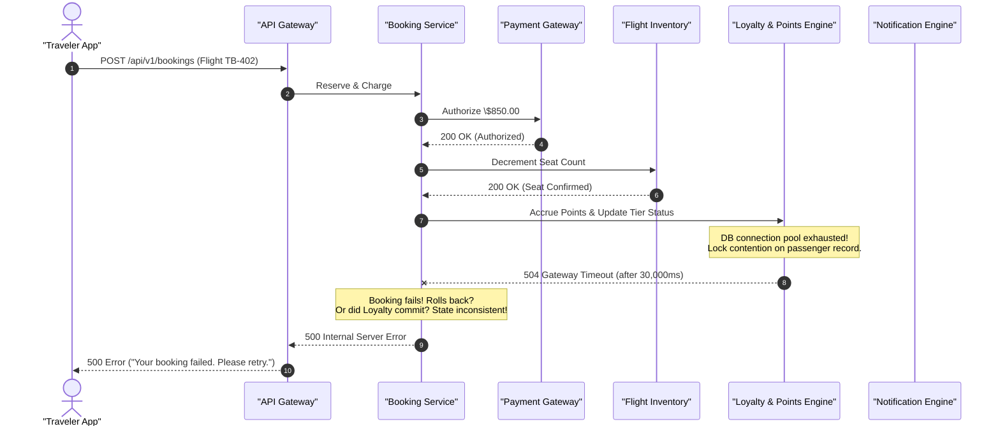
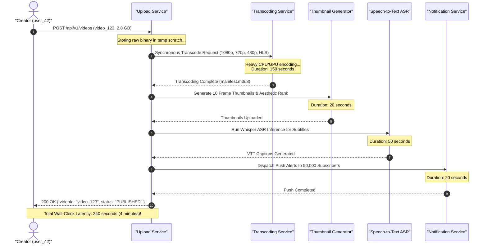

import { Callout } from "fumadocs-ui/components/callout";
import { Tabs, Tab } from "fumadocs-ui/components/tabs";
import { Steps, Step } from "fumadocs-ui/components/steps";
import { Cards, Card } from "fumadocs-ui/components/card";

## The Synchronous Illusion: The Architecture That Fails Under Pressure

In traditional web architecture and early microservice implementations, systems communicate primarily through **synchronous Request-Response protocols** (HTTP/REST, gRPC, direct RPC). A client issues a command, the backend opens downstream connections to sibling services, waits for each to compute and reply, aggregates the responses, and returns a final payload to the client.

In isolation, this model is simple, intuitive, and easy to trace with basic mental models. However, when scaled across distributed infrastructure, synchronous communication creates severe structural liabilities:

1. **Temporal Coupling**: The client, producer, intermediate orchestrators, and all downstream services must be operational, healthy, and reachable at the exact same physical millisecond.
2. **Spatial Coupling**: The caller must know the network identity, API contract, and endpoint location of every downstream recipient.
3. **Availability Degradation**: Downstream failures bubble up directly to the end user.
4. **Latency Accumulation**: Total request latency equals the sum of all downstream latencies plus network round-trips.

```mermaid
flowchart LR
    subgraph Synchronous["Synchronous Cascading Chain"]
        direction LR
        A["Client"] -->|"HTTP POST (Blocks)"| B["Service A"]
        B -->|"HTTP POST (Blocks)"| C["Service B"]
        C -->|"HTTP POST (Blocks)"| D["Service C"]
        D -->|"HTTP POST (Blocks)"| E["Service D"]
    end

    subgraph FailureImpact["Failure Modes"]
        direction TB
        F1["Latency = L_A + L_B + L_C + L_D"]
        F2["Availability = A_A × A_B × A_C × A_D"]
        F3["Thread Pool Exhaustion across all hops"]
    end

    Synchronous -.-> FailureImpact

    style Synchronous fill:#1e1e2e,stroke:#f38ba8,stroke-width:2px
    style FailureImpact fill:#181825,stroke:#fab387,stroke-width:1px
```

---

## The Running Narratives: Production Catastrophes in the Wild

To ground these distributed systems principles in engineering reality, Track 7 examines two contrasting production architectures: the enterprise e-commerce meltdown of **TravelBuddy** and the unscalable media pipeline of **The Video Platform**.

### Case Study 1: TravelBuddy's Black Friday Meltdown

**TravelBuddy** is a global airline ticketing and travel reservation platform handling 250,000 queries per second during peak travel booking windows.

During a Black Friday promotional campaign offering 70% discounts on transatlantic routes, TravelBuddy's booking engine encountered catastrophic cascading failure:

#### What Broke in Production?

1. **The Loyalty Engine Bottleneck**: The core flight booking and credit card authorization succeeded in under 400ms. However, the auxiliary `Loyalty & Points Engine` struggled under database row lock contention while recalculating frequent-flyer tier status.
2. **Cascading Thread Starvation**: Because the `Booking Service` waited synchronously for the `Loyalty Engine`, its worker thread pool (Tomcat/Netty connection workers) was exhausted waiting on I/O.
3. **The Stampeding Retry Storm**: Users whose screens displayed "500 Internal Server Error" immediately tapped the "Book Flight" button repeatedly. This amplified inbound load by 800%, driving the API Gateway into total thread exhaustion.
4. **Catastrophic State Inconsistency**: The passenger's credit card was charged \$850, and seat 14B was marked sold in the inventory database, but the booking record was never generated. Customer support queues spiked to 40,000 tickets within 45 minutes.

---

### Case Study 2: The Video Platform's 4-Minute Synchronous Cascade

Consider a naive implementation of a media distribution platform. A content creator, `user_42`, uploads a high-definition 4K video file, `video_123`.

In a synchronous design, the platform attempts to execute every post-upload lifecycle phase within the context of a single HTTP request:

#### The Realities of Holding a 4-Minute Synchronous Connection

Holding an HTTP connection open for 240 seconds violates fundamental assumptions of distributed infrastructure:

- **Intermediate Proxy Timeouts**: Edge reverse proxies (Cloudflare, AWS ALB, NGINX) terminate HTTP connections after standard timeout windows (typically 30s to 60s). The client sees a `504 Gateway Timeout` even though the backend is still running.
- **Mobile Client Dropouts**: Mobile operating systems aggressively background or terminate socket connections when an app loses focus or changes network interfaces (e.g., switching from 5G to Wi-Fi).
- **Zero Fault Tolerance**: If the `Notification Service` fails at second 238, the entire 240-second pipeline returns an error to the creator. The video was encoded, thumbnails were extracted, and subtitles were generated—yet the user is told the upload failed.
- **Wasted Compute on Retry**: When `user_42` retries, the entire 240 seconds of heavy GPU and CPU computation restarts from scratch, multiplying cloud infrastructure costs.

---

## The Mathematical Reality of Availability Collapse

When distributed services communicate synchronously in a serial chain, their operational availability does not average out; it **multiplies**:

### Serial Availability Formula

For a request requiring $n$ sequential synchronous microservice calls, where each service $i$ has an independent availability $p_i$:

$$P(\text{System Success}) = \prod_{i=1}^{n} p_i = p_1 \times p_2 \times p_3 \times \dots \times p_n$$

Assume an organization deploys five microservices, each architected to achieve an admirable **"three nines"** (99.9%) availability:

$$P(\text{Success}) = 0.999 \times 0.999 \times 0.999 \times 0.999 \times 0.999 = (0.999)^5 \approx 0.99501 \text{ (99.5\% availability)}$$

<Callout type="error" title="The High Cost of Synchronous Depth">
By chaining five "three nines" services synchronously, your system's overall availability drops to **99.5%**.

Your allowable downtime jumps from **8.76 hours per year to 43.8 hours per year**. You have lost two full nines of reliability purely through architectural topology.

If the services operate at standard **99%** availability ($p = 0.99$):

$$P(\text{Success}) = (0.99)^5 \approx 0.95099 \text{ (95.1\% availability)}$$

Nearly **1 out of every 20 user requests will fail**, even though every individual microservice dashboard is "green" 99% of the time!

</Callout>

### Tail Latency Amplification

Synchronous chaining exacerbates latency through **tail latency amplification**. If each service has a 99th percentile ($p99$) latency of 1 second, what is the probability that a transaction hitting 10 synchronous services experiences at least one $p99$ delay?

$$P(\ge 1 \text{ service at } p99) = 1 - (1 - 0.01)^{10} = 1 - (0.99)^{10} \approx 9.56\%$$

Nearly **10% of all user requests** will suffer from tail latency delays.

### Little's Law and Thread Pool Starvation

Little's Law defines the relationship between concurrency, arrival rate, and latency in any queuing system:

$$L = \lambda \times W$$

Where:

- $L$ is the average number of concurrent requests inside the system (active threads, sockets, file descriptors).
- $\lambda$ is the arrival rate of incoming requests (requests per second).
- $W$ is the average response time (wall-clock latency).

Let us compare the resource utilization of the Video Platform handling an arrival rate of $\lambda = 500 \text{ uploads/sec}$:

| Metric                               | Synchronous 4-Minute Cascade ($W = 240\text{s}$)                    | Asynchronous Event Ingestion ($W = 0.15\text{s}$) |
| :----------------------------------- | :------------------------------------------------------------------ | :------------------------------------------------ |
| **Arrival Rate ($\lambda$)**         | $500 \text{ req/sec}$                                               | $500 \text{ req/sec}$                             |
| **Duration ($W$)**                   | $240 \text{ seconds}$                                               | $0.15 \text{ seconds}$ ($150\text{ms}$)           |
| **Concurrent Connections ($L$)**     | $500 \times 240 = \mathbf{120,000 \text{ threads}}$                 | $500 \times 0.15 = \mathbf{75 \text{ threads}}$   |
| **Memory Footprint (at 1MB/thread)** | $\approx \mathbf{120 \text{ GB RAM}}$ purely for idle thread stacks | $\approx \mathbf{75 \text{ MB RAM}}$              |
| **Failure Mode**                     | Sockets exhausted, kernel OOM, 504 timeouts                         | Microservice idle, threads returned to pool       |

Holding threads open while waiting on downstream network I/O guarantees that a slow downstream service will inevitably crash every upstream service that calls it.

---

## The Paradigm Shift: Event-Driven Fan-Out Architecture

To eliminate temporal coupling and prevent cascading collapses, we invert the communication model. Instead of coordinating downstream work through imperative synchronous calls, the ingestion service performs minimal work, commits state, emits an **immutable Domain Event**, and returns immediately.

```mermaid
flowchart TD
    subgraph Ingestion["1. Synchronous Ingestion (150ms)"]
        Creator["Creator (user_42)"] -->|"1. POST video binary"| UploadSvc["Upload Service"]
        UploadSvc -->|"2. Write Raw Blob"| S3[("Object Storage (S3 / GCS)")]
        UploadSvc -->|"3. Publish VideoUploaded Event"| Broker{{"Distributed Event Broker<br/>(Kafka / Pulsar / RabbitMQ)"}}
        UploadSvc -->|"4. 202 Accepted (video_123)"| Creator
    end

    subgraph AsyncWorkers["2. Asynchronous Concurrent Fan-Out"]
        Broker -.->|"Consumer Group 1"| W_Transcode["Transcoding Cluster<br/>(GPU Autoscaling Pool)"]
        Broker -.->|"Consumer Group 2"| W_Thumb["Thumbnail Generator<br/>(Extract 10 frames)"]
        Broker -.->|"Consumer Group 3"| W_ASR["Speech-to-Text ASR<br/>(Whisper Inference)"]
        Broker -.->|"Consumer Group 4"| W_Mod["Content Moderation<br/>(Safety & Copyright)"]
        Broker -.->|"Consumer Group 5"| W_Search["Search Indexer<br/>(Vector & Full-Text DB)"]
    end

    W_Transcode --> StoreProcessed[("CDN Edge Storage")]
    W_Thumb --> StoreProcessed
    W_ASR --> StoreProcessed

    style Ingestion fill:#1e1e2e,stroke:#89b4fa,stroke-width:2px
    style AsyncWorkers fill:#181825,stroke:#a6e3a1,stroke-width:2px
    style Broker fill:#313244,stroke:#f9e2af,stroke-width:2px
```

### Architectural Transformations

1. **Client Latency Decoupling**: The upload service completes in **150ms** rather than **240 seconds**. It persists the raw video file to durable object storage, produces a single `VideoUploaded` event to the broker, and responds to the client with `202 Accepted`.
2. **True Concurrency**: Transcoding, thumbnail extraction, speech-to-text, and content moderation execute **in parallel**, bounded only by worker pool capacity, rather than serially.
3. **Isolated Blast Radius**: If the Speech-to-Text service experiences a GPU out-of-memory crash, the video still transcodes, thumbnails are still generated, and the media file is published. The captioning worker can retry independently or alert operators without blocking the core user journey.
4. **Elastic Independent Scaling**: The transcoding cluster can scale horizontally based on GPU queue depth, while the thumbnail generator scales on standard CPU metrics. Neither service impacts the deployment or runtime health of the upload ingress tier.

---

## Track Curriculum & Navigation

This track provides an end-to-end blueprint for architecting, deploying, and operating production-grade event-driven systems. Explore the six foundational modules:

<Cards>
  <Card
    title="01: Event Types, Anatomy & Messaging Models"
    href="/docs/system-design/07-event-driven-architecture/01-event-types-anatomy-and-messaging-models"
    icon="Radio"
    description="The command-query-event triad, CloudEvents envelopes, the 2x2 delivery matrix, schema governance with Avro/Protobuf, and ephemeral queues vs append-only commit logs."
  />
  <Card
    title="02: Delivery Guarantees & Idempotent Consumers"
    href="/docs/system-design/07-event-driven-architecture/02-delivery-guarantees-and-idempotent-consumers"
    icon="ShieldCheck"
    description="At-least-once, at-most-once, and exactly-once processing. Idempotency keys, distributed deduplication with Redis/PostgreSQL, and stateful stream deduplication."
  />
  <Card
    title="03: Transactional Outbox, CDC & Sagas"
    href="/docs/system-design/07-event-driven-architecture/03-transactional-outbox-cdc-and-sagas"
    icon="Database"
    description="Solving the dual-write dilemma. Transactional outbox pattern, Change Data Capture (CDC) with Debezium, and orchestrating distributed transactions via Sagas."
  />
  <Card
    title="04: Resilience, Error Topologies & Observability"
    href="/docs/system-design/07-event-driven-architecture/04-resilience-error-topologies-and-observability"
    icon="AlertTriangle"
    description="Dead-letter queues (DLQs), retry topics with exponential backoff and jitter, poison pill handling, and end-to-end OpenTelemetry distributed tracing."
  />
  <Card
    title="05: Webhooks, Edge Events & SaaS Reconciliation"
    href="/docs/system-design/07-event-driven-architecture/05-webhooks-edge-events-and-saas-reconciliation"
    icon="Webhook"
    description="Building production-grade webhook ingestion systems, HMAC-SHA256 signature verification, edge event buffers, and automated daily reconciliation engines."
  />
  <Card
    title="06: Technology Selection & Deadly Antipatterns"
    href="/docs/system-design/07-event-driven-architecture/06-technology-selection-and-deadly-antipatterns"
    icon="Layers"
    description="Technology decision matrix (Kafka vs RabbitMQ vs SQS vs Pulsar) and post-mortem analysis of deadly antipatterns like event-carried temporal coupling and distributed big balls of mud."
  />
</Cards>

---

## Developer Core Competency Checklist

Use this checklist to audit your architecture as you progress through Track 7:

<Steps>
  <Step>
    ### Event Modeling & Contract Governance
    - [ ] Differentiate strictly between Commands (imperative), Queries (read-only), and Events (immutable facts).
    - [ ] Eliminate "passive-aggressive commands" disguised as events.
    - [ ] Wrap all event payloads in a standardized CloudEvents v1.0 specification envelope with distributed tracing IDs.
    - [ ] Implement schema governance using a Schema Registry (Confluent / Apicurio) enforcing Backward or Full compatibility.
  </Step>

<Step>
  ### Atomicity & Dual-Write Elimination - [ ] Audit application code for the
  dual-write anti-pattern (e.g., updating a database row and calling
  `kafkaProducer.send()` in the same function). - [ ] Implement the
  Transactional Outbox Pattern with Change Data Capture (Debezium / PostgreSQL
  `test_decoding`) to guarantee zero data loss. - [ ] Replace synchronous
  distributed 2-Phase Commit (2PC) with Saga Choreography or Orchestration
  featuring explicit compensating transactions.
</Step>

<Step>
  ### Delivery Semantics & Consumer Idempotency - [ ] Design every consumer
  assuming **At-Least-Once delivery**; expect network retries and duplicate
  events. - [ ] Implement deterministic idempotency keys stored in an atomic
  datastore (PostgreSQL unique constraints or Redis `SETNX`). - [ ] Validate
  consumer ordering assumptions: partition keys ensure strict per-entity
  ordering without sacrificing global horizontal concurrency.
</Step>

  <Step>
    ### Resilient Error Topologies & Observability
    - [ ] Eliminate unhandled infinite retry loops blocking partition progress.
    - [ ] Deploy multi-tiered retry topics with exponential backoff and randomized jitter.
    - [ ] Route unrecoverable malformed messages to a Dead-Letter Queue (DLQ) with automated alerting and replay tooling.
    - [ ] Propagate W3C TraceContext headers (`traceparent`, `tracestate`) across all message boundaries to maintain end-to-end distributed traces.
  </Step>
</Steps>
