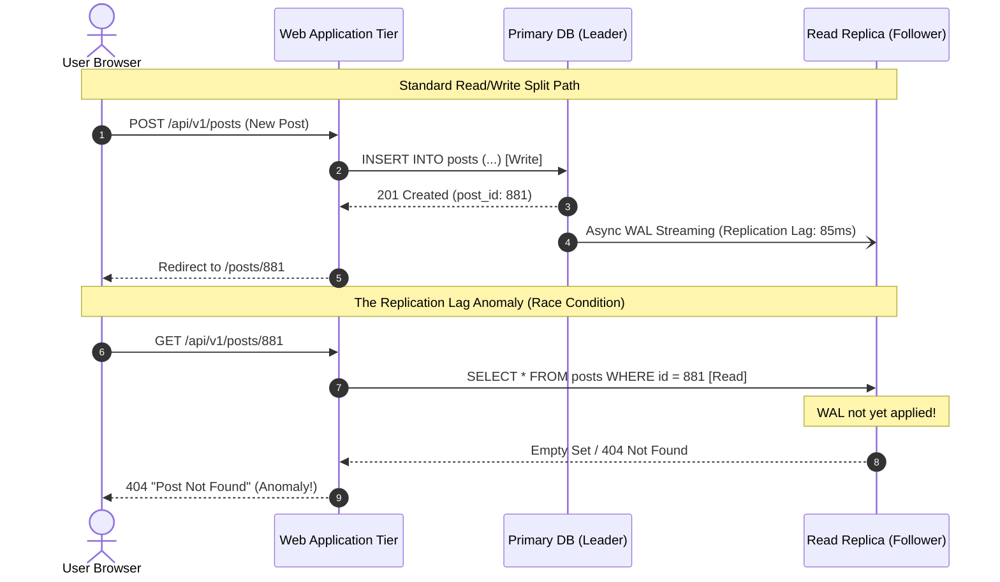

import { Callout } from "fumadocs-ui/components/callout";
import { Tabs, Tab } from "fumadocs-ui/components/tabs";
import { Steps, Step } from "fumadocs-ui/components/steps";

When an application crosses 10,000 Daily Active Users (DAU), the single-server monolith (Stage 1) crashes into its hard physical boundaries. Co-locating application workers, database engines, and asset delivery on one virtual machine triggers catastrophic resource contention: a burst of web traffic starves the database of CPU, while an intensive database query exhausts RAM and triggers the Linux Out-Of-Memory (OOM) killer.

Stage 2 represents the **first major architectural inflection point**: separating compute from state, introducing managed data infrastructure, offloading read-heavy queries through replicas and caching, and pushing static asset delivery to the network edge.

---

## 1. Quantitative Sizing & The Inflection Point

Before drawing diagrams or provisioning cloud resources, modern systems architecture requires sizing against empirical workload parameters.

```mermaid
flowchart LR
    subgraph TrafficProfile["Stage 2 Workload Metrics"]
        direction TB
        DAU["10,000 – 100,000 DAU"]
        QPS["Average: 10 – 50 QPS<br/>Peak: 150 – 300 QPS"]
        Storage["50 – 200 GB Storage<br/>Growth: ~1-3 GB/month"]
        Bandwidth["10 – 25 Mbps Origin Egress<br/>(Without CDN: 80+ Mbps)"]
    end

    subgraph StressPoints["Monolith Breaking Points"]
        direction TB
        B1["RAM Starvation: App Heap vs DB Shared Buffers"]
        B2["Disk IOPS Thrashing: WAL Writes vs App Logs"]
        B3["Single Point of Failure: 1 Reboot = 100% Outage"]
    end

    TrafficProfile --> StressPoints
    style TrafficProfile fill:#0f172a,stroke:#38bdf8,stroke-width:2px
    style StressPoints fill:#1e1e2e,stroke:#f43f5e,stroke-width:2px
```



### Back-of-the-Envelope Capacity Calculations

Let us derive the system constraints for an application serving **50,000 DAU** (the midpoint of Stage 2):

1. **Request Volume & Throughput**:
   - Average user sessions generate approximately $30\text{ to }50$ HTTP requests per day across page loads, API calls, and polling.
   - **Total Daily Requests**:
     $$\text{Daily Requests} = 50,000 \times 40 = 2,000,000 \text{ requests/day}$$
   - **Average Queries Per Second (QPS)**:
     $$\text{Average QPS} = \frac{2,000,000}{86,400 \text{ seconds}} \approx 23.1 \text{ QPS}$$
   - **Peak QPS**: Web traffic is non-uniform and clusters in daylight hours. Using a standard diurnal peak factor of $4\times$ to $6\times$:
     $$\text{Peak QPS} = 23.1 \times 5 \approx 115\text{–}150 \text{ QPS}$$

2. **Storage Growth**:
   - Each active user writes metadata, activity logs, transactions, or comments averaging $5 \text{ KB}$ of state per day.
   - Daily write volume: $50,000 \times 5 \text{ KB} = 250 \text{ MB/day} \approx 7.5 \text{ GB/month}$.
   - Over a 1-year horizon with indexes and transaction logs (WAL), storage demands range between **50 GB and 200 GB**.

3. **Bandwidth Demands**:
   - Without a CDN, every page bundle, avatar, and stylesheet flows through the origin server.
   - Assuming an average page payload of $1.2 \text{ MB}$ (HTML, CSS, JS, media) and $150 \text{ Peak QPS}$:
     $$\text{Peak Egress} = 150 \times 1.2 \text{ MB} \times 8 \text{ bits} = 1.44 \text{ Gbps}$$
   - A single VPS with a $100 \text{ Mbps}$ port will saturate immediately, dropping incoming TCP SYN packets and timing out requests.
   - **With CDN edge offloading (85% cache hit ratio)**: Egress drops from $1.44 \text{ Gbps}$ to **$15\text{–}25 \text{ Mbps}$**, preserving origin compute.

<Callout type="warn" title="Why the Single VPS Monolith Fails at this Scale">
  At 50 QPS, PostgreSQL background workers (autovacuum, WAL writers) compete
  directly with Node.js/Python event loops for CPU time slices. When disk I/O
  wait climbs above 20%, request latency cascades from 40ms to 4,000ms, causing
  reverse proxy connection pools to back up until the server stops accepting new
  TCP handshakes.
</Callout>

---

## 2. Decoupled Architecture Topology

To survive this scale, the single node must be decomposed into dedicated, purpose-built infrastructure tiers. The application server no longer hosts data; it becomes a specialized compute layer flanked by managed storage, an in-memory caching engine, and a global edge proxy.

```mermaid
flowchart TD
    subgraph Clients["Edge & Public Internet"]
        Users["Global Users & Mobile Apps"]
    end

    subgraph EdgeTier["Layer 1: Edge & Anycast Routing"]
        DNS["Authoritative DNS<br/>(Cloudflare Route 53)"]
        CDN["Cloudflare CDN & Edge Shield<br/>• Static Asset Caching (JS/CSS/Img)<br/>• TLS Termination & HTTP/3<br/>• DDoS & WAF Layer"]
    end

    subgraph ComputeTier["Layer 2: Compute Tier (Stateless Web Nodes)"]
        Nginx["Nginx Reverse Proxy<br/>Gzip / Brotli, Rate Limiting"]
        App1["App Server 1<br/>(Node.js / Go / FastAPI)"]
        App2["App Server 2<br/>(Secondary Web Worker)"]
    end

    subgraph CacheTier["Layer 3: In-Memory Cache"]
        Redis["Managed Redis (Cache-Aside)<br/>• Hot Entities (User Profiles, Feeds)<br/>• Session Storage & Rate Limits"]
    end

    subgraph DataTier["Layer 4: Managed Database Tier (Multi-AZ)"]
        PrimaryDB[("Primary Database (Writes)<br/>AWS RDS PostgreSQL<br/>Multi-AZ Sync Standby")]
        ReadReplica[("Read Replica (Reads)<br/>Async Streaming Replication<br/>Heavy Queries & Feeds")]
    end

    Users -->|1. Query DNS| DNS
    DNS -->|2. Anycast Routing| CDN
    CDN -->|"3a. Edge Cache HIT (85%)"| Users
    CDN -->|3b. Dynamic Cache MISS| Nginx
    Nginx --> App1
    Nginx --> App2

    App1 -->|4. Read Cache Check| Redis
    App1 -.->|5. Cache Miss: Read Heavy Data| ReadReplica
    App1 -->|6. Direct Writes & Transactions| PrimaryDB
    PrimaryDB -.->|WAL Replication Stream| ReadReplica

    style Clients fill:#0b132b,stroke:#48cae4,stroke-width:1px
    style EdgeTier fill:#1c2541,stroke:#3a86ff,stroke-width:2px
    style ComputeTier fill:#1c2541,stroke:#06d6a0,stroke-width:2px
    style CacheTier fill:#1c2541,stroke:#f72585,stroke-width:2px
    style DataTier fill:#1c2541,stroke:#ffb703,stroke-width:2px
```



### Request Flow Taxonomy

1. **Static Edge Hit**: 80–90% of requests for images, fonts, and hashed JavaScript bundles terminate at the CDN edge within 10–30ms without hitting the origin.
2. **Dynamic Read Flow**:
   - The application checks **Redis** for the key (`user:1042:profile`).
   - If present (**Cache Hit**, 2ms), the serialized JSON is returned directly.
   - If absent (**Cache Miss**), the query is routed to the **PostgreSQL Read Replica**, populated back into Redis with an explicit TTL, and returned to the client.
3. **Dynamic Write Flow**:
   - All mutations (`INSERT`, `UPDATE`, `DELETE`) route strictly to the **Primary Database**.
   - Associated cache keys in Redis are either invalidated or updated to prevent stale data anomalies.

---

## 3. Tier Separation: Why Moving the Database is Step 1

The single highest-leverage operational decision in Stage 2 is **moving the relational database off the web server onto a managed database service** (such as AWS RDS, Google Cloud SQL, or Azure Database for PostgreSQL).

```mermaid
flowchart LR
    subgraph SelfHosted["Self-Hosted on Web VPS (Stage 1 Anti-Pattern)"]
        direction TB
        A1["Manual pg_dump via cron to local disk"]
        A2["Manual OS patching breaks libc/PostgreSQL"]
        A3["Disk fill-up triggers crash recovery corruption"]
        A4["Hardware failure = Hours of manual recovery"]
    end

    subgraph ManagedRDS["Managed Cloud Database (Stage 2 Standard)"]
        direction TB
        B1["Continuous WAL streaming to S3 (PITR to second)"]
        B2["Zero-downtime automated OS & engine updates"]
        B3["Auto-expanding storage & dedicated IOPS (gp3)"]
        B4["Multi-AZ synchronous replica with automated failover"]
    end

    SelfHosted -->|Migrate To| ManagedRDS
    style SelfHosted fill:#2b1015,stroke:#ef4444,stroke-width:1px
    style ManagedRDS fill:#062d24,stroke:#10b981,stroke-width:2px
```



### Critical Managed Database Capabilities

<Steps>
<Step>
### Synchronous Multi-AZ Failover
In a managed Multi-AZ deployment, the cloud provider provisions a primary instance in Availability Zone A and an exact synchronous standby replica in Availability Zone B.
- Writes are acknowledged only after being committed to both AZs.
- If physical hardware in AZ-A fails, the managed control plane detects the loss of heartbeat, promotes the standby to primary, and repoints the database DNS endpoint (`mydb.c123.rds.amazonaws.com`) within **60 to 120 seconds**—requiring zero manual DNS edits.
</Step>

<Step>
  ### Point-in-Time Recovery (PITR) Traditional daily backups (`pg_dump`) mean a
  failure at 11:59 PM loses 23 hours and 59 minutes of user transactions.
  Managed RDS streams continuous Write-Ahead Logs (WAL) to an object store (S3).
  Engineers can restore the database to **any specific second** over the
  retention window (e.g., *14:32:05 UTC yesterday*, right before an errant
  migration ran).
</Step>

<Step>
  ### Dedicated Provisioned Storage & IOPS Web application logging and temp
  files can exhaust disk bandwidth. Managed instances run on dedicated storage
  volumes (e.g., AWS EBS gp3) configured with baseline IOPS (e.g., 3,000 IOPS
  and 125 MB/s throughput) isolated from application disk activity.
</Step>

<Step>
### Network & VPC Isolation
By placing the database in a **Private Isolated Subnet** with no Public IP address or Internet Gateway route, the database cannot be reached from the public internet. Access is strictly governed by VPC Security Groups allowing traffic solely on port 5432 from web instances in the application subnet.
</Step>
</Steps>

---

## 4. Read/Write Splitting & Replica Lag Anomalies

In 95% of web applications, traffic is overwhelmingly read-heavy: users read feeds, view catalogs, and browse dashboards far more often than they post content or submit checkout transactions. Typical read-to-write ratios range between **5:1 and 20:1**.

Attempting to scale the primary database vertically to handle read spikes is economically wasteful. Instead, we introduce **Read Replicas**.



### The Replication Lag Anomaly

Read replicas in PostgreSQL and MySQL use **asynchronous replication** to protect write performance. The primary database commits the transaction locally, responds to the client, and asynchronously streams the WAL log records over the network to replicas.

Under typical network conditions, replication lag is low (10ms – 50ms). However, during write bursts or large schema updates, lag can spike to **500ms – 5,000ms**. This introduces classic distributed consistency anomalies:

- **Read-Your-Own-Writes Violation**: A user changes their bio, clicks save, page reloads, and the old bio still displays.
- **Monotonic Read Inversion**: A user refreshes a page twice; request 1 hits an up-to-date replica, while request 2 hits a lagging replica, causing time to appear to move backward.

### Mitigating Replication Lag: Read-Your-Own-Writes Pinning

The industry standard solution for Stage 2 is **Session-Based Master Pinning**:
When a client executes a write mutation, the application sets a temporary cookie or Redis token marking the mutation timestamp. For the subsequent $N$ seconds (e.g., 5 seconds), all read requests from that specific user session are routed directly to the **Primary Database**. All other unauthenticated or passive readers continue querying the Read Replica.

### Production Read/Write Splitting Implementations

<Tabs items={['TypeScript (Prisma ORM)', 'Python (SQLAlchemy)']}>
<Tab value="TypeScript (Prisma ORM)">

Prisma provides native read-write splitting through the official `@prisma/extension-read-replicas` client extension:

```typescript
import { PrismaClient } from "@prisma/client";
import { readReplicas } from "@prisma/extension-read-replicas";

// 1. Initialize base client with write primary
const basePrisma = new PrismaClient({
  datasources: {
    db: {
      url: process.env.DATABASE_PRIMARY_URL, // Primary RDS (Port 5432)
    },
  },
});

// 2. Extend with Read Replicas and Session Pinning Logic
export const prisma = basePrisma.$extends(
  readReplicas({
    url: [
      process.env.DATABASE_REPLICA_URL_1!, // Read Replica 1
      process.env.DATABASE_REPLICA_URL_2!, // Read Replica 2
    ],
  })
);

/**
 * Controller demonstrating Read-Your-Own-Writes pinning
 */
export async function getUserProfile(
  userId: string,
  lastWriteTimestamp?: number
) {
  const REPLICATION_GRACE_PERIOD_MS = 5000;
  const isRecentWriter =
    lastWriteTimestamp &&
    Date.now() - lastWriteTimestamp < REPLICATION_GRACE_PERIOD_MS;

  if (isRecentWriter) {
    // Force read to Primary to bypass replication lag
    return await prisma.$primary().user.findUnique({
      where: { id: userId },
      include: { profile: true },
    });
  }

  // Automatically load-balanced across read replicas
  return await prisma.user.findUnique({
    where: { id: userId },
    include: { profile: true },
  });
}

export async function updateUserBio(userId: string, newBio: string) {
  // Writes automatically route to primary
  const updated = await prisma.user.update({
    where: { id: userId },
    data: { bio: newBio },
  });

  return {
    user: updated,
    writeTimestamp: Date.now(), // Return to client to set cookie
  };
}
```

</Tab>
<Tab value="Python (SQLAlchemy)">

In SQLAlchemy, dynamic read/write splitting is implemented using a custom routing `Session` that inspects the query statement:

```python
import os
import time
from sqlalchemy import create_engine
from sqlalchemy.orm import sessionmaker, Session

# 1. Dedicated Connection Engines
primary_engine = create_engine(
    os.getenv("DATABASE_PRIMARY_URL"),
    pool_size=10,
    max_overflow=5,
    pool_recycle=1800,
)

replica_engine = create_engine(
    os.getenv("DATABASE_REPLICA_URL"),
    pool_size=20,
    max_overflow=10,
    pool_recycle=1800,
)

class RoutingSession(Session):
    """
    Dynamically routes SQL statements:
    - Writes (INSERT/UPDATE/DELETE) -> Primary Engine
    - Reads (SELECT) -> Replica Engine (unless pinned)
    """
    def __init__(self, *args, force_primary: bool = False, **kwargs):
        super().__init__(*args, **kwargs)
        self.force_primary = force_primary

    def get_bind(self, mapper=None, clause=None, **kwargs):
        # 1. Transactions or explicit primary pin
        if self.is_modified() or self.force_primary:
            return primary_engine

        # 2. Inspect SQL clause type
        if clause is not None and clause.is_select:
            return replica_engine

        # 3. Default fallback to primary for safety
        return primary_engine

# Session factory
RoutedSessionFactory = sessionmaker(class_=RoutingSession)

def get_db_session(user_last_write: float = 0.0) -> Session:
    """Dependency injection helper with 3-second read-after-write pinning."""
    lag_window_seconds = 3.0
    needs_primary_pin = (time.time() - user_last_write) < lag_window_seconds
    return RoutedSessionFactory(force_primary=needs_primary_pin)
```

</Tab>
</Tabs>

---

## 5. In-Memory Caching with Redis

Database queries—even those running against indexes on read replicas—require disk I/O, parsing, planning, and memory serialization, typically taking **5ms to 25ms**.

An in-memory data store like **Redis** serves cached key-value structures from RAM with sub-millisecond latencies (**< 1ms**), absorbing repetitive read load before it ever touches database connection pools.

```mermaid
flowchart TD
    Req["Incoming API Request<br/>GET /api/v1/products/491"] --> CheckCache{"Query Redis<br/>Key: product:491"}

    CheckCache -->|"Cache HIT (92%)<br/>Latency: 0.8ms"| ReturnCached["Return Cached JSON<br/>No DB contact"]

    CheckCache -->|"Cache MISS (8%)<br/>Latency: 1.2ms"| QueryDB[("Query Read Replica<br/>Latency: 18ms")]

    QueryDB --> StoreCache["Store in Redis<br/>SETEX product:491 TTL=300 + Jitter"]
    StoreCache --> ReturnDB["Return Fresh Payload"]

    ReturnCached --> ClientResponse["HTTP 200 OK"]
    ReturnDB --> ClientResponse

    style CheckCache fill:#1c2541,stroke:#f72585,stroke-width:2px
    style ReturnCached fill:#062d24,stroke:#10b981,stroke-width:2px
    style QueryDB fill:#2b1015,stroke:#ef4444,stroke-width:1px
    style StoreCache fill:#1c2541,stroke:#38bdf8,stroke-width:1px
```



### The Cache-Aside (Lazy Loading) Pattern

In Stage 2, **Cache-Aside** is the superior strategy over Write-Through:

1. The application code explicitly requests data from the cache first.
2. If the data is absent, the application fetches it from the database and writes it to the cache.
3. If the cache goes down, the application falls back gracefully to the database without complete downtime.
4. Only requested data is cached, preserving Redis memory.

### Cache Eviction Policies & TTL Sizing

Redis memory is finite. When allocated memory reaches `maxmemory`, Redis executes an eviction policy:

| Policy         | Behavior                                                             | Recommendation for Stage 2                                                  |
| :------------- | :------------------------------------------------------------------- | :-------------------------------------------------------------------------- |
| `allkeys-lru`  | Evicts the Least Recently Used keys among all keys.                  | **Recommended for General Caching**: Maximizes hit ratio for popular items. |
| `volatile-lru` | Evicts LRU keys _only_ among keys with an expiration (`EXPIRE`) set. | Safe when Redis co-hosts ephemeral sessions alongside permanent tokens.     |
| `allkeys-lfu`  | Evicts Least Frequently Used keys.                                   | Best for access patterns with clear power-law distributions.                |
| `noeviction`   | Returns errors when memory limit is reached on write commands.       | **Dangerous**: Crashes writes when memory spikes. Avoid for web caches.     |

<Callout type="info" title="The TTL Jitter Pattern">
Never set identical TTLs (e.g., exactly 3,600 seconds) across millions of records written in batch. When they expire simultaneously, a **Cache Stampede** hammers the primary database. Always append pseudo-random jitter:
$$\text{Effective TTL} = \text{Base TTL} + \text{random}(0, \text{Jitter Window})$$
</Callout>

### Production Cache-Aside Implementations with Fallback

<Tabs items={['TypeScript (ioredis)', 'Python (redis-py)']}>
<Tab value="TypeScript (ioredis)">

```typescript
import Redis from "ioredis";

// 1. Resilient Redis client configuration with retry strategy
export const redis = new Redis({
  host: process.env.REDIS_HOST || "127.0.0.1",
  port: Number(process.env.REDIS_PORT) || 6379,
  password: process.env.REDIS_PASSWORD,
  maxRetriesPerRequest: 3,
  enableReadyCheck: true,
  connectTimeout: 5000,
  retryStrategy(times) {
    const delay = Math.min(times * 50, 2000);
    return delay;
  },
});

redis.on("error", (err) => {
  // Log cache connection failures; do not crash the application
  console.error("[Redis Client Error]:", err.message);
});

/**
 * Generic Cache-Aside helper with resilient fallback and jittered TTL
 */
export async function getOrSetCache<T>(
  key: string,
  baseTtlSeconds: number,
  fetchFromDb: () => Promise<T>
): Promise<T> {
  // 1. Attempt Cache Read
  try {
    const cachedData = await redis.get(key);
    if (cachedData) {
      return JSON.parse(cachedData) as T;
    }
  } catch (err) {
    // Cache read failure: Log and degrade gracefully to DB
    console.warn(`[Cache Warning] Read error on key ${key}:`, err);
  }

  // 2. Fallback to Primary/Replica Database
  const freshData = await fetchFromDb();

  // 3. Populate Cache Asynchronously with Jitter (±15%)
  if (freshData !== null && freshData !== undefined) {
    const jitter =
      Math.floor(Math.random() * (baseTtlSeconds * 0.3)) -
      baseTtlSeconds * 0.15;
    const finalTtl = Math.max(10, Math.floor(baseTtlSeconds + jitter));

    redis.setex(key, finalTtl, JSON.stringify(freshData)).catch((err) => {
      console.warn(`[Cache Warning] Write error on key ${key}:`, err);
    });
  }

  return freshData;
}
```

</Tab>
<Tab value="Python (redis-py)">

```python
import json
import logging
import random
from typing import Callable, TypeVar, Optional
import redis

logger = logging.getLogger(__name__)
T = TypeVar("T")

# 1. Connection Pool with Keep-Alive
pool = redis.ConnectionPool(
    host="127.0.0.1",
    port=6379,
    db=0,
    socket_timeout=2.0,
    socket_connect_timeout=2.0,
    max_connections=50,
)
redis_client = redis.Redis(connection_pool=pool)

def get_or_set_cache(
    key: str,
    base_ttl_seconds: int,
    fetch_from_db: Callable[[], T],
) -> T:
    """
    Implements Cache-Aside with graceful degradation and TTL jitter.
    """
    # 1. Attempt cache lookup
    try:
        cached_bytes = redis_client.get(key)
        if cached_bytes:
            return json.loads(cached_bytes.decode("utf-8"))
    except (redis.RedisError, Exception) as exc:
        logger.warning("Redis read failure on key %s: %s", key, exc)

    # 2. Query Database on Cache Miss
    fresh_data = fetch_from_db()

    # 3. Store back in Redis with randomized jitter
    if fresh_data is not None:
        try:
            jitter = random.randint(
                -int(base_ttl_seconds * 0.15),
                int(base_ttl_seconds * 0.15),
            )
            final_ttl = max(10, base_ttl_seconds + jitter)
            serialized = json.dumps(fresh_data)
            redis_client.setex(name=key, time=final_ttl, value=serialized)
        except (redis.RedisError, Exception) as exc:
            logger.warning("Redis write failure on key %s: %s", key, exc)

    return fresh_data
```

</Tab>
</Tabs>

### Session Externalization

In Stage 1, user authentication sessions are typically held in web process memory (e.g., Express `express-session` MemoryStore) or local disk files.

In Stage 2, **session state must be extracted to Redis**. Moving sessions to Redis decouples authentication state from the web server process: if the web server restarts or crashes under load, users are not logged out, paving the way for adding multiple web servers behind a load balancer in Stage 3.

---

## 6. Edge Offloading via CDN

The most cost-effective and scalable server is the one that **never receives the request**.

A Content Delivery Network (CDN) such as Cloudflare, Fastly, or AWS CloudFront terminates TLS connections close to end users across 300+ Points of Presence (PoPs), caching and returning static assets directly from edge SSDs.

```mermaid
flowchart LR
    Browser["User Browser<br/>(London, UK)"]
    Edge["Cloudflare Edge PoP<br/>(LHR Datacenter)"]
    Origin["Origin Web Server<br/>(AWS us-east-1, Virginia)"]

    Browser -->|1. GET /assets/app.8f9b2a.js| Edge

    subgraph CDNLogic["CDN Cache Evaluation"]
        Edge -->|Cache HIT| ReturnFast["Return Edge Copy<br/>RTT: 8ms | 0ms Origin Load"]
        Edge -.->|Cache MISS| FetchOrigin["Traverse Atlantic Fiber<br/>RTT: 82ms"]
    end

    FetchOrigin --> Origin
    Origin -.->|HTTP 200 + Cache Headers| Edge
    Edge -.-> ReturnFast
    ReturnFast --> Browser

    style Edge fill:#1c2541,stroke:#3a86ff,stroke-width:2px
    style ReturnFast fill:#062d24,stroke:#10b981,stroke-width:2px
    style FetchOrigin fill:#2b1015,stroke:#ef4444,stroke-width:1px
```



### HTTP Cache-Control Directives Deep Dive

To enable edge offloading without serving stale application code after deployments, modern architectures implement **Immutable Fingerprinted Caching**:

```http
# 1. Static Assets (Webpack/Vite/Rollup bundled assets with content hashes)
HTTP/1.1 200 OK
Content-Type: application/javascript; charset=UTF-8
Cache-Control: public, max-age=31536000, immutable
ETag: "33a64df551425fcc55e4d42a148795d9f25f89d4"

# 2. Dynamic HTML Documents (Entry point that references the hashed JS/CSS)
HTTP/1.1 200 OK
Content-Type: text/html; charset=UTF-8
Cache-Control: no-cache, no-store, must-revalidate
Pragma: no-cache
Expires: 0

# 3. Semi-Dynamic API Responses (e.g., public catalog items, top 10 rankings)
HTTP/1.1 200 OK
Content-Type: application/json; charset=UTF-8
Cache-Control: public, max-age=60, s-maxage=300, stale-while-revalidate=600
```

### Explaining Key Directives

- `public`: Indicates that any cache (browser, CDN edge, corporate proxy) can store the response.
- `max-age=31536000`: Cache the resource for 1 full year ($31,536,000 \text{ seconds}$) in the client browser.
- `immutable`: Tells modern browsers that this file's contents **will never change** over its lifetime. The browser will never send a 304 conditional validation request (`If-None-Match`) even when the user hits refresh.
- `s-maxage=300`: Shared cache TTL. Tells edge CDNs to cache the response for 300 seconds, overriding the client-side `max-age`.
- `stale-while-revalidate=600`: If a request arrives within 600 seconds after cache expiry, the CDN immediately serves the stale cached response, while asynchronously initiating a background request to the origin to refresh the cache. Users experience zero origin latency spikes.

---

## 7. Failure Modes & The Breaking Point

While Stage 2 comfortably accommodates 10,000 to 100,000 users, it is not an endgame. As traffic nears 100,000 DAU and peak bursts push past **250 QPS**, new architectural bottlenecks emerge.

```mermaid
flowchart TD
    subgraph FailurePoints["Stage 2 Breaking Points"]
        F1["1. Database Connection Pool Exhaustion<br/>Web workers open 100s of direct connections<br/>PostgreSQL throws 'FATAL: remaining connection slots reserved'"]
        F2["2. Replication Lag Spikes on Write Bursts<br/>Batch imports or notification floods choke replica WAL replay<br/>Users receive stale data for minutes"]
        F3["3. Compute Node CPU Saturation<br/>JSON parsing, TLS crypto, and SSR spike single web server to 100% CPU<br/>Requests queue in kernel listen backlog"]
        F4["4. Redis Cache Stampede & SPOF<br/>Single Redis node restarts -> 100% of read traffic drops directly onto RDS<br/>Primary DB crashes from IOPS overload"]
    end

    style F1 fill:#2b1015,stroke:#ef4444,stroke-width:1px
    style F2 fill:#2b1015,stroke:#ef4444,stroke-width:1px
    style F3 fill:#2b1015,stroke:#ef4444,stroke-width:1px
    style F4 fill:#2b1015,stroke:#ef4444,stroke-width:1px
```



### 1. Connection Pool Exhaustion

In PostgreSQL, each client connection spawns an operating system process consuming **5 MB to 10 MB of RAM** and contending for shared locks.

- If a web tier runs multiple instances with default connection pools of 20–50 connections each, total open connections quickly exceed PostgreSQL's default `max_connections = 100`.
- New API calls throw: `FATAL: remaining connection slots are reserved for non-replication superuser connections`.
- _Solution (Stage 3)_: Implement a dedicated connection pooler like **PgBouncer** or AWS RDS Proxy.

### 2. Replication Lag Cascades

During flash sales or viral bursts, write volume on the primary database spikes. The read replica's single-threaded WAL recovery process struggles to keep pace with parallel write workers on the primary.

- Replication lag stretches from 20ms to 30,000ms.
- Read queries hitting the replica display hours-old data, rendering user workflows broken.

### 3. Compute Node CPU Saturation

While the database is now isolated on RDS, the web application server is still a single or fixed pair of instances.

- A sudden surge in dynamic API traffic saturates web worker CPU.
- Because there is no **Layer 7 Load Balancer** or **Auto-Scaling Group (ASG)**, traffic cannot dynamically spread across additional compute instances.

---

## 8. Architectural Rules of Thumb & Graduation Checklist

Use this engineering checklist to evaluate whether your Stage 2 system is stable, and when you must initiate the transition to **Stage 3 (100K to 500K Users)**.

### Production Rules of Thumb

1. **The 80/20 Working Set Rule**:
   - $20\%$ of your database entities generate $80\%$ of your read traffic.
   - Sizing your Redis RAM to hold **$20\%$ of your active table rows** typically yields an **$\approx 85\text{–}90\%$ Cache Hit Ratio**.
2. **The 5ms Database Rule**:
   - If average read query latency on the database exceeds $5\text{ ms}$, you are missing B-Tree composite indexes or attempting relational joins that belong in an in-memory cache or specialized search index.
3. **The 75% Origin Offload Target**:
   - Inspect your CDN analytics weekly. If less than $70\%$ of total HTTP requests terminate at the CDN edge, review your `Cache-Control` headers and asset hashing configuration.

### Stage 3 Graduation Readiness Checklist

```markdown
- [ ] Database Connection Pooling: Have we deployed PgBouncer or RDS Proxy to cap active connections at < 100?
- [ ] Stateless Verification: Have all file uploads moved to S3/GCS presigned URLs, and all sessions moved to Redis?
- [ ] Read-After-Write Protection: Does the ORM or API layer reliably route recent writers to the primary DB?
- [ ] CDN Coverage: Are all static assets version-hashed and cached with `public, max-age=31536000, immutable`?
- [ ] Automated Backup Verification: Has a test restore from S3 WAL point-in-time recovery succeeded this quarter?
- [ ] CPU / Autoscaling Trigger: Is the compute layer ready to be placed behind an AWS ALB or Google Cloud HTTPS Load Balancer with an Auto Scaling Group?
```

<Callout type="idea" title="Ready to Scale Further?">
  Once your compute tier is completely stateless and your database connections
  are pooled, advance to [Stage 3: 100,000 to 500,000 Users (Horizontal Compute
  & Asynchronous
  Queues)](/docs/system-design/examples/03-scaling-100k-to-500k-users) to
  introduce Elastic Load Balancing, message queues (RabbitMQ/BullMQ), and
  auto-scaling fleets.
</Callout>
