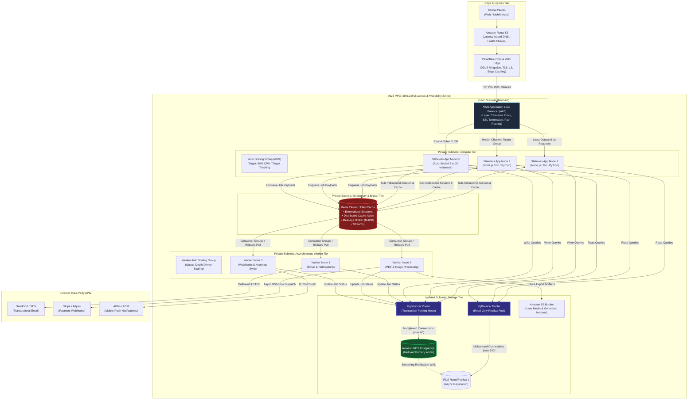
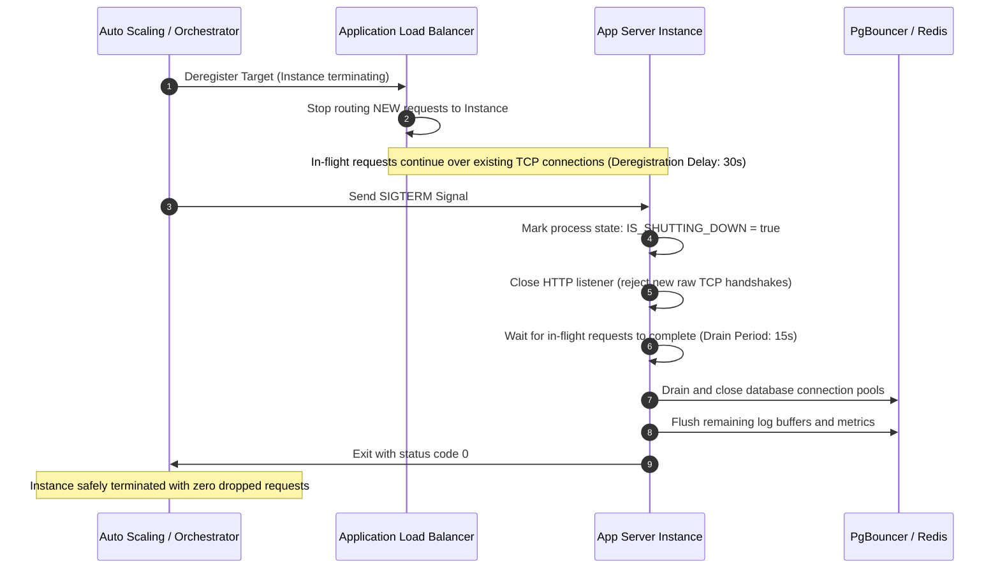
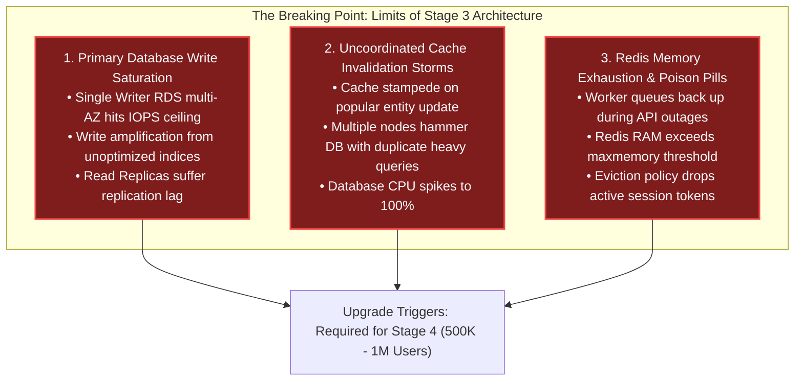

import { Callout } from "fumadocs-ui/components/callout";
import { Tabs, Tab } from "fumadocs-ui/components/tabs";
import { Steps, Step } from "fumadocs-ui/components/steps";

When an application crosses **100,000 Daily Active Users (DAU)** on its trajectory toward half a million, the architectural paradigms of Stage 2 (vertical scaling, read replicas, and co-located background jobs) collapse under concurrent load.

At this inflection point, the system encounters three critical breaking barriers:

1. **The Single-Node Compute Ceiling**: Even a beefy 64-core compute instance will experience thread pool starvation, high garbage-collection pauses, and CPU saturation during peak traffic spikes. A single server is also a catastrophic Single Point of Failure (SPOF) during hardware degradation or rolling code deployments.
2. **Synchronous Request Saturation**: Performing transactional emails, image transcoding, PDF invoice generation, or outbound third-party webhooks inside the HTTP request-response cycle ties up application worker threads. When an external API (e.g., Stripe, SendGrid, Twilio) experiences a 3-second latency spike, your ingress web workers saturate, request queues fill, and the entire system cascades into HTTP 504 Gateway Timeouts.
3. **The PostgreSQL Process-per-Connection Penalty**: Scaling out application servers multiplies database connections. Because PostgreSQL allocates a dedicated operating system process for each connection (~5–10 MB of memory plus query execution scratchpads), 300 to 500 direct client connections cause severe context switching, spinlock contention, and memory exhaustion.

Stage 3 transforms the architecture from a monolithic compute box into a **horizontally scalable, stateless application tier**, backed by an **asynchronous background queue tier** and protected by a **high-throughput connection multiplexer (PgBouncer)**.

---

## 1. Quantitative Sizing & Operational Bottlenecks

Engineering decisions at this tier must be grounded in physical resource constraints and mathematical traffic profiles.

### Traffic & Resource Matrix

| Metric Dimension               | Baseline (100,000 DAU)          | Peak Load (500,000 DAU)                 | Architectural Implication                                               |
| :----------------------------- | :------------------------------ | :-------------------------------------- | :---------------------------------------------------------------------- |
| **Daily Active Users (DAU)**   | 100,000                         | 500,000                                 | User base spread across peak daylight hours.                            |
| **User Action Frequency**      | 30 requests / user / day        | 50 requests / user / day                | Dynamic HTTP API interactions per active session.                       |
| **Average Daily Ingress QPS**  | $\approx 35\text{ QPS}$         | $\approx 290\text{ QPS}$                | Smooth baseline across 24 hours.                                        |
| **Peak-to-Average Multiplier** | $3.5\times$                     | $4.5\times$                             | Flash sales, push notification surges, lunch hour spikes.               |
| **Peak Ingress QPS**           | $\mathbf{120\text{ QPS}}$       | $\mathbf{1,300\text{ QPS}}$             | Ingress capacity target for the Layer 7 load balancer.                  |
| **CDN Offload Efficiency**     | 80% static / edge cached        | 88% static / edge cached                | Cloudflare/CloudFront absorbing images, JS, CSS, static HTML.           |
| **Origin Web Server QPS**      | $\approx 25\text{ QPS}$         | $\mathbf{150 - 300\text{ QPS}}$         | Dynamic application requests requiring backend compute.                 |
| **Network Egress Bandwidth**   | 35 Mbps                         | 120–180 Mbps                            | Origin network pipeline after edge CDN caching.                         |
| **Database Write Throughput**  | 10–25 writes/sec                | 60–150 writes/sec                       | Transactions committed directly to Primary PostgreSQL.                  |
| **Database Read Throughput**   | 50–120 reads/sec                | 350–800 reads/sec                       | Offloaded across Redis cache and read replicas.                         |
| **App Server Instances**       | 3–4 instances                   | 10–20 auto-scaled nodes                 | Sized at $2\text{ vCPU} / 4\text{ GB RAM}$ stateless containers or VMs. |
| **Raw DB Client Connections**  | $\approx 80\text{ connections}$ | $\mathbf{300 - 600\text{ connections}}$ | Exceeds PostgreSQL's optimal concurrency sweet spot.                    |

### Little's Law and the Synchronous Blocking Trap

The mathematical justification for asynchronous worker queues stems from **Little's Law**:

$$L = \lambda \times W$$

Where:

- $L$ = Number of concurrent requests occupying application worker threads.
- $\lambda$ = Arrival rate of incoming requests (QPS).
- $W$ = Average response time (latency) per request.

Consider an order checkout endpoint handling $\lambda = 200\text{ requests/sec}$:

```
Scenario A (Synchronous):
- Database transaction: 25 ms
- SendGrid transactional receipt email: 450 ms
- Stripe payment capture: 350 ms
- Total Latency (W): 825 ms (0.825 seconds)
- Concurrency (L): 200 * 0.825 = 165 concurrent worker threads locked.

Scenario B (Asynchronous Queue Decoupled):
- Database transaction: 25 ms
- Enqueue background jobs (Redis LPUSH/XADD): 2 ms
- Return HTTP 202 Accepted: total Latency (W) = 27 ms (0.027 seconds)
- Concurrency (L): 200 * 0.027 = 5.4 concurrent worker threads locked.
```

By decoupling third-party external I/O into background workers, the required web server capacity drops by **$30\times$**, drastically shrinking your infrastructure spend and insulating your ingress pipeline from upstream partner latency spikes.

---

## 2. Horizontal Architecture Topology

The Stage 3 topology eliminates all compute Single Points of Failure by placing stateless nodes behind an Elastic Application Load Balancer across multiple Availability Zones, segregating background processing into dedicated worker pools, and shielding the database with PgBouncer.



---

## 3. Layer 7 Load Balancing & Reverse Proxies

At Stage 3, a Layer 4 (Transport Layer: TCP/UDP, IP + Port) load balancer is insufficient for dynamic web traffic. Modern architectures deploy an **Elastic Layer 7 (Application Layer) Load Balancer** (such as AWS ALB, HAProxy, Envoy, or Nginx).

### Layer 4 vs. Layer 7 Load Balancing

```
Layer 4 (Transport / TCP):
[Client IP:Port] ---> [ L4 Balancer (NAT / DSR) ] ---> [Backend Server]
  - No inspection of HTTP headers, cookies, or URL paths.
  - TLS termination cannot happen based on HTTP Hostname (SNI only).
  - Cannot differentiate between static assets and dynamic API calls.

Layer 7 (Application / HTTP):
[Client HTTPS Request] ---> [ L7 Load Balancer ]
                             |-- Terminate TLS (Hardware Accelerated)
                             |-- Inspect Host, Path (/api vs /static), Cookies
                             |-- Route /api/v1/checkout  --> Target Group: High-Memory App Nodes
                             |-- Route /api/v1/reports   --> Target Group: Async Processing Nodes
                             |-- Route /ws               --> Target Group: WebSocket Node Pool
```

### Critical Load Balancing Responsibilities

1. **Hardware-Accelerated SSL/TLS Termination**: The LB handles compute-heavy cryptographic handshakes (Diffie-Hellman ephemeral exchanges, RSA/ECDSA verification, TLS 1.3 session tickets). Traffic routed across the internal VPC to app servers runs over secure, low-latency private subnets, unburdening backend CPUs.
2. **Path-Based & Host-Based Routing**: Clean separation of micro-concerns without needing complex routing logic in backend code.
3. **Balancing Algorithm Selection**:
   - **Round Robin**: Distributes requests sequentially. Performs poorly when request processing duration has high variance (e.g., a 2 ms cached read vs. a 450 ms complex search).
   - **Least Outstanding Requests (LOR / Least Connections)**: Dynamically directs new requests to the instance with the fewest active, uncompleted HTTP transactions. **This is mandatory for Stage 3 workloads.**

### Health Checking Strategy: Shallow vs. Deep

A common failure pattern is writing a "deep" health check that queries the primary database and Redis cache inside `/healthz`.

<Callout type="danger" title="The Deep Health Check Cascading Blackout">
  If the primary database experiences a temporary lock contention spike or slow
  query backlog, a deep health check endpoint will time out. The load balancer
  marks **every single application instance as unhealthy simultaneously**,
  removes all servers from the target group, and returns 100% `502 Bad Gateway`
  errors to all incoming users—amplifying a minor database stall into a total
  service blackout.
</Callout>

Instead, implement strict architectural separation:

```
1. Shallow (Liveness) Probe: GET /healthz/live
   - Verifies ONLY that the web process event loop is active and accepting TCP sockets.
   - Used by the Load Balancer to determine traffic routing.
   - Fast (< 5 ms execution time), zero external I/O.

2. Deep (Readiness) Probe: GET /healthz/ready
   - Verifies connectivity to PostgreSQL, Redis, and local disks.
   - Used ONLY by deployment scripts, canary monitors, and internal DevOps dashboards.
   - Never used for automated, destructive load balancer traffic dropping.
```

### Production Nginx Reverse Proxy Configuration

When self-hosting reverse proxies or operating ingress controllers, use this tuned Nginx configuration featuring keepalive pools, buffer hardening, and LOR load distribution:

```nginx
# /etc/nginx/nginx.conf
user nginx;
worker_processes auto;
worker_rlimit_nofile 65535;
pid /var/run/nginx.pid;

events {
    worker_connections 8192;
    use epoll;
    multi_accept on;
}

http {
    include /etc/nginx/mime.types;
    default_type application/octet-stream;

    # Performance optimizations
    sendfile on;
    tcp_nopush on;
    tcp_nodelay on;
    keepalive_timeout 65;
    types_hash_max_size 2048;

    # Upstream Stateless Application Cluster
    upstream backend_app_cluster {
        # Least Outstanding Requests balancing
        least_conn;

        server 10.0.10.15:8080 max_fails=3 fail_timeout=10s;
        server 10.0.10.16:8080 max_fails=3 fail_timeout=10s;
        server 10.0.10.17:8080 max_fails=3 fail_timeout=10s;

        # Keepalive connections to backend servers prevent socket churn
        keepalive 64;
    }

    server {
        listen 443 ssl http2;
        server_name api.cookbook.internal;

        # Modern TLS configuration
        ssl_certificate /etc/ssl/certs/api_bundle.crt;
        ssl_certificate_key /etc/ssl/private/api.key;
        ssl_protocols TLSv1.2 TLSv1.3;
        ssl_ciphers ECDHE-ECDSA-AES128-GCM-SHA256:ECDHE-RSA-AES128-GCM-SHA256:ECDHE-ECDSA-AES256-GCM-SHA384:ECDHE-RSA-AES256-GCM-SHA384;
        ssl_prefer_server_ciphers off;
        ssl_session_cache shared:SSL:50m;
        ssl_session_timeout 1d;
        ssl_session_tickets off;

        # Security Headers
        add_header X-Frame-Options DENY always;
        add_header X-Content-Type-Options nosniff always;
        add_header X-XSS-Protection "1; mode=block" always;

        # Shallow Liveness Health Check
        location = /healthz {
            access_log off;
            proxy_pass http://backend_app_cluster/healthz;
            proxy_connect_timeout 2s;
            proxy_read_timeout 2s;
        }

        # Dynamic API Ingress
        location / {
            proxy_pass http://backend_app_cluster;
            proxy_http_version 1.1;

            # Clear Connection header to allow upstream keepalive
            proxy_set_header Connection "";
            proxy_set_header Host $host;
            proxy_set_header X-Real-IP $remote_addr;
            proxy_set_header X-Forwarded-For $proxy_add_x_forwarded_for;
            proxy_set_header X-Forwarded-Proto $scheme;

            # Buffering & Timeouts
            proxy_buffering on;
            proxy_buffer_size 8k;
            proxy_buffers 16 8k;
            proxy_connect_timeout 5s;
            proxy_send_timeout 15s;
            proxy_read_timeout 15s;
        }
    }
}
```

---

## 4. True Statelessness: Session Externalization

Horizontal auto-scaling is physically impossible if application nodes maintain **in-memory session state**, **local file uploads**, or **sticky sessions**.

### The Anti-Pattern: Sticky Sessions (Session Affinity)

Sticky sessions instruct the load balancer to bind a user's IP or cookie to a specific backend server instance. While this allows legacy monolithic apps to scale to 2–3 nodes without refactoring code, it destroys Stage 3 architecture:

- **Load Imbalance**: Power users, web scrapers, or enterprise NAT gateways direct huge traffic spikes to a single server, starving it while adjacent nodes idle.
- **Autoscaling Incompatibility**: When traffic drops, the Auto Scaling Group (ASG) cannot safely terminate instances without abruptly logging out thousands of active users.
- **Failure Cascades**: When a server crashes, all users pinned to that instance lose their shopping carts and active sessions.

### The Remedy: Centralized Session Architecture

At Stage 3, choose between two production patterns:

```
Pattern A: Centralized Fast In-Memory Store (Redis Cluster)
[Client] ---> [Any App Node] ---> GET session:<session_token> ---> [Redis (RAM)]
  - Pros: Instant session revocation, arbitrary session data payload size.
  - Cons: Requires network round-trip (< 1.5 ms), operational burden of Redis persistence.

Pattern B: Cryptographically Signed Stateless Tokens (JWT / Paseto)
[Client] ---> Header: Authorization: Bearer <token> ---> [Any App Node: Local Verification]
  - Pros: Zero database/Redis network calls for identity verification.
  - Cons: Cannot revoke without a central blocklist; token payload bloats HTTP request headers.
```

### Graceful Shutdown & Zero-Downtime Deployments

In an auto-scaled environment, servers are ephemeral; nodes launch during morning traffic surges and terminate during night valleys. If an orchestrator sends `SIGKILL` (`kill -9`), in-flight database transactions are aborted, HTTP sockets are severed, and users receive failed requests.

Systems must adhere to the **POSIX Graceful Shutdown Lifecycle**:



### Production Node.js Graceful Shutdown Implementation

```typescript
import http from "http";
import express, { Request, Response } from "express";
import { Pool } from "pg";
import Redis from "ioredis";

const app = express();
const server = http.createServer(app);

const dbPool = new Pool({
  host: process.env.PGBOUNCER_HOST,
  port: 6432,
  user: "app_user",
  password: process.env.DB_PASSWORD,
  database: "production_db",
  max: 20,
  idleTimeoutMillis: 10000,
  connectionTimeoutMillis: 3000,
});

const redis = new Redis({
  host: process.env.REDIS_HOST,
  port: 6379,
  enableReadyCheck: true,
  maxRetriesPerRequest: 3,
});

let isShuttingDown = false;

// Shallow Liveness Check
app.get("/healthz", (req: Request, res: Response) => {
  if (isShuttingDown) {
    // Return 503 so ALB removes node during drain window
    return res.status(503).json({ status: "draining", timestamp: Date.now() });
  }
  return res.status(200).json({ status: "alive" });
});

// Deep Readiness Check (Canary / Deployments only)
app.get("/healthz/ready", async (req: Request, res: Response) => {
  try {
    const dbCheck = dbPool.query("SELECT 1");
    const redisCheck = redis.ping();
    await Promise.all([dbCheck, redisCheck]);
    return res.status(200).json({ status: "ready", db: "up", redis: "up" });
  } catch (error) {
    return res
      .status(500)
      .json({ status: "unready", error: (error as Error).message });
  }
});

server.listen(8080, () => {
  console.log("Ingress server listening on port 8080");
});

// Signal Handling for Graceful Termination
const gracefulShutdown = (signal: string) => {
  console.warn(`[SHUTDOWN] Received ${signal}. Initiating graceful drainage.`);
  isShuttingDown = true;

  // 1. Stop accepting new connections at HTTP layer
  server.close(async (err) => {
    if (err) {
      console.error("[SHUTDOWN] Error during HTTP server close:", err);
      process.exit(1);
    }
    console.log(
      "[SHUTDOWN] HTTP listener closed. Draining database and cache connections."
    );

    try {
      // 2. Close PostgreSQL Pool
      await dbPool.end();
      console.log("[SHUTDOWN] Database connection pool closed.");

      // 3. Disconnect Redis Client
      redis.disconnect();
      console.log("[SHUTDOWN] Redis connections disconnected.");

      console.log("[SHUTDOWN] Clean exit achieved.");
      process.exit(0);
    } catch (cleanupError) {
      console.error("[SHUTDOWN] Error during resource cleanup:", cleanupError);
      process.exit(1);
    }
  });

  // Force shutdown if in-flight requests hang beyond safety threshold
  setTimeout(() => {
    console.error(
      "[SHUTDOWN] Forceful termination: drain timeout of 25s exceeded."
    );
    process.exit(1);
  }, 25000).unref();
};

process.on("SIGTERM", () => gracefulShutdown("SIGTERM"));
process.on("SIGINT", () => gracefulShutdown("SIGINT"));
```

---

## 5. Asynchronous Worker Architecture

In Stage 3, web servers only accept requests, validate schema inputs, persist transactional changes, and dispatch asynchronous tasks. **Everything else is moved to background workers.**

### Message Broker Evaluation

<Tabs
  items={[
    "BullMQ (Redis-Backed)",
    "RabbitMQ (AMQP 0-9-1)",
    "Celery (Python Ecosystem)",
  ]}
>
  <Tab value="BullMQ (Redis-Backed)">
    **Best For**: Node.js / TypeScript microservices with existing Redis
    infrastructure. * **Throughput**: 10,000–30,000 jobs/sec per Redis instance.
    * **Key Features**: Delayed jobs (`delay: 60000`), parent-child job
    workflows, automatic exponential backoff, rate limiters, built-in
    stream-based events. * **Operational Overhead**: Extremely low if managed
    AWS ElastiCache / Redis is already provisioned.
  </Tab>
  <Tab value="RabbitMQ (AMQP 0-9-1)">
    **Best For**: Polyglot environments (Go, Python, Java, Node.js) requiring
    complex message routing. * **Throughput**: 20,000–50,000 persistent
    messages/sec. * **Key Features**: Topic/Fanout exchanges, granular consumer
    acknowledgments (`basic.ack`, `basic.nack`), dead-letter exchanges
    (`x-dead-letter-exchange`), high availability via Quorum Queues. *
    **Operational Overhead**: Moderate (requires Erlang VM monitoring, disk
    alarms, and cluster split-brain mitigations).
  </Tab>
  <Tab value="Celery (Python Ecosystem)">
    **Best For**: Django / FastAPI backends with heavy data-science or
    asynchronous processing requirements. * **Broker Support**: RabbitMQ
    (preferred for reliability) or Redis. * **Key Features**: Canvas primitives
    (`chain`, `group`, `chord`), task revocation, periodic tasks (Celery Beat).
    * **Operational Overhead**: Requires strict tuning of prefetch limits
    (`CELERYD_PREFETCH_MULTIPLIER = 1`) to prevent worker monopolization.
  </Tab>
</Tabs>

### The 4 Pillars of Resilient Worker Design

1. **Idempotency**: Because distributed queues guarantee **at-least-once delivery**, workers will inevitably receive the same message twice (e.g., during network drops right before an ACK). Every job must carry an `idempotency_key` checked atomically via Redis or PostgreSQL unique constraints before side-effects execute.
2. **Exponential Backoff with Full Jitter**: Prevents downstream dependency stampedes when third-party systems recover from outages.

   $$\text{Backoff Interval} = \min\left(T_{\text{max}}, T_{\text{base}} \times 2^{\text{attempts}}\right) + \text{random\_jitter}$$

3. **Dead Letter Queues (DLQ)**: If a job fails after $N$ retries (e.g., invalid email syntax, non-existent customer ID), it is a **poison pill**. The worker routes it to a DLQ for manual inspection, preventing it from looping forever and choking the queue.
4. **Queue Depth Auto-Scaling**: Worker nodes should scale based on **CloudWatch / Prometheus Queue Latency** or **Unconsumed Message Count**, _not_ CPU utilization. If a queue backs up to 50,000 messages while workers wait on I/O, CPU remains low while latency spikes out of control.

### Production TypeScript Worker with BullMQ & Redis

Here is a hardened background worker implementing idempotency locks, exponential backoff, dead-letter routing, and graceful job interruption:

```typescript
// worker.ts
import { Worker, Queue, Job } from "bullmq";
import Redis from "ioredis";

const redisConnection = new Redis(
  process.env.REDIS_URL || "redis://10.0.20.10:6379",
  {
    maxRetriesPerRequest: null, // Required by BullMQ
  }
);

export interface OrderNotificationPayload {
  orderId: string;
  userId: string;
  email: string;
  amountCents: number;
  idempotencyKey: string;
}

// Dead Letter Queue reference
const deadLetterQueue = new Queue("order-notifications-dlq", {
  connection: redisConnection,
});

export const notificationWorker = new Worker<OrderNotificationPayload>(
  "order-notifications",
  async (job: Job<OrderNotificationPayload>) => {
    const { orderId, email, amountCents, idempotencyKey } = job.data;

    console.log(
      `[Job ${job.id}] Processing order notification for Order ${orderId}`
    );

    // 1. Idempotency Guard (Redis Atomic SET NX with 24-hour TTL)
    const lockKey = `idempotency:order-email:${idempotencyKey}`;
    const acquired = await redisConnection.set(
      lockKey,
      "PROCESSED",
      "EX",
      86400,
      "NX"
    );

    if (!acquired) {
      console.warn(
        `[Job ${job.id}] Duplicate detected for key ${idempotencyKey}. Skipping.`
      );
      return { status: "skipped", reason: "idempotent_duplicate" };
    }

    try {
      // 2. Perform External Third-Party Call (Simulated SendGrid / SES)
      await sendTransactionalEmail(email, orderId, amountCents);

      console.log(`[Job ${job.id}] Successfully dispatched email to ${email}`);
      return { status: "completed", deliveredTo: email };
    } catch (error) {
      // Release idempotency lock so subsequent retries can execute
      await redisConnection.del(lockKey);

      console.error(
        `[Job ${job.id}] Delivery failed: ${(error as Error).message}`
      );
      throw error; // Re-throw to trigger BullMQ exponential backoff
    }
  },
  {
    connection: redisConnection,
    concurrency: 10, // Process 10 jobs concurrently per worker core
    limiter: {
      max: 100, // Rate limit: max 100 jobs
      duration: 1000, // per 1000 ms to honor third-party API quotas
    },
  }
);

// Event Listeners for Failures & DLQ Forwarding
notificationWorker.on(
  "failed",
  async (job: Job<OrderNotificationPayload> | undefined, error: Error) => {
    if (!job) return;

    console.error(
      `[WORKER ALERT] Job ${job.id} failed on attempt ${job.attemptsMade}/${job.opts.attempts}. Error: ${error.message}`
    );

    // When all retries are exhausted, forward to the Dead Letter Queue
    if (job.attemptsMade >= (job.opts.attempts || 5)) {
      console.error(
        `[POISON PILL] Job ${job.id} exhausted retries. Evicting to DLQ.`
      );
      await deadLetterQueue.add("dead-letter-job", {
        originalJobId: job.id,
        failedReason: error.message,
        payload: job.data,
        exhaustedAt: new Date().toISOString(),
      });
    }
  }
);

async function sendTransactionalEmail(
  to: string,
  orderId: string,
  amount: number
): Promise<void> {
  // Simulate network request with occasional 500 error for testing backoff
  if (Math.random() < 0.1) {
    throw new Error("SendGrid API 503 Service Unavailable");
  }
  await new Promise((resolve) => setTimeout(resolve, 150));
}
```

### Enqueueing with Jittered Exponential Backoff

```typescript
// producer.ts
import { Queue } from "bullmq";
import Redis from "ioredis";

const redisConnection = new Redis(
  process.env.REDIS_URL || "redis://10.0.20.10:6379"
);
export const notificationQueue = new Queue("order-notifications", {
  connection: redisConnection,
});

export async function dispatchOrderEmail(payload: OrderNotificationPayload) {
  await notificationQueue.add("send-order-receipt", payload, {
    attempts: 5,
    backoff: {
      type: "exponential",
      delay: 2000, // 2s, 4s, 8s, 16s, 32s (BullMQ automatically applies jitter)
    },
    removeOnComplete: 1000, // Keep last 1,000 completed jobs for audit
    removeOnFail: false, // Retain failures for inspection
  });
}
```

---

## 6. Database Connection Pooling with PgBouncer

As the application horizontally scales from 4 to 20 instances, each with default connection pools of 20–30 connections, total direct connections to PostgreSQL reach **400 to 600**.

### The Hidden PostgreSQL Trap: Process-Per-Connection

Unlike MySQL (which uses lightweight OS threads) or Go/Node backends (which use event loops or goroutines), **PostgreSQL forks an entire operating system process for every connected client**.

```
PostgreSQL Connection Memory Allocation:
1. OS Backend Process baseline: ~5 MB to 10 MB per connection.
2. work_mem: Per sort/hash operation within a query (default 4 MB). A query with 3 joins can allocate 12 MB.
3. temp_buffers: Session-specific temporary tables.

At 500 Direct Connections:
  Idle Connection Overhead = 500 * 8 MB = 4,000 MB (4 GB of RAM consumed doing nothing!)
```

Beyond RAM consumption, the true killer is **CPU context switching and internal lock contention**. When hundreds of backend processes compete for CPU cycles and shared buffer pool memory locks (`LWLock`), throughput degrades catastrophically:

```
Direct PostgreSQL Concurrency vs. Throughput Curve:
Throughput (TPS)
   ^
   |        /-----------\
   |       /   Optimal   \
   |      /  (40-80 conn) \
   |     /                 \
   |    /                   \  <--- Severe Lock Contention & Context Thrashing
   |   /                     \------------------------------------
   +------------------------------------------------------------->
   0   20    40    80   100   200   300   400   500   600  Connections
```

### PgBouncer to the Rescue

**PgBouncer** is a lightweight, single-threaded connection multiplexer written in C using `libevent`. It sits between your application tier and PostgreSQL, maintaining thousands of client connections on the frontend while multiplexing them into a tiny pool of persistent backend connections (e.g., 40–60) on PostgreSQL.

### Pooling Modes Compared

```
+-----------------------------------------------------------------------------------------+
| Mode         | When Connection is Returned to Pool | Scaling Efficiency | Compatibility |
| :---         | :---                                | :---               | :---          |
| Session      | When client disconnects TCP socket. | Low (1x - 2x)      | 100% features |
| Transaction  | When COMMIT or ROLLBACK completes.  | Extreme (15x - 50x)| 95% features  |
| Statement    | After every single SQL statement.   | Dangerous          | Multi-stmt txn breaks |
+-----------------------------------------------------------------------------------------+
```

<Callout
  type="info"
  title="Why Transaction Pooling is the Stage 3 Gold Standard"
>
  In a web application, an HTTP request typically takes 50 ms, but only executes
  database queries for 3 ms. With **Transaction Pooling**, PgBouncer holds a
  PostgreSQL backend connection *only for those 3 ms*. The remaining 47 ms of
  network I/O, JSON serialization, and template rendering free up the connection
  for other concurrent requests.
</Callout>

### Transaction Pooling Caveats & Mitigations

Because PgBouncer assigns different transactions from the same client to different backend PostgreSQL processes, certain session-level state is broken:

1. **Prepared Statements**:
   - _Problem_: `PREPARE stmt` stores the query plan in the specific backend process memory. A subsequent `EXECUTE` on a different process yields `prepared statement does not exist`.
   - _Solution_: Modern PgBouncer (v1.21+) supports `max_prepared_statements = 100`. Alternatively, configure your ORM/driver (such as Prisma or pg-promise) to use unnamed prepared statements or query strings without binary preparation.
2. **Advisory Locks (`pg_advisory_lock`)**:
   - _Problem_: Locks are session-scoped. If the transaction ends, the connection returns to the pool, leaving the lock dangling or assigned to another client.
   - _Solution_: Use transaction-scoped advisory locks: `pg_advisory_xact_lock()`.
3. **`LISTEN` / `NOTIFY`**:
   - _Problem_: Pub/Sub requires an open, permanent session connection.
   - _Solution_: Maintain a dedicated, non-pooled connection specifically for `LISTEN` consumers, or use Redis Pub/Sub / RabbitMQ.

### Production-Grade `pgbouncer.ini` Configuration

```ini
;; /etc/pgbouncer/pgbouncer.ini
[databases]
;; Direct connection to AWS RDS Multi-AZ Primary
production_db = host=db-primary.internal.vpc port=5432 dbname=production_db auth_user=pgbouncer_auth

;; Read-only connection multiplexing to Replica
production_db_readonly = host=db-replica.internal.vpc port=5432 dbname=production_db auth_user=pgbouncer_auth

[pgbouncer]
;; Administrative settings
logfile = /var/log/pgbouncer/pgbouncer.log
pidfile = /var/run/pgbouncer/pgbouncer.pid
listen_addr = 0.0.0.0
listen_port = 6432
auth_type = scram-sha-256
auth_file = /etc/pgbouncer/userlist.txt
auth_query = SELECT usename, passwd FROM pgbouncer.get_auth($1)

;; CRITICAL: Transaction pooling for dynamic web workloads
pool_mode = transaction

;; Connection Sizing Matrix
;; Max client sockets allowed from auto-scaled application containers
max_client_conn = 5000

;; Default server connections maintained to RDS PostgreSQL per database
default_pool_size = 50

;; Extra connections opened during emergency traffic spikes
reserve_pool_size = 15
reserve_pool_timeout = 3.0

;; Sizing for administrative queries
max_db_connections = 120

;; Timeouts and Hygiene
server_reset_query = DISCARD ALL
server_check_delay = 10.0
server_check_query = SELECT 1
server_idle_timeout = 300.0
client_idle_timeout = 120.0
query_timeout = 15.0

;; Buffer Tuning
pkt_buf = 4096
max_packet_size = 2147483648
```

---

## 7. Failure Modes & The Breaking Point

Stage 3 successfully eliminates compute SPOFs and insulates against third-party synchronous latency. However, as load climbs toward **500,000 DAU and peak traffic approaches 1,500 QPS**, new architectural cracks emerge.



### 1. Primary Database Write Saturation

- **The Mechanism**: While read traffic can be distributed across read replicas and Redis, **all writes must serialize through the single Primary PostgreSQL writer**.
- **The Symptom**: Provisioned IOPS on AWS RDS EBS volumes hit 100% utilization. Write latency increases from 5 ms to 250 ms. Streaming replication lag to read replicas balloons past 30 seconds, causing dirty reads ("I just updated my profile, but I don't see the changes").
- **The Stage 4 Remedy**: Command Query Responsibility Segregation (CQRS), table partitioning, and data archival strategies.

### 2. Cache Stampede (Thundering Herd)

- **The Mechanism**: A popular key (e.g., `featured_products_list`) expires from Redis. Concurrently, 500 web requests experience a cache miss within the exact same 10-millisecond window.
- **The Symptom**: All 500 application threads simultaneously fire identical complex analytical SQL queries with multiple table joins to the primary database. The database CPU hits 100%, cascading into timeout failures.
- **The Stage 4 Remedy**: Implementing the **XFetch probabilistic early expiration algorithm** or distributed mutex locking (Redlock).

### 3. Worker Queue Memory Starvation & Message Loss

- **The Mechanism**: When an external partner (e.g., Stripe) has a prolonged 4-hour regional outage, millions of payment notification jobs accumulate inside Redis-backed queues.
- **The Symptom**: Redis reaches its `maxmemory` limit. If the eviction policy is misconfigured to `allkeys-lru`, Redis begins **evicting active user authentication sessions** to make room for incoming queue messages. If configured to `noeviction`, web servers crash with `OOM command not allowed`.
- **The Stage 4 Remedy**: Migrating queues from in-memory Redis to dedicated distributed event logs (Apache Kafka) or disk-backed queues (RabbitMQ Quorum Queues / AWS SQS).

---

## 8. Architectural Rules of Thumb & Graduation Checklist

### Rules of Thumb for Stage 3 Systems

<Steps>
<Step>
### The Database Connection Sizing Formula
Never allocate more database connections than your physical hardware can handle. Calculate target pool size using PostgreSQL's empirical formula:

$$\text{Max Server Connections} = \left(\text{CPU Cores} \times 2\right) + \text{Effective Spindle Count}$$

For a 16-core RDS instance on SSD storage, optimal pool size is between **36 and 50 connections**. Let PgBouncer handle client concurrency.

</Step>

<Step>
  ### Auto-Scaling Thresholds Set Auto-Scaling Group (ASG) scale-out triggers on
  **Target Tracking: 60% Average CPU Utilization** or **ALB Request Count Per
  Target**. Do not scale on Memory utilization (RAM in Node.js/Go stays flat due
  to heap allocation strategies).
</Step>

<Step>
### Timeouts Must Be Cascading and Strict
Ensure timeouts decrease as requests travel deeper into the stack to prevent ghost processing:
* **Cloudflare Edge Timeout**: 30 seconds
* **Load Balancer Ingress Timeout**: 15 seconds
* **Application HTTP Timeout**: 10 seconds
* **PgBouncer Query Timeout**: 5 seconds
* **PostgreSQL `statement_timeout`**: 3 seconds
</Step>
</Steps>

### Stage 4 Readiness Checklist

Before transitioning from Stage 3 to **Stage 4: 500,000 to 1,000,000 Users**, verify that your system satisfies every production criteria:

- [ ] **100% Stateless Application Tier**: No local file system writes, zero sticky sessions, sessions externalized to Redis or signed JWTs.
- [ ] **Health Check Segregation**: Load balancers route strictly on shallow `/healthz/live` endpoints; deep checks are isolated to deployment gates.
- [ ] **Zero-Downtime Rolling Deployments**: Application containers trap `SIGTERM`, deregister from the ALB, and drain connections within a 20–30s grace window.
- [ ] **Non-Blocking Ingress**: All side-effects exceeding 50 ms (emails, push notifications, reports, external webhooks) execute inside asynchronous queues.
- [ ] **Worker Fault Tolerance**: Background jobs implement idempotency keys, jittered exponential backoffs, and automated Dead Letter Queue (DLQ) alerts.
- [ ] **PgBouncer Multiplexing**: PgBouncer sits between compute and database operating in `pool_mode = transaction`, capping physical Postgres connections below 80.
- [ ] **Automated Backup & Failover**: Automated Multi-AZ database failover tested and verified with zero data corruption.
