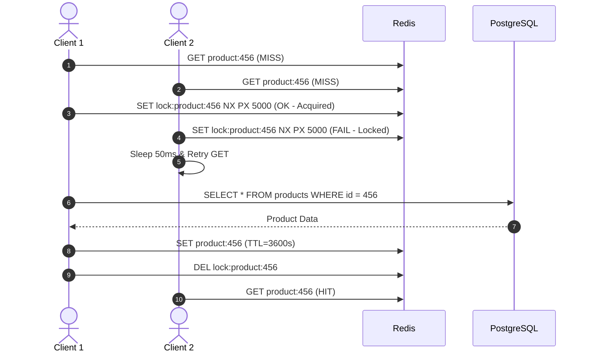
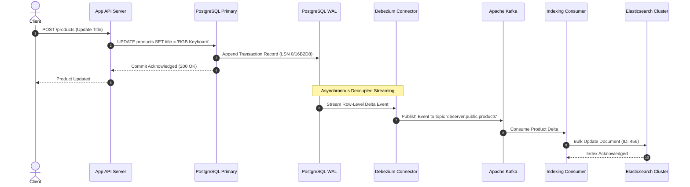

import { Callout } from "fumadocs-ui/components/callout";
import { Tabs, Tab } from "fumadocs-ui/components/tabs";
import { Steps, Step } from "fumadocs-ui/components/steps";

Crossing the threshold from 500,000 to 1,000,000 Daily Active Users (DAU) represents a fundamental inflection point in systems engineering. In Stages 1 through 3, horizontal scaling of stateless compute and basic read-replica offloading could absorb traffic surges. At 1M users, however, **the primary relational database becomes the ultimate architectural bottleneck**.

At this scale, relational databases collapse under specialized query patterns: complex text search destroys disk IOPS via unindexed scan operations, synchronized cache expirations trigger catastrophic thundering herds against the primary database, and massive monolithic schemas cause write-lock contention across unrelated business domains.

Stage 4 is about **polyglot persistence, specialized data engines, and data tier hardening**. We stop forcing the relational database to do things it was never designed to do well.

---

## 1. Quantitative Sizing & The 1M User Ceiling

Before drafting architectures, we must ground our engineering decisions in rigorous mathematical realities. Sizing determines whether our designs survive peak surges or degrade into cascading brownouts.

### Capacity Calculations

```
+-------------------------------------------------------------------------------+
| PARAMETER                    | VALUE RANGE              | NOTES               |
+-------------------------------------------------------------------------------+
| Daily Active Users (DAU)     | 500,000 - 1,000,000      | Active unique users |
| Actions per User Day         | 30 - 60 actions          | Pageviews, clicks   |
| Total Daily Requests         | 30M - 60M requests/day   | HTTP transactions   |
| Average Daily QPS            | 350 - 700 req/sec        | Total requests / 86400 |
| Peak Multiplier              | 3x - 5x                  | Daily traffic spikes|
| Peak Compute QPS             | 1,500 - 3,500 req/sec    | Flash crowds/promos |
| Write vs Read Ratio          | 1:9 (10% writes, 90% rds)| Read-heavy web app  |
| Primary Database Write QPS   | 150 - 500 writes/sec     | ACID transactions   |
| Cache Layer QPS (95% hit)    | 1,350 - 3,150 req/sec    | In-memory lookups   |
| Average Object Size          | 2 KB - 10 KB             | User profiles, JSON |
| Active Working Set (20%)     | 64 GB - 128 GB           | RAM cache footprint |
| 1-Year Cumulative Storage    | 2 TB - 10 TB             | Relational + Media  |
| Egress Bandwidth             | 250 Mbps - 800 Mbps      | Compressed CDN/Edge |
+-------------------------------------------------------------------------------+
```

### The Breaking Point of Stage 3 Architecture

Why does the Stage 3 architecture (Stateless Compute + Managed Primary RDS + 2 Read Replicas + Single-Node Redis) fail at this juncture?

$$\text{DB Connection Pressure} = \text{App Nodes} \times \text{Workers per Node} \times \text{Pool Size}$$

1. **The Single-Node Cache Limit**: A standalone Redis node tops out at ~100,000 QPS (single-threaded event loop CPU saturation or network NIC packet limit). While 3,500 QPS is well within raw throughput, high-cardinality keys, network packet contention, and multi-gigabyte memory footprints (64GB–128GB) introduce severe latency jitter and out-of-memory risks without clustering.
2. **Full-Text Search IOPS Exhaustion**: In Stage 3, full-text search is typically performed using PostgreSQL `ILIKE '%query%'` or `tsvector` with GIN indexes. When the product catalog hits $10^7$ rows and hundreds of concurrent users search simultaneously, random disk reads saturate provisioned IOPS (e.g., AWS gp3 at 3,000 IOPS), spiking query latencies from 15ms to 8,000ms.
3. **Cache Stampedes (Thundering Herd)**: When a heavily accessed cache key (e.g., homepage banner or trending item) expires under a 3,000 QPS load, hundreds of worker processes simultaneously query the primary database to recompute the value, triggering immediate database CPU pegging (100%) and pool exhaustion.
4. **Monolithic Table Lock Contention**: The `users`, `orders`, and `inventory` tables share the same database instance. High-frequency write transactions on checkout lock rows in shared buffers, starving reads on user profiles and search indexes.

---

## 2. Hardened Polyglot Architecture Topology

To overcome these constraints, Stage 4 introduces dedicated search engines (Elasticsearch/OpenSearch), asynchronous Change Data Capture (CDC) via Debezium and Apache Kafka, Redis Cluster sharding, and bounded functional databases.

```mermaid
flowchart TD
    subgraph Clients["Clients & Edge Tier"]
        Web["Web Browsers"]
        Mobile["Mobile Apps"]
        Edge["Cloudflare CDN / DDoS Shield"]
    end

    subgraph Ingress["Ingress Tier"]
        ALB["Application Load Balancer (AWS ALB / Multi-AZ)"]
    end

    subgraph Compute["Stateless Compute Tier"]
        App1["App Node 1 (ECS/EKS)"]
        App2["App Node 2 (ECS/EKS)"]
        App3["App Node N (Auto-Scaling)"]
    end

    subgraph CacheTier["Distributed Cache Tier (Redis Cluster)"]
        RC1["Redis Shard 1 (Master/Replica)"]
        RC2["Redis Shard 2 (Master/Replica)"]
        RC3["Redis Shard 3 (Master/Replica)"]
    end

    subgraph DataTier["Primary Relational Storage (Split by Domain)"]
        UserDB[("User & Auth DB<br/>Primary + Replicas")]
        OrderDB[("Orders & Billing DB<br/>Primary + Replicas")]
        CatalogDB[("Catalog DB<br/>Primary + Replicas")]
    end

    subgraph CDCPipeline["Asynchronous Event & CDC Stream"]
        Debezium["Debezium CDC Connector"]
        Kafka["Apache Kafka Event Bus"]
    end

    subgraph SpecializedEngines["Specialized Data Engines"]
        ES[("Elasticsearch / OpenSearch<br/>(Full-Text & Faceted Search)")]
        CH[("ClickHouse / BigQuery<br/>(OLAP Analytics Store)")]
    end

    %% Client flows
    Web --> Edge
    Mobile --> Edge
    Edge --> ALB
    ALB --> App1
    ALB --> App2
    ALB --> App3

    %% App to Cache
    App1 <-->|Cache-Aside + XFetch| CacheTier
    App2 <-->|Cache-Aside + XFetch| CacheTier
    App3 <-->|Cache-Aside + XFetch| CacheTier

    %% App to DB (Domain Writes & Critical Reads)
    App1 -->|Writes / Txns| UserDB
    App1 -->|Writes / Txns| OrderDB
    App1 -->|Writes / Txns| CatalogDB

    App2 -->|Writes / Txns| UserDB
    App2 -->|Writes / Txns| OrderDB
    App2 -->|Writes / Txns| CatalogDB

    App3 -->|Writes / Txns| UserDB
    App3 -->|Writes / Txns| OrderDB
    App3 -->|Writes / Txns| CatalogDB

    %% CDC pipeline
    CatalogDB -.->|WAL / binlog replication| Debezium
    OrderDB -.->|WAL / binlog replication| Debezium
    Debezium -->|Stream CDC Events| Kafka

    %% Consumer updates specialized engines
    Kafka -->|CDC Consumer Indexer| ES
    Kafka -->|CDC Consumer Aggregator| CH

    %% App reading specialized engines
    App1 -->|Search Queries| ES
    App2 -->|Search Queries| ES
    App3 -->|Search Queries| ES

    classDef edge fill:#1e293b,stroke:#38bdf8,stroke-width:1px;
    classDef compute fill:#0f172a,stroke:#34d399,stroke-width:1px;
    classDef cache fill:#3b0764,stroke:#c084fc,stroke-width:1px;
    classDef db fill:#172554,stroke:#60a5fa,stroke-width:1px;
    classDef stream fill:#451a03,stroke:#fb923c,stroke-width:1px;
    classDef spec fill:#064e3b,stroke:#34d399,stroke-width:1px;

    class Web,Mobile,Edge,ALB edge;
    class App1,App2,App3 compute;
    class CacheTier,RC1,RC2,RC3 cache;
    class UserDB,OrderDB,CatalogDB db;
    class Debezium,Kafka stream;
    class ES,CH spec;
```



---

## 3. Production Cache Hardening

In Stage 4, cache failure is no longer an inconvenience that slightly degrades performance; **a cache outage immediately crashes the relational database**. The cache is now a mission-critical shield.

### 3.1 Cache Stampede (Thundering Herd) Defense

A cache stampede occurs when high-concurrency requests encounter an expired key simultaneously. If calculating the cache value takes 300ms of intense SQL processing, and 1,000 requests arrive per second, 300 parallel heavy SQL queries hit the primary database at the same instant.

#### Strategy A: Distributed Mutex Locking

The simplest defense acquires an atomic distributed lock via Redis `SET key value NX PX 5000` before querying the database.



_Trade-off_: Mutex locks eliminate DB stampedes but introduce thread sleep delays and tail latency spikes ($P_{99}$) for client requests waiting on the lock.

---

#### Strategy B: Optimal Probabilistic Early Expiration (XFetch Algorithm)

Published in 2015 by Vattani, Chierichetti, and Lowenstein (_Optimal Probabilistic Cache Stampede Prevention_), **XFetch** computes a dynamic probability of background recomputation _before_ the key officially expires.

The closer the key is to its expiration time, and the longer the database computation takes, the higher the mathematical probability that an incoming request will voluntarily recompute the key in the background while still serving the stale value immediately to the user.

$$\text{Recompute If:} \quad -\beta \times \delta \times \ln(U) > (\text{TTL} - \text{Now})$$

Where:

- $\delta$ (`delta`): The computation duration in milliseconds to compute the value from the database.
- $\beta$ (`beta`): Aggressiveness parameter ($\beta > 0$). Setting $\beta = 1.0$ is optimal for most production systems. Increasing $\beta > 1$ forces earlier recomputations.
- $U$: A random uniform float drawn from the interval $(0, 1]$.
- $\text{TTL}$: The absolute timestamp (unix epoch milliseconds) when the key expires.
- $\text{Now}$: The current timestamp (unix epoch milliseconds).

```mermaid
flowchart TD
    Req["Incoming Read Request"] --> Get["Fetch Cached Object (Value, Delta, Expiry)"]
    Get --> Check{"Object Exists in Cache?"}
    Check -- No --> FetchSync["Cache Miss: Fetch from DB, Save to Cache, Return"]
    Check -- Yes --> Prob{"Compute XFetch:<br/>-β * δ * ln(U) > (Expiry - Now)?"}
    Prob -- No (False) --> ReturnFresh["Cache Hit: Return Cached Value Immediately"]
    Prob -- Yes (True) --> RecomputeBg["Trigger Asynchronous DB Recomputation"]
    RecomputeBg --> ReturnStale["Return Current Cached Value (No User Latency Spike)"]
    RecomputeBg --> UpdateCache["Update Cache with New Value, New Delta, New Expiry"]

    style Prob fill:#3b0764,stroke:#c084fc,stroke-width:2px
    style RecomputeBg fill:#064e3b,stroke:#34d399,stroke-width:2px
```



#### Production XFetch Implementation

<Tabs items={["TypeScript / Node.js", "Go"]}>
<Tab value="TypeScript / Node.js">

```typescript
import Redis from "ioredis";

interface CacheEnvelope<T> {
  value: T;
  delta: number; // Time in ms taken to compute this value from the database
  expiry: number; // Unix epoch timestamp in ms when the key expires
}

export class XFetchCache {
  private redis: Redis;

  constructor(redisClient: Redis) {
    this.redis = redisClient;
  }

  /**
   * Reads from cache with probabilistic early expiration (XFetch algorithm)
   *
   * @param key Redis cache key
   * @param ttlSeconds Intended cache TTL in seconds
   * @param fetchFn Asynchronous fallback function querying the primary database
   * @param beta Constant tuning aggressiveness (default: 1.0)
   */
  async getOrFetch<T>(
    key: string,
    ttlSeconds: number,
    fetchFn: () => Promise<T>,
    beta: number = 1.0
  ): Promise<T> {
    const raw = await this.redis.get(key);
    const now = Date.now();

    if (raw) {
      try {
        const envelope: CacheEnvelope<T> = JSON.parse(raw);
        const { value, delta, expiry } = envelope;

        // Draw random float U in (0, 1]
        const u = Math.random() || 0.0001; // Guard against Math.random() returning exactly 0
        const xfetchScore = -beta * delta * Math.log(u);

        // If the probabilistic score exceeds remaining life, recompute early!
        if (xfetchScore > expiry - now) {
          // Fire non-blocking or single-flight background recomputation
          this.recomputeInBackground(key, ttlSeconds, fetchFn).catch((err) => {
            console.error(
              `[XFetch] Background recomputation failed for ${key}:`,
              err
            );
          });
        }

        // Return cached value immediately without blocking user thread
        return value;
      } catch (err) {
        // Fall back to synchronous fetch if JSON corruption occurred
      }
    }

    // Cache MISS: Must compute synchronously
    const startTime = Date.now();
    const freshValue = await fetchFn();
    const computeDuration = Date.now() - startTime;

    const envelope: CacheEnvelope<T> = {
      value: freshValue,
      delta: computeDuration,
      expiry: Date.now() + ttlSeconds * 1000,
    };

    // Store in Redis with TTL plus safety buffer (e.g. 2x TTL to allow late serving)
    await this.redis.set(key, JSON.stringify(envelope), "EX", ttlSeconds * 2);

    return freshValue;
  }

  private async recomputeInBackground<T>(
    key: string,
    ttlSeconds: number,
    fetchFn: () => Promise<T>
  ): Promise<void> {
    // Acquire a short lock so only ONE worker recomputes concurrently
    const lockKey = `lock:xfetch:${key}`;
    const acquired = await this.redis.set(lockKey, "1", "NX", "PX", 10000);
    if (!acquired) return;

    try {
      const startTime = Date.now();
      const freshValue = await fetchFn();
      const computeDuration = Date.now() - startTime;

      const envelope: CacheEnvelope<T> = {
        value: freshValue,
        delta: computeDuration,
        expiry: Date.now() + ttlSeconds * 1000,
      };

      await this.redis.set(key, JSON.stringify(envelope), "EX", ttlSeconds * 2);
    } finally {
      await this.redis.del(lockKey);
    }
  }
}
```

</Tab>
<Tab value="Go">

```go
package cache

import (
	"context"
	"encoding/json"
	"math"
	"math/rand"
	"time"

	"github.com/redis/go-redis/v9"
)

type Envelope[T any] struct {
	Value  T     `json:"value"`
	Delta  int64 `json:"delta"`  // Milliseconds
	Expiry int64 `json:"expiry"` // Unix epoch milliseconds
}

type XFetchClient struct {
	rdb *redis.Client
}

func NewXFetchClient(rdb *redis.Client) *XFetchClient {
	return &XFetchClient{rdb: rdb}
}

func GetOrFetch[T any](
	ctx context.Context,
	c *XFetchClient,
	key string,
	ttl time.Duration,
	beta float64,
	fetchFn func(ctx context.Context) (T, error),
) (T, error) {
	now := time.Now().UnixMilli()
	raw, err := c.rdb.Get(ctx, key).Result()

	if err == nil {
		var env Envelope[T]
		if err := json.Unmarshal([]byte(raw), &env); err == nil {
			u := rand.Float64()
			if u == 0.0 {
				u = 0.0001
			}

			// XFetch test: -beta * delta * ln(u) > (expiry - now)
			xfetchScore := -beta * float64(env.Delta) * math.Log(u)
			remainingMs := float64(env.Expiry - now)

			if xfetchScore > remainingMs {
				// Launch goroutine to refresh in background
				go func() {
					bgCtx, cancel := context.WithTimeout(context.Background(), 10*time.Second)
					defer cancel()

					lockKey := "lock:xfetch:" + key
					if set, _ := c.rdb.SetNX(bgCtx, lockKey, "1", 10*time.Second).Result(); set {
						defer c.rdb.Del(bgCtx, lockKey)
						start := time.Now()
						freshVal, fErr := fetchFn(bgCtx)
						if fErr == nil {
							duration := time.Since(start).Milliseconds()
							newEnv := Envelope[T]{
								Value:  freshVal,
								Delta:  duration,
								Expiry: time.Now().Add(ttl).UnixMilli(),
							}
							data, _ := json.Marshal(newEnv)
							c.rdb.Set(bgCtx, key, data, ttl*2)
						}
					}
				}()
			}
			return env.Value, nil
		}
	}

	// Cache Miss: Synchronous recompute
	start := time.Now()
	freshVal, err := fetchFn(ctx)
	if err != nil {
		var zero T
		return zero, err
	}
	duration := time.Since(start).Milliseconds()

	newEnv := Envelope[T]{
		Value:  freshVal,
		Delta:  duration,
		Expiry: time.Now().Add(ttl).UnixMilli(),
	}
	data, _ := json.Marshal(newEnv)
	c.rdb.Set(ctx, key, data, ttl*2)

	return freshVal, nil
}
```

</Tab>
</Tabs>

---

### 3.2 Cache Penetration Defense: Bloom Filters

**Cache Penetration** occurs when attackers or crawler bots query IDs that _do not exist_ in the database (e.g., `GET /api/v1/users/uuid-that-does-not-exist`). Because the item does not exist, the cache cannot store it, causing 100% of these requests to bypass the cache and hammer the database directly.

#### Remediation Approaches

```
+-----------------------------------------------------------------------------------------+
| STRATEGY                 | MECHANISM                      | TRADE-OFF                   |
+-----------------------------------------------------------------------------------------+
| 1. Null Value Caching    | Store "NULL" with 60s TTL      | Consumes cache RAM;         |
|                          | on DB miss                     | vulnerable to random keys   |
| 2. Redis Bloom Filter    | Probabilistic bit array check  | Slight false positive rate; |
|    (RedisBloom module)   | BEFORE hitting cache or DB     | 0% false negative rate      |
+-----------------------------------------------------------------------------------------+
```

A Bloom filter is an $m$-bit array initialized with $k$ independent hash functions.

- If the Bloom filter returns **False**: The key is **guaranteed** not to exist in the database. Return `404 Not Found` immediately. Do not touch Redis cache or the database.
- If the Bloom filter returns **True**: The key _probably_ exists (with false positive rate $P \approx 0.01$). Proceed to cache lookup.

```mermaid
flowchart LR
    Req["Request: GET /item/9999999"] --> BF{"Check Bloom Filter<br/>(In-Memory / RedisBloom)"}
    BF -- "Does NOT Exist (100% Certain)" --> Ret404["Return HTTP 404 (0 DB/Cache Load)"]
    BF -- "Probably Exists (99% Accurate)" --> Cache["Check Redis Cluster"]
    Cache -- Hit --> Ret200["Return 200 OK"]
    Cache -- Miss --> DB[("Query Primary DB")]
    DB --> RetDB["Return Result & Cache"]

    style BF fill:#3b0764,stroke:#c084fc,stroke-width:2px
    style Ret404 fill:#064e3b,stroke:#34d399,stroke-width:2px
```



---

### 3.3 Redis High Availability: Sentinel vs. Redis Cluster

At Stage 4 ($>500\text{K}$ DAU, 64GB–128GB working set), architectures must transition from single-node instances to true clustered distribution.

| Feature                | Redis Sentinel (Stage 3)                   | Redis Cluster (Stage 4)                                        |
| :--------------------- | :----------------------------------------- | :------------------------------------------------------------- |
| **Topology**           | 1 Master + 2 Replicas + 3 Sentinels        | $N$ Masters + $N$ Replicas (Min 3 Masters + 3 Replicas)        |
| **Data Partitioning**  | None (All data lives on single master)     | **16,384 Hash Slots** distributed across master nodes          |
| **Max Memory Limit**   | Limited to single machine RAM (~32–64GB)   | Horizontally scales across nodes (e.g. 6 × 32GB = 192GB)       |
| **Throughput Ceiling** | ~80,000 – 120,000 QPS writes               | Linearly scales with master count (300,000+ QPS)               |
| **Failover Mechanism** | Sentinels elect replica via Raft/Quorum    | Gossip protocol between nodes; automatic replica promotion     |
| **Client Routing**     | Client connects to Sentinel to find Master | Smart clients (`ioredis`, `go-redis`) cache hash slot mappings |

In Redis Cluster, keys are assigned to hash slots via CRC16:

$$\text{Slot} = \text{CRC16}(\text{key}) \pmod{16384}$$

<Callout type="warn" title="Redis Cluster Multi-Key Constraint">
Multi-key operations (transactions, pipelines, `MGET`) in Redis Cluster only work if all keys hash to the **exact same slot**. Enforce this using Hash Tags: `{user:123}:profile` and `{user:123}:orders` will both be hashed using only the text inside `{user:123}`, guaranteeing they land on the same master shard.
</Callout>

---

## 4. Decoupling Search: Offloading SQL from Search

One of the most destructive antipatterns in scaling applications is using relational databases for full-text and faceted search.

### Why Relational Databases Choke on Search

Consider an e-commerce catalog search query at 1,000,000 users:

```sql
-- The Query That Destroys Primary Database IOPS
SELECT id, title, price, category_id, rating
FROM products
WHERE status = 'ACTIVE'
  AND title ILIKE '%mechanical keyboard%'
  AND price BETWEEN 50.00 AND 150.00
ORDER BY rating DESC, created_at DESC
LIMIT 20 OFFSET 0;
```

#### The Mechanical Failure:

1. **B-Tree Index Invalidation**: Standard B-Tree indexes search from the _beginning_ of a string. An expression with a leading wildcard (`'%mechanical%'`) **cannot use a B-Tree index**. The engine must perform a full table scan or full index scan over millions of rows.
2. **Buffer Pool Eviction**: A sequential table scan pulls gigabytes of cold table blocks from disk into memory, evicting frequently accessed hot user sessions and metadata from PostgreSQL's `shared_buffers` or MySQL's `innodb_buffer_pool`.
3. **Compound Ordering & Sorting Costs**: Combining range filters (`BETWEEN`), string matching, and multi-column sorting forces PostgreSQL to use costly in-memory or on-disk external merge sorts (`WorkMem` overflow).

---

### Dedicated Search Engine: Elasticsearch / OpenSearch

Elasticsearch organizes text data using an **Inverted Index**. Instead of mapping records to terms, it maps every unique word token to a sorted list of Document IDs (posting lists).

```
Token: "mechanical" -> [Doc #12, Doc #405, Doc #1892, Doc #98432]
Token: "keyboard"   -> [Doc #12, Doc #88,  Doc #1892, Doc #54321]

Intersection ("mechanical" AND "keyboard") = [Doc #12, Doc #1892]
```

Intersecting bitsets takes sub-millisecond CPU operations, regardless of whether the index contains 10,000 or 50,000,000 documents.

---

### Synchronizing Data: The Dual-Writing Fallacy vs. CDC

How do we keep Elasticsearch synchronized with the Primary Relational Database?

#### The Dual-Writing Trap (Anti-Pattern)

```typescript
// DANGEROUS ANTI-PATTERN: Dual-Writing in Application Code
async function updateProduct(product: Product) {
  // 1. Write to Primary Database
  await db.query("UPDATE products SET title = $1 WHERE id = $2", [
    product.title,
    product.id,
  ]);

  // 2. Write to Elasticsearch
  // BREAKING POINT: What happens if network fails here? Or app crashes?
  // Result: Silent data divergence. DB has new title; Search index has old title forever.
  await elasticsearch.update({
    index: "products",
    id: product.id,
    body: { doc: product },
  });
}
```

Dual-writing suffers from three fatal distributed systems flaws:

1. **No Distributed Atomicity**: If step 1 succeeds and step 2 fails, data is permanently inconsistent.
2. **Race Conditions & Out-of-Order Execution**: If Request A updates product price to \$10 and Request B updates it to \$12 concurrently, network latency might cause Elasticsearch to process Request B _before_ Request A, leaving the search index with stale pricing (\$10).
3. **Application Thread Blocking**: Search engine ingestion latencies directly degrade user-facing API response times.

---

#### The Solution: Change Data Capture (CDC) with Debezium and Kafka

Change Data Capture reads database transactions directly from the database engine's **Write-Ahead Log (WAL in PostgreSQL)** or **Binary Log (binlog in MySQL)** at the storage layer.



#### Why CDC is the Gold Standard:

- **Zero Performance Impact on Primary DB**: Debezium reads raw log bytes asynchronously without executing SQL queries or locking tables.
- **Guaranteed Event Ordering**: Kafka partitions preserve total ordering per primary key (e.g., partitioning by `product_id`).
- **Resilience**: If the search cluster crashes, Kafka buffers hours or days of changes. Once Elasticsearch recovers, consumers resume indexing from their last committed offset without data loss.

---

## 5. Functional / Vertical Database Partitioning

At 1,000,000 users, housing all application tables in a single relational schema causes severe disk I/O contention, locks buffer memory, and exposes the system to single-table failure cascades.

**Vertical Partitioning** (Functional Splitting) divides the monolithic database by **Bounded Contexts** (Domain-Driven Design).

```mermaid
flowchart TD
    subgraph MonolithDB["Stage 3: Monolithic Database (Overloaded)"]
        direction TB
        T1["users"] --- T2["user_profiles"]
        T2 --- T3["orders"]
        T3 --- T4["order_items"]
        T4 --- T5["products"]
        T5 --- T6["inventory"]
        T6 --- T7["payments"]
    end

    MonolithDB -.->|Vertical Domain Decomposition| Split

    subgraph Split["Stage 4: Vertically Partitioned Databases"]
        subgraph UserDomain["Users & Auth DB"]
            U1["users"]
            U2["user_profiles"]
            U3["user_sessions"]
        end

        subgraph OrderDomain["Orders & Billing DB"]
            O1["orders"]
            O2["order_items"]
            O3["payments"]
            O4["invoices"]
        end

        subgraph CatalogDomain["Catalog & Inventory DB"]
            C1["products"]
            C2["categories"]
            C3["inventory_counts"]
        end
    end

    classDef old fill:#450a0a,stroke:#ef4444,stroke-width:1px;
    classDef domain fill:#0f172a,stroke:#38bdf8,stroke-width:2px;
    class MonolithDB old;
    class UserDomain,OrderDomain,CatalogDomain domain;
```



### Resolving Cross-Table Relational Joins

Before vertical partitioning, generating an order receipt was a simple SQL `JOIN`:

```sql
-- MONOLITHIC JOIN (No longer possible across physical databases)
SELECT o.id, o.total_amount, u.email, p.title
FROM orders o
JOIN users u ON o.user_id = u.id
JOIN order_items oi ON oi.order_id = o.id
JOIN products p ON oi.product_id = p.id
WHERE o.id = 'ord_98765';
```

When `users`, `orders`, and `products` reside on separate physical database servers, SQL-level foreign keys and joins are physically impossible. We resolve this using two patterns:

#### Pattern 1: Application-Level Fan-Out (Parallel Scatter-Gather)

The application orchestrates independent queries across the domain databases in parallel:

```typescript
interface OrderReceipt {
  orderId: string;
  totalAmount: number;
  customerEmail: string;
  items: Array<{ title: string; price: number; quantity: number }>;
}

async function getOrderReceipt(orderId: string): Promise<OrderReceipt> {
  // 1. Fetch Order Entity from Orders DB
  const order = await ordersDb.query("SELECT * FROM orders WHERE id = $1", [
    orderId,
  ]);
  const orderItems = await ordersDb.query(
    "SELECT * FROM order_items WHERE order_id = $1",
    [orderId]
  );

  // 2. Concurrently fetch User and Products from separate physical databases
  const productIds = orderItems.map((item) => item.product_id);

  const [user, products] = await Promise.all([
    usersDb.query("SELECT email FROM users WHERE id = $1", [order.user_id]),
    catalogDb.query("SELECT id, title FROM products WHERE id = ANY($1)", [
      productIds,
    ]),
  ]);

  // 3. Assemble composite response in application memory
  const productMap = new Map(products.map((p) => [p.id, p.title]));

  return {
    orderId: order.id,
    totalAmount: order.total_amount,
    customerEmail: user.email,
    items: orderItems.map((item) => ({
      title: productMap.get(item.product_id) || "Unknown Item",
      price: item.price,
      quantity: item.quantity,
    })),
  };
}
```

#### Pattern 2: Bounded Domain Duplication (Denormalization at Write Time)

Rather than querying the `products` table every time an invoice is loaded, **snapshot essential immutable data at creation time**.

In `order_items`, store:

```sql
CREATE TABLE order_items (
    id UUID PRIMARY KEY,
    order_id UUID REFERENCES orders(id),
    product_id UUID NOT NULL,       -- Foreign reference (soft link, no DB constraint)
    product_title VARCHAR(255),      -- Denormalized snapshot at time of purchase
    unit_price NUMERIC(10, 2),       -- Price at time of purchase
    quantity INT NOT NULL
);
```

This eliminates cross-database lookups entirely for historic orders, while preserving historical accuracy if the catalog product title or price changes later.

---

## 6. CQRS (Command Query Responsibility Segregation) at 1M Scale

At 1M users, read traffic and write traffic exhibit completely different characteristics:

- **Writes (Commands)**: Need strict ACID compliance, row locking, high consistency, and normalized schemas to prevent anomaly states. Throughput: ~300 QPS.
- **Reads (Queries)**: Need highly denormalized, pre-aggregated representations with zero join overhead, fast indexing, and elastic caching. Throughput: ~3,000 QPS.

**CQRS** separates the write model from the read model.

```mermaid
flowchart LR
    subgraph ClientLayer["Clients"]
        User["User Device"]
    end

    subgraph CommandStack["Write Path (Command Stack)"]
        CmdAPI["Command API"]
        WriteDB[("PostgreSQL Primary<br/>Normalized 3NF Schema")]
    end

    subgraph QueryStack["Read Path (Query Stack)"]
        QueryAPI["Query API"]
        ReadView[("Elasticsearch / Read DB<br/>Denormalized JSON Views")]
        RedisCache[("Redis Query Cache")]
    end

    subgraph AsyncSync["Event Synchronization"]
        CDC["Debezium + Kafka"]
        Projector["Projection Worker"]
    end

    User -->|"POST /orders (Submit)"| CmdAPI
    CmdAPI -->|ACID Transaction| WriteDB

    WriteDB -.->|Commit Log| CDC
    CDC --> Projector
    Projector -->|Update Materialized View| ReadView
    Projector -->|Invalidate/Warm| RedisCache

    User -->|GET /orders/my-summary| QueryAPI
    QueryAPI -->|Check Cache| RedisCache
    RedisCache -- Miss --> ReadView

    classDef cmd fill:#1e1e38,stroke:#818cf8,stroke-width:1px;
    classDef qry fill:#064e3b,stroke:#34d399,stroke-width:1px;
    classDef sync fill:#451a03,stroke:#fb923c,stroke-width:1px;
    class CmdAPI,WriteDB cmd;
    class QueryAPI,ReadView,RedisCache qry;
    class CDC,Projector sync;
```



### Handling Eventual Consistency Latency

Because the read view is updated asynchronously via CDC and Kafka, there exists a tiny replication window ($\Delta t \approx 50\text{ms} - 500\text{ms}$) where the read view does not yet reflect the latest write.

#### The "Read-Your-Own-Writes" Dilemma:

A user places an order, gets redirected to `/orders/123`, but the page displays "Order Not Found" because the consumer is still processing the Kafka queue.

#### Remediation Patterns:

1. **Optimistic Local UI State**: The client web/mobile app immediately inserts the new order into its local state store (e.g., Redux, TanStack Query cache) upon receiving a `200 OK` from the Command API, avoiding a network fetch for several seconds.
2. **Version Token / Monotonic Read Routing**:
   - The Command API returns a database transaction ID or version token: `{ orderId: "123", lsn: "0/16B2D8" }`.
   - The Query API checks if the read replica or search index has caught up to that log sequence number (`LSN`).
   - If the read model lags behind, the Query API routes that specific user's read directly to the **Primary Database** for a 2-second grace period.

---

## 7. Failure Modes & The Breaking Point

Stage 4 architectures introduce distributed components that fail in subtle, complex ways. Recognizing these symptoms early prevents catastrophic outages.

### 1. Primary Database Write IOPS Saturation

Even with reads offloaded to replicas, caches, and Elasticsearch, **every write must still hit the primary database**. When write operations reach 1,500–2,000 IOPS on a single primary node, AWS gp3 or io2 storage buffers fill up, disk write queues spike, and connection latency explodes.

- _Symptom_: Write transactions take seconds to commit; connection pools (`PgBouncer`) fill up completely; application servers exhaust their thread pools waiting for database write ACKs.
- _Trigger for Stage 5_: When no further write optimization (batching, schema tuning, functional splitting) can lower primary DB write IOPS, you must implement **Horizontal Database Sharding**.

### 2. CDC Replication Lag Spikes

Under intense database batch updates (e.g., midnight bulk price update of 500,000 catalog items), Debezium's WAL reader falls millions of offsets behind the primary database.

- _Symptom_: Elasticsearch search results remain stale for 15–45 minutes. Users see outdated prices or phantom stock levels.
- _Remediation_: Rate-limit bulk administrative jobs; partition Kafka topics with multiple consumer groups; alert on `debezium_streaming_milli_seconds_behind_source > 5000`.

### 3. Dual-Database Consistency Divergence

If a schema migration alters a column format in PostgreSQL, but the Kafka Projection Worker or Elasticsearch index mapping is not updated simultaneously, the projector worker crashes in a fatal loop.

- _Symptom_: Kafka lag grows monotonically; Elasticsearch stops receiving all updates; primary database and search engines permanently drift apart.
- _Remediation_: Implement strict **Schema Registries** (Confluent Schema Registry or Avro/Protobuf contracts). Poison pill messages that fail schema validation must be routed to a **Dead Letter Queue (DLQ)** with PagerDuty alerts, rather than halting consumer processing.

---

## 8. Architectural Rules of Thumb & Stage 5 Checklist

<Callout type="info" title="Stage 4 Core Axiom">
  At 1M users, optimize for **Data Locality and Engine Specialization**. Stop
  using relational databases for caching, text search, high-throughput counters,
  or analytical rollups. Use the right tool for the job.
</Callout>

### Senior Architect Rules of Thumb for Stage 4

1. **The 95/5 Cache Ratio**: At 1M users, your cache hit ratio must exceed $95\%$. If it dips below $90\%$, your primary database will crash during peak traffic spikes.
2. **Never Allow Unbounded Full-Text Searches in SQL**: Any query utilizing `LIKE '%foo%'` or unindexed joins must be blocked at the API gateway layer or replaced with Elasticsearch.
3. **Always Decouple Sync Ingestion from Async Indexing**: Never update search indexes, analytics warehouses, or notification pipelines in the same synchronous web transaction that writes to your primary database.
4. **Enforce Strict Connection Pool Caps**: Configure PgBouncer max connections to match the primary hardware core count ($N_{\text{connections}} \approx 2 \times \text{CPU cores} + \text{Disk Spindle Count}$). Do not let 50 auto-scaling app nodes open 100 connections each directly to PostgreSQL.

---

### Graduation Checklist: Are You Ready for Stage 5 (1M to 10M Users)?

Review these operational criteria before initiating the transition to horizontal sharding and distributed microservices:

<Steps>
<Step>
### Redis Cluster Production Deployment
- [ ] Redis Cluster running with at least 3 Master shards and 3 Replica shards across independent Availability Zones.
- [ ] XFetch or distributed mutex locking implemented on all hot keys to prevent cache stampedes.
- [ ] Memory fragmentation ratio monitored (`used_memory_rss / used_memory < 1.5`); Redis eviction policy explicitly configured to `volatile-lru` or `allkeys-lru`.
</Step>

<Step>
  ### Search & CDC Infrastructure Hardened - [ ] Dedicated multi-node
  Elasticsearch/OpenSearch cluster handling 100% of user-facing catalog and
  full-text search queries. - [ ] Debezium CDC streaming transaction logs via
  Apache Kafka with offset monitoring and Dead Letter Queues configured. - [ ]
  Primary database load verified to show zero full-table scan search queries
  during peak hours.
</Step>

<Step>
  ### Functional Database Segregation Complete - [ ] Monolithic database
  vertically split into at least 3 bounded domain databases (e.g., Users,
  Catalog, Orders). - [ ] Cross-database relational foreign keys replaced with
  soft application-level references and write-time denormalization snapshots.
</Step>

<Step>
### Stage 5 Upgrade Triggers Identified
- [ ] Primary database write IOPS nearing 70% of maximum provisioned volume capacity during non-peak hours.
- [ ] Table row counts in core transactional tables (`orders`, `transactions`) exceeding 50,000,000 rows, making single-instance B-Tree maintenance, vacuuming, and indexing operations unmanageable.
- [ ] The engineering organization has outgrown the monolithic codebase, requiring independent deployment pipelines and database schemas per engineering squad.
</Step>
</Steps>
