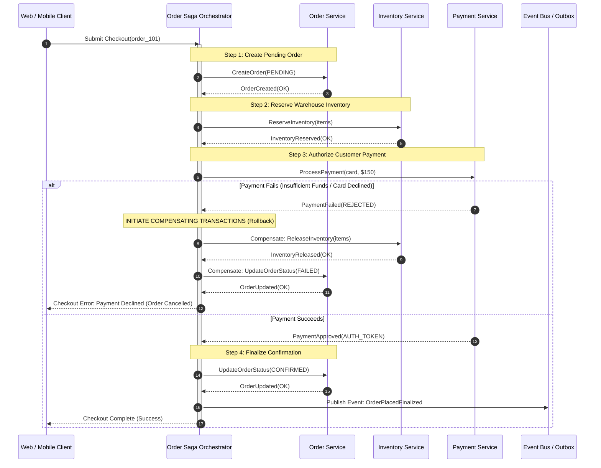

import { Callout } from "fumadocs-ui/components/callout";
import { Tabs, Tab } from "fumadocs-ui/components/tabs";
import { Steps, Step } from "fumadocs-ui/components/steps";

When an engineering organization crosses the threshold from 1,000,000 toward 10,000,000 Daily Active Users (DAU), the fundamental assumptions of classical web architecture disintegrate. In Stages 1 through 4, state management relied on a single authoritative primary relational database instance. Read traffic was scaled across read replicas, volatile working sets were cached in Redis clusters, and search queries were offloaded to Elasticsearch.

At Stage 5, this paradigm encounters an insurmountable physical wall: **the primary database write throughput ceiling**. No vertical cloud instance can sustain 50,000 ACID transactions per second against a 50-terabyte monolithic schema. Concurrently, monolithic deployment cadences collapse under organizational friction as hundreds of software engineers commit code to a single shared repository and database migration pipeline.

Surviving Stage 5 requires **horizontal database sharding** across distributed database partitions, safe decomposition of the application via the **Strangler Fig pattern**, adoption of an append-only distributed event spine via **Apache Kafka**, and coordination of business workflows across bounded contexts using the **Saga pattern**.

---

## 1. Quantitative Sizing & The Single-Primary Limit

To design systems deterministically at this tier, we must calculate the exact network, memory, disk I/O, and replication pressures generated by 10 million active users.

```
+---------------------------------------------------------------------------------------------------+
|                               STAGE 5 SYSTEM SCALE & WORKLOAD PROFILE                              |
+------------------------------+----------------------------------+---------------------------------+
| Metric Parameter             | Nominal Baseline (1M - 3M DAU)   | Peak Stress Scale (10M DAU)    |
+------------------------------+----------------------------------+---------------------------------+
| Daily Active Users (DAU)     | 1,000,000 to 3,000,000           | 10,000,000                      |
| Average Daily Actions/User   | 40 requests/day                  | 65 requests/day                 |
| Total Daily Requests         | 40,000,000 to 120,000,000 reqs   | 650,000,000 reqs                |
| Average Ingestion QPS        | 1,500 req/sec                    | 7,523 req/sec                   |
| Peak Traffic Factor          | 3.0x - 4.5x                      | 6.6x (diurnal rush / campaigns) |
| Peak System QPS              | 6,000 req/sec                    | 50,000 req/sec                  |
| Read : Write Ratio           | 4:1 (write-heavy consumer flow)  | 5:1 (mixed user interactions)   |
| Peak Write Transactions/Sec  | 1,200 writes/sec                 | 10,000 writes/sec               |
| Total Active Storage         | 10 TB NVMe                       | 85 TB - 100 TB NVMe             |
| Daily Net Ingestion Volume   | 45 GB/day raw storage            | 380 GB/day raw storage          |
| Ingress / Egress Bandwidth   | 600 Mbps / 1.5 Gbps              | 2.2 Gbps / 5.8 Gbps             |
| Kafka Daily Event Volume     | 180,000,000 events/day           | 1,800,000,000 events/day        |
+------------------------------+----------------------------------+---------------------------------+
```

### The Mathematics of the Single-Primary Saturation

Consider AWS `db.r6i.32xlarge` (128 vCPUs, 1,024 GiB RAM, 100,000 provisioned IOPS over io2 EBS storage). Why does a single primary fail at Stage 5?

1. **Write Amplification and WAL Flush Saturation**:
   Every database write triggers write-ahead logging (`WAL` / `binlog`), B-Tree index updates, foreign key checks, and row-level locks. For a table with 6 indexes (e.g., `user_id`, `created_at`, `status`, `tenant_id`, `email`, `composite_key`):
   $$\text{Disk Operations per Write} = 1\ (\text{WAL Append}) + 1\ (\text{Table Heap Block}) + 6 \times (\text{Dirty Index Blocks}) = 8\ \text{Random/Sequential IOPS}$$
   At a peak of 10,000 transactional writes per second:
   $$\text{IOPS Required} = 10,000 \times 8 = 80,000\ \text{IOPS}$$
   While raw storage arrays advertise 100,000 IOPS, fsync latency spikes from sub-millisecond to $18\text{ ms}$ under sustained $80\%$ saturation.

2. **Replication Lag Compounding**:
   PostgreSQL streaming replication and MySQL semi-synchronous replication are predominantly single-threaded or weakly parallelized on the replica's relay-log applier thread. At 10,000 writes/sec, replicas fall hundreds of seconds behind the primary:
   $$\text{Replication Lag Seconds} = \frac{\text{Primary WAL Generation Rate} - \text{Replica Apply Rate}}{\text{Primary WAL Generation Rate}} \times \Delta t$$
   When replicas lag, stale read anomalies force downstream application nodes to route reads back to the primary, triggering an immediate positive feedback death loop.

3. **Memory Working Set Eviction**:
   With 100 TB of total active storage, even if 15% of data is "hot" working set ($15\text{ TB}$), a single server with $1\text{ TB}$ of RAM has a cache hit ratio of less than:
   $$\text{Buffer Pool Hit Ratio} \approx \frac{1\text{ TB}}{15\text{ TB}} = 6.67\%$$
   The remaining 93.3% of read requests trigger physical NVMe disk fetches, exhausting read IOPS and collapsing query latency.

---

## 2. Sharded Distributed Architecture Topology

At Stage 5, the monolithic codebase and single-master database are systematically dismantled into **independently deployable bounded-context microservices** backed by a **horizontally sharded database cluster** and connected via an **immutable distributed event spine**.

```mermaid
flowchart TD
    subgraph ClientPerimeter["Client Tier & Edge"]
        Clients["Mobile Apps / SPA Clients / Webhook Partners"]
        Cloudflare["Anycast Edge & CDN / DDoS Protection"]
    end

    subgraph IngressGateway["Perimeter Ingress Tier"]
        KongEnvoy["Kong / Envoy API Gateway<br/>• mTLS & OAuth2/JWT Validation<br/>• Distributed Rate Limiting (Redis Token Bucket)<br/>• Dynamic Upstream Routing & Canary Splits"]
    end

    subgraph ServiceMesh["Domain Microservices Tier (Kubernetes EKS / GKE)"]
        AuthSvc["Auth Service<br/>(Go / Rust)"]
        UserSvc["User Service<br/>(Node.js / Go)"]
        OrderSvc["Order Service<br/>(Java / Spring Boot)"]
        InvSvc["Inventory Service<br/>(Go)"]
        PaySvc["Payment Service<br/>(Java / C#)"]
    end

    subgraph DataAccessProxy["Distributed Database Sharding Middleware"]
        ShardingProxy["Database Proxy Tier (Vitess / Citus / Hash Ring Driver)<br/>• Consistent Hashing Coordinator<br/>• Connection Pooling (Thread Multiplexing)<br/>• Scatter-Gather Query Optimizer"]
    end

    subgraph ShardedCluster["Sharded Database Tier (PostgreSQL / MySQL)"]
        subgraph Shard1["Shard Node 0 (Keyspace 0x0000 - 0x3FFF)"]
            P1[("Primary 0")]
            R1[("Replica 0")]
        end
        subgraph Shard2["Shard Node 1 (Keyspace 0x4000 - 0x7FFF)"]
            P2[("Primary 1")]
            R2[("Replica 1")]
        end
        subgraph Shard3["Shard Node 2 (Keyspace 0x8000 - 0xBFFF)"]
            P3[("Primary 2")]
            R3[("Replica 2")]
        end
        subgraph ShardN["Shard Node N (Keyspace 0xC000 - 0xFFFF)"]
            PN[("Primary N")]
            RN[("Replica N")]
        end
    end

    subgraph EventStreaming["Distributed Event Backbone (Apache Kafka Tier)"]
        KafkaBrokers["Apache Kafka Cluster (KRaft Mode)<br/>• Topic: order-events (64 partitions)<br/>• Topic: payment-events (64 partitions)<br/>• Topic: inventory-events (64 partitions)"]
        Debezium["Debezium CDC<br/>(Transactional Outbox)"]
    end

    subgraph Consumers["Downstream Async Consumers & Projections"]
        Analytics["ClickHouse Analytics Consumer"]
        ElasticSearch["Elasticsearch Indexer (Search Views)"]
        Notification["Push / Email Notification Workers"]
    end

    Clients --> Cloudflare --> KongEnvoy
    KongEnvoy -->|/api/v1/auth| AuthSvc
    KongEnvoy -->|/api/v1/users| UserSvc
    KongEnvoy -->|/api/v1/orders| OrderSvc
    KongEnvoy -->|/api/v1/inventory| InvSvc
    KongEnvoy -->|/api/v1/payments| PaySvc

    OrderSvc -->|gRPC Internal| InvSvc
    OrderSvc -->|gRPC Internal| PaySvc

    UserSvc --> ShardingProxy
    OrderSvc --> ShardingProxy

    ShardingProxy --> Shard1
    ShardingProxy --> Shard2
    ShardingProxy --> Shard3
    ShardingProxy --> ShardN

    P1 -.-> R1
    P2 -.-> R2
    P3 -.-> R3
    PN -.-> RN

    OrderSvc --> Debezium
    Debezium --> KafkaBrokers
    OrderSvc -.->|Direct Produce| KafkaBrokers

    KafkaBrokers --> Analytics
    KafkaBrokers --> ElasticSearch
    KafkaBrokers --> Notification

    style KongEnvoy fill:#0f172a,stroke:#38bdf8,stroke-width:2px
    style ShardingProxy fill:#0f172a,stroke:#f59e0b,stroke-width:2px
    style KafkaBrokers fill:#0f172a,stroke:#ef4444,stroke-width:2px
    style Shard1 fill:#1e293b,stroke:#34d399,stroke-width:1px
    style Shard2 fill:#1e293b,stroke:#34d399,stroke-width:1px
    style Shard3 fill:#1e293b,stroke:#34d399,stroke-width:1px
    style ShardN fill:#1e293b,stroke:#34d399,stroke-width:1px
```



---

## 3. Horizontal Database Sharding Deep Dive

Horizontal sharding partitions a monolithic table row-wise across multiple independent database engines. Unlike functional splitting (putting users in DB A and products in DB B), sharding places distinct subsets of the _same_ table schema across multiple physical nodes.

### Sharding Key Selection Strategy

The selection of the **shard key** determines system survival. A poorly selected shard key causes unbalanced data distribution (hotspots) or turns single-record fetches into expensive multi-node network broadcasts.

```
+---------------------------------------------------------------------------------------------------+
|                                  SHARD KEY TRADE-OFF EVALUATION                                   |
+-------------------+----------------------------+-----------------------------+--------------------+
| Dimension         | user_id                    | tenant_id (B2B SaaS)        | Timestamp / Range  |
+-------------------+----------------------------+-----------------------------+--------------------+
| Uniformity        | High (if hash-distributed) | Variable (Large vs SMB)     | Catastrophically   |
|                   |                            |                             | Non-uniform (Hot)  |
| Transaction Scope | Local ACID on 1 user data  | Local ACID on tenant data   | Multi-node writes  |
| Joins Feasibility | High for user-scoped data  | High within single tenant   | Extreme network    |
|                   |                            |                             | scatter-gather     |
| Hotspot Risk      | Celebrity user anomaly     | Enterprise whales (>20% load| Current hour shard |
|                   | (mitigate with salt)       | (dedicated isolated shard)  | melts; past cold   |
+-------------------+----------------------------+-----------------------------+--------------------+
```

### Hash-Based vs. Range-Based Sharding

1. **Range-Based Sharding**:
   Assigns contiguous key segments to shards (e.g., `Shard 0: IDs 1 - 1,000,000`, `Shard 1: IDs 1,000,001 - 2,000,000`).
   - _Critical Flaw_: Monotonically increasing auto-increment IDs or timestamp ranges write $100\%$ of incoming traffic to the highest-boundary shard. It produces a severe write hotspot while all historical shards sit idle.

2. **Hash-Based Sharding**:
   Computes a deterministic hash of the shard key:
   $$\text{Shard ID} = \text{Hash}(K) \pmod N$$
   - _Critical Flaw_: If the cluster scales from $N=8$ to $N=9$ shards, almost every existing key maps to a new shard ($\approx 88.9\%$ of data requires physical movement).

### Consistent Hashing with Virtual Nodes

Consistent hashing solves the dynamic scaling problem by mapping both data keys and database nodes onto a continuous mathematical ring $[0, 2^{32} - 1]$.

```mermaid
flowchart TD
    subgraph HashRing["Consistent Hash Ring (Modulo 2^32 - 1)"]
        direction TB
        P0["Node A_vnode_1<br/>(Angle: 30°)"]
        K1["Key: user_9824<br/>(Angle: 55° -> Node B)"]
        P1["Node B_vnode_1<br/>(Angle: 90°)"]
        K2["Key: user_1042<br/>(Angle: 140° -> Node C)"]
        P2["Node C_vnode_1<br/>(Angle: 180°)"]
        P3["Node A_vnode_2<br/>(Angle: 240°)"]
        K3["Key: user_5531<br/>(Angle: 280° -> Node B_vnode_2)"]
        P4["Node B_vnode_2<br/>(Angle: 300°)"]
    end

    style HashRing fill:#0f172a,stroke:#38bdf8,stroke-width:2px
    style P0 fill:#1e293b,stroke:#34d399,stroke-width:1px
    style P1 fill:#1e293b,stroke:#f59e0b,stroke-width:1px
    style P2 fill:#1e293b,stroke:#ef4444,stroke-width:1px
```



When an address is hashed, the system walks clockwise along the ring until it intersects the nearest node token.

- **Virtual Nodes (VNodes)**: To prevent non-uniform clustering (where one physical server gets 60% of the ring due to random hashing variance), each physical node is replicated as $V = 100 \text{ to } 256$ virtual positions across the ring (e.g., `NodeA#0`, `NodeA#1`, ..., `NodeA#199`).
- When adding a physical node, it only acquires a balanced fraction of data ($\approx 1 / (N+1)$) from adjacent predecessors without triggering total reshuffling.

#### Production Consistent Hash Ring Implementation in TypeScript

```typescript
// ConsistentHashRing.ts
import * as crypto from "crypto";

export class ConsistentHashRing {
  private readonly ring: Map<number, string> = new Map();
  private readonly sortedKeys: number[] = [];
  private readonly vnodes: number;

  constructor(nodes: string[], vnodes: number = 160) {
    this.vnodes = vnodes;
    for (const node of nodes) {
      this.addNode(node);
    }
  }

  private hash(key: string): number {
    const digest = crypto.createHash("md5").update(key).digest();
    // Extract first 4 bytes as unsigned 32-bit integer
    return digest.readUInt32BE(0);
  }

  public addNode(node: string): void {
    for (let i = 0; i < this.vnodes; i++) {
      const vnodeKey = `${node}#vnode_${i}`;
      const hashValue = this.hash(vnodeKey);
      this.ring.set(hashValue, node);
      this.sortedKeys.push(hashValue);
    }
    this.sortedKeys.sort((a, b) => a - b);
  }

  public removeNode(node: string): void {
    for (let i = 0; i < this.vnodes; i++) {
      const vnodeKey = `${node}#vnode_${i}`;
      const hashValue = this.hash(vnodeKey);
      this.ring.delete(hashValue);
      const index = this.sortedKeys.indexOf(hashValue);
      if (index !== -1) {
        this.sortedKeys.splice(index, 1);
      }
    }
  }

  public getNode(key: string): string {
    if (this.ring.size === 0) {
      throw new Error("Hash ring is unpopulated: no shards available");
    }

    const hashValue = this.hash(key);

    // Binary search for clockwise immediate successor
    let low = 0;
    let high = this.sortedKeys.length - 1;
    let targetIndex = 0;

    if (hashValue > this.sortedKeys[high]) {
      // Wrap around to ring origin
      targetIndex = 0;
    } else {
      while (low <= high) {
        const mid = Math.floor((low + high) / 2);
        if (this.sortedKeys[mid] >= hashValue) {
          targetIndex = mid;
          high = mid - 1; // Narrow down to find first element >= hashValue
        } else {
          low = mid + 1;
        }
      }
    }

    const matchedHash = this.sortedKeys[targetIndex];
    return this.ring.get(matchedHash)!;
  }
}
```

### The Scatter-Gather Query Problem on Secondary Indexes

When sharding by `user_id`, a query like `SELECT * FROM orders WHERE user_id = ?` is dispatched directly to exactly one shard. This is a **single-shard point routing** query ($O(1)$ database network overhead).

However, consider an administrative or operational query on a secondary attribute:

```sql
SELECT * FROM orders WHERE status = 'PENDING' AND created_at >= NOW() - INTERVAL '1 hour';
```

Because `status` is not part of the shard key, the query must be executed as a **Scatter-Gather** operation:

```mermaid
flowchart TD
    Client["App Server / Gateway Router"]
    Client -->|1. Parallel Query| Shard0[("Shard 0")]
    Client -->|1. Parallel Query| Shard1[("Shard 1")]
    Client -->|1. Parallel Query| Shard2[("Shard 2")]
    Client -->|1. Parallel Query| Shard3[("Shard 3")]

    Shard0 -->|2. Local Result Set| Client
    Shard1 -->|2. Local Result Set| Client
    Shard2 -->|2. Local Result Set| Client
    Shard3 -->|2. Local Result Set| Client

    Client -->|3. Merge Sort, In-Memory Pagination, Limit| FinalResult["Unified Response"]

    style Client fill:#0f172a,stroke:#38bdf8,stroke-width:2px
    style Shard0 fill:#1e293b,stroke:#f59e0b,stroke-width:1px
    style Shard1 fill:#1e293b,stroke:#f59e0b,stroke-width:1px
    style Shard2 fill:#1e293b,stroke:#f59e0b,stroke-width:1px
    style Shard3 fill:#1e293b,stroke:#f59e0b,stroke-width:1px
```



<Callout type="error" title="Scatter-Gather Latency Degradation Law">
If a cluster has $N$ shards and each shard has an independent 99th percentile query latency $p_{99} = 15\text{ ms}$, the probability that a scatter-gather query across all $N$ shards returns within $15\text{ ms}$ decays exponentially:
$$P(\text{All respond in } \le 15\text{ ms}) = (0.99)^N$$
For $N = 32$ shards:
$$(0.99)^{32} = 72.5\%$$
Over **27.5% of your scatter-gather queries will suffer tail-latency degradation** caused by the slowest node in the cluster. Never run scatter-gather queries on the transactional user path. Secondary lookup queries must be served by **Global Secondary Indexes** maintained asynchronously in Elasticsearch or dedicated reverse-index tables.
</Callout>

### Resharding Mechanics (Splitting Shards Live)

When Shard 2 reaches its capacity limit (85% disk storage or CPU saturation), it must be split into two sub-shards (e.g., Shard 2A and Shard 2B) with **zero customer downtime**:

<Steps>
  <Step>
    ### Establish Logical Target Shards Provision target physical database
    instances `Shard-2A` and `Shard-2B` with the exact schema, constraints, and
    indexes.
  </Step>
  <Step>
    ### Dual-Write or Continuous Replication Sync Configure Change Data Capture
    (CDC via Debezium or PostgreSQL logical replication slots) from `Shard-2` to
    stream all mutations (`INSERT`, `UPDATE`, `DELETE`) into `Shard-2A` and
    `Shard-2B`. A routing filter on the replica stream routes keys where $\text
    {vnode} \in \text{Range}_A$ to `Shard-2A` and $\text{vnode} \in \text{Range}
    _B$ to `Shard-2B`.
  </Step>
  <Step>
    ### Historical Backfill & Snapshot Catch-up Take a consistent storage
    snapshot of `Shard-2`. Hydrate target nodes and stream CDC logs until
    replication lag reaches $0\text{ms}$.
  </Step>
  <Step>
    ### Shadow Verification (Read Comparison) Enable read-shadowing at the
    application proxy tier. The proxy executes queries against both `Shard-2`
    and `[Shard-2A, Shard-2B]`, asserting 100% cryptographic checksum parity on
    returned rows while discarding shadow latency.
  </Step>
  <Step>
    ### Atomic Route Cutover Update the proxy routing table (via ZooKeeper,
    Etcd, or Vitess VSchema update). Traffic instantly switches to `Shard-2A`
    and `Shard-2B`. Deprecate and decommission legacy `Shard-2`.
  </Step>
</Steps>

---

## 4. Microservices Migration: The Strangler Fig Pattern

Attempting a "Big Bang" architectural rewrite of a 1M-user monolith into microservices has an industry failure rate exceeding 80%. The correct engineering methodology is Martin Fowler's **Strangler Fig Pattern**: incrementally intercepting and carving out vertical slices of business functionality until the monolith is hollowed out.

```mermaid
flowchart TD
    subgraph Clients["Clients"]
        BrowserMobile["Mobile & Web Traffic"]
    end

    subgraph APIPerimeter["Perimeter Routing (Strangler Facade)"]
        Gateway["Envoy / Kong API Gateway"]
    end

    subgraph LegacyMonolithTier["Legacy Footprint"]
        Monolith["Monolith Application<br/>(Legacy Rails / Django / Spring)"]
        MonoDB[("Monolith DB<br/>(Shared PostgreSQL)")]
    end

    subgraph ExtractedServices["Extracted Microservices"]
        OrderMicro["Order Service (New)<br/>(Go / gRPC)"]
        OrderDB[("Isolated Orders DB<br/>(Sharded)")]
        PayMicro["Payment Service (New)<br/>(Java / Spring Boot)"]
        PayDB[("Isolated Payments DB")]
    end

    BrowserMobile --> Gateway
    Gateway -->|Path: /api/v1/auth, /api/v1/search| Monolith
    Gateway -->|Strangled Path: /api/v1/orders*| OrderMicro
    Gateway -->|Strangled Path: /api/v1/payments*| PayMicro

    Monolith --> MonoDB
    OrderMicro --> OrderDB
    PayMicro --> PayDB

    Monolith -.->|Internal Migration Sync| OrderMicro

    style Gateway fill:#0f172a,stroke:#38bdf8,stroke-width:2px
    style Monolith fill:#334155,stroke:#94a3b8,stroke-width:1px
    style OrderMicro fill:#0f172a,stroke:#34d399,stroke-width:2px
    style PayMicro fill:#0f172a,stroke:#34d399,stroke-width:2px
```



### Perimeter Routing & Facade Rules

The API Gateway acts as an intelligent strangler facade. When slicing out the `Order Service`:

1. **Phase 1: Read Shadowing**: The API Gateway routes the live request to the monolith. An asynchronous plugin copies the payload and dispatches it to the newly extracted `Order Service`. Discrepancies in response JSON structure are logged to telemetry.
2. **Phase 2: Master Routing Cutover**: The Gateway updates its routing tree. Requests matching `/api/v1/orders/**` are routed directly to the `Order Service`.
3. **Phase 3: Database Decoupling**: The new microservice MUST NEVER connect to the legacy monolith database. **Database-per-service** is an unnegotiable distributed systems invariant. Shared databases reintroduce hidden coupling, schema lockouts, and catastrophic connection pool exhaustion across boundaries.

### Synchronous vs. Asynchronous Communication Protocols

At 10M users, inter-service HTTP/1.1 with JSON payloads exhausts server thread pools and incurs substantial serialization overhead. The internal transport layer is split into two specialized pathways:

```
+---------------------------------------------------------------------------------------------------+
|                           INTERNAL TRANSPORT COMMUNICATION PROTOCOLS                              |
+--------------------------+-----------------------------------+------------------------------------+
| Feature Matrix           | Internal Synchronous (gRPC / HTTP/2)| Asynchronous (Apache Kafka)      |
+--------------------------+-----------------------------------+------------------------------------+
| Serialization Protocol   | Protocol Buffers (Binary, Typed)  | Apache Avro / Schema Registry      |
| Latency Profile          | P99 < 3ms inside local cluster    | Decoupled (Sub-10ms durability)    |
| Connection Architecture  | Single TCP connection multiplexed | Long-polling persistent consumer   |
| Primary Use Case         | Immediate consistency queries,    | State changes, side-effects, audit |
|                          | authorization token verifications | logs, long-running workflow sagas  |
| Failure Consequence      | Hard synchronous cascade if       | Resilient; messages buffer safely  |
|                          | circuit breakers fail             | on disk broker partitions          |
+--------------------------+-----------------------------------+------------------------------------+
```

#### Protocol Buffers Service Contract Definition

```protobuf
// order_service.proto
syntax = "proto3";

package commerce.orders.v1;

option go_package = "github.com/company/proto/commerce/orders/v1;ordersv1";

service OrderService {
  rpc CreateOrder (CreateOrderRequest) returns (CreateOrderResponse);
  rpc GetOrder (GetOrderRequest) returns (GetOrderResponse);
}

message CreateOrderRequest {
  string idempotency_key = 1;
  string user_id = 2;
  repeated OrderItem items = 3;
  int64 total_cents = 4;
  string currency = 5;
}

message OrderItem {
  string product_id = 1;
  int32 quantity = 2;
  int64 unit_price_cents = 3;
}

message CreateOrderResponse {
  string order_id = 1;
  enum OrderStatus {
    ORDER_STATUS_UNSPECIFIED = 0;
    ORDER_STATUS_PENDING = 1;
    ORDER_STATUS_RESERVED = 2;
    ORDER_STATUS_FAILED = 3;
  }
  OrderStatus status = 2;
  int64 created_at_unix_ms = 3;
}

message GetOrderRequest {
  string order_id = 1;
  string user_id = 2; // Required for shard routing verification
}

message GetOrderResponse {
  string order_id = 1;
  string user_id = 2;
  string status = 3;
  int64 total_cents = 4;
}
```

---

## 5. Event-Driven Backbone with Apache Kafka

Traditional message brokers (RabbitMQ, AWS SQS) maintain mutable state: as consumers acknowledge messages, the broker deletes them from queues and updates index metadata. Under 10M DAU ($>1.5\text{ billion}$ events daily), queue index lock contention collapses broker throughput.

Apache Kafka utilizes a radically different abstraction: an **immutable, distributed, append-only disk commit log**.

```mermaid
flowchart TD
    subgraph Topic["Kafka Topic: 'order-events' (Total Partitions = 4)"]
        subgraph P0["Partition 0 (Append-Only Log)"]
            O0["Off: 0"] --- O1["Off: 1"] --- O2["Off: 2"] --- O3["Off: 3"] --- O4["Off: 4 (Head)"]
        end
        subgraph P1["Partition 1 (Append-Only Log)"]
            P1_0["Off: 0"] --- P1_1["Off: 1"] --- P1_2["Off: 2"] --- P1_3["Off: 3 (Head)"]
        end
        subgraph P2["Partition 2 (Append-Only Log)"]
            P2_0["Off: 0"] --- P2_1["Off: 1"] --- P2_2["Off: 2 (Head)"]
        end
        subgraph P3["Partition 3 (Append-Only Log)"]
            P3_0["Off: 0"] --- P3_1["Off: 1"] --- P3_2["Off: 2"] --- P3_3["Off: 3 (Head)"]
        end
    end

    subgraph ConsumerGroupA["Consumer Group: 'inventory-workers' (2 Instances)"]
        WorkerA1["Worker Instance 1<br/>Reads P0, P1"]
        WorkerA2["Worker Instance 2<br/>Reads P2, P3"]
    end

    subgraph ConsumerGroupB["Consumer Group: 'analytics-streaming' (4 Instances)"]
        Stream1["Analytics Pod 1 (Reads P0)"]
        Stream2["Analytics Pod 2 (Reads P1)"]
        Stream3["Analytics Pod 3 (Reads P2)"]
        Stream4["Analytics Pod 4 (Reads P3)"]
    end

    P0 -.-> WorkerA1
    P1 -.-> WorkerA1
    P2 -.-> WorkerA2
    P3 -.-> WorkerA2

    P0 --> Stream1
    P1 --> Stream2
    P2 --> Stream3
    P3 --> Stream4

    style Topic fill:#0f172a,stroke:#ef4444,stroke-width:2px
    style ConsumerGroupA fill:#0f172a,stroke:#38bdf8,stroke-width:1px
    style ConsumerGroupB fill:#0f172a,stroke:#34d399,stroke-width:1px
```



### Partitioning Keys, Offsets, and Consumer Groups

1. **Sequential PageCache Disk Writes**: Kafka writes events sequentially to physical disk segment files. Sequential disk I/O on modern NVMe drives achieves $>2\text{ GB/sec}$ throughput, matching or exceeding random memory access speeds.
2. **Deterministic Partition Ordering**: By producing messages with a partition key (e.g., `user_id` or `order_id`), all state transitions for that specific entity are guaranteed to append to the exact same partition in strict chronological order.
3. **Consumer Independence via Offset Tracking**: Consumers do not modify the broker log. They only advance their own lightweight 64-bit integer cursor (`offset`). 50 different consumer microservices can read the same event stream at different speeds without degrading broker performance.

### The Dual-Write Vulnerability & The Transactional Outbox Pattern

A fatal rookie mistake in distributed microservices is the "Dual-Write Bug":

```typescript
// ANTI-PATTERN: DO NOT USE IN PRODUCTION
async function createOrderBad(orderData: Order) {
  // 1. Write to local database
  await db.orders.insert(orderData);

  // 2. Publish event to Kafka
  // IF NETWORK CUTS HERE OR KAFKA TIMES OUT:
  // Order is committed in DB, but NO EVENT EVER PUBLISHED TO KAFKA!
  // Inventory is never deducted, payments never collected, data is corrupt.
  await kafkaProducer.send({ topic: "order-events", message: orderData });
}
```

Reversing the order is equally catastrophic: if Kafka accepts the event, but the database transaction rolls back due to a constraint violation, phantom events flood downstream services.

#### The Transactional Outbox Pattern Solution

To guarantee zero event loss without slow, blocking Two-Phase Commit protocols, the service writes the business record and the outbox event into the **same relational database within a single local ACID transaction**:

```mermaid
flowchart LR
    subgraph Microservice["Order Microservice Context"]
        App["Order Service Logic"]
        subgraph LocalDB["Local Relational DB"]
            OrdersTable[("orders Table")]
            OutboxTable[("outbox_events Table")]
        end
    end

    subgraph CDC["CDC / Relayer Tier"]
        Debezium["Debezium Engine<br/>(Tail WAL / binlog)"]
    end

    subgraph KafkaCluster["Apache Kafka"]
        KafkaTopic[("Kafka Topic: order-events")]
    end

    App -->|1. Single Local ACID Transaction<br/>INSERT into orders<br/>INSERT into outbox_events| LocalDB
    OrdersTable -.->|Commit WAL| OutboxTable
    OutboxTable -->|2. Stream WAL Mutations| Debezium
    Debezium -->|3. Exactly-Once Delivery with Ack| KafkaTopic

    style App fill:#0f172a,stroke:#38bdf8,stroke-width:2px
    style LocalDB fill:#1e293b,stroke:#34d399,stroke-width:2px
    style Debezium fill:#0f172a,stroke:#f59e0b,stroke-width:2px
    style KafkaTopic fill:#0f172a,stroke:#ef4444,stroke-width:2px
```



#### Production PostgreSQL Outbox Implementation

```sql
-- Schema migration for Outbox table
CREATE TABLE outbox_events (
    id UUID PRIMARY KEY DEFAULT gen_random_uuid(),
    aggregate_type VARCHAR(64) NOT NULL,
    aggregate_id VARCHAR(64) NOT NULL,
    event_type VARCHAR(128) NOT NULL,
    payload JSONB NOT NULL,
    created_at TIMESTAMPTZ NOT NULL DEFAULT NOW(),
    processed_at TIMESTAMPTZ NULL
);

CREATE INDEX idx_outbox_unprocessed ON outbox_events (created_at)
WHERE processed_at IS NULL;
```

```typescript
// OrderService.ts (Transactional Outbox write)
import { PoolClient } from "pg";

export async function createOrderSecure(
  client: PoolClient,
  order: Order
): Promise<void> {
  try {
    await client.query("BEGIN");

    // 1. Insert core domain record
    const orderInsertQuery = `
      INSERT INTO orders (id, user_id, total_cents, status, created_at)
      VALUES ($1, $2, $3, $4, NOW())
    `;
    await client.query(orderInsertQuery, [
      order.id,
      order.userId,
      order.totalCents,
      "PENDING",
    ]);

    // 2. Insert outbox event in the EXACT SAME local transaction
    const outboxInsertQuery = `
      INSERT INTO outbox_events (aggregate_type, aggregate_id, event_type, payload)
      VALUES ($1, $2, $3, $4)
    `;
    const eventPayload = {
      orderId: order.id,
      userId: order.userId,
      totalCents: order.totalCents,
      items: order.items,
      timestamp: Date.now(),
    };
    await client.query(outboxInsertQuery, [
      "Order",
      order.id,
      "OrderCreated",
      JSON.stringify(eventPayload),
    ]);

    // 3. Commit locally: If this succeeds, both the order and event exist guaranteed
    await client.query("COMMIT");
  } catch (error) {
    await client.query("ROLLBACK");
    throw error;
  }
}
```

---

## 6. Distributed Transactions: The Saga Pattern

In a sharded microservices architecture, operations that once executed within a single database transaction (e.g., checkout cart $\rightarrow$ lock inventory $\rightarrow$ debit wallet $\rightarrow$ create invoice) now span multiple physical databases and isolated network services.

### Why Two-Phase Commit (2PC / XA) Fails at Scale

Classical distributed database theory suggests Two-Phase Commit (`2PC`): a transaction coordinator prepares all participating nodes before sending a global commit.

At 10,000,000 users, 2PC is an anti-pattern that leads to systemic outages:

1. **Blocking Protocol Latency**: Every participant must hold local database row locks across the entire duration of all network round-trips:
   $$\text{Total Lock Hold Time} = \sum_{i=1}^{k} (\text{Network RTT}_i + \text{Disk fsync}_i)$$
2. **Coordinator Crash Vulnerability**: If the coordinator crashes during the commit phase, resource locks remain frozen indefinitely on participants, starving incoming queries.
3. **Availability Collapse (CAP Theorem)**: An operation requiring consensus across 5 independent microservices experiences uptime equal to the product of individual uptimes:
   $$\text{Availability}_{\text{system}} = (0.999)^5 = 99.50\% \implies 43.8\text{ hours of downtime/year!}$$

### Orchestration vs. Choreography Sagas

A **Saga** is a sequence of local transactions where each step updates data within a single service and publishes an event. If a local transaction fails along the execution chain, the Saga executes **compensating transactions** backward to undo the preceding work.

```
+---------------------------------------------------------------------------------------------------+
|                                 SAGA ARCHITECTURE COMPARISON                                      |
+--------------------------+-----------------------------------+------------------------------------+
| Dimension                | Choreography (Event-Driven)       | Orchestration (State Machine)      |
+--------------------------+-----------------------------------+------------------------------------+
| Coordination Point       | Decentralized; services react     | Centralized Orchestrator           |
|                          | to published domain events        | (Temporal / Cadence / Step Svc)    |
| Coupling                 | Loose coupling via Kafka events   | Services coupled to orchestrator   |
| Complexity Hotspot       | Cyclic dependency tracking,       | Centralized workflow logic         |
|                          | difficult global state visibility |                                    |
| Recommended Scale        | 2 to 4 collaborating services     | 5+ microservices with branching    |
|                          | with simple linear transitions    | decisions & complex rollbacks      |
+--------------------------+-----------------------------------+------------------------------------+
```

### Complete Saga Execution Flow with Compensating Actions



### Idempotency Key Implementation

Because networks are inherently unreliable, compensating transactions and retries will be executed more than once. Every microservice consumer **must be mathematically idempotent**:
$$f(f(x)) = f(x)$$

```typescript
// IdempotentPaymentConsumer.ts
import { PoolClient } from "pg";

interface PaymentCommand {
  idempotencyKey: string;
  orderId: string;
  userId: string;
  amountCents: number;
}

export async function processPaymentIdempotent(
  client: PoolClient,
  command: PaymentCommand
): Promise<{ status: string; transactionId: string }> {
  try {
    await client.query("BEGIN");

    // 1. Atomic check-and-insert lock on idempotency token
    const idempotencyQuery = `
      INSERT INTO processed_requests (idempotency_key, resource_type, created_at)
      VALUES ($1, 'PAYMENT', NOW())
      ON CONFLICT (idempotency_key) DO NOTHING
      RETURNING id;
    `;
    const idempRes = await client.query(idempotencyQuery, [
      command.idempotencyKey,
    ]);

    if (idempRes.rowCount === 0) {
      // Key already exists! Fetch previous successful execution result
      const existingTx = await client.query(
        "SELECT status, transaction_id FROM payments WHERE idempotency_key = $1",
        [command.idempotencyKey]
      );
      await client.query("COMMIT");

      return {
        status: existingTx.rows[0].status,
        transactionId: existingTx.rows[0].transaction_id,
      };
    }

    // 2. Fresh request: Execute financial transaction against Stripe / Bank
    const bankResult = await executeExternalCardCharge(command.amountCents);

    // 3. Persist transaction record
    const insertPaymentQuery = `
      INSERT INTO payments (id, idempotency_key, order_id, amount_cents, status, transaction_id)
      VALUES (gen_random_uuid(), $1, $2, $3, $4, $5)
    `;
    await client.query(insertPaymentQuery, [
      command.idempotencyKey,
      command.orderId,
      command.amountCents,
      bankResult.status,
      bankResult.gatewayTransactionId,
    ]);

    await client.query("COMMIT");
    return {
      status: bankResult.status,
      transactionId: bankResult.gatewayTransactionId,
    };
  } catch (err) {
    await client.query("ROLLBACK");
    throw err;
  }
}
```

---

## 7. Failure Modes & The Breaking Point

At 10,000,000 users, single points of failure move up the stack into emergent distributed system pathologies.

```
+---------------------------------------------------------------------------------------------------+
|                             STAGE 5 SYSTEM BREAKING POINTS & REMEDIATIONS                         |
+--------------------------+-----------------------------------+------------------------------------+
| Failure Mode             | Physical Root Cause               | Mitigation & Architectural Shield  |
+--------------------------+-----------------------------------+------------------------------------+
| Cascading Microservice   | Unresponsive downstream service   | Exponential backoff with jitter;   |
| Thread Starvation        | exhausts thread pools upstream    | Circuit breakers (Envoy / Resilience4j)|
|                          | via lingering blocking connections| Strict 500ms gRPC timeouts         |
+--------------------------+-----------------------------------+------------------------------------+
| Cross-Shard Deadlocks    | Client runs transaction touching  | Pure prohibition of cross-shard    |
|                          | rows on Shard 2 and Shard 7       | transactions; decouple into async  |
|                          | simultaneously                    | Sagas via Kafka outbox             |
+--------------------------+-----------------------------------+------------------------------------+
| Kafka Consumer Lag       | Slow DB operations or poison pill | Dead Letter Queues (DLQ); partition|
| Tsunami                  | message blocks consumer offset    | scaling; asynchronous worker batch |
|                          | advancement                       | processing within consumers        |
+--------------------------+-----------------------------------+------------------------------------+
| Clock Drift Inversion    | Server clocks drift by >50ms;     | Hybrid Logical Clocks (HLC);       |
|                          | causal event ordering corrupts    | Strict Kafka offset ordering rather|
|                          | distributed business logic        | than wall-clock timestamp sorting  |
+--------------------------+-----------------------------------+------------------------------------+
| Datacenter Isolation     | Entire AWS Availability Zone or   | Active-Active multi-AZ clusters;   |
| (Single-Region Wall)     | primary region suffers fiber cut  | Multi-region migration (Stage 6)   |
+--------------------------+-----------------------------------+------------------------------------+
```

### The Cascading Outage Death Spiral

In a microservices topology with 40 distinct services, if Service D experiences a 2-second database query stall, upstream Services A, B, and C will hold open inbound HTTP connections waiting for Service D. Within 45 seconds:

1. Web worker thread pools across the entire cluster are exhausted.
2. Ingress health checks fail.
3. The load balancer marks all instances as dead and ceases routing traffic entirely.

```mermaid
flowchart LR
    Client["Client Traffic"] --> Gateway["API Gateway"]
    Gateway --> ServiceA["Service A (Orders)"]
    ServiceA --> ServiceB["Service B (Inventory)"]
    ServiceB --> ServiceC["Service C (Warehouse DB)"]

    ServiceC -.->|Database Lock: 5s Hang| ServiceB
    ServiceB -.->|Threads Exhausted: 100% CPU| ServiceA
    ServiceA -.->|Connection Pool Dry| Gateway
    Gateway -.->|504 Gateway Timeout| Client

    style ServiceC fill:#7f1d1d,stroke:#ef4444,stroke-width:2px
    style ServiceB fill:#7f1d1d,stroke:#ef4444,stroke-width:2px
    style ServiceA fill:#7f1d1d,stroke:#ef4444,stroke-width:2px
    style Gateway fill:#7f1d1d,stroke:#ef4444,stroke-width:2px
```



**Architectural Law**: Every synchronous internal gRPC call MUST be bounded by a timeout ($\le 800\text{ ms}$), an adaptive circuit breaker, and a graceful fallback.

---

## 8. Architectural Rules of Thumb & Checklist for Graduating to Stage 6

Before an engineering system can safely scale past 10,000,000 users toward the planetary scale of 50,000,000 users, it must satisfy rigorous architectural operational thresholds.

### The Operational Readiness Checklist

- [ ] **Zero Cross-Shard Transactions**: No query in production joins tables across distinct physical shards. All cross-domain consistency is orchestrated via Sagas or materialized read views.
- [ ] **Database Connection Virtualization**: Application servers do not open direct database connections. Vitess, Citus, or high-performance proxies multiplex hundreds of thousands of ephemeral application threads over pooled physical connections.
- [ ] **Contract-First API Governance**: Protobuf definitions and Kafka Avro schemas are stored in a centralized Schema Registry. Breaking changes are blocked automatically in CI/CD pipelines.
- [ ] **Transactional Outbox Everywhere**: No service performs a dual-write. 100% of domain events are committed atomically alongside entity state mutations.
- [ ] **Strict Circuit Breaking and Deadlines**: Every inter-service RPC propagates a distributed deadline context (`grpc-timeout`). Downstream services abort processing immediately if the caller's deadline has elapsed.
- [ ] **Comprehensive Distributed Tracing**: Every inbound HTTP request is injected with a W3C `traceparent` header. OpenTelemetry spans trace execution across Gateway $\rightarrow$ Microservices $\rightarrow$ Shards $\rightarrow$ Kafka $\rightarrow$ Consumers.

### When to Graduate to Stage 6 (10M to 50M+ Users)

You have outgrown Stage 5 and must begin transition to Stage 6 when:

1. **Continental Network Latency**: Over 40% of your user base resides outside your primary continent, suffering round-trip times $>200\text{ ms}$ that degrade conversion metrics.
2. **Catastrophic Blast Radius Risk**: A configuration error or regional cloud outage knocks down all 10M users simultaneously. You need **Cell-Based Architecture** to constrain blast radius to isolated user segments ($<5\%$).
3. **Write Sharding Complexity Ceiling**: Managing 128 manual PostgreSQL shards creates insurmountable operational maintenance overhead, requiring migration to globally distributed NewSQL engines (Google Cloud Spanner, CockroachDB, YugabyteDB).
