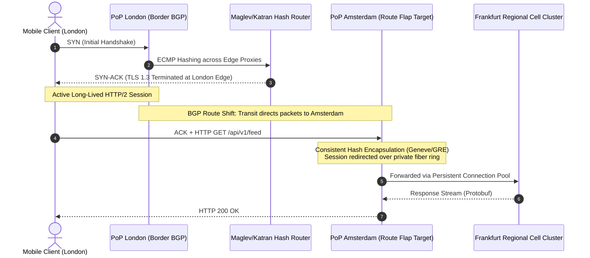

import { Callout } from "fumadocs-ui/components/callout";
import { Tabs, Tab } from "fumadocs-ui/components/tabs";
import { Steps, Step } from "fumadocs-ui/components/steps";

When an engineering system scales from 10 million to beyond 50 million Daily Active Users (DAU), software architecture ceases to be an isolated exercise in software design; it becomes constrained by **planetary physics, telecommunications routing topology, and global distributed consensus**.

At this threshold, single-region deployments are obsolete. A catastrophe in an AWS availability zone or transatlantic fiber cut can take down global business operations. Furthermore, the speed of light makes cross-continental round-trips an impassable latency bottleneck for interactive user experiences. Stage 6 represents the pinnacle of modern systems engineering: **multi-region active-active cell deployments, global Anycast BGP ingress, linearizable distributed consensus, real-time stream processing DAGs, and continuous chaos engineering.**

---

## 1. Quantitative Sizing & Planetary Physics

Scaling to 50 million DAU shifts all operational baseline metrics by orders of magnitude compared to Stage 5.

### Traffic & Storage Profile

| Dimensional Metric             | Value Range (50M DAU)          | Architectural Implication                                                             |
| :----------------------------- | :----------------------------- | :------------------------------------------------------------------------------------ |
| **Daily Active Users (DAU)**   | 10,000,000 – 50,000,000+       | Heterogeneous user populations distributed across all continents and time zones.      |
| **Daily User Operations**      | 1.5 – 3.5 Billion actions/day  | Assuming 30 to 70 interactions per active user per day.                               |
| **Ingress Average QPS**        | 20,000 – 45,000 external QPS   | Sustained global edge ingress.                                                        |
| **Ingress Peak QPS**           | 100,000 – 500,000 external QPS | Global peak events (e.g., Black Friday, World Cup, New Year's Eve).                   |
| **Internal RPC Fan-Out**       | 500,000 – 3,500,000 RPC QPS    | East-West service mesh amplification (average 7x to 10x call multiplier).             |
| **Primary Relational State**   | 150 TB – 1.5+ PB               | Too massive for traditional single-instance databases or naive primary-replica pairs. |
| **Analytical & Log Egress**    | 5 PB – 50+ PB / year           | Continuous telemetry ingested into real-time streaming DAGs and analytical lakes.     |
| **Sustained Egress Bandwidth** | 15 Gbps – 80+ Gbps             | Heavy reliance on edge caching and planetary point-of-presence (PoP) termination.     |

### The Speed of Light Constraint

In single-datacenter engineering, network latency is modeled as sub-millisecond local switching noise ($< 0.5\text{ ms}$). Across a planet of radius $R \approx 6,371\text{ km}$, latency is bounded by the laws of electrodynamics.

The speed of light in a vacuum is:
$$c \approx 299,792\text{ km/s} \approx 300\text{ km/ms}$$

Light travels through standard single-mode silica glass optical fiber ($n \approx 1.468$) at roughly two-thirds of vacuum speed:
$$v_{\text{fiber}} = \frac{c}{n} \approx \frac{300,000\text{ km/s}}{1.468} \approx 204.36\text{ km/ms} \approx 204\text{ km per millisecond}$$

Because terrestrial and submarine cables cannot follow ideal great-circle paths—meandering along tectonic shelves, rights of way, and terrestrial trenches—we apply an empirical **routing factor** of approximately $1.30 \text{ to } 1.45$:

```
Theoretical Great-Circle Distance vs Real-World Fiber RTT:
-----------------------------------------------------------------------------------------
Route                          Great Circle       Theoretical Min RTT    Real-World Fiber RTT
-----------------------------------------------------------------------------------------
New York ⇄ London             ~5,585 km          ~27.3 ms               ~68 ms - 74 ms
San Francisco ⇄ Tokyo         ~8,280 km          ~40.5 ms               ~105 ms - 118 ms
London ⇄ Singapore            ~10,850 km         ~53.1 ms               ~155 ms - 170 ms
Frankfurt ⇄ Sydney            ~16,500 km         ~80.7 ms               ~280 ms - 310 ms
-----------------------------------------------------------------------------------------
```

<Callout type="error" title="The Planetary Synchronous Consensus Trap">
  If an architecture attempts to execute a synchronous cross-continental
  Two-Phase Commit (2PC) or Raft quorum write between Singapore and Northern
  Virginia for every write request, the physical speed-of-light penalty
  guarantees a baseline application latency floor of **$220\text{ms} - 280\text
  {ms}$** before a single line of server code executes. At 50M DAU, your
  database must either partition data by geography or execute consensus across
  localized regional quorums.
</Callout>

---

## 2. Planetary Multi-Region Active-Active Topology

To overcome planetary physics, survive full cloud region outages, and deliver $<50\text{ ms}$ tail latencies globally, Stage 6 deploys a **Multi-Region Active-Active Cell Topology**.

```mermaid
flowchart TD
    subgraph GlobalClients["Global Client Layer (10M - 50M+ DAU)"]
        U_NA["North America Users"]
        U_EU["Europe Users"]
        U_APAC["Asia-Pacific Users"]
    end

    subgraph EdgeAnycast["Global Anycast Edge Layer (300+ PoPs)"]
        BGP["Global Anycast BGP Prefix (AS-Path Optimization)<br/>Cloudflare Magic Transit / AWS Global Accelerator"]
        TLS_Term["Edge TLS 1.3 Termination (0-RTT) + DDoS Scrubbing + HTTP/3 QUIC"]
    end

    U_NA --> BGP
    U_EU --> BGP
    U_APAC --> BGP
    BGP --> TLS_Term

    subgraph RegionUS["Active Region 1: US-East (N. Virginia)"]
        ALB_US["Regional Gateway / NLB"]
        CR_US["Cell Router (Consistent Hashing)"]
        subgraph Cells_US["Cellular Deployment Units"]
            Cell_US1["Cell 01 (1M Users)"]
            Cell_US2["Cell 02 (1M Users)"]
        end
        Cache_US["Regional Redis Cluster"]
        Kafka_US["Local Apache Kafka Cluster"]
    end

    subgraph RegionEU["Active Region 2: EU-Central (Frankfurt)"]
        ALB_EU["Regional Gateway / NLB"]
        CR_EU["Cell Router (Consistent Hashing)"]
        subgraph Cells_EU["Cellular Deployment Units"]
            Cell_EU1["Cell 03 (1M Users)"]
            Cell_EU2["Cell 04 (1M Users)"]
        end
        Cache_EU["Regional Redis Cluster"]
        Kafka_EU["Local Apache Kafka Cluster"]
    end

    subgraph RegionAPAC["Active Region 3: APAC-South (Singapore)"]
        ALB_APAC["Regional Gateway / NLB"]
        CR_APAC["Cell Router (Consistent Hashing)"]
        subgraph Cells_APAC["Cellular Deployment Units"]
            Cell_APAC1["Cell 05 (1M Users)"]
            Cell_APAC2["Cell 06 (1M Users)"]
        end
        Cache_APAC["Regional Redis Cluster"]
        Kafka_APAC["Local Apache Kafka Cluster"]
    end

    TLS_Term -- "Private Fiber Backbone" --> ALB_US
    TLS_Term -- "Private Fiber Backbone" --> ALB_EU
    TLS_Term -- "Private Fiber Backbone" --> ALB_APAC

    ALB_US --> CR_US --> Cells_US
    ALB_EU --> CR_EU --> Cells_EU
    ALB_APAC --> CR_APAC --> Cells_APAC

    Cells_US --- Cache_US
    Cells_US --- Kafka_US
    Cells_EU --- Cache_EU
    Cells_EU --- Kafka_EU
    Cells_APAC --- Cache_APAC
    Cells_APAC --- Kafka_APAC

    subgraph PlanetaryData["Global Distributed Consensus & Replication Tier"]
        DB_Spanner[("Google Cloud Spanner / CockroachDB<br/>Multi-Region Linearizable Paxos/Raft Quorum")]
        Kafka_MM["Cross-Region Kafka MirrorMaker 2 / Cluster Linking"]
    end

    Cells_US <===> DB_Spanner
    Cells_EU <===> DB_Spanner
    Cells_APAC <===> DB_Spanner

    Kafka_US <-.-> Kafka_MM <-.-> Kafka_EU
    Kafka_EU <-.-> Kafka_MM <-.-> Kafka_APAC

    style GlobalClients fill:#0f172a,stroke:#38bdf8,stroke-width:2px
    style EdgeAnycast fill:#1e293b,stroke:#f59e0b,stroke-width:2px
    style RegionUS fill:#0f172a,stroke:#3b82f6,stroke-width:2px
    style RegionEU fill:#0f172a,stroke:#10b981,stroke-width:2px
    style RegionAPAC fill:#0f172a,stroke:#8b5cf6,stroke-width:2px
    style PlanetaryData fill:#18181b,stroke:#ef4444,stroke-width:3px
```



---

## 3. Global Edge Routing & Anycast BGP

Routing tens of millions of concurrent connections across continents cannot rely on standard authoritative DNS record lookups.

### Anycast BGP vs. GeoDNS

<Tabs items={['Anycast BGP Routing', 'GeoDNS Routing', 'Edge Architecture Comparison']}>
  <Tab value="Anycast BGP Routing">
    **Mechanism**: The exact same public IPv4 prefix (e.g., `/24`) and IPv6 prefix (e.g., `/48`) are broadcast via the **Border Gateway Protocol (BGP)** from hundreds of edge Points of Presence (PoPs) globally using an autonomous system number (ASN).
    
    - **Routing Mechanics**: Upstream Internet Service Providers (Tier 1 transit providers like Lumen, Telia, Cogent) dynamically compute the shortest BGP `AS-Path` to route user packets to the topologically closest PoP.
    - **Failover Speed**: **Sub-second**. If a PoP loses connectivity or burns down, BGP withdraws the prefix route advertisement; global routers immediately converge on the next best PoP without client intervention.
    - **DDoS Scrubbing**: Volumetric attacks (e.g., 1.5 Tbps UDP floods) are decentralized and dispersed across 300+ PoPs, where each edge location absorbs a trivial fraction (3–5 Gbps) before transit peering saturates.
  </Tab>
  <Tab value="GeoDNS Routing">
    **Mechanism**: Authoritative DNS nameservers inspect the incoming resolver's IP address (or EDNS0 Client Subnet) and respond with a regional IP address (e.g., `198.51.100.1` for US, `203.0.113.1` for Asia).
    
    - **Failover Latency**: **Slow and Unpredictable (Minutes to Hours)**. ISP recursive resolvers routinely violate DNS Time-to-Live (TTL) values, caching dead IPs long after failovers.
    - **Client Misrouting**: Public DNS resolvers (like `8.8.8.8` or corporate VPN egress points) without EDNS Client Subnet (ECS) can cause a user in Tokyo to resolve a Virginia IP.
    - **Verdict**: GeoDNS is reserved as a secondary fallback layer, not primary traffic ingestion at 50M DAU scale.
  </Tab>
  <Tab value="Edge Architecture Comparison">
    | Attribute | Anycast BGP (Stage 6 Standard) | GeoDNS (Stage 4–5 Legacy) |
    | :--- | :--- | :--- |
    | **Convergence / Failover** | Instantaneous ($< 1\text{ second}$) via BGP withdrawals | High ($300\text{ s} - 86,400\text{ s}$) due to recursive DNS caching |
    | **DDoS Dispersion** | Planetary dispersion across 300+ edge scrubbers | Concentrated on regional ingress points |
    | **Routing Determinism** | BGP metrics (AS-Path, local pref, prepends) | Geographic IP databases (MaxMind GeoIP) |
    | **Transport Resiliency** | Requires stable TCP routes (ECMP hash stabilization) | Standard unicast routing |
  </Tab>
</Tabs>

### BGP Route Flapping & Anycast TCP Stability

The classic challenge with Anycast TCP is **route flapping**: if intermediate Tier-1 BGP routes shift mid-connection, subsequent TCP packets (e.g., an HTTP/2 payload) could route to a _different_ physical PoP that holds no TCP session state, triggering connection resets (`TCP RST`).

Modern planetary architectures solve this using **State-Preserving Katran/Maglev Consistent Hash Load Balancers** at the edge:



### Edge TLS Termination & Dedicated Backbone Routing

1. **TLS 1.3 with 0-RTT Session Resumption**: Handshakes complete at the edge PoP within **$5\text{ ms} - 12\text{ ms}$** of the client, regardless of where origin compute lives.
2. **Persistent Warm Connection Pools**: Between the edge PoP and regional data centers, traffic traverses **dedicated dark fiber / Cloud Interconnect backbones** using pre-warmed, multiplexed HTTP/2 or gRPC connection pools, eliminating continental TCP slow-start phases.

---

## 4. Planetary Distributed Data: Spanner, CockroachDB & Consensus

At 50 million DAU, single-instance relational databases and simple primary-replica configurations collapse under write lock contention and continental cross-region replication lag. Systems at this scale demand **Globally Distributed, Multi-Region Consensus Engines**.

### The PACELC Theorem at Planetary Scale

The **PACELC Theorem** (an extension of CAP by Daniel Abadi) dictates:

> If there is a **Partition (P)**, trade off **Availability (A)** versus **Consistency (C)**;  
> **Else (E)**, trade off **Latency (L)** versus **Consistency (C)**.

```
                  ┌────────────── Planetary Distributed Databases ──────────────┐
                  │                                                             │
                  ▼                                                             ▼
        PC/EC (Consistency First)                                     PA/EL (Availability & Latency First)
   Google Spanner, CockroachDB, YugabyteDB                      DynamoDB Global Tables, Cassandra, ScyllaDB
   - Linearizable reads & writes                                - Multi-region active-active masterless writes
   - Raft / Paxos consensus rounds                              - Sub-10ms local writes everywhere
   - Synchronous WAN round-trip on commit (30-80ms)             - Asynchronous cross-region replication (eventual consistency)
   - Zero split-brain or data anomalies                         - Conflict resolution via CRDTs or Last-Write-Wins (LWW)
```

### Google Cloud Spanner: TrueTime & External Consistency

Google Spanner achieves **external consistency (linearizability)** across continental regions without locking read transactions, powered by the **TrueTime API**.

#### The TrueTime Mechanism

Standard computer clocks (quartz crystal oscillators synchronized via NTP) drift significantly—often by $100\text{ ms} \text{ to } 250\text{ ms}$ over WAN networks. Distributed snapshot isolation cannot determine strict causal ordering based on uncertain local timestamps.

TrueTime explicitly represents time as an **uncertainty interval**:
$$\text{TT.now}() = [t_{\text{earliest}}, t_{\text{latest}}] \quad \text{where } \epsilon = \frac{t_{\text{latest}} - t_{\text{earliest}}}{2}$$

```
TrueTime Datacenter Topology:
[GPS Antennas on Roof] ──► [Master Time Daemon] ◄── [Atomic Rubidium Clocks]
                                    │
                         Time Uncertainty (ε ≤ 7ms)
                                    │
                         [Spanner Node Clocks]
```

#### The Commit Wait Rule

To guarantee that transaction $T_2$ committing _after_ $T_1$ receives an absolute timestamp $s_2 > s_1$, Spanner enforces the **Commit Wait Rule**:

<Steps>
  <Step title="Acquire Locks & Generate Timestamp">
    The Paxos leader for the shard acquires write locks and samples TrueTime:
    $$s = \text{TT.now}().\text{latest}$$
  </Step>
  <Step title="Consensus Quorum Execution">
    The leader replicates the commit record to a Paxos quorum of replicas across regions (e.g., US-East, US-Central, US-West).
  </Step>
  <Step title="Commit Wait Period (Waiting Out the Uncertainty)">
    The leader **deliberately halts and waits** until:
    $$\text{TT.now}().\text{earliest} > s$$
    The duration of this wait is at least $2\epsilon$ (typically $4\text{ ms} - 14\text{ ms}$).
  </Step>
  <Step title="Release Locks & Return to Client">
    Locks are released. Any subsequent transaction anywhere on Earth will sample a timestamp guaranteed to be strictly greater than $s$.
  </Step>
</Steps>

<Callout type="info" title="Why Commit Wait Is Revolutionary">
  By waiting out the clock uncertainty $\epsilon$ at commit time, Spanner allows
  **global read-only transactions across millions of rows to execute without
  acquiring any locks or blocking concurrent writes**, producing a
  mathematically provable, consistent snapshot of the entire planetary database.
</Callout>

### CockroachDB: Multi-Region Table Topologies

CockroachDB implements multi-region Raft without atomic clocks by utilizing **Hybrid Logical Clocks (HLC)** and declarative table localization topologies.

```sql
-- Configuring a Multi-Region Database in CockroachDB
ALTER DATABASE production_platform SET PRIMARY REGION "us-east-1";
ALTER DATABASE production_platform ADD REGION "eu-west-1";
ALTER DATABASE production_platform ADD REGION "ap-southeast-1";

-- 1. REGIONAL BY ROW: High-frequency user records pinned to their home continent
CREATE TABLE users (
    user_id UUID DEFAULT gen_random_uuid(),
    home_region crdb_internal_region AS (
        CASE
            WHEN country_code IN ('US', 'CA', 'MX') THEN 'us-east-1'
            WHEN country_code IN ('DE', 'FR', 'UK') THEN 'eu-west-1'
            ELSE 'ap-southeast-1'
        END
    ) STORED,
    email VARCHAR(255) NOT NULL,
    country_code VARCHAR(2) NOT NULL,
    account_balance NUMERIC(15, 2) NOT NULL,
    PRIMARY KEY (home_region, user_id)
) LOCALITY REGIONAL BY ROW;

-- 2. GLOBAL TABLE: Rarely-written lookup data readable locally in 1ms worldwide
CREATE TABLE platform_feature_flags (
    feature_key VARCHAR(64) PRIMARY KEY,
    is_enabled BOOLEAN NOT NULL DEFAULT FALSE,
    rollout_percentage INT NOT NULL DEFAULT 0,
    updated_at TIMESTAMPTZ DEFAULT clock_timestamp()
) LOCALITY GLOBAL;
```



```mermaid
flowchart LR
    subgraph TableTypes["CockroachDB Multi-Region Locality Models"]
        subgraph RegionalByRow["REGIONAL BY ROW (e.g., User Accounts)"]
            R_US["Raft Leaseholder: us-east-1<br/>Write Latency: ~5ms<br/>Local Read: ~1ms"]
            R_EU["Raft Leaseholder: eu-west-1<br/>Write Latency: ~5ms<br/>Local Read: ~1ms"]
        end
        subgraph GlobalTable["GLOBAL TABLES (e.g., Configuration / SKUs)"]
            G_Lease["All Replicas Serve Reads Locally (0ms WAN Latency)"]
            G_Writes["Writes Require Global Quorum WAN RTT (~120ms)"]
        end
    end

    style TableTypes fill:#0f172a,stroke:#38bdf8,stroke-width:1px
    style RegionalByRow fill:#1e293b,stroke:#10b981,stroke-width:2px
    style GlobalTable fill:#1e293b,stroke:#f59e0b,stroke-width:2px
```

### DynamoDB Global Tables & Conflict-Free Replicated Data Types (CRDTs)

When extreme write throughput ($>500,000\text{ writes/sec}$) renders synchronous cross-region consensus too costly, architectures transition to **Amazon DynamoDB Global Tables** (multi-region active-active masterless replication).

DynamoDB replicates asynchronously across regions in roughly $500\text{ ms} - 1,500\text{ ms}$. Because concurrent writes can strike both regions simultaneously, applications must manage conflict resolution:

#### 1. Last-Write-Wins (LWW) Dangers

DynamoDB by default resolves write conflicts using a **Last-Write-Wins (LWW)** strategy based on system update timestamps. If two writes happen within milliseconds in different regions:

- Region A updates `balance = balance - 50`
- Region B updates `balance = balance - 30`
- **Result**: One write completely overwrites the other, creating silent financial discrepancies.

#### 2. State-Based Conflict-Free Replicated Data Types (CRDTs)

To achieve mathematical consistency without cross-region locks, state updates use **CRDTs**:

```typescript
/**
 * Positive-Negative Counter (PN-Counter) CRDT
 * Allows independent, concurrent increments and decrements across continental regions
 * without locking, converging deterministically upon merge.
 */
export interface PNCounterState {
  positiveIncrements: Record<string, number>; // RegionID -> Sum of increments
  negativeDecrements: Record<string, number>; // RegionID -> Sum of decrements
}

export class PlanetaryPNCounter {
  constructor(
    private readonly regionId: string,
    public state: PNCounterState = {
      positiveIncrements: {},
      negativeDecrements: {},
    }
  ) {
    if (!this.state.positiveIncrements[this.regionId]) {
      this.state.positiveIncrements[this.regionId] = 0;
    }
    if (!this.state.negativeDecrements[this.regionId]) {
      this.state.negativeDecrements[this.regionId] = 0;
    }
  }

  public increment(value: number): void {
    if (value < 0) throw new Error("Increment value must be non-negative");
    this.state.positiveIncrements[this.regionId] += value;
  }

  public decrement(value: number): void {
    if (value < 0) throw new Error("Decrement value must be non-negative");
    this.state.negativeDecrements[this.regionId] += value;
  }

  public readValue(): number {
    const totalPositive = Object.values(this.state.positiveIncrements).reduce(
      (a, b) => a + b,
      0
    );
    const totalNegative = Object.values(this.state.negativeDecrements).reduce(
      (a, b) => a + b,
      0
    );
    return totalPositive - totalNegative;
  }

  /**
   * Commutative, Associative, Idempotent Merge Function
   * Guarantees eventual convergence across all planetary replicas regardless of delivery order.
   */
  public merge(remoteState: PNCounterState): void {
    const allRegions = new Set([
      ...Object.keys(this.state.positiveIncrements),
      ...Object.keys(remoteState.positiveIncrements),
      ...Object.keys(this.state.negativeDecrements),
      ...Object.keys(remoteState.negativeDecrements),
    ]);

    for (const r of allRegions) {
      const localP = this.state.positiveIncrements[r] ?? 0;
      const remoteP = remoteState.positiveIncrements[r] ?? 0;
      this.state.positiveIncrements[r] = Math.max(localP, remoteP);

      const localN = this.state.negativeDecrements[r] ?? 0;
      const remoteN = remoteState.negativeDecrements[r] ?? 0;
      this.state.negativeDecrements[r] = Math.max(localN, remoteN);
    }
  }
}
```

---

## 5. Cell-Based Architecture

As a global system reaches 50 million users, single monolithic clusters—even when broken into microservices—pose an existential threat known as the **Catastrophic Blast Radius Problem**.

### The Blast Radius Dilemma

If your architecture runs 400 microservices inside one massive Kubernetes cluster backed by a shared sharded database:

- A single corrupted schema deployment, memory leak, or poison pill payload (e.g., a regex catastrophic backtracking query) causes cascading failures.
- **Blast Radius = 100% of all 50M users**. An outage results in total platform unavailability.
- Mean Time to Recovery (MTTR) is high because diagnosing an issue across an enormous shared topology is complex.

### The Cellular Solution

Pioneered by AWS and Slack, **Cell-Based Architecture** partitions the entire platform into **small, independent, self-contained deployment units called Cells**.

```mermaid
flowchart TD
    subgraph IngressGateway["Global Ingress & Routing Layer"]
        UserReq["Incoming Request: user_id = 48291048"]
        Router["Thin Cell Router (Stateless Reverse Proxy)<br/>Calculates Cell Allocation Key"]
    end

    UserReq --> Router

    subgraph CellCluster["Partitioned Planetary Cells (Max 1M - 2M Users Each)"]
        subgraph CellA["Cell 01 (Max 1.5M Users)"]
            GW_A["Envoy Gateway"]
            SVC_A["Microservices Stack"]
            DB_A[("Isolated Database Shard")]
            GW_A --> SVC_A --> DB_A
        end

        subgraph CellB["Cell 02 (Max 1.5M Users)"]
            GW_B["Envoy Gateway"]
            SVC_B["Microservices Stack"]
            DB_B[("Isolated Database Shard")]
            GW_B --> SVC_B --> DB_B
        end

        subgraph CellC["Cell 35 (Max 1.5M Users)"]
            GW_C["Envoy Gateway"]
            SVC_C["Microservices Stack"]
            DB_C[("Isolated Database Shard")]
            GW_C --> SVC_C --> DB_C
        end
    end

    Router -- "Hash(UserID) % TotalCells == 1" --> GW_A
    Router -- "Hash(UserID) % TotalCells == 2" --> GW_B
    Router -- "Hash(UserID) % TotalCells == 35" --> GW_C

    style IngressGateway fill:#0f172a,stroke:#38bdf8,stroke-width:2px
    style CellCluster fill:#090d16,stroke:#64748b,stroke-width:1px
    style CellA fill:#1e293b,stroke:#10b981,stroke-width:2px
    style CellB fill:#1e293b,stroke:#3b82f6,stroke-width:2px
    style CellC fill:#1e293b,stroke:#a855f7,stroke-width:2px
```



### Core Tenets of Cellular Architecture

1. **Strict Isolation**: A cell contains its own ingress gateways, application microservices, Kafka topics, Redis caches, and database instances. Cells **never communicate directly with other cells via synchronous East-West RPC**.
2. **Fixed Maximum Capacity**: Each cell is capped at a strict upper boundary (e.g., 1.5 million users or 10,000 peak QPS). When the user base grows from 30M to 50M, engineers do not scale existing cells larger; they **provision new cells (e.g., Cell 21 through Cell 35)**.
3. **Bounded Blast Radius**: If a fatal bug, corrupted database index, or hardware fault destroys Cell 04:
   $$\text{Failure Blast Radius} = \frac{1}{\text{Total Cells}} = \frac{1}{35} \approx 2.85\%$$
   **97.15% of all planetary users experience zero interruption.**

### The Thin Cell Router

The Cell Router is a high-performance, stateless proxy (built on Envoy or custom Rust) running at the regional edge:

```go
package main

import (
	"crypto/sha256"
	"encoding/binary"
	"fmt"
	"net/http"
	"net/http/httputil"
	"net/url"
)

type CellRouter struct {
	TotalActiveCells uint32
	CellEndpoints    map[uint32]*url.URL
}

func (cr *CellRouter) RouteUserToCell(userID string) uint32 {
	hasher := sha256.New()
	hasher.Write([]byte(userID))
	digest := hasher.Sum(nil)
	hashInt := binary.BigEndian.Uint32(digest[:4])
	return (hashInt % cr.TotalActiveCells) + 1
}

func (cr *CellRouter) ServeHTTP(w http.ResponseWriter, r *http.Request) {
	userID := r.Header.Get("X-User-ID")
	if userID == "" {
		http.Error(w, "Missing required X-User-ID routing header", http.StatusBadRequest)
		return
	}

	cellID := cr.RouteUserToCell(userID)
	targetEndpoint, exists := cr.CellEndpoints[cellID]
	if !exists {
		http.Error(w, fmt.Sprintf("Cell %d currently offline", cellID), http.StatusServiceUnavailable)
		return
	}

	proxy := httputil.NewSingleHostReverseProxy(targetEndpoint)
	r.Header.Set("X-Routed-Cell-ID", fmt.Sprintf("%d", cellID))
	proxy.ServeHTTP(w, r)
}
```

---

## 6. Real-Time Stream Processing at Scale: Apache Flink

At 50 million DAU, batch extract-transform-load (ETL) processing fails: fraud detection, dynamic rate limiting, continuous security telemetry, and personalized recommendations cannot wait for hourly batch jobs. They require **Stateful, Exactly-Once Event Stream Processing DAGs**.

```mermaid
flowchart LR
    subgraph EventIngress["Planetary Event Ingress (500K+ Events/Sec)"]
        K_IN["Partitioned Apache Kafka Ingress<br/>Transactions, Logins, Telemetry"]
    end

    subgraph FlinkDAG["Apache Flink Distributed Streaming Execution DAG"]
        Op_Watermark["Event-Time Watermarking<br/>BoundedOutOfOrderness(10s)"]
        Op_KeyBy["KeyBy: user_id & merchant_id"]
        Op_Window["Sliding Event-Time Window<br/>Length: 5 min, Slide: 10 sec"]
        Op_Pattern["CEP State Machine<br/>Velocity & Geolocation Anomaly Detection"]
        Op_Checkpoint["Asynchronous Barrier Snapshotting<br/>RockDB Distributed State Backend"]
    end

    subgraph EventSinks["Actionable Low-Latency Sinks"]
        K_ALERT["Kafka: fraud-block-alerts<br/>(Latency < 250ms)"]
        Sink_Iceberg[("Apache Iceberg Data Lake<br/>Continuous Parquet Storage")]
    end

    K_IN --> Op_Watermark --> Op_KeyBy --> Op_Window --> Op_Pattern
    Op_Pattern --> K_ALERT
    Op_Pattern --> Sink_Iceberg
    Op_Window -.-> Op_Checkpoint

    style EventIngress fill:#0f172a,stroke:#38bdf8,stroke-width:2px
    style FlinkDAG fill:#1e293b,stroke:#f59e0b,stroke-width:2px
    style EventSinks fill:#0f172a,stroke:#10b981,stroke-width:2px
```



### Event-Time vs. Processing-Time & Planetary Watermarking

On mobile devices traversing cellular networks, subway tunnels, and airplanes, client events arrive **wildly out of order**.

- **Processing-Time**: The time the event hits the streaming cluster node. Using processing-time causes data corruption when network latency varies.
- **Event-Time**: The time the event occurred on the user's client device (embedded in metadata).
- **Watermarking**: A watermark $W(t)$ is an assertion that the stream processor has observed all events with event-time $\le t$. Any event arriving with timestamp $< W(t)$ is categorized as **late data**.

```java
// Production Apache Flink Streaming Pipeline for Planetary Fraud Detection
package com.platform.streaming;

import org.apache.flink.api.common.eventtime.WatermarkStrategy;
import org.apache.flink.api.common.functions.AggregateFunction;
import org.apache.flink.streaming.api.datastream.DataStream;
import org.apache.flink.streaming.api.environment.StreamExecutionEnvironment;
import org.apache.flink.streaming.api.windowing.assigners.SlidingEventTimeWindows;
import org.apache.flink.streaming.api.windowing.time.Time;
import java.time.Duration;

public class PlanetaryFraudDetectionEngine {

    public static void main(String[] args) throws Exception {
        final StreamExecutionEnvironment env = StreamExecutionEnvironment.getExecutionEnvironment();

        // Exactly-Once End-to-End Processing via Chandy-Lamport distributed snapshots
        env.enableCheckpointing(10000); // Checkpoint every 10 seconds to S3/GCS
        env.getCheckpointConfig().setCheckpointTimeout(60000);

        DataStream<TransactionEvent> transactionStream = env
            .fromSource(new KafkaTransactionSource(), WatermarkStrategy.noWatermarks(), "KafkaIngress")
            // Tolerating up to 15 seconds of planetary WAN out-of-order arrival
            .assignTimestampsAndWatermarks(
                WatermarkStrategy.<TransactionEvent>forBoundedOutOfOrderness(Duration.ofSeconds(15))
                    .withTimestampAssigner((event, timestamp) -> event.getEventTimestampEpochMs())
            );

        DataStream<FraudRiskAlert> alertStream = transactionStream
            .keyBy(TransactionEvent::getUserId)
            // 10-minute sliding window evaluated every 30 seconds
            .window(SlidingEventTimeWindows.of(Time.minutes(10), Time.seconds(30)))
            .aggregate(new TransactionVelocityAggregator(), new FraudWindowEvaluationProcessFunction());

        alertStream.sinkTo(new KafkaAlertSink());
        env.execute("Planetary-Fraud-Detection-DAG");
    }
}
```

---

## 7. Chaos Engineering & Disaster Survivability

At 50M+ users, outages will occur constantly across thousands of server instances, disk drives, top-of-rack switches, and submarine fiber cables. Reliability cannot be hoped for; it must be **empirically proven through continuous production chaos injection**.

```mermaid
flowchart TD
    subgraph ChaosPlane["Continuous Chaos Engine (Automated Scheduled Game Days)"]
        CM["Chaos Monkey<br/>Random Pod & Node Termination"]
        CK["Chaos Kong<br/>Simulates Total AWS Region Blackhole"]
        Latency_Injector["Network Jitter & Packet Loss Injection<br/>Toxiproxy / Chaos Mesh"]
    end

    subgraph PlatformDefenses["Planetary Resiliency Defenses"]
        OD["Envoy Outlier Detection<br/>Ejects failing endpoints in 100ms"]
        CB["Circuit Breakers & Exponential Jitter Backoff"]
        LS["Adaptive Concurrency Load Shedding<br/>(Little's Law Latency Gradient)"]
        Degrade["Graceful Degradation Ladders<br/>Drops non-critical telemetry & recommendations"]
    end

    ChaosPlane ==> PlatformDefenses

    style ChaosPlane fill:#450a0a,stroke:#ef4444,stroke-width:2px
    style PlatformDefenses fill:#0f172a,stroke:#10b981,stroke-width:2px
```



### Chaos Kong: Severing an Entire Cloud Region

**Chaos Kong** simulates the catastrophic failure of an entire primary cloud region (e.g., `us-east-1` losing all power or network transit).

```yaml
# Chaos Mesh Workflow: Simulating Total Region WAN Partition
apiVersion: chaos-mesh.org/v1alpha1
kind: NetworkChaos
metadata:
  name: simulate-region-severance
  namespace: core-infrastructure
spec:
  action: partition
  mode: all
  selector:
    namespaces:
      - production-cells
  direction: to
  target:
    mode: all
    selector:
      namespaces:
        - peer-region-eu-central
  duration: "15m"
```

### Automated Traffic Shedding & Degradation Ladders

When a continental region drops offline, remaining regions face an instantaneous surge of **150% to 200% over-capacity**. Unprotected services enter a death spiral as CPU queues exhaust memory buffers.

To guarantee survivability, Stage 6 implements an **Automated Graceful Degradation Ladder**:

```
                       ┌──────────────────────────────────────────────────────────┐
                       │               NORMAL OPERATIONAL STATE                   │
                       │ Full fidelity: AI recommendations, live presence, video  │
                       └────────────────────────────┬─────────────────────────────┘
                                                    │
                                     CPU > 75%, Latency P99 > 150ms
                                                    ▼
                       ┌──────────────────────────────────────────────────────────┐
                       │                  DEGRADATION LEVEL 1                     │
                       │ Disable async telemetry, drop non-critical background    │
                       │ read jobs, disable dynamic recommendations               │
                       └────────────────────────────┬─────────────────────────────┘
                                                    │
                                     CPU > 85%, Latency P99 > 300ms
                                                    ▼
                       ┌──────────────────────────────────────────────────────────┐
                       │                  DEGRADATION LEVEL 2                     │
                       │ Serve cached stale read-views (TTL + 24 hours),          │
                       │ disable search autocomplete, disable write webhooks      │
                       └────────────────────────────┬─────────────────────────────┘
                                                    │
                                     CPU > 92%, Queue Depth Critical
                                                    ▼
                       ┌──────────────────────────────────────────────────────────┐
                       │                  DEGRADATION LEVEL 3                     │
                       │ ADAPTIVE LOAD SHEDDING: Prioritize authenticated revenue │
                       │ transactions (checkout, balance). Drop anonymous traffic │
                       │ immediately with HTTP 429 / 503 Retry-After headers      │
                       └──────────────────────────────────────────────────────────┘
```

#### Adaptive Concurrency Limiting (Little's Law)

Instead of hardcoded static rate limits (which fail during unexpected traffic compositions), edge proxies monitor response latency using **Vegas / Gradient Concurrency Limits** based on **Little's Law**:

$$L = \lambda \times W$$
_Where $L$ is concurrent in-flight requests, $\lambda$ is throughput, and $W$ is response latency._

If round-trip latency increases without an increase in successful throughput, the system detects downstream queue congestion and **immediately restricts the allowable concurrency window at the ingress gateway**, shedding surplus requests _before_ downstream memory saturates.

---

## 8. The Evolutionary Retrospective: From 1 Server to 50M Users

Every production system begins as a single process running on local hardware. The journey across six orders of magnitude is summarized below:

```mermaid
flowchart LR
    S1["Stage 1<br/>10K Users<br/>Single VPS"] --> S2["Stage 2<br/>100K Users<br/>Decoupled DB & Cache"]
    S2 --> S3["Stage 3<br/>500K Users<br/>Stateless ASG & Queues"]
    S3 --> S4["Stage 4<br/>1M Users<br/>Redis Cluster & CQRS"]
    S4 --> S5["Stage 5<br/>10M Users<br/>Sharding & Kafka"]
    S5 --> S6["Stage 6<br/>50M+ Users<br/>Planetary Active-Active"]

    style S1 fill:#0f172a,stroke:#38bdf8,stroke-width:1px
    style S2 fill:#0f172a,stroke:#38bdf8,stroke-width:1px
    style S3 fill:#0f172a,stroke:#34d399,stroke-width:1px
    style S4 fill:#0f172a,stroke:#a855f7,stroke-width:1px
    style S5 fill:#0f172a,stroke:#f59e0b,stroke-width:2px
    style S6 fill:#0f172a,stroke:#ef4444,stroke-width:3px
```



### The Master Evolutionary Comparison

| Metric / Dimension       | Stage 1 (0 – 10K)         | Stage 2 (10K – 100K)              | Stage 3 (100K – 500K)                   | Stage 4 (500K – 1M)                       | Stage 5 (1M – 10M)                                     | Stage 6 (10M – 50M+)                                            |
| :----------------------- | :------------------------ | :-------------------------------- | :-------------------------------------- | :---------------------------------------- | :----------------------------------------------------- | :-------------------------------------------------------------- |
| **Active Users (DAU)**   | $< 10,000$                | $10,000 - 100,000$                | $100,000 - 500,000$                     | $500,000 - 1,000,000$                     | $1,000,000 - 10,000,000$                               | $10,000,000 - 50,000,000+$                                      |
| **Typical Ingress QPS**  | $1 - 10$                  | $10 - 100$                        | $100 - 1,000$                           | $1,000 - 5,000$                           | $5,000 - 25,000$                                       | $25,000 - 200,000+$                                             |
| **Primary Data Tier**    | Co-located PostgreSQL     | AWS RDS Multi-AZ + Read Replica   | RDS + PgBouncer Pool                    | Functional Databases (User/Order/Catalog) | Horizontally Sharded SQL (Consistent Hashing / Vitess) | Multi-Region Distributed SQL (Spanner / CockroachDB / DynamoDB) |
| **Caching Layer**        | In-Memory (App heap)      | Single-instance Redis             | Redis Sentinel                          | Redis Cluster + XFetch Stampede Guard     | Sharded Redis Cluster + Local L1 In-Memory Caches      | Multi-Region Edge Caches + CRDT In-Memory Stores                |
| **Compute Topology**     | Single VPS Monolith       | Multiple EC2 Instances behind DNS | Stateless Auto-Scaling Group behind ALB | Containerized Services (ECS / Kubernetes) | Domain-Driven Microservices Mesh                       | Independent Cellular Clusters (1.5M users/cell)                 |
| **Asynchronous Work**    | cron / in-process threads | Redis-backed BullMQ / Celery      | RabbitMQ / Celery Workers               | Amazon SQS / Apache Kafka                 | Apache Kafka Event Backbone (CDC Debezium)             | Kafka + Apache Flink Real-Time Streaming DAGs                   |
| **Global Routing**       | Direct A Record           | Cloudflare DNS Proxy              | AWS Application Load Balancer           | Multi-AZ ALB + Global CDN                 | GeoDNS + Regional Anycast Gateways                     | Planetary Anycast BGP (300+ PoPs) + Katran/Maglev               |
| **Failure Tolerance**    | Zero (VPS crash = down)   | Single Host Failover              | Zone Redundancy (Multi-AZ)              | AZ Resiliency + Service Fallbacks         | Independent Service Failures Isolated                  | Multi-Region Continental Survivability (Chaos Kong)             |
| **Estimated Cloud Cost** | \$20 – \$50 / mo          | \$250 – \$800 / mo                | \$1,500 – \$5,000 / mo                  | \$6,000 – \$20,000 / mo                   | \$25,000 – \$90,000 / mo                               | \$150,000 – \$600,000+ / mo                                     |

---

## Architectural Wisdom for Systems Architects

As you design systems that advance through these orders of magnitude, keep four architectural principles at the forefront of every design review:

1. **The Conservation of Complexity**: You cannot eliminate complexity from a software system; you can only shift where it lives. Moving from a monolith to microservices does not remove complexity—it pushes it from compile-time function calls into runtime network serialization, distributed tracing, and out-of-order partial failure handling.
2. **State Is the Only True Enemy of Scaling**: Stateless compute instances can be scaled horizontally from 10 to 10,000 nodes in minutes using auto-scalers. State has inertia, consistency requirements, physical disk IOPS ceilings, and speed-of-light propagation delays. Treat stateful systems with defensive care.
3. **Design for Failure as a First-Class Citizen**: At planetary scale, failures are not exceptional events—they are steady-state background conditions. Hard drives fail every hour; network cables get cut every week. If your system cannot gracefully drop non-critical functions while preserving core transactions, it will eventually experience total collapse.
4. **Never Build Stage 6 for a Stage 1 Problem**: Premature distributed optimization is an engineering failure mode. A startup with 5,000 users that deploys multi-region Spanner, cell routing, and Apache Flink will exhaust its engineering velocity and burn capital before finding product-market fit. Build what solves today's bottleneck while ensuring tomorrow's evolutionary path remains clear.
