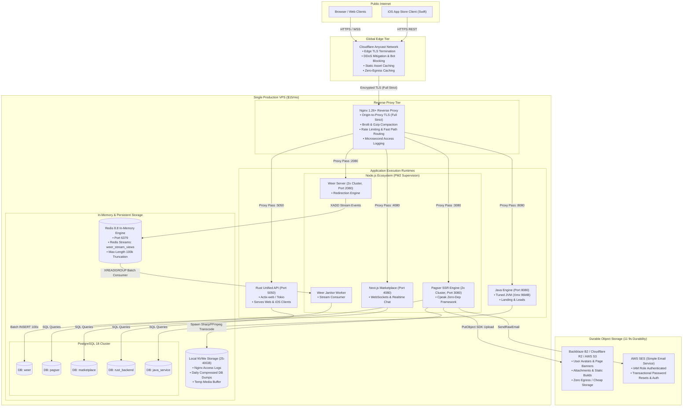

import { Callout } from "fumadocs-ui/components/callout";
import { Tabs, Tab } from "fumadocs-ui/components/tabs";
import { Steps, Step } from "fumadocs-ui/components/steps";

A ubiquitous myth in contemporary software engineering states that handling tens of millions of monthly requests demands Kubernetes clusters, managed serverless topologies, distributed service meshes, and an army of auxiliary AWS/GCP managed services costing thousands of dollars per month.

In reality, modern compute hardware is extraordinarily capable. When you push back against the cloud marketing narrative and apply relentless performance discipline, you can comfortably serve **50 Million real-world HTTP requests every month on a single $15/month virtual private server (VPS)**—while hosting five distinct polyglot production backends, 175 HTTP routes, five isolated relational databases, high-throughput Redis streaming pipelines, end-to-end TLS encryption, and S3-compatible media storage backed by 11 nines of durability.

This is not a theoretical "Hello World" benchmark running in memory. It is the full operational blueprint of a battle-tested production environment handling real user traffic, complex business logic, rich media pipelines, and full authentication systems.

---

## 1. The $15/Month Challenge & The Economics of Extreme Efficiency

### The Quantitative Scale: Real Workloads vs. Synthetic Demos

When tech conferences demonstrate single-box performance, they frequently show Go or Rust binaries serving static JSON responses returning `{"status": "ok"}`. Those demos are trivial.

This production architecture handles **50,000,000 real HTTP transactions per month** across five distinct systems. These include:

- **175 unique HTTP routes** across polyglot micro-monoliths.
- **50+ production environment variables** managed via central secret vaults.
- Intensive database reads, relational queries, complex nested comment threads, transactional mutations, and asynchronous write buffering.
- Server-Side Rendering (SSR) for search engine indexing.
- High-volume file and image uploads with server-side cropping, WebP transcoding, and S3 dispatch.
- WebSockets and real-time bidirectional chatting.
- Granular access logging tracking path, response duration (in milliseconds), status code, and IP on every single transaction.
- Over **50,000 lines of custom production source code**.

```
+-------------------------------------------------------------------------------------------------+
|                                 50,000,000 REQUESTS/MONTH ENVELOPE                              |
+-------------------------------------------------------------------------------------------------+
|  Average Steady-State Rate:                                                                     |
|    50,000,000 / (30 days * 86,400 sec) ≈ 19.3 requests/second (QPS)                             |
|                                                                                                 |
|  Daily Diurnal Peak (3x to 5x baseline):                                                        |
|    19.3 * 3 to 5 ≈ 60 to 100 requests/second (QPS)                                               |
|                                                                                                 |
|  Extreme Surge / Spike Headroom (10x rare spikes, e.g., Black Friday):                          |
|    19.3 * 10 ≈ 200 requests/second (QPS)                                                        |
|                                                                                                 |
|  Throughput Sizing Target:                                                                      |
|    The server must cruise at 20 QPS with <10% CPU usage, digest 60-100 QPS without latency degradation,|
|    and absorb 200 QPS without memory exhaustion or process thrashing.                            |
+-------------------------------------------------------------------------------------------------+
```

At this volume, an online business typically yields between **$300,000 and several million dollars in gross annual revenue** depending on user monetization models. Yet the underlying infrastructure cost remains an astonishing **$15 per month** ($180/year).

### The Big Cloud Pricing Trap

Cloud providers dedicate billions of dollars annually to enterprise marketing, evangelizing architectures that maximize provider profit margins rather than customer efficiency.

Consider what this identical multi-service stack costs if provisioned on standard Big Cloud managed services:

| Architectural Component       | Managed Big Cloud Implementation                  | Estimated Monthly Cost     | Frugal VPS Implementation                             | Cost                      |
| :---------------------------- | :------------------------------------------------ | :------------------------- | :---------------------------------------------------- | :------------------------ |
| **Relational Database**       | AWS RDS PostgreSQL (Multi-AZ, 5 DBs or instances) | $120.00 – $250.00          | Co-located PostgreSQL 18 with 5 isolated DB schemas   | $0.00                     |
| **In-Memory Cache & Streams** | AWS ElastiCache for Redis (t4g.micro)             | $25.00 – $40.00            | Co-located Redis 8.8 in-memory instance               | $0.00                     |
| **Compute / Containers**      | AWS ECS Fargate or EKS Cluster                    | $80.00 – $220.00           | 1x ARM64 VPS (2 vCPU, 2-4GB RAM, NVMe)                | $12.00                    |
| **Media & File Storage**      | AWS S3 Standard (Storage + PUT/GET API fees)      | $15.00 – $45.00            | Cloudflare R2 / Backblaze B2 (Zero egress fees)       | $1.50                     |
| **Transactional Email**       | Managed SaaS (SendGrid / Mailgun pro tiers)       | $35.00 – $90.00            | AWS SES (Simple Email Service via IAM role)           | $0.50                     |
| **Egress Bandwidth**          | AWS CloudFront / EC2 Egress ($0.09/GB for 2TB)    | $180.00                    | Included VPS Transfer (2–20TB) + Cloudflare Free Edge | $0.00                     |
| **Load Balancer**             | AWS Application Load Balancer (ALB)               | $25.00 + LCU fees (~$40)   | Native Nginx Reverse Proxy with Brotli/TLS            | $0.00                     |
| **Total Monthly Spend**       | **Standard Cloud Architecture**                   | **$475.00 – $865.00 / mo** | **Optimized Frugal Architecture**                     | **~$14.00 – $15.00 / mo** |

<Callout type="warn" title="The Egress Bandwidth Trap">
The single most predatory cost center in modern cloud computing is **egress data transfer**. Amazon AWS and Google Cloud routinely charge between **$0.08 and $0.12 per gigabyte** of outbound traffic. Serving 5TB of assets, HTML, and media on AWS costs $450 in bandwidth alone—thirty times the compute bill!

By routing traffic through **Cloudflare's zero-cost caching edge** and storing images in **S3-compatible egress-free buckets (Cloudflare R2 or Backblaze B2)**, this architecture completely eliminates the egress tax.

</Callout>

### Hardware Baseline: The $15 Host Profile

The deployment runs on a commodity 64-bit ARM or x86 VPS instance (such as an AWS EC2 `t4g.small` on Graviton2, a Hetzner `CAX11/CPX21`, or an equivalent Linode/DigitalOcean droplet):

- **CPU:** 2 vCPU cores (AWS Graviton2 ARM64 or AMD EPYC).
- **Memory:** 2.0 GB to 4.0 GB physical RAM.
- **Storage:** 25 GB to 40 GB NVMe SSD (gp3 EBS with 3,000 IOPS / 125 MB/s burst).
- **Network:** Up to 5 Gbps burst, 2 TB included outbound data transfer.
- **Operating System:** Ubuntu 24.04 / 26.04 LTS (Kernel 6.8+).

---

## 2. The 5 Co-located Production Applications Deep Dive

Rather than deploying five separate server clusters, all five applications execute concurrently on the single server node under optimized execution runtimes.

```
+---------------------------------------------------------------------------------------------------+
|                                     THE 5 CO-LOCATED WORKLOADS                                    |
+---------------------------------------------------------------------------------------------------+
|  [1] JAVA RUNTIME (Port 8080)                                                                     |
|      Landing page, lead capture, newsletter sync, contact handling. JVM memory-tuned.             |
|                                                                                                   |
|  [2] RUST BACKEND (Port 5050)                                                                     |
|      Unified native API powering both a responsive Web SPA and an Apple App Store iOS application. |
|                                                                                                   |
|  [3] NODE.JS SAAS 1: PAGSER (Port 3080)                                                           |
|      Full content/blogging platform: SSR public pages, rich-text TinyMCE, nested comments,        |
|      media upload, image crop/resize, user subscriptions, library & reading history.              |
|                                                                                                   |
|  [4] NODE.JS SAAS 2: WEER URL SHORTENER (Port 2080)                                               |
|      High-throughput URL redirection engine: custom aliases, QR generation, click analytics,     |
|      decoupled Redis streaming & asynchronous Janitor background batching.                        |
|                                                                                                   |
|  [5] NEXT.JS MARKETPLACE & REAL-TIME CHAT (Port 4080)                                             |
|      Classified listings marketplace with WebSocket-based live chat and instant notifications.    |
+---------------------------------------------------------------------------------------------------+
```

### Application 1: Java Landing Page & Lead Capture Engine

A lightweight Java service powering landing pages, lead capture, newsletter signups, and customer feedback.

- **JVM Footprint Optimization:** Standard enterprise Java configurations frequently consume 1–2 GB of RAM by default. By tuning JVM heap bounds and Garbage Collection ergonomics, the Java service runs comfortably within a strict **96 MB RAM footprint**:
  ```bash
  java -Xms32m -Xmx96m -XX:+UseSerialGC -XX:+TieredCompilation -XX:TieredStopAtLevel=1 -jar app.jar
  ```
  - `-XX:+UseSerialGC`: Eliminates the high memory metadata overhead of parallel or G1 collectors on low-core instances.
  - `-XX:TieredStopAtLevel=1`: Limits JVM JIT compilation to C1 (client compiler), drastically reducing startup time and warmup memory usage.

### Application 2: Rust Multi-Platform Unified Backend

A high-concurrency Rust API compiled directly to native ARM64 machine code.

- **Dual-Client Unified Surface:** A single Rust backend serves both a high-speed web client and a native **iOS App Store application** written in Swift.
- **Memory & Threading Model:** Written in Rust using Tokio and Actix-web/Axum. Consumes only **18 MB of RAM** at idle and scales past thousands of concurrent connections without garbage collection latency spikes.

### Application 3: Node.js SaaS 1 (Pagser - Content Sharing Platform)

Pagser (`pagser.com`) is a full-fledged production content platform where users publish long-form articles, interact through multi-level nested discussion threads, manage collections, and follow authors.

- **Zero-Dependency Architecture:** Powered by **Cpeak**, a custom zero-dependency framework built directly on native Node.js HTTP primitives.
- **Server-Side Rendering (SSR):** Public article pages (`/page/:id`) and author profiles (`/:username`) are rendered server-side on the backend to achieve maximum search engine crawlability and sub-100ms First Contentful Paint (FCP).
- **Rich Client Layer:** A companion Single Page Application (SPA) built with React and Redux, utilizing Webpack code-splitting, modular SCSS stylesheets, and an independent Dark Theme CSS bundle.
- **Embedded Media Engine:** Integrates a self-hosted **TinyMCE** rich-text editor, handling inline image insertion, page banners, custom thumbnails, and downloadable binary attachments.

### Application 4: Node.js SaaS 2 (Weer - High-Scale URL Shortener)

Weer (`weer.pro`) is an ultra-fast URL shortener designed to compete with industry-leading services.

- **Multi-Format Redirection Routing:** Supports permanent numeric IDs (e.g., `/355`), 6-character alphanumeric hashes, and premium 2-character ultra-short codes.
- **Yarn Workspaces Monorepo Architecture:**
  Weer is organized as a clean multi-package monorepo under a single root `node_modules` cache, eliminating redundant dependency installations across front and backends:
  ```
  weer/
  ├── packages/
  │   ├── server/       # Cpeak HTTP API server & Janitor stream consumer
  │   ├── web/          # React SPA client & modular SASS styling
  │   ├── reusable/     # Reusable UI component mini-framework (modals, dropdowns)
  │   └── common/       # Single source of truth: shared TypeScript interfaces & models
  ├── package.json      # Yarn workspaces root manifest
  └── env.sh            # Dynamic AWS SSM parameter loader script
  ```
- **Compile-Time Contract Sharing (`packages/common`):**
  A frequent defect in decoupled full-stack teams is drift between backend JSON responses and frontend expectations. In Weer, `packages/common` exports strict TypeScript interfaces (e.g., `UrlApiResponse`, `LinkModel`, `ViewRecord`) consumed by both the React UI and the Node.js backend. If a backend engineer changes a payload structure, the build fails at compile time (`yarn build`) with strict type errors, catching breaking schema bugs before runtime deployment.
- **Decoupled Asynchronous Analytics:** Every link redirection requires click analytics (HTTP Referrer, User Agent, device type, QR-code source detection, geolocation). Doing synchronous SQL `INSERT` statements on every redirect would destroy database performance under traffic spikes. Weer utilizes **Redis Streams** and an independent **Janitor process** to decouple redirection from database writes.

### Application 5: Next.js Marketplace & Real-Time Chat

A peer-to-peer marketplace application (similar to Facebook Marketplace) allowing users to create listings, negotiate, and communicate.

- **WebSockets & Bidirectional Messaging:** Utilizes WebSocket connections to deliver instant messaging, typing indicators, and read receipts across users without polling.

### Deployment Runtime Showdown: Docker Compose vs. Native Bare-Metal

A critical design decision when hosting five production applications on a single $15/month VPS (2 vCPU, 2 GB RAM, 25 GB NVMe) is choosing between **containerized Docker Compose** and **native process supervision (PM2 + systemd)**.

Both deployment modes were built and benchmarked:

```
+---------------------------------------------------------------------------------------------------+
|                        DEPLOYMENT FOOTPRINT BENCHMARK (ON 2 GB VPS)                               |
+---------------------------------------------------------------------------------------------------+
|  Metric                   Docker Compose (4 Services)      Native Bare-Metal (PM2 + systemd)      |
+---------------------------------------------------------------------------------------------------+
|  Total Disk Consumed      ~6.0 GB (3 GB images + 1.5 GB cache) ~4.8 GB (Single Yarn root cache)   |
|  Idle System Memory (RAM) ~480 MB (daemon + bridges + veth)    ~210 MB (Direct Unix processes)    |
|  Container / Startup Latency 15 - 45 seconds (Image build)    1 - 3 seconds (Direct fork / PM2)   |
|  OS & Kernel Tuning       Restricted / Docker daemon flags     Direct sysctl, limits.conf, sysfs  |
+---------------------------------------------------------------------------------------------------+
```

#### The Containerization Friction on Low-Resource Hardware

1. **Disk Amplification (`docker system df`):**
   A standard multi-container Docker deployment (Node server, Janitor worker, PostgreSQL 18, Redis 8.8) generates **~3.0 GB of base images** and **~1.5 GB of build cache**. On a 25 GB NVMe drive hosting five databases and rich media pipelines, sacrificing 6.0 GB of storage to container layers leaves inadequate headroom for database dumps and WAL logs.
2. **Memory Taxation on a 2 GB RAM Ceiling:**
   The `dockerd` daemon, container shim processes, and virtual Ethernet bridging (`veth`) consume **250 MB to 300 MB of resident RAM** before processing a single user request. On a 2 GB host, this overhead consumes over 12% of total system RAM, increasing the risk of triggering the Linux Out-Of-Memory (OOM) killer during traffic spikes.
3. **Storage Hygiene & Pruning:**
   When using Docker, iterative deployments accumulate dangling layers and volumes that require aggressive pruning:
   ```bash
   # Tear down containers and destroy ephemeral volumes
   docker compose down --volumes
   # Nuke unused build caches and dangling images
   docker system prune -a --volumes -f
   ```

#### Why Native Bare-Metal Wins for $15/Month Consolidation

By installing runtimes natively:

- **Node.js 24 LTS via NVM:** Bypasses Ubuntu's older default `apt` packages (`apt-cache policy nodejs`) to run modern V8 optimizations.
- **Co-located PostgreSQL 18 & Redis 8.8:** Managed directly via `systemctl`, listening directly on loopback `127.0.0.1` without virtual container bridge network hops.
- **Process Supervision via PM2:** PM2 supervises the Node.js instances in cluster mode, handling automatic health restarts, memory thresholds, and zero-downtime reloads.
- **Unified Workspace Cache:** Yarn workspaces shares all common dependencies (e.g., React, TypeScript) inside a single root `node_modules`, keeping disk consumption strictly under 5 GB for the entire multi-app suite.

---

## 3. Single-Node System Topology & Network Architecture

The entire single-box topology is engineered to eliminate internal network latency. All inter-process communication occurs over Unix domain sockets or the local loopback interface (`127.0.0.1`), delivering microsecond-level IPC speeds.

### Comprehensive Network Topology



### End-to-End Encryption Strategy

Security is never compromised for frugality. The architecture implements **dual-layer end-to-end encryption**:

1. **Proxy-to-Client TLS:** Terminated at Cloudflare's global edge network using modern TLS 1.3 with automated certificate rotation.
2. **Origin-to-Proxy TLS:** Cloudflare connects to our VPS origin server using **Cloudflare Full (Strict) SSL Mode**. Nginx presents a valid 15-year Cloudflare Origin CA certificate. Direct IP access to the VPS on port 80/443 is blocked for all public traffic via Linux `iptables` / UFW, allowing traffic exclusively from Cloudflare's published IP ranges:

```bash
# Allow SSH only from your trusted administrative IP
sudo ufw default deny incoming
sudo ufw default allow outgoing
sudo ufw allow from YOUR_STATIC_IP to any port 22 proto tcp

# Allow HTTP and HTTPS strictly from Cloudflare IP addresses
curl -s https://www.cloudflare.com/ips-v4 | while read ip; do sudo ufw allow from "$ip" to any port 443 proto tcp; done
curl -s https://www.cloudflare.com/ips-v6 | while read ip; do sudo ufw allow from "$ip" to any port 443 proto tcp; done
sudo ufw enable
```

### High-Speed Asynchronous Request Logging Without Disk I/O Bottlenecks

Logging every single HTTP transaction at 200 requests/second can easily choke disk I/O if written synchronously. Nginx solves this by writing to an in-memory buffer before flushing to NVMe storage:

```nginx
# Custom high-performance JSON log format with millisecond response timing
log_format production_json escape=json
  '{"time_iso":"$time_iso8601",'
  '"client_ip":"$http_cf_connecting_ip",'
  '"method":"$request_method",'
  '"uri":"$request_uri",'
  '"status":$status,'
  '"bytes_sent":$body_bytes_sent,'
  '"request_time_ms":$request_time,'
  '"upstream_response_time":$upstream_response_time,'
  '"http_referer":"$http_referer",'
  '"http_user_agent":"$http_user_agent"}';

# Buffer 64KB chunks or flush every 5 seconds to eliminate synchronous write penalties
access_log /var/log/nginx/production_access.log production_json buffer=64k flush=5s;
```

---

## 4. Storage, Media Pipelines & The "11 Nines" Durability Strategy

A major hesitation engineers have when consolidating onto a single server is fear of catastrophic data loss. What happens if the NVMe drive fails or the VPS instance is terminated?

The answer lies in strict **separation of persistent state from ephemeral compute**, coupled with an automated **11 Nines (99.999999999%) durability strategy**.

### Running 5 Separate SQL Databases on a Single Node

Instead of spinning up five expensive managed database instances, a single native **PostgreSQL 18** cluster runs on the VPS, hosting five completely isolated logical databases:

```sql
-- Executed inside the psql superuser console
CREATE DATABASE weer OWNER app_user;
CREATE DATABASE pagser OWNER app_user;
CREATE DATABASE marketplace OWNER app_user;
CREATE DATABASE rust_backend OWNER app_user;
CREATE DATABASE java_service OWNER app_user;
```

#### Shared Resource Budgeting for PostgreSQL (`postgresql.conf`)

To prevent PostgreSQL from competing with the application runtimes for RAM, configure conservative memory boundaries:

```ini
# /etc/postgresql/18/main/postgresql.conf
max_connections = 100                 # Shared connection limit across all 5 databases
shared_buffers = 512MB                # 25% of 2GB RAM allocated to PostgreSQL cache
work_mem = 4MB                        # Memory per sort/hash operation
maintenance_work_mem = 64MB           # Vacuuming and index creation budget
effective_cache_size = 1200MB         # Hint for OS file system cache
wal_buffers = 16MB                    # Write-Ahead Log buffer
checkpoint_completion_target = 0.9    # Spread checkpoint I/O over time
random_page_cost = 1.1                # Optimized for fast NVMe storage
```

### Backend Media Processing: Sharp, Cropping & WebP Transcoding

When users upload profile photos, page thumbnails, or post attachments on Pagser:

1. **Client-Side Pre-Crop:** The React client allows the user to crop the image using canvas coordinates, sending the binary blob and coordinate bounding box (`{x, y, width, height}`) to the backend.
2. **Server-Side Transcoding Pipeline:** Node.js receives the stream, utilizes the high-performance C-backed **Sharp** library (libvips), crops to exact specifications, resizes to multiple responsive dimensions (e.g., thumbnail 150x150, banner 1200x400), and converts the image to **WebP** at 82% quality.
3. **Memory Protection:** Streams are parsed without loading entire gigabyte files into Node.js heap memory, preventing Out-Of-Memory (OOM) crashes.

```typescript
// Production media pipeline using Sharp
import sharp from "sharp";

export async function processAndOptimizeMedia(
  inputBuffer: Buffer,
  cropArea: { x: number; y: number; width: number; height: number },
  targetWidth: number,
  targetHeight: number
): Promise<Buffer> {
  return await sharp(inputBuffer)
    .extract({
      left: Math.round(cropArea.x),
      top: Math.round(cropArea.y),
      width: Math.round(cropArea.width),
      height: Math.round(cropArea.height),
    })
    .resize(targetWidth, targetHeight, {
      fit: "cover",
      withoutEnlargement: true,
    })
    .webp({ quality: 82, effort: 4 })
    .toBuffer();
}
```

### Achieving 11 Nines (99.999999999%) Durability

Solid-State Drives (SSDs) experience an annual failure rate of approximately 1%. Leaving user uploads on the VPS disk is an operational hazard.

```
+-------------------------------------------------------------------------------------------------+
|                                 THE 11 NINES DURABILITY STRATEGY                                |
+-------------------------------------------------------------------------------------------------+
|                                                                                                 |
|   1. ZERO LOCAL MEDIA STORAGE:                                                                  |
|      Optimized WebP assets are dispatched immediately to S3-compatible cloud storage            |
|      (Cloudflare R2 or Backblaze B2) using AWS SDK v3.                                          |
|      Data is replicated across a minimum of 3 independent geographical availability zones.      |
|                                                                                                 |
|   2. CONTINUOUS WAL-G / S3 DATABASE BACKUPS:                                                    |
|      PostgreSQL Write-Ahead Logs (WAL) and hourly pg_dump snapshots are encrypted (AES-256)      |
|      and streamed to remote object storage with automated 30-day lifecycle expiration.          |
|                                                                                                 |
|   3. EBS / VPS DISK SNAPSHOTS:                                                                  |
|      A daily scheduled cron triggers an AWS EBS or VPS snapshot. At $0.05/GB, keeping a 12GB    |
|      compressed image costs just $0.60/month. If the instance is incinerated, a new server      |
|      boots from the snapshot in under 3 minutes.                                                |
|                                                                                                 |
+-------------------------------------------------------------------------------------------------+
```

#### Automated S3 Offloading Pipeline

```typescript
// S3 / R2 dispatch module using IAM / Cloud credentials
import { S3Client, PutObjectCommand } from "@aws-sdk/client-s3";

const s3 = new S3Client({
  region: process.env.AWS_REGION || "us-east-1",
  endpoint: process.env.S3_CUSTOM_ENDPOINT, // Optional: Cloudflare R2 / Backblaze B2 endpoint
  credentials: {
    accessKeyId: process.env.AWS_ACCESS_KEY_ID!,
    secretAccessKey: process.env.AWS_SECRET_ACCESS_KEY!,
  },
});

export async function uploadPublicMedia(
  fileBuffer: Buffer,
  fileName: string,
  contentType: string = "image/webp"
): Promise<string> {
  const bucketName = process.env.S3_BUCKET_NAME!;

  await s3.send(
    new PutObjectCommand({
      Bucket: bucketName,
      Key: fileName,
      Body: fileBuffer,
      ContentType: contentType,
      CacheControl: "public, max-age=31536000, immutable",
    })
  );

  return `${process.env.MEDIA_CDN_URL}/${fileName}`;
}
```

---

## 5. Redis for High-Throughput Streaming & Decoupled Queues

### Why Redis Streams?

The URL shortener (Weer) is engineered to process massive bursts of redirect reads. If a popular link goes viral on Twitter or Reddit, the application might receive **1,000 to 5,000 clicks per second**.

Executing a PostgreSQL `INSERT INTO views (...) VALUES (...)` on every single redirect would lock rows, saturate database connections, and exhaust disk I/O within seconds.

Instead, the Weer web application treats Redis as an ultra-fast in-memory streaming queue via **Redis Streams (`XADD`)**:

```
[ User Request ]
       │
       ▼
[ Weer HTTP Server ] ──(1) Instant 301/302 Redirect ──► [ User Browser ]
       │
       └──(2) Non-blocking XADD ──► [ Redis Stream: weer_stream_views ]
                                              │
                                              ▼ (Batch of 100-500 events)
                                     [ Janitor Worker Process ]
                                              │
                                              ▼ (Single Batch INSERT)
                                     [ PostgreSQL: views table ]
```

### The Stream Producer: Instant Redirection (`XADD`)

When a user visits `weer.pro/355`, the HTTP server immediately retrieves the target destination URL from Redis memory cache (or indexed PostgreSQL query) and issues an HTTP 301/302 redirect. Concurrently, it asynchronously appends the click metadata into the Redis Stream:

```typescript
// Fast-path analytics stream producer
import Redis from "ioredis";

const redis = new Redis({
  host: process.env.REDIS_HOST || "127.0.0.1",
  port: Number(process.env.REDIS_PORT) || 6379,
});

export async function recordLinkClickStream(payload: {
  linkId: number;
  ip: string;
  userAgent: string;
  referer: string;
  isQr: boolean;
}): Promise<void> {
  try {
    // XADD stream_key MAXLEN ~ 100000 * field value ...
    await redis.xadd(
      "weer_stream_views",
      "MAXLEN",
      "~",
      "100000", // Capped stream: automatically truncates beyond 100k items
      "*", // Auto-generated timestamp ID
      "link_id",
      payload.linkId.toString(),
      "ip",
      payload.ip,
      "user_agent",
      payload.userAgent,
      "referer",
      payload.referer,
      "is_qr",
      payload.isQr ? "1" : "0",
      "timestamp",
      Date.now().toString()
    );
  } catch (err) {
    console.error("Non-critical: Failed to append view stream to Redis", err);
  }
}
```

### The Janitor Process: Batch Drainage to PostgreSQL

An autonomous background worker—the **Janitor process**—runs alongside the web server, pulling batched chunks of clicks from the Redis Stream and persisting them into PostgreSQL using a single multi-row `INSERT` statement:

```typescript
// Janitor batch drainage consumer
import { Pool } from "pg";
import Redis from "ioredis";

const pgPool = new Pool({ connectionString: process.env.DATABASE_URL });
const redis = new Redis({ host: "127.0.0.1", port: 6379 });

const CONSUMER_GROUP = "weer_janitor_group";
const CONSUMER_NAME = "janitor_worker_1";
const STREAM_KEY = "weer_stream_views";

async function initStreamGroup() {
  try {
    await redis.xgroup("CREATE", STREAM_KEY, CONSUMER_GROUP, "0", "MKSTREAM");
  } catch (e) {
    // Group already exists
  }
}

async function startJanitorDrainLoop() {
  await initStreamGroup();

  while (true) {
    try {
      // Read up to 250 records, blocking for at most 2000ms if empty
      const streamData = await redis.xreadgroup(
        "GROUP",
        CONSUMER_GROUP,
        CONSUMER_NAME,
        "BLOCK",
        "2000",
        "COUNT",
        "250",
        "STREAMS",
        STREAM_KEY,
        ">"
      );

      if (!streamData || streamData.length === 0) continue;

      const entries = streamData[0][1];
      if (entries.length === 0) continue;

      const idsToAck: string[] = [];
      const rows: any[] = [];

      for (const [id, fields] of entries) {
        idsToAck.push(id);
        const obj: any = {};
        for (let i = 0; i < fields.length; i += 2) {
          obj[fields[i]] = fields[i + 1];
        }
        rows.push(obj);
      }

      // Efficient multi-row PostgreSQL Batch Insert
      const client = await pgPool.connect();
      try {
        await client.query("BEGIN");

        const valueStrings: string[] = [];
        const queryParams: any[] = [];
        let pIndex = 1;

        for (const row of rows) {
          valueStrings.push(
            `($${pIndex++}, $${pIndex++}, $${pIndex++}, $${pIndex++}, $${pIndex++})`
          );
          queryParams.push(
            parseInt(row.link_id, 10),
            row.ip,
            row.user_agent,
            row.referer,
            row.is_qr === "1"
          );
        }

        const insertQuery = `
          INSERT INTO views (link_id, ip, user_agent, referer, is_qr)
          VALUES ${valueStrings.join(", ")}
        `;

        await client.query(insertQuery, queryParams);
        await client.query("COMMIT");

        // Acknowledge processed messages in Redis
        await redis.xack(STREAM_KEY, CONSUMER_GROUP, ...idsToAck);
      } catch (err) {
        await client.query("ROLLBACK");
        console.error("Batch DB insert failed, preserving stream entries", err);
      } finally {
        client.release();
      }
    } catch (loopErr) {
      console.error("Error in Janitor loop:", loopErr);
      await new Promise((r) => setTimeout(r, 1000));
    }
  }
}

startJanitorDrainLoop();
```

### Remote GUI Administration via Encrypted SSH Tunnels

A common fear when running PostgreSQL and Redis on a private VPS without public IPs is that developers will lose the ability to use rich desktop management GUIs.

Exposing PostgreSQL (`5432`) or Redis (`6379`) to the public internet is a severe vulnerability. Instead, developers establish an **encrypted SSH Tunnel**:

```
+───────────────────+       Encrypted SSH (Port 22)       +───────────────────────+
| Local Workstation | ──────────────────────────────────► | Production Host (Sky) |
| • Redis Insight   |                                     | • Redis (127.0.0.1)   |
| • pgAdmin / DataGrip | ──── Loopback 127.0.0.1:Tunnel ────► | • Postgres (127.0.0.1)|
+───────────────────+                                     +───────────────────────+
```

```bash
# Forward local port 6379 directly to remote server's Redis via SSH
ssh -N -L 6379:127.0.0.1:6379 -i ~/.ssh/udcc.pem ubuntu@sky-ip

# Forward local port 5432 directly to remote PostgreSQL instance
ssh -N -L 5432:127.0.0.1:5432 -i ~/.ssh/udcc.pem ubuntu@sky-ip
```

- **Redis Insight:** Connects to `localhost:6379` to inspect the `weer_stream_views` stream, trace field payloads (`link_id`, `is_qr`, `referer`), and monitor memory fragmentation in real time.
- **pgAdmin / DataGrip:** Connects to `localhost:5432` with native SSH tunneling enabled, granting full relational visual querying, explain plans, and index management without exposing database ports through the firewall.

---

## 6. Nginx & Reverse Proxy Optimization

At the gateway of the server sits a tuned **Nginx 1.26+** instance. Nginx operates as the reverse proxy, TLS terminator, HTTP keepalive pool manager, and rate limiter.

### Production `nginx.conf` Master Configuration

```nginx
user www-data;
worker_processes auto;
worker_rlimit_nofile 65535;
pid /run/nginx.pid;

events {
    worker_connections 8192;
    use epoll;
    multi_accept on;
}

http {
    include /etc/nginx/mime.types;
    default_type application/octet-stream;

    # Performance Tuning: Sendfile & TCP Pragmatics
    sendfile on;
    tcp_nopush on;
    tcp_nodelay on;
    keepalive_timeout 65;
    keepalive_requests 10000;
    types_hash_max_size 2048;
    server_tokens off;

    # Buffer Overflow & Attack Protection
    client_body_buffer_size 128k;
    client_max_body_size 25M;        # Allows rich media and video attachment uploads
    client_header_buffer_size 1k;
    large_client_header_buffers 4 8k;

    # Compression: Gzip & Brotli
    gzip on;
    gzip_vary on;
    gzip_proxied any;
    gzip_comp_level 6;
    gzip_types text/plain text/css text/xml application/json application/javascript
               application/rss+xml application/atom+xml image/svg+xml;

    # Rate Limiting Zones (Protects Login, Registration, and Password Reset)
    limit_req_zone $binary_remote_addr zone=api_general:10m rate=50r/s;
    limit_req_zone $binary_remote_addr zone=auth_strict:10m rate=5r/s;

    # Upstream Definitions with Persistent Keepalive Sockets
    upstream weer_backend {
        server 127.0.0.1:2080;
        keepalive 64;
    }

    upstream pagser_backend {
        server 127.0.0.1:3080;
        keepalive 64;
    }

    upstream next_backend {
        server 127.0.0.1:4080;
        keepalive 64;
    }

    upstream rust_backend {
        server 127.0.0.1:5050;
        keepalive 64;
    }

    upstream java_backend {
        server 127.0.0.1:8080;
        keepalive 32;
    }

    # =========================================================================
    # VHOST 1: Weer URL Shortener (weer.pro)
    # =========================================================================
    server {
        listen 443 ssl http2;
        server_name weer.pro www.weer.pro;

        ssl_certificate /etc/ssl/certs/cloudflare_origin.pem;
        ssl_certificate_key /etc/ssl/private/cloudflare_origin.key;
        ssl_protocols TLSv1.2 TLSv1.3;
        ssl_ciphers HIGH:!aNULL:!MD5;

        # Static Asset Fast Path (Bypasses Node.js runtime entirely)
        location /static/ {
            alias /home/ubuntu/weer/packages/server/public/;
            expires 30d;
            add_header Cache-Control "public, no-transform";
            access_log off;
        }

        # Dynamic Route Handling
        location / {
            limit_req zone=api_general burst=100 nodelay;

            proxy_pass http://weer_backend;
            proxy_http_version 1.1;
            proxy_set_header Connection "";
            proxy_set_header Host $host;
            proxy_set_header X-Real-IP $http_cf_connecting_ip;
            proxy_set_header X-Forwarded-For $proxy_add_x_forwarded_for;
            proxy_set_header X-Forwarded-Proto $scheme;

            # Buffering: Protects backend runtimes from slow clients (Slowloris)
            proxy_buffering on;
            proxy_buffer_size 8k;
            proxy_buffers 16 8k;
        }
    }

    # =========================================================================
    # VHOST 2: Pagser Content Sharing Platform (pagser.com)
    # =========================================================================
    server {
        listen 443 ssl http2;
        server_name pagser.com www.pagser.com;

        ssl_certificate /etc/ssl/certs/cloudflare_origin.pem;
        ssl_certificate_key /etc/ssl/private/cloudflare_origin.key;

        # Strict Rate Limiting on Authentication Endpoints
        location ~* /(api/auth/login|api/auth/register|api/auth/forgot-password) {
            limit_req zone=auth_strict burst=10 nodelay;

            proxy_pass http://pagser_backend;
            proxy_http_version 1.1;
            proxy_set_header Connection "";
            proxy_set_header Host $host;
            proxy_set_header X-Real-IP $http_cf_connecting_ip;
            proxy_set_header X-Forwarded-For $proxy_add_x_forwarded_for;
        }

        location / {
            proxy_pass http://pagser_backend;
            proxy_http_version 1.1;
            proxy_set_header Connection "";
            proxy_set_header Host $host;
            proxy_set_header X-Real-IP $http_cf_connecting_ip;
            proxy_set_header X-Forwarded-For $proxy_add_x_forwarded_for;
        }
    }

    # =========================================================================
    # VHOST 3: Next.js Marketplace & Realtime WebSockets
    # =========================================================================
    server {
        listen 443 ssl http2;
        server_name marketplace.domain.com;

        ssl_certificate /etc/ssl/certs/cloudflare_origin.pem;
        ssl_certificate_key /etc/ssl/private/cloudflare_origin.key;

        location / {
            proxy_pass http://next_backend;
            proxy_http_version 1.1;

            # WebSocket Connection Upgrades
            proxy_set_header Upgrade $http_upgrade;
            proxy_set_header Connection "upgrade";

            proxy_set_header Host $host;
            proxy_set_header X-Real-IP $http_cf_connecting_ip;
            proxy_read_timeout 86400s;       # Keeps long-lived WebSockets alive
            proxy_send_timeout 86400s;
        }
    }
}
```

---

## 7. Automated Production Secrets Management & Zero `.env` Deployment

Hardcoding secrets in `.env` files checked into Git—or manually editing `.env` files via SSH—is an anti-pattern that causes security breaches and prevents zero-downtime automation.

### Cloud Vault Architecture (AWS Systems Manager Parameter Store)

In this architecture, production servers contain **zero persistent `.env` files**. All configuration values and secrets are stored in a centralized vault (**AWS SSM Parameter Store**), which is completely free for standard string parameters.

```
+──────────────────────────────────────────────────────────────────+
|                    AWS PARAMETER STORE HIERARCHY                 |
+──────────────────────────────────────────────────────────────────+
|  /weer/prod/port                -> "2080"               (String) |
|  /weer/prod/cookie_secret       -> "7f8a9...b4c" (SecureString)  |
|  /weer/prod/db_password         -> "pw1234"      (SecureString)  |
|  /pagser/prod/port              -> "3080"               (String) |
|  /pagser/prod/s3_bucket         -> "pagser-media"       (String) |
|  /pagser/prod/cookie_secret     -> "9c0d1...e2f" (SecureString)  |
+──────────────────────────────────────────────────────────────────+
```

### Passwordless Server Authorization via IAM Instance Roles

Rather than storing AWS access keys on the server, the VPS instance is bound to an **IAM Instance Profile (`sky-role`)**. The AWS CLI and SDKs automatically detect ambient credentials through the instance metadata service (`IMDSv2`):

```json
{
  "Version": "2012-10-17",
  "Statement": [
    {
      "Sid": "AllowSSMParameterReadByPath",
      "Effect": "Allow",
      "Action": ["ssm:GetParametersByPath", "ssm:GetParameter"],
      "Resource": "arn:aws:ssm:us-east-1:*:parameter/*"
    },
    {
      "Sid": "AllowS3MediaUploads",
      "Effect": "Allow",
      "Action": ["s3:PutObject", "s3:GetObject"],
      "Resource": "arn:aws:s3:::pagser-media/*"
    },
    {
      "Sid": "AllowSESTransactionalEmails",
      "Effect": "Allow",
      "Action": ["ses:SendEmail", "ses:SendRawEmail"],
      "Resource": "*"
    }
  ]
}
```

### Dynamic Secret Injection (`env.sh`)

When the application boots (via PM2, systemd, or Docker), a lightweight bootstrap shell script dynamically fetches secrets by application path, exports them into the process environment, and immediately launches the runtime:

```bash
#!/usr/bin/env bash
# env.sh - Dynamic secret injection from AWS SSM
set -e

APP_NAME="$1" # e.g. "weer" or "pagser"
STAGE="prod"
PARAM_PATH="/${APP_NAME}/${STAGE}/"

echo "==> Fetching secrets for ${APP_NAME} (${STAGE}) from AWS Parameter Store..."

# Query parameters by path and decrypt SecureStrings
PARAMETERS_JSON=$(aws ssm get-parameters-by-path \
  --path "$PARAM_PATH" \
  --with-decryption \
  --region us-east-1 \
  --output json)

# Parse JSON into environment variables and evaluate
eval $(echo "$PARAMETERS_JSON" | jq -r '.Parameters[] | "export " + (.Name | split("/") | last | ascii_upcase) + "=\"" + .Value + "\""')

echo "==> Environment loaded successfully. Executing application command..."
exec "$@"
```

---

## 8. Local Pragmatic AI vs. Cloud AI

Modern software development workflows increasingly integrate AI for tasks such as automated data processing, query formatting, speech transcription, and config generation. However, relying on third-party cloud AI APIs introduces severe operational flaws:

- **High Recurring Expenses:** Monthly API costs for token-based cloud LLMs frequently dwarf compute infrastructure costs.
- **Network Latency & Downtime Risk:** Remote API calls introduce 500–2,000ms latency spikes and expose the system to third-party outages.
- **Privacy & Secret Leakage:** Feeding production configurations, environment variables, or private customer records into third-party cloud APIs poses severe compliance and security hazards.

### The Pragmatic On-Device Architecture

In this production workflow, routine maintenance, transcription, and configuration synthesis are performed using **local, on-device AI**:

```
+──────────────────────────────────────────────────────────────────────────+
|                    LOCAL AI WORKFLOW PIPELINE                            |
+──────────────────────────────────────────────────────────────────────────+
|  1. VOICE INPUT & TRANSCRIPTION:                                         |
|     Engineers use custom Swift tools (e.g., Vox) on Apple Silicon /      |
|     Linux workstations.                                                  |
|     Voice instructions are transcribed locally using Whisper.cpp.        |
|                                                                          |
|  2. REASONING & CLI SYNTHESIS:                                           |
|     Local small language models (Google Gemma, Llama 3) running via      |
|     LM Studio / Ollama parse configuration templates and emit verified   |
|     AWS SSM parameter injection commands.                                |
|                                                                          |
|  3. ZERO THIRD-PARTY TOKEN EXPENDITURE:                                  |
|     Zero secrets leave the local machine. Zero API subscription fees.    |
|     100% deterministic and private.                                      |
+──────────────────────────────────────────────────────────────────────────+
```

By keeping operational AI tooling strictly on-device, you eliminate recurring SaaS subscriptions while preserving total privacy over server configurations and user data.

---

## 9. The Frugal Engineering Manifesto: Monolith vs. Microservices

Why deploy five systems to a single $15/month VPS rather than distributing them across twenty Kubernetes pods and five managed cloud databases?

### The Rules of Thumb for Frugal Production Engineering

<Steps>
<Step>
### The "Hardware Underutilization" Principle
Modern CPUs complete billions of cycles per second. A single 2-core AMD or ARM64 processor can execute hundreds of thousands of instructions per request. Unless you have mathematically verified that your single node's CPU or memory is saturated, do not distribute the system. Distribution adds latency, network failure modes, serialization overhead, and cognitive complexity.
</Step>

<Step>
  ### The "Data Proximity" Advantage When your application runtime, Nginx proxy,
  Redis streaming buffer, and PostgreSQL relational engine execute on the same
  host, inter-service network latency drops from **2–10 milliseconds (VPC
  network hop)** to **microsecond Unix IPC / loopback speeds**. Database joins,
  cache checks, and stream pushes complete nearly instantaneously.
</Step>

<Step>
  ### The "Decoupled Writes, Fast-Path Reads" Pattern Never let write-heavy
  operations (such as click analytics, audit logging, or notification dispatch)
  block the synchronous user request pipeline. Push mutations into an in-memory
  queue (Redis Streams or ring buffer) and let an asynchronous worker
  batch-write to disk.
</Step>

<Step>
### The "Zero Managed Egress" Rule
Never host user-generated media or static bundles on services that charge for outbound bandwidth. Push static assets to global Anycast CDNs (Cloudflare) and offload object storage to egress-free providers (Cloudflare R2, Backblaze B2).
</Step>
</Steps>

### Architectural Decision Matrix: Single VPS vs. Distributed Cloud

| Decision Metric                | Single Optimized VPS ($15/mo)                         | Distributed Cloud (Kubernetes + RDS)                          |
| :----------------------------- | :---------------------------------------------------- | :------------------------------------------------------------ |
| **Monthly Operational Budget** | \$14.00 – \$25.00                                     | \$600.00 – \$3,500.00+                                        |
| **Architectural Complexity**   | Low: 1 server, 1 firewall, 1 backup routine           | Very High: VPCs, IAM, Helm, Ingress, CNI, CI/CD pipelines     |
| **Inter-Service Latency**      | **Microseconds** (Local loopback / Unix sockets)      | **Milliseconds** (Cross-AZ network hops)                      |
| **Failure Modes**              | Predictable: Single-node resource saturation          | Emergent: Network partitions, split-brain, cascading timeouts |
| **Operational Maintenance**    | 1 engineer can manage all systems easily              | Demands dedicated DevOps / Site Reliability Engineers         |
| **Traffic Ceiling**            | Up to **50M–100M requests/month** (with edge caching) | Hundreds of millions to billions of requests/month            |

---

## 10. Operational Runbook: Day-to-Day Maintenance & Disaster Recovery

### Connecting in 1 Second: The Developer SSH & SCP Automation

Never type complex SSH flags, key paths, or raw IP addresses. Add this shell automation to your workstation's `~/.zshrc` or `~/.bashrc`:

```bash
# ~/.zshrc or ~/.bashrc helper
sky() {
  if [ "$1" = "upload" ]; then
    # Usage: sky upload <local_file> [remote_dest]
    scp -i ~/.ssh/udcc.pem "$2" ubuntu@sky-ip:"${3:-/home/ubuntu/}"
  elif [ "$1" = "download" ]; then
    # Usage: sky download <remote_file> [local_dest]
    scp -i ~/.ssh/udcc.pem ubuntu@sky-ip:"$2" "${3:-$HOME/Downloads/}"
  else
    # Direct terminal SSH session
    ssh -i ~/.ssh/udcc.pem ubuntu@sky-ip
  fi
}
```

Now, typing `sky` immediately drops you into your production server shell, `sky upload ./config.json` transfers files instantly, and `sky download /var/log/nginx/access.log` fetches logs directly to your local workstation.

### Database Snapshot & Disaster Recovery Runbook

Even if a catastrophic failure completely destroys your server instance, this automated disaster recovery procedure restores the entire production environment in **under 5 minutes**:

```bash
# =========================================================================
# Step 1: Automated Nightly Backup Cron (Runs on VPS)
# =========================================================================
#!/usr/bin/env bash
DATE=$(date +%Y%m%d_%H%M%S)
BACKUP_DIR="/var/backups/postgres"
mkdir -p "$BACKUP_DIR"

# Dump all 5 databases into a single compressed stream
pg_dumpall -U postgres | gzip > "$BACKUP_DIR/all_dbs_$DATE.sql.gz"

# Encrypt and stream backup off-site to S3 / Backblaze B2
aws s3 cp "$BACKUP_DIR/all_dbs_$DATE.sql.gz" \
  s3://production-backups-vault/postgres/ \
  --storage-class STANDARD_IA

# Retain only the last 7 days of local backups
find "$BACKUP_DIR" -name "*.sql.gz" -mtime +7 -delete

# =========================================================================
# Step 2: Instant Disaster Recovery (Booting New Machine)
# =========================================================================
# 1. Launch a new $15/mo Ubuntu LTS VPS instance and attach 'sky-role'.
# 2. Pull down the latest encrypted backup from S3:
aws s3 cp s3://production-backups-vault/postgres/all_dbs_LATEST.sql.gz ./restore.sql.gz

# 3. Stream restore into fresh PostgreSQL 18 instance:
gunzip -c ./restore.sql.gz | psql -U postgres

# 4. Clone repositories, run setup scripts, and launch runtimes:
git clone -b udcc https://github.com/org/pagser.git && cd pagser && yarn setup && yarn start
git clone -b udcc https://github.com/org/weer.git && cd weer && yarn setup && yarn start

# 5. Point Cloudflare DNS to the new server IP. Traffic resumes instantly!
```

### The EBS "Modified Block" Snapshot Cost Trap

When utilizing AWS EBS snapshots or AMIs for point-in-time machine backups, engineers frequently encounter a bewildering billing anomaly:

<Callout type="warn" title="Why Did My 5 GB Disk Snapshot Bill for 25 GB?">
You take an AWS EBS snapshot of a 25 GB drive with only **5 GB of active filesystem data**. You expect to be billed for 5 GB ($0.25/mo). Instead, AWS bills you for the full **25 GB ($1.25/mo)**. Why?

**EBS snapshots operate at the physical block layer, not the OS filesystem layer.**
Whenever any process writes a large file—such as a 20 GB temporary load-test file, uncompressed logs, or swap file—the underlying EBS blocks are marked as _allocated and dirty_. Even after you execute `rm -rf /tmp/testfile`, the Linux filesystem simply marks the inodes as free, but **AWS EBS has no awareness that those blocks are empty**. Consequently, EBS snapshots capture all 25 GB of modified blocks!

</Callout>

#### Mitigation & Snapshot Cost Discipline

1. **Filesystem TRIM / Discard:** Run `sudo fstrim -av` periodically so the OS issues ATA/SCSI discard commands informing the virtual disk that unused blocks can be reclaimed.
2. **Snapshot Archiving ($0.0125/GB):** If pausing an environment for weeks or months, deregister the AMI and move the underlying snapshot to **EBS Archive tier** (saving 75% on storage costs, at ~1 cent/GB/month).
3. **EC2 Termination Protection:** Always enable EC2 Termination Protection (`aws ec2 modify-instance-attribute --instance-id i-xxx --enable-termination-protection`). On a single-box architecture, a single accidental click in the AWS Console would terminate five production services.

---

## 11. Conclusion: The Power of Single-Box Mastery

Handling 50 million requests per month for $15 is not about cutting corners or taking reckless risks. It is about understanding the fundamentals of modern computer hardware, Linux operating system pragmatics, and network architecture.

By co-locating five polyglot applications, sharing a single tuned PostgreSQL cluster, buffering high-velocity write events with Redis Streams, terminating TLS at Cloudflare's edge, and storing media assets in egress-free S3-compatible cloud storage, you build a system that is:

1. **Ultra-Performant:** Sub-15ms internal latency via local IPC and zero VPC network hops.
2. **Highly Resilient:** 11 nines of durable object storage and automated offsite database snapshots.
3. **Financially Sovereign:** Slashing cloud infrastructure costs from hundreds of dollars a month down to the price of a couple of coffees, preserving capital for real business growth.
