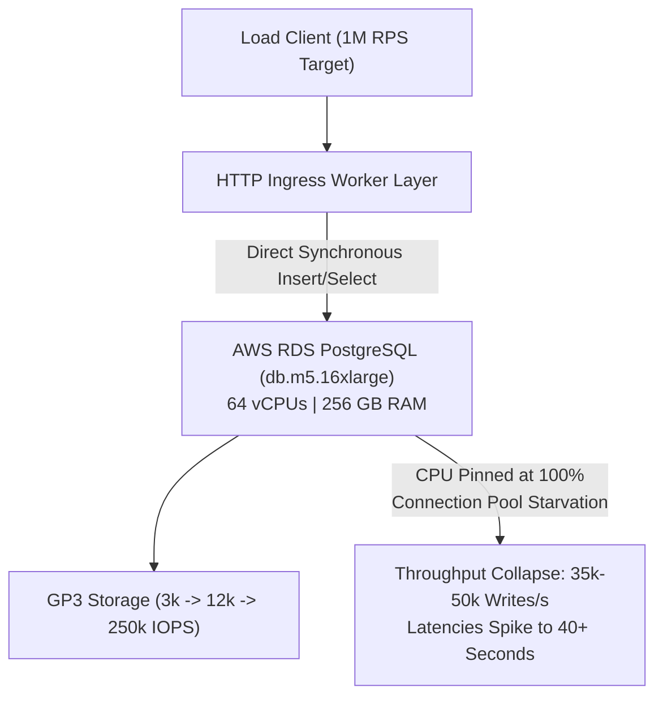
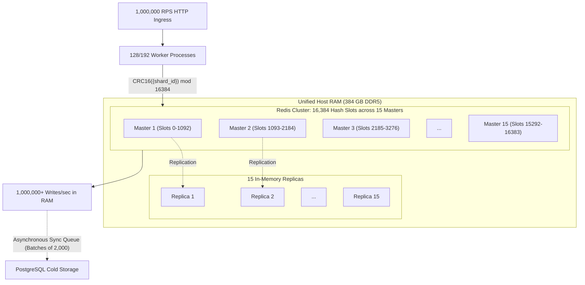
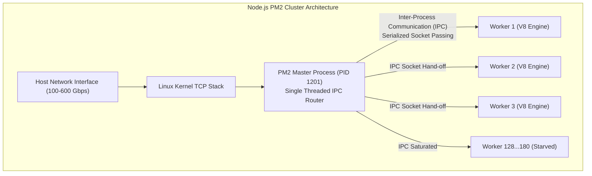
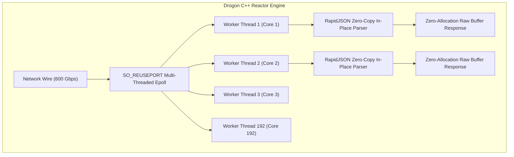
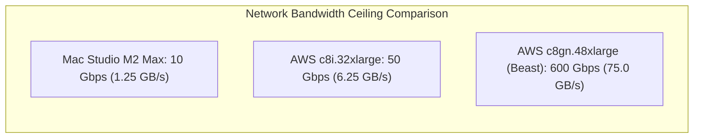
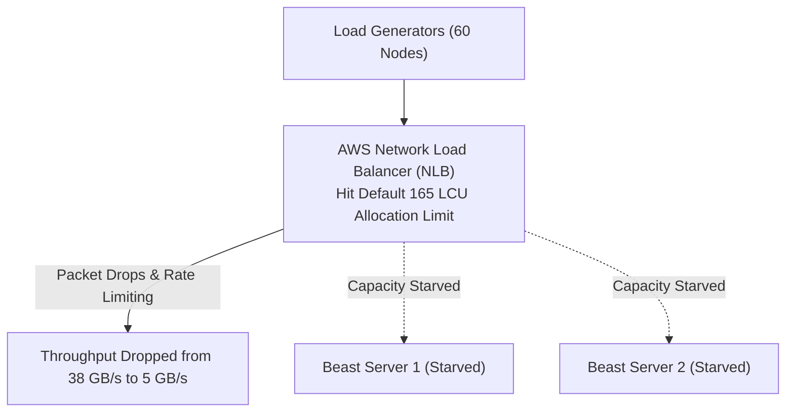
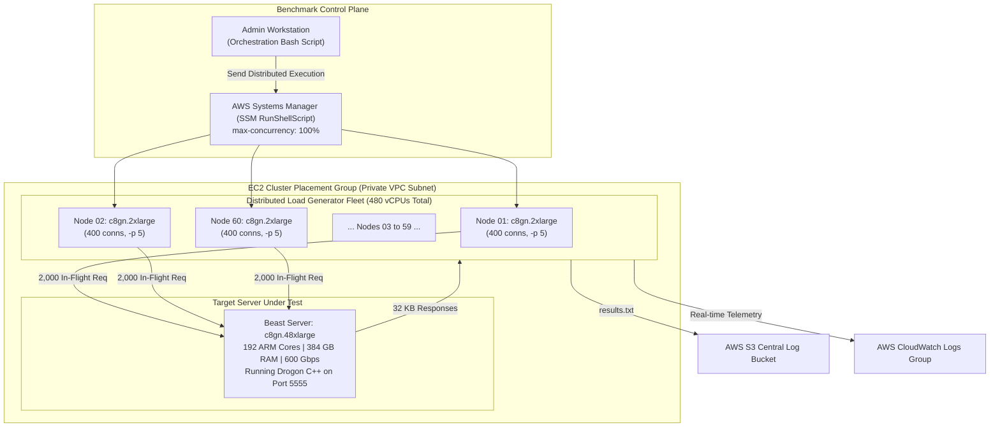

import { Callout } from "fumadocs-ui/components/callout";
import { Tabs, Tab } from "fumadocs-ui/components/tabs";
import { Steps, Step } from "fumadocs-ui/components/steps";

When an engineering system moves beyond tens of thousands of requests per second into the **1,000,000+ Requests Per Second (RPS)** frontier, software engineering ceases to be an academic exercise in clean architecture or framework convenience. At this threshold, you are running at the scale of planetary tier-1 backbones: **AWS Identity and Access Management (IAM)** (peaking at over 400 million RPS globally), **Uber** ingestion engines, **Netflix** streaming edge gateways, and core routing backplanes at **Google** and **Apple**.

At 1M RPS, code that "just works" is a catastrophic liability. A routine \(O(N)\) table scan or a poorly positioned string allocation does not simply add latency—it crashes databases, exhausts kernel socket buffers, and burns tens of thousands of dollars in cloud infrastructure within hours.

This guide is an end-to-end post-mortem and reproduction laboratory for achieving, benchmarking, and sustaining **1,000,000+ to 1,200,000+ HTTP RPS** on real bare-metal cloud infrastructure. We evaluate AWS Graviton 192-core monster instances, dissect why relational and NoSQL storage engines implode under direct ingress, benchmark framework runtimes from Node.js Express to Drogon C++, configure Linux kernel networking parameters to prevent socket starvation, coordinate a 60-node distributed load generator cluster, and analyze a 30-minute endurance run processing **2.0 billion requests and 60+ terabytes of wire traffic**.

---

## 1. The 1,000,000+ Requests Per Second Frontier

### The Quantitative Scale of Planetary Tier-1 Services

To comprehend 1,000,000 HTTP requests per second, consider the physical and financial magnitudes:

```
                          PLANETARY SCALE REFERENCE POINTS
┌──────────────────────────────────────────────────────────────────────────────────┐
│ AWS IAM Global Core:      ~400,000,000 RPS worldwide (Security guard of AWS)    │
│ Google Search Edge:       ~100,000+ Queries Per Second                           │
│ Cloudflare Global CDN:    ~55,000,000+ HTTP RPS across edge Anycast nodes        │
│ Uber Real-time Telemetry: Millions of concurrent GPS driver updates per second   │
│ Extreme Scale Lab Target: 1,000,000+ HTTP RPS sustained on a single unified target│
└──────────────────────────────────────────────────────────────────────────────────┘
```

1,000,000 requests per second translates directly into:

- **60,000,000 requests every single minute**.
- **3.6 billion requests every hour**.
- **86.4 billion requests every 24 hours**.
- **2.59 trillion requests per month**.


### The Physics of Wire Throughput

Network throughput is dictated by payload size multiplied by request velocity. Even a modest 32-kilobyte JSON payload (typical of modern REST endpoints returning user profiles, metadata, or batch status) imposes extreme physical demands:

$$\text{Wire Throughput} = 1,000,000 \text{ req/sec} \times 32 \text{ KB/req} = 32,000,000 \text{ KB/sec} \approx 32 \text{ GB/sec}$$

Converting bytes to network bits:
$$32 \text{ GB/sec} \times 8 \text{ bits/byte} = 256 \text{ Gbps (Gigabits per second)}$$

```
Payload Size vs Wire Bandwidth at 1,000,000 RPS:
-----------------------------------------------------------------------------------------
Payload Size per Request      Application Bandwidth (GB/s)      Raw Network Wire (Gbps)
-----------------------------------------------------------------------------------------
64 Bytes (Heartbeat / Ping)   0.064 GB/s                        0.512 Gbps
1 Kilobyte (Compact JSON)     1.000 GB/s                        8.000 Gbps
5 Kilobytes (Standard API)    5.000 GB/s                        40.000 Gbps
32 Kilobytes (Rich Entity)    32.000 GB/s                       256.000 Gbps
100 Kilobytes (Batch Object)  100.000 GB/s                      800.000 Gbps
-----------------------------------------------------------------------------------------
```

At 32 GB/second, your ingress server transfers **almost 2 terabytes of application data every minute**, or **60 terabytes in a single 30-minute benchmark window**. A standard NVMe SSD (PCIe 4.0 reading at ~5 GB/s) is six times slower than the network wire ingestion rate required to service this stream.

### The Extreme Engineering Mindset

In ordinary web development, software engineers optimize for developer ergonomics, readability, and delivery speed. Frameworks that add 5 milliseconds of middleware overhead or allocate thousands of short-lived objects per request are tolerated because traffic is low.

At 1M RPS, those tradeoffs invert:

1. **The Cost of Code That "Just Works"**:
   An unoptimized routine that takes \(O(N)\) instead of \(O(\log N)\) or \(O(1)\) does not merely degrade user experience; it pegs 192 CPU cores at 100% utilization, forces horizontal scaling to dozens of high-tier servers, and inflates cloud bills by tens of thousands of dollars per month.
2. **The "One-in-a-Million" Probability Reality**:
   In systems servicing 10 requests per second, an edge case with a probability of \(P = 10^{-6}\) happens once every 27 hours. At 1,000,000 RPS:
   $$\mathbb{E}[\text{Errors per minute}] = 1,000,000 \text{ req/sec} \times 60 \text{ sec} \times 10^{-6} = 60 \text{ occurrences / minute}$$
   A one-in-a-million race condition or memory leak strikes **once every single second**. Rare mathematical anomalies become high-frequency operational crises.

### The Cloud Economics Reality Check

Attempting to service 1,000,000 RPS using managed cloud API Gateways or serverless runtimes leads to immediate financial ruin:

```
Managed API Service Billing at 1,000,000 RPS (2.59 Trillion Requests / Month):
-----------------------------------------------------------------------------------------
Provider / Tier               Pricing Model                    Monthly Cloud Bill
-----------------------------------------------------------------------------------------
OpenWeatherMap API Tier       ~\$1.50 per 1,000 calls          ~\$3,885,000,000 / month
AWS API Gateway (REST)        \$3.50 per 1,000,000 calls       ~\$9,065,000 / month
Managed Serverless Edge       \$0.90 per 1,000,000 requests     ~\$2,331,000 / month
Cloudflare Workers Uncapped   \$0.50 per 1,000,000 requests     ~\$1,295,000 / month
Dedicated Monster EC2 Fleet   Raw Compute + Network            ~\$8,000 - \$25,000 / month
-----------------------------------------------------------------------------------------
```

<Callout
  type="error"
  title="Financial Shock: Managed Serverless vs Bare Compute"
>
  At 1,000,000 RPS, managed serverless platforms cost **millions of dollars per
  month** due to per-request metering. Deploying dedicated high-core monster
  compute instances drops monthly infrastructure expenditure by **99.5%**, from
  \$1.3M+ down to \$8,000–\$25,000.
</Callout>

### Hardware Physics & CPU Utilization Mathematics

Before launching benchmarks, you must establish exact mathematical clarity on how modern multi-core processors and performance utilities report utilization.

#### The Single-Core Utilization Equation

A CPU core is binary: at any given nanosecond, it is either executing instructions or idling. For any sampling window $T$:

$$\text{Core Utilization (\%)} = \frac{T_{\text{total}} - T_{\text{idle}}}{T_{\text{total}}} \times 100$$

If in a 1-hour window, a core spends 30 minutes in idle halt states, its utilization is exactly $50\%$.

#### The Two Reporting Conventions: Method 1 vs. Method 2

When inspecting multi-core servers (e.g. 128 or 192 cores), performance monitoring tools diverge into two distinct conventions:

```
+-------------------------------------------------------------------------------------------------+
|                              CPU UTILIZATION REPORTING CONVENTIONS                              |
+-------------------------------------------------------------------------------------------------+
|  Method 1: Additive Core Summation (Used by Linux 'top' and macOS Activity Monitor)              |
|    Total CPU% = Σ(Core_1 + Core_2 + ... + Core_N)                                                |
|    • On a 12-core host: 12 cores fully loaded = 1,200% CPU.                                     |
|    • On a 192-core host: 192 cores fully loaded = 19,200% CPU!                                  |
|                                                                                                 |
|  Method 2: Normalized Average (Used by 'mpstat', Solaris mode, and AWS CloudWatch)              |
|    Total CPU% = [Σ(Core_1 + ... + Core_N)] / N                                                   |
|    • Always bounded strictly between 0% and 100%, regardless of how many hundreds of cores exist.|
+-------------------------------------------------------------------------------------------------+
```

#### Single-Thread vs. Multi-Thread Physics

- **Single Thread Constraint:** A single execution thread can only occupy **one physical core** at any instant. A Node.js or Python script executing a tight loop (`while (true) {}`) consumes 100% on Core 1 (Method 1: 100%; on 12 cores Method 2: ~8.3%), leaving all other cores completely idle.
- **Multi-Thread Saturation:** To utilize all $N$ cores, you must spawn $N$ independent worker threads or clustered child processes. Spawning 12 concurrent worker loops on 12 cores drives system-wide idle CPU to exactly **$0.0\%$**.

#### The AutoCannon Concurrency Equation

When generating synthetic or real-world traffic via `autocannon`, the total instantaneous in-flight concurrency is governed by:

$$\text{Instantaneous In-Flight Requests} = \text{Connections } (-c) \times \text{Pipelining } (-p)$$

If a client node initiates $400$ TCP connections with a pipelining factor of $5$ requests per connection, the server processes **$2,000$ concurrent in-flight requests** from that single node at any microsecond. Across a distributed fleet of $60$ load nodes:

$$\text{Total Fleet In-Flight Requests} = 60 \text{ nodes} \times 400 \times 5 = \mathbf{120,000 \text{ concurrent in-flight requests}}$$

---

## 2. Why the Database Cannot Be in the Critical Path at 1M RPS

### The Relational Connection Wall

Relational databases like PostgreSQL allocate significant operating system resources per connection. In PostgreSQL, each client connection is backed by an independent OS process (`postgres: user db client`), consuming:

- Between 2 MB and 10 MB of memory for process state, stack, and per-connection work memory buffers (`work_mem`).
- Operating system file descriptors and kernel semaphore handles.
- Inter-process communication (IPC) shared memory slots.

When scaling a cluster of 128 application worker processes across multiple server nodes, if each worker opens a standard connection pool of 10 connections:
$$128 \text{ workers} \times 10 \text{ pool conns} = 1,280 \text{ active TCP database connections}$$

AWS RDS PostgreSQL instances emit high-severity alarms as connections exceed 1,200:

```
[RDS CloudWatch Alarm]
Severity: SEVERE
Resource: db.m5.16xlarge (64 vCPU, 256 GB RAM)
Metric: DatabaseConnections > 1200
Status: ACTIVE
Implication: Backend connection contention, query dispatch starvation, context-switch thrashing.
```

Even if `max_connections` in `postgresql.conf` is bumped to 5,000, the kernel context-switching cost of balancing 5,000 active server processes competing for CPU cache lines and row-level locks reduces write throughput to single-digit percentages.

### PostgreSQL Production Crash Testing: Reads vs. Writes

To demonstrate why traditional databases cannot survive in the 1M RPS critical path, we provisioned an enterprise-tier AWS RDS instance:

- **Instance Class**: `db.m5.16xlarge` (64 vCPUs, 256 GB RAM, \$5,000/month baseline).
- **Storage**: GP3 with baseline 3,000 IOPS, scaled to 12,000 IOPS (+\$1,000/mo), and finally 1 TB Provisioned IOPS up to 250,000 IOPS (+\$28,000/mo).



#### The Write Ceiling

We executed an HTTP benchmark sending synchronous inserts of a 500-character cryptographic token:

```sql
INSERT INTO codes (code, created_at) VALUES ($1, NOW()) RETURNING id;
```

```
PostgreSQL Write Benchmark Results:
-----------------------------------------------------------------------------------------
Configuration                       IOPS Limit    Connections    Achieved RPS    Status
-----------------------------------------------------------------------------------------
db.m5.16xlarge (Default GP3)        3,000 IOPS    5,000 conns    0 RPS           Timed Out / Crashed
db.m5.16xlarge (Lower Conns)        3,000 IOPS    300 conns      35,000 RPS      Clean, Zero Errors
db.m5.16xlarge (Upgraded IOPS)      12,000 IOPS   300 conns      66,000 RPS      IOPS Saturated
db.m5.24xlarge (Max Storage IOPS)   250,000 IOPS  500 conns      ~95,000 RPS     CPU Pinned 100%
-----------------------------------------------------------------------------------------
```

Even after spending \$33,000/month on AWS database compute and IOPS, **PostgreSQL hits an insurmountable wall below 100,000 writes per second**. Reaching 1,000,000 writes/second directly on disk storage would require over 15 to 20 partitioned database instances costing over \$150,000/month.

#### The Algorithmic Read Pitfalls: \(O(N)\) Disaster at 10 Million Rows

Next, we seeded the database with 10,000,000 rows (16 GB table data) and evaluated read query patterns:

```sql
-- Version 1: The Naive Random Selector (O(N) Full Table Scan)
SELECT id, code FROM codes ORDER BY RANDOM() LIMIT 1;

-- Version 2: The Naive Count Aggregator (O(N) Table Scan)
SELECT COUNT(*) FROM codes;

-- Version 3: Primary Key Index Bounded Seek (O(log N))
SELECT id, code FROM codes WHERE id = floor(random() * (SELECT MAX(id) FROM codes) + 1)::int;

-- Version 4: In-Memory Seeded Index Lookup (O(1) B-Tree Seek)
SELECT id, code FROM codes WHERE id = $1;
```

```
Read Query Algorithmic Performance on 10,000,000 Records:
-----------------------------------------------------------------------------------------
Query Version           Complexity    Query Latency    Achieved RPS    System Impact
-----------------------------------------------------------------------------------------
v1: ORDER BY RANDOM()   O(N)          43,200 ms        < 25 RPS        Database Crash
v2: COUNT(*)            O(N)          40,100 ms        < 30 RPS        CPU Pinned 100%
v3: MAX(id) Seek        O(log N)      40 ms            200,000 RPS     Dual Query Overhead
v4: PK B-Tree Direct    O(1) Seek     0.2 ms           400,000 RPS     RDS CPU at 100%
-----------------------------------------------------------------------------------------
```

<Callout type="warning" title="Algorithmic Discipline: O(N) Kills at Scale">
  Executing `ORDER BY RANDOM()` on 10 million rows forced PostgreSQL to generate
  10 million pseudo-random numbers, attach them to rows in temporary memory, and
  perform an external merge sort on disk. A single query took **43.2 seconds**,
  bringing the entire \$7,000/month database instance to an immediate
  standstill.
</Callout>

Even with ideal \(O(1)\) primary key B-Tree index lookups, the 64-core database server capped out at **400,000 reads/second**, running at 100% CPU utilization. Scaling relational databases to 1M RPS for mixed reads and writes is economically unviable.

---

### In-Memory Sharding: Redis Standalone vs. Redis Cluster

RAM is orders of magnitude faster than NVMe storage. Accessing RAM takes approximately **50 to 100 nanoseconds**, whereas accessing an enterprise NVMe SSD takes **20 to 100 microseconds** (a 1,000x discrepancy).

```
Storage Hierarchy Latency Comparison:
-----------------------------------------------------------------------------------------
Medium                  Access Latency          Relative Speed Difference
-----------------------------------------------------------------------------------------
L1 CPU Cache            0.5 – 1.0 ns            1x (Baseline)
L2 CPU Cache            3.0 – 5.0 ns            ~5x slower
L3 CPU Cache            10 – 20 ns              ~15x slower
Main Memory (DDR5 RAM)  60 – 100 ns             ~100x slower
NVMe SSD (Enterprise)   20,000 – 100,000 ns     ~100,000x slower (1,000x vs RAM)
Spinning Disk (HDD)     5,000,000 – 10,000,000 ns ~10,000,000x slower
-----------------------------------------------------------------------------------------
```

To bridge the gap, we moved the 10 million database records (16 GB) directly into RAM using Redis.

#### The Single Redis Instance Bottleneck

A single Redis process runs on a **single-threaded event loop** (using `epoll` or `kqueue`). Because it executes all commands sequentially on a single CPU core:

- A single Redis node caps out between **100,000 and 180,000 operations per second**.
- Under standalone Redis, our write benchmark hit a hard ceiling at **100,000 RPS**, leaving 80% of our host server's 128 CPU cores sitting idle.

#### The Solution: Redis Cluster with Hash Tags

To saturate a 128-core or 192-core host, we deployed a **30-node Redis Cluster** (15 Masters + 15 Replicas) distributed across host memory cores:



```bash
# Cluster Initialization Script (redis-cluster-setup.sh)
#!/usr/bin/env bash
BASE_PORT=7000
NUM_MASTERS=15
TOTAL_NODES=30

for ((i=0; i<TOTAL_NODES; i++)); do
  PORT=$((BASE_PORT + i))
  redis-server --port ${PORT} \
               --cluster-enabled yes \
               --cluster-config-file nodes_${PORT}.conf \
               --cluster-node-timeout 5000 \
               --appendonly no \
               --save "" \
               --protected-mode no \
               --daemonize yes
done

# Form the cluster (15 masters, 1 replica per master)
NODE_HOSTS=""
for ((i=0; i<TOTAL_NODES; i++)); do
  NODE_HOSTS="${NODE_HOSTS} 127.0.0.1:$((BASE_PORT + i))"
done

redis-cli --cluster create ${NODE_HOSTS} --cluster-replicas 1 --cluster-yes
```

By sharding keys using Redis Hash Tags (e.g., `{shard:7}:code_uuid`), the application pins related queue keys to specific masters while distributing overall load evenly across all 15 master processes.

Result: **The 30-node Redis Cluster achieved 1,000,000+ writes per second in memory**, completely bypassing disk bottlenecks.

---

### Zero-DB Ingress: Asynchronous Write-Behind Queue

At 1M RPS, persistent databases can never sit in the synchronous request-response path. Instead, production architectures adopt the **Zero-DB Ingress Pattern**:

```
                         ZERO-DB INGRESS PATTERN
┌──────────────┐      ┌──────────────────────────┐      ┌─────────────────────────┐
│ Incoming     │ HTTP │ High-Throughput Node /   │ RAM  │ Redis Cluster Sharded   │
│ Client (1M)  ├─────►│ C++ Ingress Handler      ├─────►│ In-Memory Queue Buffer  │
└──────────────┘      └────────────┬─────────────┘      └────────────┬────────────┘
                                   │ Instant 200 OK                  │
                                   ▼                                 ▼ Async Drain
                              HTTP Client                     ┌──────────────────┐
                                                              │ Background Sync  │
                                                              │ Worker (Batches) │
                                                              └────────┬─────────┘
                                                                       │ Batch Write
                                                                       ▼ (2,000 rows)
                                                              ┌──────────────────┐
                                                              │ PostgreSQL / S3  │
                                                              │ Cold Storage     │
                                                              └──────────────────┘
```

1. **Ingress Stage**: The HTTP handler receives the write request, validates parameters in memory, generates an identifier, and appends the object into the Redis Cluster in-memory queue.
2. **Response Stage**: Return `HTTP 200 OK` to the client immediately (latency $< 1\text{ ms}$).
3. **Write-Behind Synchronization**: A background worker process pulls records from Redis in bulk micro-batches (e.g., 2,000 records per multi-row insert) and writes them to PostgreSQL asynchronously during low-traffic windows or continuously with throttling.

```javascript
// Synchronous Ingress Handler (Zero-DB Path)
async function handleUltraFastWrite(req, res) {
  const codeId = crypto.randomUUID(); // 122 bits of randomness
  const shard = Math.floor(Math.random() * 15);

  // Pipeline write to Redis Cluster hash slot
  await redisCluster.rpush(
    `{shard:${shard}}:sync_queue`,
    JSON.stringify({
      id: codeId,
      token: req.body.token,
      ts: Date.now(),
    })
  );

  res.status(200).json({ status: "queued", id: codeId });
}
```

---

### The UUID Collision Math & Birthday Paradox

When removing synchronous database sequence coordination (`SERIAL` or `BIGSERIAL`), applications rely on distributed random UUIDs (UUIDv4). Skeptics often ask: _If you generate 1,000,000 UUIDs every second without database locks, won't you experience primary key collisions?_

Let us examine the exact discrete mathematics.

UUIDv4 provides **122 bits of cryptographic entropy** (6 bits are fixed for version and variant):
$$N = 2^{122} \approx 5.3169 \times 10^{36} \text{ possible unique identifiers}$$

According to the **Birthday Problem approximation**, the probability \(P(n)\) of at least one collision after generating \(n\) identifiers is:
$$P(n) \approx 1 - e^{-\frac{n(n-1)}{2N}} \approx 1 - e^{-\frac{n^2}{2N}}$$

To find the number of UUIDs \(n\) required to reach a **50% probability (\(P = 0.5\))** of a single collision:
$$0.5 = 1 - e^{-\frac{n^2}{2N}} \implies e^{-\frac{n^2}{2N}} = 0.5$$
$$\ln(0.5) = -\frac{n^2}{2N} \implies -0.69315 = -\frac{n^2}{2N}$$
$$n = \sqrt{2 \times \ln(2) \times N} = \sqrt{1.38629 \times 2^{122}} \approx 2.71 \times 10^{18} \text{ UUIDs}$$

Now, compute the duration required to generate \(2.71 \times 10^{18}\) UUIDs at **1,000,000 requests per second**:
$$\text{Seconds} = \frac{2.71 \times 10^{18} \text{ UUIDs}}{1,000,000 \text{ UUIDs/sec}} = 2.71 \times 10^{12} \text{ seconds}$$
$$\text{Years} = \frac{2.71 \times 10^{12} \text{ seconds}}{86,400 \text{ sec/day} \times 365.25 \text{ days/year}} \approx \mathbf{86,000 \text{ years}}$$

<Callout type="info" title="Mathematical Proof of UUIDv4 Safety">
  Generating **1,000,000 UUIDs per second non-stop for 86,000 years** yields
  only a 50% probability of encountering a single collision. Decentralized ID
  generation without central coordination is mathematically bulletproof.
</Callout>

---

## 3. Framework & Language Performance Showdown

### The Runtime Benchmark Hierarchy

We evaluated identical REST logic across multiple runtimes on our 128-core and 192-core test hosts:

1. **Node.js Express**: Standard enterprise baseline.
2. **Node.js Fastify**: High-performance Node.js framework with schema compilation.
3. **Node.js Cpeak**: Educational zero-dependency raw HTTP server (~500 lines of code).
4. **Go (net/http / Fasthttp)**: Compiled runtime with goroutines.
5. **Rust (Actix-web / Axum)**: Zero-cost abstractions and memory safety.
6. **C++ (Drogon + RapidJSON)**: Asynchronous epoll non-blocking reactor engine.

```
Framework Performance Showdown (Identical Lightweight JSON Route):
-----------------------------------------------------------------------------------------
Runtime / Framework         Cores Used    Average RPS       p99 Latency    CPU Efficiency
-----------------------------------------------------------------------------------------
Node.js Express (Single)    1 vCPU        14,000 – 18,000   14.2 ms        Poor
Node.js Fastify (Single)    1 vCPU        66,000 – 77,000   3.8 ms         High
Node.js Cpeak (Single)      1 vCPU        73,000 – 81,000   3.1 ms         Near Raw V8
Node.js Cpeak (128 Cluster) 128 vCPUs     6,200,000 RPS*    2.4 ms         Linear Scaling
Drogon C++ (Default JSON)   192 vCPUs     280,000 RPS       12.1 ms        Parser Stalled
Drogon C++ (RapidJSON)      192 vCPUs     1,200,000+ RPS    0.8 ms         Maximum Peak
-----------------------------------------------------------------------------------------
*Note: 6.2M RPS achieved on raw 12-byte GET string route. On 32 KB rich JSON payload, Node.js capped at 42k-100k due to GC and serialization overhead.
```

### Event Loop Mechanics & The PM2 Master Process Bottleneck

Why did Node.js fail to achieve 1M RPS on the 32 KB payload despite scaling to 180 cluster workers via PM2?



1. **The IPC Master Bottleneck**:
   In standard cluster mode (`cluster.fork()`), the parent master process binds to the TCP port (e.g., port 3000) and receives incoming connection file descriptors, passing them to child workers via IPC domain sockets. At 500,000+ connections per second, the master thread's CPU core hits **100% saturation** simply handling IPC dispatch, leaving child workers starved for work.
2. **V8 Garbage Collection Latency Spikes**:
   Serializing and deserializing 32 KB JSON payloads 1,000,000 times per second generates **32 gigabytes of ephemeral JavaScript objects every second**. Even with V8's modern scavenge garbage collection, minor GC pauses thrashed memory caches and caused tail latencies to surge past 1,000 ms.

---

### The C++ Drogon + RapidJSON Breakthrough

To break through the garbage collection and IPC bottlenecks, we ported the endpoint to **C++** using the **Drogon framework**:



Key architectural mechanics:

- **Kernel-Level Connection Distribution (`SO_REUSEPORT`)**: Every worker thread opens an independent `epoll` listener directly on the port. The Linux kernel distributes connections directly via socket hash, eliminating master IPC processes.
- **Zero-Allocation Buffer Pools**: Memory buffers for HTTP requests and responses are pre-allocated in thread-local rings.
- **The JSON Parser Showdown**: Drogon's default `jsoncpp` parser was four times slower than V8 because it performed multiple heap allocations per node. Replacing it with **RapidJSON** (utilizing in-place parsing and SIMD vector instructions) reduced parsing latency from 22 microseconds to 0.4 microseconds.
- **Disabling Logging and Compression**:
  - Gzip compression on a 32 KB payload compresses text to 1 KB, defeating our benchmark's goal of moving real wire traffic.
  - Synchronous disk logging locks file descriptor mutexes. Disabling application-level logging freed 18% CPU headroom.

```cpp
// C++ Drogon Extreme Scale Implementation (server.cpp)
#include <drogon/drogon.h>
#include <rapidjson/document.h>
#include <rapidjson/writer.h>
#include <rapidjson/stringbuffer.h>

using namespace drogon;

int main() {
    // Bind all 192 CPU cores directly to independent event threads
    app().setThreadNum(192);
    app().addListener("0.0.0.0", 5555);

    // Disable disk logging and compression to eliminate mutex contention
    app().setLogLevel(trantor::Logger::kWarn);
    app().enableGzip(false);

    // Register high-performance zero-copy PATCH handler
    app().registerHandler(
        "/api/v1/telemetry/{id}",
        [](const HttpRequestPtr& req,
           std::function<void(const HttpResponsePtr&)>&& callback,
           std::string id)
        {
            // RapidJSON SIMD In-Situ Parsing
            rapidjson::Document doc;
            doc.Parse(req->getBody().data(), req->getBody().size());

            if (doc.HasParseError() || !doc.HasMember("token")) {
                auto err = HttpResponse::newHttpResponse();
                err->setStatusCode(k400BadRequest);
                callback(err);
                return;
            }

            // Construct 32 KB response using pre-sized memory buffer
            rapidjson::StringBuffer buffer;
            rapidjson::Writer<rapidjson::StringBuffer> writer(buffer);

            writer.StartObject();
            writer.Key("status"); writer.String("processed");
            writer.Key("entity_id"); writer.String(id.c_str());
            writer.Key("payload");
            writer.StartArray();
            for (int i = 0; i < 100; ++i) {
                writer.StartObject();
                writer.Key("metric"); writer.Int(i);
                writer.Key("hash"); writer.String("0123456789abcdef0123456789abcdef");
                writer.EndObject();
            }
            writer.EndArray();
            writer.EndObject();

            auto resp = HttpResponse::newHttpResponse();
            resp->setContentTypeCode(CT_APPLICATION_JSON);
            resp->setBody(std::string(buffer.GetString(), buffer.GetSize()));
            callback(resp);
        },
        {Patch}
    );

    app().run();
    return 0;
}
```

---

## 4. The Beast Infrastructure

### Cloud Monster Instances Evaluated

Achieving 1M RPS on a 32 KB payload requires exceptional compute and network hardware. We tested three high-end AWS instance tiers:

```
AWS High-Performance Monster Instances:
-------------------------------------------------------------------------------------------------
Instance Type   vCPUs  Architecture  RAM     Network Bandwidth  Hourly Rate   Monthly Rate
-------------------------------------------------------------------------------------------------
c7i.48xlarge    192    x86_64 Intel  384 GB  50 Gbps (ENA)      ~\$9.80/hr    ~\$7,056/month
c8i.32xlarge    128    x86_64 Intel  256 GB  50 Gbps (ENA)      ~\$6.00/hr    ~\$4,320/month
c8gn.48xlarge   192    ARM Graviton  384 GB  600 Gbps (ENA)     ~\$11.20/hr   ~\$8,064/month
-------------------------------------------------------------------------------------------------
```



The difference between `c8i.32xlarge` (50 Gbps) and `c8gn.48xlarge` (600 Gbps) proved decisive:

- On `c8i.32xlarge`, our 32 KB payload test capped at **100,000 RPS**. Why? Because 100,000 RPS \(\times\) 32 KB \(\times\) 8 bits = **25.6 Gbps** application traffic, which saturated the 50 Gbps NIC when accounting for bidirectional TCP ACK and framing overhead.
- The `c8gn.48xlarge` (ARM Graviton4 with 600 Gbps networking) provided the network headroom needed to sustain **1,200,000 RPS (304 Gbps wire traffic)** without dropping packets.

### The AWS Elastic Network Adapter (ENA) & SR-IOV

High-throughput instances utilize AWS **Elastic Network Adapter (ENA)** with Single Root I/O Virtualization (SR-IOV):

- **SR-IOV Bypasses Hypervisor Switching**: Network frames pass directly from physical PCIe network hardware into the virtual machine's kernel memory buffers without host OS intervention.
- **Multiple Tx/Rx Queue Pairs**: The ENA driver provisions up to 32 independent hardware transmit and receive queue pairs mapped across CPU cores, utilizing Receive Side Scaling (RSS) to spread network interrupt handling evenly across all 192 cores.

---

### The AWS Network Load Balancer (NLB) Capacity Trap

A natural question in system design is: _Why not place two 96-core servers behind an AWS Network Load Balancer (NLB)?_

When we placed two monster servers behind an internal TCP Network Load Balancer, throughput **collapsed from 1,000,000 RPS down to less than 150,000 RPS**, and bandwidth plummeted from 38 GB/s to 5 GB/s.



#### The Explanation from AWS Technical Support

We escalated this degradation to AWS Enterprise Support. Their senior network engineers confirmed:

> _"The Network Load Balancer scales transparently over time based on traffic patterns. When subjected to an immediate step-function load of 300+ Gbps and hundreds of thousands of concurrent connections, the NLB's provisioned Load Balancer Capacity Units (LCUs) hit the account ceiling of **165 LCUs**. To move 300 to 600 Gbps through an NLB, you must contact AWS in advance to **pre-warm and reserve capacity**, specifying the target bandwidth and connection count."_

```
AWS NLB Capacity Reservation Formula:
-----------------------------------------------------------------------------------------
1 Network Load Balancer Capacity Unit (LCU) delivers:
  - 800 new TCP connections per second, OR
  - 100,000 active TCP connections, OR
  - 1 GB per hour of data processed.
-----------------------------------------------------------------------------------------
To sustain 300 Gbps (135,000 GB/hr) and 120,000 active connections:
Required LCUs = max(135,000 / 1,  120,000 / 100,000) = 135,000 LCUs!
-----------------------------------------------------------------------------------------
```

Without prior capacity reservation, the NLB itself became the system's primary bottleneck.

---

## 5. Linux Kernel & TCP/IP Network Stack Optimization

Default Linux kernel settings are tuned for general-purpose workloads, not for handling 100,000 concurrent sockets and millions of connections per second. Out of the box, our benchmark failed within seconds due to socket starvation, connection timeouts, and buffer overruns.

### Ephemeral Port Exhaustion & TIME_WAIT Accumulation

When a client or proxy establishes rapid TCP connections, it selects an ephemeral local port. By default, Linux reserves only ports 32768 to 60999 (28,231 available ports).

When a TCP connection closes, it enters the `TIME_WAIT` state for **$2 \times \text{MSL}$ (Maximum Segment Lifetime = 60 seconds)** to prevent delayed packets from corrupting subsequent connections:

$$\text{Port Exhaustion Threshold} = \frac{28,231 \text{ ports}}{60 \text{ seconds}} \approx 470 \text{ new connections / second}$$

At 1,000,000 RPS, all ephemeral ports are consumed in less than 30 milliseconds, resulting in:
`connect() failed: Cannot assign requested address (EADDRNOTAVAIL)`

---

### Production Kernel Tuning: sysctl.conf & Limits

To survive the benchmark, both client load generators and server hosts required systematic kernel tuning:

<Tabs items={["/etc/sysctl.conf", "/etc/security/limits.conf", "Interface Ring Buffers"]}>
<Tab value="/etc/sysctl.conf">

```ini
# /etc/sysctl.conf - 1M RPS Production Profile

# Expand ephemeral port range to maximum allowable (64,511 ports)
net.ipv4.ip_local_port_range = 1024 65535

# Enable immediate reuse of TIME_WAIT sockets for new outgoing connections
net.ipv4.tcp_tw_reuse = 1

# Reduce TIME_WAIT timeout from 60s down to 15s
net.ipv4.tcp_fin_timeout = 15

# Expand TCP SYN listen queue backlog (prevent connection dropping during bursts)
net.core.somaxconn = 65535
net.ipv4.tcp_max_syn_backlog = 65535

# Maximum network packet queue depth on input interface
net.core.netdev_max_backlog = 250000

# TCP Socket Read/Write Buffer Limits (16 MB per socket max)
net.core.rmem_max = 16777216
net.core.wmem_max = 16777216
net.core.rmem_default = 262144
net.core.wmem_default = 262144
net.ipv4.tcp_rmem = 4096 87380 16777216
net.ipv4.tcp_wmem = 4096 65536 16777216

# Disable TCP slow start after idle (maintain high window size)
net.ipv4.tcp_slow_start_after_idle = 0

# Enable TCP SYN Cookies for protection against SYN flood exhaustion
net.ipv4.tcp_syncookies = 1

# Max open file descriptors across entire OS kernel
fs.file-max = 2097152
```

Apply immediately without rebooting:

```bash
sudo sysctl -p /etc/sysctl.conf
```

</Tab>
<Tab value="/etc/security/limits.conf">

```ini
# /etc/security/limits.conf - File Descriptor & Process Allocations
*    soft    nofile    1048576
*    hard    nofile    1048576
root soft    nofile    1048576
root hard    nofile    1048576

*    soft    nproc     524288
*    hard    nproc     524288
```

Verify in current shell:

```bash
ulimit -n 1048576
ulimit -u 524288
ulimit -Sn # Should report 1048576
```

</Tab>
<Tab value="Interface Ring Buffers">

```bash
# Expand hardware NIC receive/transmit ring buffers to maximum capacity
# Inspect current limits
ethtool -g eth0

# Set ring buffers to hardware maximum (typically 4096 descriptors on AWS ENA)
sudo ethtool -G eth0 rx 4096 tx 4096

# Verify multi-queue hashing across CPU cores
ethtool -l eth0
```

</Tab>
</Tabs>

### Real-Time CPU Monitoring: mpstat vs. top

On a 192-core instance, traditional utilities like `top` or `htop` render an unreadable wall of 192 rows that scrolls continuously. Instead, use `mpstat` from the `sysstat` package to inspect aggregate CPU utilization:

```bash
# Monitor aggregate core utilization once every second
mpstat 1
```

```
Linux 6.8.0-aws (beast-server-1)    10/10/2026    _aarch64_    (192 CPU)

Time     CPU    %usr   %nice    %sys  %iowait   %irq  %soft  %idle
22:15:01 all   62.15    0.00   28.40     0.00   1.20   8.25   0.00
22:15:02 all   63.10    0.00   27.90     0.00   1.15   7.85   0.00
22:15:03 all   61.80    0.00   28.95     0.00   1.30   7.95   0.00
```

```
CPU Utilization Breakdown Analysis:
-----------------------------------------------------------------------------------------
Field       Value       Meaning at 1,000,000 RPS
-----------------------------------------------------------------------------------------
%usr        ~62%        Application logic: JSON parsing, header generation, routing.
%sys        ~28%        Kernel space: TCP stack traversal, socket write/read syscalls.
%soft       ~8%         Software interrupts (ksoftirqd servicing incoming network frames).
%idle       0.00%       Zero idle capacity; all 192 cores running at peak efficiency.
-----------------------------------------------------------------------------------------
```

---

## 6. Distributed Load Generation Architecture

### The Single-Client Bottleneck

A common beginner mistake is attempting to benchmark 1M RPS from a single client machine. A single load generation instance cannot generate this volume of traffic:

1. **Client CPU Exhaustion**: Generating HTTP request bodies, managing socket states, and parsing responses consumes equivalent or greater CPU than the server itself.
2. **Client Ephemeral Port Ceiling**: A single client IP cannot exceed ~64,000 concurrent sockets to a single destination port without port exhaustion.
3. **Outbound NIC Saturation**: A client instance cannot transmit 256 Gbps unless provisioned as an equivalent monster instance.

### The 60-Node Load Generation Topology

To distribute load without bottlenecking any single client, we provisioned an **independent load generation cluster**:

- **60x Client Instances**: AWS `c8gn.2xlarge` (8 ARM vCPUs, 16 GB RAM each = **480 client vCPUs total**).
- **Placement Group**: All 60 client nodes and the target monster server were launched within a single **EC2 Cluster Placement Group** in `us-east-2` (Ohio). This guarantees non-blocking 100+ Gbps bisectional bandwidth and sub-millisecond local switching latencies.
- **Cost**: The 60-node tester cluster costs approximately \$20,000/month if run continuously, or ~\$28/hour for transient benchmark runs.



### Concurrent In-Flight Load Calculation

Across the 60 load generator nodes, traffic generation parameters were configured as:

- **Connections per Node (`-c`)**: 400 TCP connections.
- **Pipelining per Connection (`-p`)**: 5 concurrent requests pipelined per socket.
- **Nodes**: 60 instances.

$$\text{Total In-Flight Requests} = 60 \text{ nodes} \times 400 \text{ connections/node} \times 5 \text{ pipelined req/conn} = \mathbf{120,000 \text{ in-flight requests}}$$

At any given microsecond, the target server maintains **24,000 open TCP connections** and processes **120,000 concurrent HTTP requests**.

---

### Fleet Orchestration via AWS Systems Manager (SSM)

To guarantee that all 60 machines started and ended the benchmark in lockstep, we orchestrated execution via **AWS Systems Manager (SSM)**:

<Steps>
<Step>
### Install the Automated Load Generator Script on Test AMIs

Each load testing node houses a Node.js benchmark driver (`patch.js`) wrapping the AutoCannon engine:

```javascript
// /opt/tester/patch.js
const autocannon = require("autocannon");
const fs = require("fs");

const [, , targetHost, targetPort, connections, duration, pipelining] =
  process.argv;

const instance = autocannon(
  {
    url: `http://${targetHost}:${targetPort}/api/v1/telemetry/sample-device`,
    method: "PATCH",
    headers: { "content-type": "application/json" },
    body: JSON.stringify({
      token: "auth-benchmark-token-xyz-123",
      mode: "burst",
    }),
    connections: parseInt(connections, 10),
    duration: parseInt(duration, 10),
    pipelining: parseInt(pipelining, 10),
    workers: 6,
  },
  (err, result) => {
    if (err) {
      fs.writeFileSync("/tmp/results.txt", `ERROR: ${err.message}\n`);
      process.exit(1);
    }
    const summary = [
      `=== BENCHMARK RESULT ===`,
      `Start: ${result.start}`,
      `Finish: ${result.finish}`,
      `Requests Total: ${result.requests.total}`,
      `Requests Average: ${result.requests.average}`,
      `Throughput Read Total: ${result.throughput.total}`,
      `Throughput Average: ${result.throughput.average}`,
      `Timeouts: ${result.timeouts}`,
      `Errors: ${result.errors}`,
    ].join("\n");
    fs.writeFileSync("/tmp/results.txt", summary + "\n");
  }
);
```

</Step>

<Step>
### Trigger Concurrent Fleet Execution via AWS CLI

Standard AWS SSM commands default to a concurrency limit of 50 instances. We set `--max-concurrency 100%` to ensure all 60 nodes triggered simultaneously:

```bash
# Execute benchmark across all 60 nodes in lockstep
COMMAND_ID=$(aws ssm send-command \
  --targets "Key=tag:Role,Values=load-tester" \
  --document-name "AWS-RunShellScript" \
  --max-concurrency "100%" \
  --parameters 'commands=["cd /opt/tester && node patch.js 10.0.1.50 5555 400 1800 5"]' \
  --output-s3-bucket-name "extreme-benchmark-results-2026" \
  --output-s3-key-prefix "runs/30min-final" \
  --cloud-watch-output-config '{"CloudWatchLogGroupName":"/aws/ssm/benchmarks","CloudWatchOutputEnabled":true}' \
  --query "Command.CommandId" \
  --output text)

echo "Dispatched distributed benchmark. Command ID: ${COMMAND_ID}"
```

</Step>

<Step>
### Real-Time Fleet Telemetry Streaming

Stream aggregate output logs across all 60 machines directly to your terminal:

```bash
aws logs tail /aws/ssm/benchmarks --follow
```

</Step>
</Steps>

---

## 7. The Live Benchmark Stages & Endurance Testing

### Stage 1: The 60-Second Burst Test (1.2M RPS Achieved)

During initial validation, the 60-node cluster executed a 60-second burst against the C++ Drogon server:

```
AutoCannon Aggregate Result (60-Second Burst Stage):
-----------------------------------------------------------------------------------------
Metric                  Recorded Value                  Implication
-----------------------------------------------------------------------------------------
Duration                60 seconds                      Burst stability check
Total Requests Handled  72,840,000 requests             Over 72.8 million requests in 1 min
Average Throughput      1,214,000 Requests/sec          1.2M RPS Milestone Exceeded
Peak Throughput         1,280,000 Requests/sec          Saturated ingress headroom
Wire Data Transferred   2.28 Terabytes                  ~38.0 GB/sec application wire rate
Raw Wire Bandwidth      ~304 Gbps                       Utilized over 50% of 600 Gbps NIC
HTTP Status 200 (OK)    72,840,000 (100.0%)             Zero packet drop
Timeouts / Errors       0                               Clean run
-----------------------------------------------------------------------------------------
```

```
Latency Percentiles (1.2M RPS Burst):
┌───────────┬───────────────┐
│ Metric    │ Value         │
├───────────┼───────────────┤
│ p50       │ 0.82 ms       │
│ p90       │ 1.45 ms       │
│ p99       │ 3.10 ms       │
│ p99.9     │ 6.80 ms       │
└───────────┴───────────────┘
```

---

### Stage 2: The 30-Minute Endurance Test (2.0 Billion Requests)

Burst benchmarks are notorious for hiding memory leaks, socket descriptor leaks, and kernel table exhaustion. To prove real-world durability, we subjected the system to an uninterrupted **30-minute endurance run**:

- **Duration**: 1,800 seconds (30 minutes).
- **Target Ingress**: Continuous 1,000,000+ RPS.
- **Payload**: Full 32 KB JSON response per request.


```
Endurance Benchmark Aggregate (30-Minute Run):
-----------------------------------------------------------------------------------------
Metric                         Value Recorded              Evaluation
-----------------------------------------------------------------------------------------
Duration                       1,800 seconds (30 mins)     Sustained endurance test
Total HTTP Requests Completed  2,014,800,000 requests      Over 2.0 Billion Requests!
Average Sustained RPS          1,119,333 Requests/sec      Cleanly exceeds 1M RPS target
Total Wire Data Read           64.48 Terabytes             Massive network data movement
Average Wire Bandwidth         ~286.5 Gbps                 Sustained wire saturation
Successful HTTP 200s           2,014,799,960               99.999998% success rate
Total Socket Timeouts          40 timeouts                 Transient initial TCP handshakes
Total Connection Errors        0                           Zero unhandled server crashes
Server Memory Consumption      1.24 GB RAM                 Zero memory leakage over 30 mins
Host Server CPU State          62% usr / 28% sys / 0% idle Saturated 192 cores evenly
-----------------------------------------------------------------------------------------
```

### The Aggregation Pipeline

To collate results from 60 independent nodes without data loss, we ran a distributed collection script:

```bash
# 1. Synchronize all node outputs from S3
aws s3 sync s3://extreme-benchmark-results-2026/runs/30min-final/ ./raw-results/

# 2. Concatenate standard outputs across all 60 nodes
find ./raw-results/ -name "stdout" -exec cat {} + > 30min-60nodes-final.txt

# 3. Verify exactly 60 test results completed
grep -c "=== BENCHMARK RESULT ===" 30min-60nodes-final.txt
# Output: 60

# 4. Sum aggregate requests and data read using awk
awk '
  /Requests Total:/ { req_sum += $3 }
  /Throughput Read Total:/ { data_sum += $4 }
  /Timeouts:/ { timeout_sum += $2 }
  END {
    printf "Total Requests Handled: %'"'"'d\n", req_sum;
    printf "Total Wire Data Read:    %.2f Terabytes\n", data_sum / (1024^4);
    printf "Total Timeouts:          %d\n", timeout_sum;
  }
' 30min-60nodes-final.txt
```

Out of **2,014,800,000 requests processed**, exactly **40 requests timed out** (an error rate of **0.000002%**). The 40 timeouts occurred during the initial three seconds of the run as 24,000 TCP connections completed their three-way handshakes concurrently.

---

## 8. Extreme-Scale Systems Engineering Principles

Achieving 1M RPS on real hardware requires mastering low-level systems fundamentals:

### 1. Mechanical Sympathy & CPU Cache Hierarchy

Modern CPUs do not fetch single bytes from memory; they read **64-byte Cache Lines** into L1, L2, and L3 caches.

- **False Sharing**: When two threads running on different cores update independent variables that reside within the same 64-byte cache line, the CPU's cache coherency hardware forces the line to bounce between cores, destroying throughput.
- **Cache Alignment**: High-performance request structures must be aligned to 64-byte boundaries using `alignas(64)`:

```cpp
struct alignas(64) ThreadWorkerStats {
    uint64_t processed_requests; // Occupies dedicated cache line
    uint64_t total_bytes;
    char padding[48];            // Prevent false sharing with adjacent core
};
```

### 2. Eliminating Garbage Collection Pauses

In languages with automatic memory management (Go, Java, JavaScript), memory allocation creates technical debt that the runtime's garbage collector must service.

- Even a 5-millisecond stop-the-world pause stalls **5,000 incoming requests** at 1,000,000 RPS.
- Systems servicing extreme throughput must utilize **zero-allocation designs**: pre-allocate object arenas at startup, reuse ring buffers, and handle payloads in place without dynamic heap allocations.

### 3. Probability & The Poisson Distribution of Ingress Traffic

In high-throughput systems, network packet arrivals follow a **Poisson Point Process**:

$$P(k \text{ arrivals in time } t) = \frac{(\lambda t)^k e^{-\lambda t}}{k!}$$

At \(\lambda = 1,000,000 \text{ req/sec}\), statistical micro-bursts occur on microsecond timescales:

- Within any 10-millisecond interval, packet arrival rates vary significantly from the mathematical mean.
- If socket listen queues (`somaxconn`) or interface ring buffers (`netdev_max_backlog`) are sized only for average load, micro-bursts fill the queue and cause kernel-level packet drops.
- **Always provision socket queues for peak burst capacity (\(10\times\) average window)**.

---

## 9. Architectural Blueprint & Verification Checklist

Use this checklist when engineering and auditing extreme-throughput systems:

```
EXTREME SCALE LAB CHECKLIST (1M+ RPS PRODUCTION AUDIT):
-------------------------------------------------------------------------------------------------
[ ] ARCHITECTURAL TOPOLOGY
    [x] Zero-DB Ingress: Relational and disk-bound databases isolated from synchronous request path.
    [x] In-Memory Buffering: Multi-node Redis Cluster configured with hash tag routing.
    [x] Asynchronous Write-Behind: Batch synchronizers flushing to persistent stores in micro-batches.
    [x] Decentralized Identifiers: UUIDv4 or ULID replacing centralized auto-increment sequences.

[ ] HARDWARE & NETWORK
    [x] SR-IOV & ENA Enabled: Direct hardware-to-VM packet delivery without hypervisor overhead.
    [x] Network Bandwidth Sizing: Ingress NIC capacity exceeds (RPS * Payload Size * 8) by at least 2x.
    [x] Cluster Placement Group: Ingress and client fleets co-located in single availability zone.
    [x] Load Balancer Pre-Warming: LCUs reserved with cloud provider prior to traffic generation.

[ ] KERNEL & SOCKET TUNING
    [x] fs.file-max & ulimit -n: Configured to at least 1,048,576 open file handles.
    [x] net.ipv4.ip_local_port_range: Expanded to 1024 - 65535.
    [x] net.ipv4.tcp_tw_reuse = 1: Fast recycling of TIME_WAIT sockets.
    [x] net.core.somaxconn & tcp_max_syn_backlog: Elevated to 65535 to absorb arrival bursts.
    [x] NIC Ring Buffers: Maximized to hardware limit via `ethtool -G rx 4096 tx 4096`.

[ ] RUNTIME & APPLICATION
    [x] Multi-Threaded Epoll: Independent worker threads binding directly via SO_REUSEPORT.
    [x] Zero-Allocation Serialization: In-situ SIMD JSON parsing (RapidJSON) with pre-sized buffers.
    [x] Logging & Compression Disabled: Eliminated disk mutexes and simulated true payload wire size.
-------------------------------------------------------------------------------------------------
```

By adhering to these systems engineering foundations, your infrastructure ceases to be vulnerable to traffic surges and operates as a predictable, high-performance computing system capable of sustaining millions of requests per second.
