import { Callout } from "fumadocs-ui/components/callout";
import { Cards, Card } from "fumadocs-ui/components/card";
import { Steps, Step } from "fumadocs-ui/components/steps";

System architecture is not a static snapshot; it is an **evolutionary discipline**. Every production application begins with a small set of users and transforms over time as its load parameters grow by orders of magnitude.

Premature optimization at Day 1 can bankrupt a startup through excessive cloud complexity and slow iteration. Conversely, failing to evolve your architecture when traffic explodes leads to cascading outages, exhausted databases, and lost users.

---

## The 6 Orders of Magnitude Journey

```mermaid
flowchart TD
    S1["Stage 1: 0 to 10K Users<br/>• Single VPS Monolith<br/>• Co-located PostgreSQL<br/>• Nginx Reverse Proxy"] --> S2["Stage 2: 10K to 100K Users<br/>• Compute & Storage Decoupled<br/>• Managed RDS + Read Replicas<br/>• Redis Cache & CDN"]
    S2 --> S3["Stage 3: 100K to 500K Users<br/>• Horizontal Stateless Nodes<br/>• Layer 7 Load Balancing<br/>• Worker Queues & PgBouncer"]
    S3 --> S4["Stage 4: 500K to 1M Users<br/>• Dedicated Search Engine (Elasticsearch)<br/>• Cache Stampede Hardening (XFetch)<br/>• Functional Partitioning (CQRS)"]
    S4 --> S5["Stage 5: 1M to 10M Users<br/>• Horizontal DB Sharding (Consistent Hashing)<br/>• Strangler Microservices<br/>• Kafka Event Streaming"]
    S5 --> S6["Stage 6: 10M to 50M+ Users<br/>• Planetary Multi-Region Active-Active<br/>• Global Anycast Routing<br/>• Cell-Based Architecture & Chaos Eng"]

    style S1 fill:#0f172a,stroke:#38bdf8,stroke-width:2px
    style S2 fill:#0f172a,stroke:#38bdf8,stroke-width:2px
    style S3 fill:#0f172a,stroke:#34d399,stroke-width:2px
    style S4 fill:#0f172a,stroke:#a855f7,stroke-width:2px
    style S5 fill:#0f172a,stroke:#f59e0b,stroke-width:2px
    style S6 fill:#0f172a,stroke:#ef4444,stroke-width:2px
```

---

## Architectural Stages & Navigation

<Cards>
  <Card
    title="Stage 1: 0 to 10,000 Users"
    href="/docs/system-design/examples/01-scaling-0-to-10k-users"
    icon="Server"
    description="The Genesis Monolith: Single VPS deployment, Nginx reverse proxy, co-located PostgreSQL, systemd, TLS termination, and automated offsite backups."
  />
  <Card
    title="Stage 2: 10,000 to 100,000 Users"
    href="/docs/system-design/examples/02-scaling-10k-to-100k-users"
    icon="Database"
    description="Decoupling Compute & Storage: Managed multi-AZ RDS, primary-replica read splitting, Redis cache-aside, and Cloudflare CDN asset offloading."
  />
  <Card
    title="Stage 3: 100,000 to 500,000 Users"
    href="/docs/system-design/examples/03-scaling-100k-to-500k-users"
    icon="Layers"
    description="Stateless Compute & Asynchronous Queues: Elastic Layer 7 load balancing, stateless JWT/Redis sessions, RabbitMQ/BullMQ workers, and PgBouncer pooling."
  />
  <Card
    title="Stage 4: 500,000 to 1,000,000 Users"
    href="/docs/system-design/examples/04-scaling-500k-to-1m-users"
    icon="Cpu"
    description="Data Tier Hardening & Specialized Engines: Redis Cluster, cache stampede mitigation (XFetch & mutexes), Elasticsearch with Debezium CDC, and CQRS."
  />
  <Card
    title="Stage 5: 1,000,000 to 10,000,000 Users"
    href="/docs/system-design/examples/05-scaling-1m-to-10m-users"
    icon="GitFork"
    description="Horizontal Sharding & Microservices: Consistent hashing shard keys, Strangler Fig microservice decomposition, Kafka event streaming, and Sagas."
  />
  <Card
    title="Stage 6: 10,000,000 to 50,000,000+ Users"
    href="/docs/system-design/examples/06-scaling-10m-to-50m-plus-users"
    icon="Globe"
    description="Planetary Multi-Region Active-Active: Anycast BGP routing, Spanner/DynamoDB global tables, cell-based fault containment, and Chaos Engineering."
  />
  <Card
    title="Case Study: 50M Requests for $15/Month"
    href="/docs/system-design/examples/07-50m-requests-for-15-dollars-single-vps"
    icon="Terminal"
    description="Frugal Engineering: Hosting 5 production apps (Rust, Java, Node.js), 175 routes, 5 SQL DBs, Redis streaming, and S3 storage with 11 9s durability on a single $15/month VPS."
  />
  <Card
    title="Extreme Scale: Benchmarking 1M+ RPS"
    href="/docs/system-design/examples/08-benchmarking-1-million-requests-per-second"
    icon="Zap"
    description="Planetary Benchmarking: 1,000,000+ HTTP RPS on AWS Graviton 192-core monster instances, kernel socket tuning, zero-DB ingress, and 1.8 billion request endurance runs."
  />
  <Card
    title="Master Scaling Quick Reference"
    href="/docs/system-design/examples/quick-reference"
    icon="Table"
    description="High-density lookup matrix comparing DAU, QPS, bandwidth, cost, bottlenecks, and upgrade triggers across all 6 tiers."
  />
</Cards>

---

## Golden Rules of Evolutionary Scaling

1. **Solve Today's Bottleneck, Not Tomorrow's Fantasy**: Building Kubernetes clusters and multi-region databases for 500 daily active users wastes engineering bandwidth.
2. **State Is the Enemy of Scaling**: The faster you make your application servers completely stateless, the easier horizontal scaling becomes.
3. **Protect the Database at All Costs**: Compute instances can be spun up in seconds via auto-scalers; databases have inertia, disk IOPS limits, and state consistency constraints.
4. **Prefer Asynchronous Decoupling Over Synchronous Blocking**: Move non-critical request paths (emails, analytics, indexing, webhooks) to asynchronous queues immediately.
