import { Callout } from "fumadocs-ui/components/callout";
import { Tabs, Tab } from "fumadocs-ui/components/tabs";

This reference matrix summarizes the quantitative metrics, architectural shifts, cloud budgets, and failure thresholds across each order of magnitude.

---

## 1. The Master Scale Matrix

| Tier                     | Active Users (DAU) | Avg / Peak QPS  | Storage & Bandwidth                  | Architecture Blueprint                                                                                           | Typical Monthly Cloud Cost |
| :----------------------- | :----------------- | :-------------- | :----------------------------------- | :--------------------------------------------------------------------------------------------------------------- | :------------------------- |
| **Stage 1: 0 – 10K**     | 1K – 10K           | 0.5 – 5 QPS     | < 10 GB Disk ~1 Mbps Egress      | Single VPS Monolith (Node/Go/Python) + co-located PostgreSQL + Nginx + Let's Encrypt                             | $10 – $40 / mo             |
| **Stage 2: 10K – 100K**  | 10K – 100K         | 10 – 50 QPS     | 50 – 200 GB Disk ~10 Mbps Egress | Web instances separated from Managed Multi-AZ RDS + Read Replica + Redis Cache-Aside + Cloudflare CDN            | $150 – $600 / mo           |
| **Stage 3: 100K – 500K** | 100K – 500K        | 50 – 300 QPS    | 500 GB – 2 TB ~50 Mbps Egress    | L7 Load Balancer (ALB) + Stateless Web Auto-Scaling Group + Redis Sessions + Celery/RabbitMQ Workers + PgBouncer | $1,200 – $4,000 / mo       |
| **Stage 4: 500K – 1M**   | 500K – 1M          | 300 – 1.5K QPS  | 2 TB – 10 TB ~250 Mbps Egress    | Redis Cluster (XFetch & Mutex) + Elasticsearch via Debezium CDC + Functional DB Splitting + CQRS Read Views      | $5,000 – $15,000 / mo      |
| **Stage 5: 1M – 10M**    | 1M – 10M           | 1.5K – 15K QPS  | 10 TB – 100 TB ~1.5 Gbps Egress  | Horizontal DB Sharding (Consistent Hashing) + Strangler Microservices + Apache Kafka Event Bus + API Gateway     | $25,000 – $80,000 / mo     |
| **Stage 6: 10M – 50M+**  | 10M – 50M+         | 15K – 100K+ QPS | 100 TB – 1+ PB ~10+ Gbps Egress  | Multi-Region Active-Active + Global Anycast + Spanner/DynamoDB Global Tables + Cell-Based Architecture + Flink   | $150,000 – $500,000+ / mo  |

---

## 2. Bottlenecks & "When to Upgrade" Triggers

```mermaid
flowchart TD
    T1["1. Single Point of Failure (SPOF)<br/>VPS reboot drops 100% traffic"] --> U1["Upgrade to Stage 2: Separate RDS & Add Read Replicas"]
    U1 --> T2["2. CPU Saturation on Web Node<br/>Slow requests block connection backlog"]
    T2 --> U2["Upgrade to Stage 3: L7 Load Balancer & Stateless ASG"]
    U2 --> T3["3. Database Write Lock Contention & Search Latency<br/>Full-text ILIKE queries exhaust IOPS"]
    T3 --> U3["Upgrade to Stage 4: Redis Cluster, Elasticsearch CDC & Functional DBs"]
    U3 --> T4["4. Single Primary Database Write IOPS Ceiling<br/>A single database server cannot write fast enough"]
    T4 --> U4["Upgrade to Stage 5: Horizontal Sharding & Kafka Event Bus"]
    U4 --> T5["5. Continental Network Latency & Single-Region Catastrophe<br/>Undersea cable cuts or AWS us-east-1 outage"]
    T5 --> U5["Upgrade to Stage 6: Multi-Region Active-Active & Global Tables"]

    style T1 fill:#1e293b,stroke:#ef4444,stroke-width:1px
    style U1 fill:#0f172a,stroke:#38bdf8,stroke-width:2px
    style T2 fill:#1e293b,stroke:#ef4444,stroke-width:1px
    style U2 fill:#0f172a,stroke:#34d399,stroke-width:2px
    style T3 fill:#1e293b,stroke:#ef4444,stroke-width:1px
    style U3 fill:#0f172a,stroke:#a855f7,stroke-width:2px
    style T4 fill:#1e293b,stroke:#ef4444,stroke-width:1px
    style U4 fill:#0f172a,stroke:#f59e0b,stroke-width:2px
    style T5 fill:#1e293b,stroke:#ef4444,stroke-width:1px
    style U5 fill:#0f172a,stroke:#ef4444,stroke-width:2px
```

---

## 3. Technology Selection Matrix Across Scales

| Component              | Stage 1 (0–10K)          | Stage 2 (10K–100K)         | Stage 3 (100K–500K)             | Stage 4 (500K–1M)           | Stage 5 (1M–10M)                       | Stage 6 (10M–50M+)                |
| :--------------------- | :----------------------- | :------------------------- | :------------------------------ | :-------------------------- | :------------------------------------- | :-------------------------------- |
| **Compute / App Tier** | Single Node (systemd)    | 2–3 Nodes (EC2 / VPS)      | Stateless Auto-Scaling Group    | Containerized K8s / ECS     | Domain Microservices                   | Cell-based Clusters               |
| **Load Balancer**      | Nginx on localhost       | Cloudflare DNS proxy       | AWS ALB / HAProxy               | Multi-AZ ALB + Envoy        | API Gateway (Kong / Envoy)             | Global Anycast + Multi-Region ALB |
| **Primary Database**   | Local PostgreSQL         | Managed RDS Postgres       | RDS + Read Replicas + PgBouncer | Functional DBs (User/Order) | Horizontally Sharded Postgres / Vitess | Google Spanner / CockroachDB      |
| **Cache Tier**         | None (Local memory)      | Single Redis (Cache-aside) | Redis Sentinel                  | Redis Cluster + XFetch      | Sharded Redis Cluster                  | Multi-Region Local Edge Caches    |
| **Asynchronous Jobs**  | cron / background thread | Redis-backed queue         | RabbitMQ / Celery               | SQS / Kafka Topics          | Apache Kafka (CDC Debezium)            | Kafka + Apache Flink DAGs         |
| **Search / Analytics** | SQL `LIKE` / `ILIKE`     | SQL B-Tree indexes         | Read Replica Analytics          | Elasticsearch / Meilisearch | Elasticsearch + ClickHouse             | OpenSearch + Snowflake / BigQuery |

---

## 4. Back-of-the-Envelope Math Shortcuts

Use these quick rules of thumb when sizing infrastructure during interviews or production capacity reviews:

1. **Daily Active Users to QPS**:
   $$\text{Daily Requests} = \text{DAU} \times 20 \text{ actions/day}$$
   $$\text{Average QPS} = \frac{\text{Daily Requests}}{86,400 \text{ seconds}} \approx \frac{\text{Daily Requests}}{10^5}$$
   $$\text{Peak QPS} \approx \text{Average QPS} \times 2 \text{ to } 3$$
2. **Bandwidth Sizing**:
   $$\text{Ingress/Egress (Mbps)} = \frac{\text{Peak QPS} \times \text{Avg Payload Size (KB)} \times 8 \text{ bits}}{1,000}$$
3. **RAM Sizing (The 80/20 Rule)**:
   - 20% of your data generates 80% of all read traffic.
   - Size your Redis cluster RAM to hold **$20\%$ of the active working dataset**.
